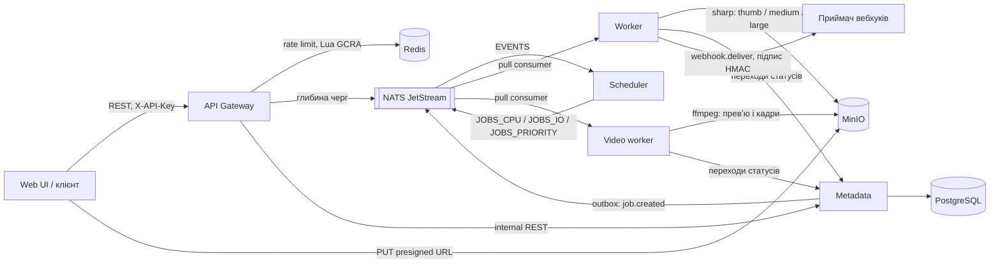

# PDP Media Pipeline

Розподілена система обробки медіа: користувач завантажує картинку чи відео, отримує `jobId`, а через
кілька секунд бачить статус `succeeded` і посилання на готові розміри або кадри. Про завершення
задачі система може сповістити підписаним вебхуком. Сервіси зв'язані через
NATS JetStream, стан задач живе в PostgreSQL, файли в S3-сумісному сховищі (MinIO).

Проєкт іде за PDP-планом з 10 етапів. Зараз готові **Етапи 0, 1, 2 і 3** (3a — надійність,
3b — `video.frames`, завантаження за URL і вебхуки). Нижче описано, як усе працює, і як руками
перевірити кожен етап.

## Як це працює



1. `POST /v1/uploads` повертає presigned URL; браузер кладе оригінал прямо в MinIO.
2. `POST /v1/jobs` створює задачу. Metadata в одній транзакції пише job і подію в outbox,
   relay публікує `job.created` у стрім `EVENTS`.
3. Scheduler визначає клас задачі (`cpu`, `io` або `priority` для пріоритету ≥ 8) і публікує її
   у стрім класу з `Nats-Msg-Id` для дедупу.
4. Worker бере повідомлення pull-консюмером, робить пресети WebP завширшки 200, 800 і 1600 px (менші оригінали не збільшуються),
   кладе їх у `results/{jobId}/{preset}.webp` і переводить задачу в `succeeded`.
   Кожна спроба пишеться в `job_executions`. Відео (`video.frames`) бере окремий video-worker:
   ffprobe перевіряє файл, ffmpeg робить превʼю і кадри в `results/{jobId}/frames/NNNN.jpg`.
5. Статуси: `queued → scheduled → running → succeeded | dead`, переходи лише через
   машину станів у Metadata. Невдача — це `dead` з причиною: `permanent` (файл непридатний) або
   `exhausted` (усі спроби вичерпано).

Захист від перевантаження (Етап 2):

- **Rate limiting.** Один Lua-скрипт GCRA за виклик перевіряє ліміт користувача (20 rps, burst 20)
  і глобальний (200 rps, burst 200). Відмова — `429` з `Retry-After` і `RateLimit-*`. Невідомі
  API-ключі лімітуються за IP (10 rps, burst 20). Якщо Redis не відповідає, gateway переходить на
  локальний ліміт у пам'яті (fail-open, [ADR-005](docs/adr/0005-rate-limiting.md)).
- **Backpressure.** Gateway читає глибину стріму класу (кеш 1 с) і, якщо вона вища за поріг,
  відповідає на `POST /v1/jobs` кодом `503` з `Retry-After`. Класи ізольовані: забита черга CPU не
  блокує пріоритетні задачі.
- **Web UI** показує `429` / `503` з відліком і сам повторює запит після `Retry-After`.

Надійність (Етап 3a, [ADR-006](docs/adr/0006-idempotency-and-delivery.md),
[ADR-007](docs/adr/0007-retries-and-dlq.md)):

- **Idempotency-Key.** Повторний `POST /v1/jobs` з тим самим ключем протягом 24 год повертає ту
  саму задачу із заголовком `Idempotent-Replayed: true`; той самий ключ з іншим тілом дає `422`,
  а запит, поки перший ще виконується, отримує `409`.
- **Inbox.** Metadata запам'ятовує оброблені повідомлення в тій самій транзакції, що й фінальний
  статус. Повторна доставка після загубленого ack отримує `DUPLICATE_DELIVERY` і не обробляється.
- **Ретраї.** Спроби рахує Metadata (`JOB_MAX_ATTEMPTS = 5`), затримка між ними — exponential
  backoff з full jitter. Crash loop теж закінчується `dead / exhausted`.
- **DLQ і redrive.** Кожна `dead`-задача потрапляє в стрім `JOBS_DLQ`;
  `POST /v1/jobs/:id/redrive` (кнопка «Запустити знову» в UI) запускає її новим поколінням спроб.
- **Метрики.** `/metrics` (Prometheus) на metadata, scheduler і worker:
  `jobs_duplicates_total{source}`, `jobs_retries_total{type}`, `jobs_dlq_total{type,reason}`.

Відео, джерела за URL і вебхуки (Етап 3b, [ADR-008](docs/adr/0008-video-worker.md),
[ADR-009](docs/adr/0009-egress-and-webhooks.md)):

- **`video.frames`.** Відео до 60 с і 100 МБ (h264, hevc, vp8, vp9, av1, mpeg4): кадр-превʼю
  і кадри з інтервалом `intervalSeconds` (2 с), не більше `maxFrames` (10), шириною до 640 px.
  ffmpeg запускається з таймаутом і `SIGKILL`.
- **Джерело за URL.** Замість `sourceKey` можна передати `sourceUrl`. Дозволені лише публічні
  http(s)-адреси: IP перевіряється після DNS-резолву, з'єднання йде саме на перевірену адресу,
  редиректи перевіряються заново, є ліміт розміру й таймаут.
- **Вебхуки.** `POST /v1/webhooks` реєструє адресу для подій `job.succeeded` і `job.dead`
  (до 5 на користувача). Секрет `whsec_…` показується один раз. Доставка — задача
  `webhook.deliver` з тими самими ретраями, DLQ і redrive; заголовки за
  [Standard Webhooks](https://www.standardwebhooks.com/): `webhook-id`, `webhook-timestamp`,
  `webhook-signature`.
- **Web UI.** Відео можна перетягнути так само, як картинку; на картці видно превʼю і кадри.
  Розділ «Вебхуки» в шапці: додати адресу, побачити доставки і надіслати «мертву» ще раз.

### Структура репозиторію

| Шлях                                   | Що там                                                              |
| -------------------------------------- | ------------------------------------------------------------------- |
| `apps/api-gateway`                     | Публічний REST API, auth за API-ключем, rate limiting, backpressure |
| `apps/metadata`                        | PostgreSQL (Drizzle), машина станів, outbox, внутрішній REST        |
| `apps/scheduler`                       | `job.created` → стрім класу                                         |
| `apps/worker`                          | `image.resize` через sharp і доставка вебхуків `webhook.deliver`    |
| `apps/video-worker`                    | `video.frames` через ffmpeg, окремий образ                          |
| `apps/webhook-receiver`                | Тестовий «поганий» приймач вебхуків для compose і тестів            |
| `apps/web`                             | React + Redux Toolkit, завантаження, задачі, вебхуки                |
| `libs/egress`                          | Безпечні вихідні запити: SSRF-захист, ліміти, ліміт на хост         |
| `libs/worker-kit`                      | Спільне для воркерів: `JobRunner`, `PermanentError`, S3, джерела    |
| `libs/*` (решта)                       | Контракти (zod), messaging, клієнт Metadata, config, observability  |
| `deploy/helm`                          | Helm-чарти сервісів                                                 |
| `perf/k6`, `perf/reports`              | Навантажувальні сценарії і звіти                                    |
| `docs/adr`, `docs/plan`, `docs/spikes` | Рішення, плани етапів, нотатки спайку                               |
| `test/`                                | Інтеграційні тести на Testcontainers                                |

## Запуск

Потрібно: Node.js 22+, pnpm 9 (`corepack enable`), Docker Desktop, `jq` і `curl`.

```bash
pnpm install
pnpm stack:up          # docker compose up -d --build --wait
docker compose ps      # усі сервіси healthy, metadata-migrate і minio-init — Exited (0)
```

> Не плутайте з `pnpm up`: це вбудована команда pnpm (`pnpm update`), вона оновить залежності
> замість запуску Docker.

Створити користувача і запам'ятати ключ у змінній поточного терміналу:

```bash
KEY=$(docker compose exec -T metadata node dist/seed-user.js --name me | jq -r .apiKey)
echo "$KEY"            # цей ключ вставляється у Web UI
```

| Що                              | Адреса                                                      |
| ------------------------------- | ----------------------------------------------------------- |
| Web UI                          | http://localhost:18090                                      |
| API Gateway і Swagger           | http://localhost:18080, http://localhost:18080/docs         |
| Metadata / Scheduler / Worker   | http://localhost:18081, :18082, :18083                      |
| Приймач вебхуків / Video worker | http://localhost:18084, :18085                              |
| Консоль MinIO                   | http://localhost:59001 (`minioadmin` / `minioadmin`)        |
| Моніторинг NATS                 | http://localhost:58222                                      |
| PostgreSQL                      | `localhost:55432`, користувач і пароль `pdp`, БД `metadata` |

Порти можна змінити через `.env` (наприклад, `GATEWAY_HOST_PORT=8080`). Зупинити:
`pnpm stack:down`; разом з даними: `docker compose down -v`.

## Перевірка етапів

Команди виконуються з кореня репозиторію при запущеному стеку і заданому `KEY`.

### Етап 0. Ініціалізація

**Критерій PDP:** `docker compose up` піднімає систему, усі `/health/ready` повертають 200, CI
зелений, у `docs/adr` чотири ADR, AWS-акаунт захищений і має бюджетний алерт.

1. Health-check'и:
   ```bash
   for p in 18080 18081 18082 18083 18085; do echo "$p $(curl -s -o /dev/null -w '%{http_code}' localhost:$p/health/ready)"; done
   ```
   Очікувано: п'ять разів `200` (18085 — video-worker з Етапу 3b).
2. Якість коду (усе має пройти без помилок):
   ```bash
   pnpm lint && pnpm typecheck && pnpm format:check && pnpm depcruise && pnpm helm:lint && pnpm build
   ```
3. Документи: `docs/adr/0001`–`0004` (домен, черга, БД, монорепо), `docs/spikes/01-jetstream-vs-bullmq.md`.
4. CI: на GitHub у вкладці Actions останній запуск на `main` зелений (jobs `verify`, `test`,
   `integration`, `audit`, `helm`, `docker`).
5. AWS (руками в консолі, у репозиторії не видно): MFA на root, окремий IAM-користувач або
   Identity Center, бюджетний алерт на $10–20.

### Етап 1. MVP черг з `image.resize`

**Критерій PDP:** наскрізний сценарій проходить у docker-compose і в інтеграційному тесті,
статуси видно через API, у `job_executions` записується кожна спроба.

1. Автоматичний наскрізний сценарій — upload, `PUT` у MinIO, `POST /v1/jobs`, очікування
   `succeeded`, завантаження пресетів, записи `job_executions`:
   ```bash
   scripts/e2e-smoke.sh
   ```
   Очікувано: у кінці `OK`.
2. Через Web UI: http://localhost:18090, вставити `KEY`, перетягнути картинку. Картка проходить
   завантаження → «Queued» → обробку → «Done», з'являються превʼю трьох розмірів.
3. Статуси через API і перевірка ключа:
   ```bash
   curl -s -H "x-api-key: $KEY" 'localhost:18080/v1/jobs?limit=3' | jq '.items[] | {id, status, attempts}'
   curl -s -o /dev/null -w '%{http_code}\n' -H 'x-api-key: wrong' localhost:18080/v1/jobs   # 401
   ```
4. Кожна спроба в БД:
   ```bash
   docker compose exec -T postgres psql -U pdp -d metadata -c \
     "select j.status, e.attempt, e.outcome from jobs j join job_executions e on e.job_id = j.id order by e.started_at desc limit 5"
   ```
5. Стріми і результати:
   ```bash
   curl -s 'localhost:58222/jsz?streams=true' | jq -c '[.account_details[0].stream_detail[] | {name, messages: .state.messages}]'
   ```
   Очікувано: `EVENTS`, `JOBS_CPU`, `JOBS_IO`, `JOBS_PRIORITY`. У консолі MinIO, бакет `media`,
   лежать `results/<jobId>/thumb.webp`, `medium.webp`, `large.webp`.
6. Задача не губиться при падінні воркера: завантажити кілька картинок у UI, одразу
   `docker compose kill worker`, потім `docker compose up -d worker` — задачі доходять до «Done».
7. Тести:
   ```bash
   pnpm test        # unit: машина станів, вибір класу, guard'и тощо
   pnpm test:int    # Testcontainers (потрібен Docker): від POST /jobs до succeeded, redelivery
   pnpm test:web    # Web UI
   ```

### Етап 2. Rate limiting і backpressure

**Критерій PDP:** k6 thresholds проходять, частка `429` відповідає налаштованим лімітам, а при
штучно забитій черзі Gateway віддає `503` замість росту затримки. P95 API нижче 150 мс.

1. Ліміт користувача — перші ~20–27 запитів `200`, далі `429` (частина ліміту встигає
   відновитися за час циклу):
   ```bash
   for i in $(seq 1 40); do curl -s -o /dev/null -w '%{http_code} ' -H "x-api-key: $KEY" 'localhost:18080/v1/jobs?limit=1'; done; echo
   curl -si -H "x-api-key: $KEY" 'localhost:18080/v1/jobs?limit=1' | grep -iE '^HTTP|retry-after|ratelimit'
   ```
   Очікувано: `429 Too Many Requests`, `Retry-After: 1`, `RateLimit-Limit: 20`,
   `RateLimit-Remaining: 0`, `RateLimit-Reset`.
2. Ліміт за IP для невідомих ключів — близько 20 відповідей `401`, далі `429`:
   ```bash
   for i in $(seq 1 25); do curl -s -o /dev/null -w '%{http_code} ' -H "x-api-key: guess$i" localhost:18080/v1/jobs; done; echo
   ```
3. Fail-open, коли Redis не відповідає:
   ```bash
   docker compose pause redis
   curl -s -o /dev/null -w '%{http_code}\n' -H "x-api-key: $KEY" 'localhost:18080/v1/jobs?limit=1'   # 200
   curl -s -o /dev/null -w '%{http_code}\n' localhost:18080/health/ready                            # 200
   docker compose unpause redis
   docker compose logs api-gateway --since 2m | grep -o 'redis[^"]*rate limits[^"]*'
   ```
   У логах: `redis unavailable, rate limits are local to this replica` і після паузи
   `redis is back, rate limits are shared again`. Цикл з п. 1 під час паузи теж дає `429` — ліміт
   тримається локально.
4. Backpressure: зупинити воркер і підняти gateway з порогом черги CPU = 3:

   ```bash
   docker compose stop worker
   BACKPRESSURE_MAX_DEPTH_CPU=3 docker compose up -d --no-deps --wait api-gateway

   IMG=perf/k6/fixtures/source.png
   UP=$(curl -s -H "x-api-key: $KEY" -H 'content-type: application/json' \
     -d "{\"contentType\":\"image/png\",\"size\":$(wc -c < $IMG | tr -d ' ')}" localhost:18080/v1/uploads)
   curl -s -X PUT -H 'content-type: image/png' --data-binary @$IMG "$(jq -r .uploadUrl <<<"$UP")"
   SRC=$(jq -r .sourceKey <<<"$UP")
   job() { curl -s -w '%{http_code}\n' -o /dev/null -H "x-api-key: $KEY" -H 'content-type: application/json' \
     -d "{\"type\":\"image.resize\",\"sourceKey\":\"$SRC\",\"presets\":[\"thumb\"]$1}" localhost:18080/v1/jobs; }

   for i in $(seq 1 8); do job; sleep 0.5; done   # кілька 202, далі 503
   job ',"priority":9'                             # 202: пріоритетна черга окрема
   ```

   Відповідь `503` містить `Retry-After: 5` і
   `{"message":"the cpu queue is full, retry later","retryAfterSeconds":5}`. Поріг може бути
   перевищений на кілька задач через кеш глибини (1 с).

   Те саме наочно у Web UI: при зупиненому воркері завантажити 6–8 картинок — частина карток
   покаже «Черга переповнена, чекаємо» з відліком. Протягом ~20 с запустити воркер, і UI сам
   довантажить решту.

   Повернути все назад:

   ```bash
   docker compose start worker
   docker compose up -d --no-deps --wait api-gateway   # поріг за замовчуванням
   ```

   Через 5–10 с після старту воркера черга розвантажується, і `job` знову повертає `202`.

5. `429` у Web UI: вибрати одразу 30–40 картинок — частина карток покаже «Ліміт запитів,
   чекаємо» з відліком і продовжить самостійно.
6. Навантажувальні тести (k6 у Docker в мережі compose, близько 6 хвилин; скрипт сам сідить
   perf-користувачів, зупиняє воркер для backpressure і відновлює стек):

   ```bash
   scripts/perf.sh                # api-baseline, rate-limit, spike, backpressure
   scripts/perf.sh autocannon     # GET /v1/jobs/:id з лімітами і без
   ```

   Очікувано: у кожному сценарії всі thresholds з `✓`. Сирий вивід — `perf/reports/raw/`.
   Зведення й інтерпретація — [perf/reports/stage-2.md](perf/reports/stage-2.md):

   | Сценарій     | Що перевіряє                           | Результат звіту           |
   | ------------ | -------------------------------------- | ------------------------- |
   | api-baseline | P95 при 100 rps у межах лімітів        | 6.8 мс (ціль 150 мс)      |
   | rate-limit   | частка `429`: 1 користувач × 40 rps    | 48.4% (розрахунок 48.3%)  |
   | rate-limit   | частка `429`: 15 користувачів × 20 rps | 31.1% (розрахунок 31.1%)  |
   | spike        | сплеск до 600 rps                      | 0 `5xx`, P95 `429` 1.2 мс |
   | backpressure | забита черга                           | 93.7% `503`, P95 5.6 мс   |

7. Інтеграційні тести етапу (`pnpm test:int`): `test/rate-limit.int-spec.ts` (ліміти на
   справжньому Redis, IP-ліміт, пауза Redis) і `test/backpressure.int-spec.ts` (`503`, пріоритет,
   відновлення після старту воркера).
8. Документи: [ADR-005](docs/adr/0005-rate-limiting.md) (GCRA проти token bucket, fail-open),
   [план етапу](docs/plan/stage-2.md), [звіт](perf/reports/stage-2.md).

### Етап 3a. Надійність

**Критерій PDP:** задача не губиться і не виконується двічі з видимим ефектом, коли падає воркер;
повторний `POST /jobs` з тим самим ключем не створює нової задачі; невдалі задачі видно в DLQ.

Підготовка: `KEY` з розділу «Запуск» і хелпер для завантаження файлу.

```bash
up() { local UP=$(curl -s -H "x-api-key: $KEY" -H 'content-type: application/json' \
    -d "{\"contentType\":\"image/png\",\"size\":$(wc -c < $1 | tr -d ' ')}" localhost:18080/v1/uploads)
  curl -s -X PUT -H 'content-type: image/png' --data-binary @$1 "$(jq -r .uploadUrl <<<"$UP")"
  jq -r .sourceKey <<<"$UP"; }
SRC=$(up perf/k6/fixtures/source.png)
```

1. Idempotency-Key — двічі `202` з тим самим `jobId`, друга відповідь з
   `idempotent-replayed: true`; інше тіло з тим самим ключем — `422 IDEMPOTENCY_KEY_REUSED`:
   ```bash
   job() { curl -s -i -H "x-api-key: $KEY" -H 'content-type: application/json' -H 'idempotency-key: demo-1' \
     -d "{\"type\":\"image.resize\",\"sourceKey\":\"$SRC\",\"presets\":[\"$1\"]}" localhost:18080/v1/jobs \
     | grep -iE '^HTTP|idempotent|jobId|code'; }
   job thumb; job thumb; job medium
   ```
2. Permanent-помилка → `dead` і DLQ:
   ```bash
   printf 'not a png' > /tmp/garbage.png
   BAD=$(curl -s -H "x-api-key: $KEY" -H 'content-type: application/json' \
     -d "{\"type\":\"image.resize\",\"sourceKey\":\"$(up /tmp/garbage.png)\",\"presets\":[\"thumb\"]}" \
     localhost:18080/v1/jobs | jq -r .jobId)
   sleep 2; curl -s -H "x-api-key: $KEY" localhost:18080/v1/jobs/$BAD | jq -c '{status, deadReason, attempts, lastError}'
   curl -s 'localhost:58222/jsz?streams=true' | jq -c '[.account_details[0].stream_detail[] | select(.name == "JOBS_DLQ") | .state.messages]'
   ```
   Очікувано: `"status":"dead","deadReason":"permanent","attempts":1` і `unreadable image` в
   `lastError`; у `JOBS_DLQ` з'явилось повідомлення.
3. Redrive — `dead`-задача стає `queued` з новим поколінням спроб (знову впаде як permanent,
   але вже з `attempts` = 3); задача, що не в стані `dead`, — `409 NOT_REDRIVABLE`:
   ```bash
   curl -s -o /dev/null -w '%{http_code}\n' -X POST -H "x-api-key: $KEY" localhost:18080/v1/jobs/$BAD/redrive   # 202
   sleep 2; curl -s -H "x-api-key: $KEY" localhost:18080/v1/jobs/$BAD | jq -c '{status, deadReason, attempts}'
   ```
   У Web UI картка такої задачі показує «Цей файл неможливо обробити.» з текстом помилки і кнопку
   «Запустити знову».
4. Метрики (gateway їх не віддає назовні, `localhost:18080/metrics` — `404`):
   ```bash
   curl -s localhost:18081/metrics | grep '^jobs_'
   ```
   Очікувано: `jobs_dlq_total{type="image.resize",reason="permanent"}` з кількістю `dead`-задач.
5. Падіння воркера посеред обробки, як в Етапі 1, п. 6: задачі доходять до «Done», а в
   `job_executions` перервана спроба має `outcome = abandoned`.
6. Інтеграційні тести етапу (`pnpm test:int`):
   - `test/reliability.int-spec.ts`: crash loop → `dead / exhausted`; загублений ack після успіху →
     inbox відкидає повторну доставку; збій S3 через TCP-проксі → ретраї з jitter →
     `exhausted` → redrive → `succeeded`;
   - `test/metadata.int-spec.ts`: Idempotency-Key — повтор, `422`, `409` при утриманому lock,
     10 конкурентних запитів створюють одну задачу;
   - `test/pipeline.int-spec.ts`: permanent → `dead` + запис у `JOBS_DLQ`, replay через gateway.
7. Документи: [ADR-006](docs/adr/0006-idempotency-and-delivery.md),
   [ADR-007](docs/adr/0007-retries-and-dlq.md), [план етапу](docs/plan/stage-3.md).

### Етап 3b. `video.frames`, завантаження за URL і вебхуки

**Критерій PDP:** вебхук на «поганий» приймач доходить після ретраїв або коректно потрапляє в DLQ.

Підготовка: `KEY` і хелпер `up` з Етапу 3a, плюс тестове відео (ffmpeg із `node_modules`):

```bash
FFMPEG=$(node -p "require('ffmpeg-static')")
$FFMPEG -loglevel error -y -f lavfi -i testsrc=duration=6:size=1280x720:rate=25 -pix_fmt yuv420p /tmp/clip.mp4
upv() { local UP=$(curl -s -H "x-api-key: $KEY" -H 'content-type: application/json' \
    -d "{\"contentType\":\"video/mp4\",\"size\":$(wc -c < $1 | tr -d ' ')}" localhost:18080/v1/uploads)
  curl -s -X PUT -H 'content-type: video/mp4' --data-binary @$1 "$(jq -r .uploadUrl <<<"$UP")"
  jq -r .sourceKey <<<"$UP"; }
hook() { curl -s -H "x-api-key: $KEY" -H 'content-type: application/json' \
  -d "{\"url\":\"http://webhook-receiver:3000$1\"}" localhost:18080/v1/webhooks; }
```

1. `video.frames` — превʼю і кадри кожні 2 с:
   ```bash
   VID=$(curl -s -H "x-api-key: $KEY" -H 'content-type: application/json' \
     -d "{\"type\":\"video.frames\",\"sourceKey\":\"$(upv /tmp/clip.mp4)\"}" localhost:18080/v1/jobs | jq -r .jobId)
   sleep 5; curl -s -H "x-api-key: $KEY" localhost:18080/v1/jobs/$VID \
     | jq -c '{status, video: (.video | {durationSeconds, codec, frames: [.frames[].atSeconds]})}'
   ```
   Очікувано: `"status":"succeeded"`, `"codec":"h264"`, кадри `[0,2,4]`. У Web UI відео можна
   просто перетягнути: на картці з'являються превʼю і рядок кадрів.
2. Ліміти відео: ролик довший за 60 с закінчується `dead / permanent` з причиною в `lastError`:
   ```bash
   $FFMPEG -loglevel error -y -f lavfi -i testsrc=duration=61:size=320x240:rate=5 -pix_fmt yuv420p /tmp/long.mp4
   LONG=$(curl -s -H "x-api-key: $KEY" -H 'content-type: application/json' \
     -d "{\"type\":\"video.frames\",\"sourceKey\":\"$(upv /tmp/long.mp4)\"}" localhost:18080/v1/jobs | jq -r .jobId)
   sleep 3; curl -s -H "x-api-key: $KEY" localhost:18080/v1/jobs/$LONG | jq -c '{status, deadReason, lastError}'
   ```
3. SSRF — приватні адреси відхиляються одразу з `400`, і для джерела, і для вебхука:
   ```bash
   for u in http://169.254.169.254/latest/meta-data http://localhost:5432 http://10.0.0.1/x.png; do
     curl -s -o /dev/null -w "%{http_code} $u\n" -H "x-api-key: $KEY" -H 'content-type: application/json' \
       -d "{\"type\":\"image.resize\",\"sourceUrl\":\"$u\",\"presets\":[\"thumb\"]}" localhost:18080/v1/jobs
   done
   curl -s -H "x-api-key: $KEY" -H 'content-type: application/json' \
     -d '{"url":"http://127.0.0.1:3000/hook"}' localhost:18080/v1/webhooks | jq -c '{statusCode, message}'
   ```
   Публічний URL працює (потрібен інтернет), наприклад
   `"sourceUrl":"https://upload.wikimedia.org/wikipedia/commons/4/47/PNG_transparency_demonstration_1.png"`.
4. Вебхук на справний приймач — підпис валідний:
   ```bash
   curl -s -X DELETE localhost:18084/deliveries
   OK_SECRET=$(hook /ok | jq -r .secret)
   curl -s -H "x-api-key: $KEY" -H 'content-type: application/json' \
     -d "{\"type\":\"image.resize\",\"sourceKey\":\"$SRC\",\"presets\":[\"thumb\"]}" localhost:18080/v1/jobs >/dev/null
   sleep 3; curl -s "localhost:18084/deliveries?secret=$OK_SECRET" \
     | jq -c '.items[] | {path, webhookId, signatureValid, type: (.body | fromjson | .type)}'
   ```
   Очікувано: `"path":"/ok","signatureValid":true,"type":"job.succeeded"`.
5. «Поганий» приймач, **критерій етапу**. Адреси за замовчуванням ловлять обидві події, тож
   кожна задача дає доставку на кожну адресу:
   - `/flaky?failures=2` — дві відповіді `500`, потім `200`: доставка `succeeded` з `attempts = 3`;
   - `/fail` (500), `/drop` (обрив), `/slow?ms=15000` (довше за `WEBHOOK_TIMEOUT_MS` = 5 с) —
     транзієнтні помилки, після 5 спроб `dead / exhausted` і запис у `JOBS_DLQ`;
   - `/status/410` — permanent: `dead / permanent` після першої спроби.

   ```bash
   # Ліміт — 5 адрес на користувача, тож спершу прибираємо адресу /ok з п. 4
   OKID=$(curl -s -H "x-api-key: $KEY" localhost:18080/v1/webhooks | jq -r '.items[0].id')
   curl -s -o /dev/null -w '%{http_code}\n' -X DELETE -H "x-api-key: $KEY" localhost:18080/v1/webhooks/$OKID   # 204
   for p in '/flaky?failures=2' /fail /drop '/slow?ms=15000' /status/410; do hook "$p" | jq -r '.id + "  " + .url'; done
   curl -s -H "x-api-key: $KEY" -H 'content-type: application/json' \
     -d "{\"type\":\"image.resize\",\"sourceKey\":\"$SRC\",\"presets\":[\"thumb\"]}" localhost:18080/v1/jobs >/dev/null
   sleep 150
   for id in $(curl -s -H "x-api-key: $KEY" localhost:18080/v1/webhooks | jq -r '.items[].id'); do
     curl -s -H "x-api-key: $KEY" localhost:18080/v1/webhooks/$id/deliveries \
       | jq -c --arg id "$id" '.items[] | {endpoint: $id[0:8], status, deadReason, attempts, responseStatus, lastError}'
   done
   curl -s localhost:18081/metrics | grep 'jobs_dlq_total{type="webhook.deliver"'
   ```

   Очікувано: `flaky` — `succeeded`, `attempts: 3`, `responseStatus: 200`; `fail`, `drop` і `slow` —
   `dead / exhausted` з `attempts: 5` і помилками `endpoint responded 500`, `socket hang up`,
   `timed out`; `410` — `dead / permanent` з `attempts: 1`. У метриках
   `jobs_dlq_total{type="webhook.deliver",reason="exhausted"} 3` і `reason="permanent"} 1`.
   Backoff з full jitter і cap 60 с, тож `exhausted` настає за 1–3 хвилини. Те саме видно в Web UI:
   «Вебхуки» в шапці → адреса → таблиця доставок зі статусом, спробами, кодом відповіді й помилкою.
   «Мертву» доставку можна надіслати знову кнопкою «Запустити знову» (або
   `POST /v1/jobs/<id доставки>/redrive`); `webhook-id` при цьому той самий.

6. Інтеграційні тести етапу (`pnpm test:int`):
   - `test/media-sources.int-spec.ts`: `video.frames` наскрізно, ліміти відео, `sourceUrl` з
     локального файлового сервера, SSRF і редиректи на приватні адреси;
   - `test/webhooks.int-spec.ts`: реєстрація, ліміт і SSRF; підписана доставка; `job.dead`;
     flaky → успіх після ретраїв; `500` / обрив / повільний → `exhausted` + DLQ; `410` → permanent →
     redrive.
7. Документи: [ADR-008](docs/adr/0008-video-worker.md), [ADR-009](docs/adr/0009-egress-and-webhooks.md),
   [план етапу](docs/plan/stage-3.md).

## Конфігурація Етапу 2

Ліміти й пороги задаються через env gateway; у `docker-compose.yml` їх можна перевизначити
змінними оточення або `.env`.

| Змінна                               | За замовчуванням | Що робить                                           |
| ------------------------------------ | ---------------- | --------------------------------------------------- |
| `RATE_LIMIT_USER_RPS` / `_BURST`     | 20 / 20          | Ліміт користувача                                   |
| `RATE_LIMIT_GLOBAL_RPS` / `_BURST`   | 200 / 200        | Глобальний ліміт                                    |
| `RATE_LIMIT_IP_RPS` / `_BURST`       | 10 / 20          | Ліміт невідомих ключів за IP                        |
| `RATE_LIMIT_REPLICAS`                | 1                | На скільки ділити ліміти в режимі fail-open         |
| `BACKPRESSURE_MAX_DEPTH_CPU` / `_IO` | 2000 / 2000      | Поріг глибини черги класу                           |
| `BACKPRESSURE_MAX_DEPTH_PRIORITY`    | 500              | Поріг пріоритетної черги                            |
| `BACKPRESSURE_RETRY_AFTER_S`         | 5                | `Retry-After` у відповіді `503`                     |
| `QUEUE_DEPTH_CACHE_MS`               | 1000             | Як довго кешується глибина черги                    |
| `WORKER_MAX_ACK_PENDING` (worker)    | 256              | Спільний для всіх реплік ліміт повідомлень у роботі |

## Конфігурація Етапу 3a

| Змінна                             | За замовчуванням | Що робить                                          |
| ---------------------------------- | ---------------- | -------------------------------------------------- |
| `JOB_MAX_ATTEMPTS` (metadata)      | 5                | Скільки виконань може почати одне покоління задачі |
| `IDEMPOTENCY_TTL_HOURS` (metadata) | 24               | Скільки живе `Idempotency-Key`                     |
| `WORKER_RETRY_BASE_MS` (worker)    | 1000             | База backoff між спробами                          |
| `WORKER_RETRY_MAX_MS` (worker)     | 60000            | Стеля backoff                                      |

## Конфігурація Етапу 3b

| Змінна                                      | За замовчуванням | Що робить                                                   |
| ------------------------------------------- | ---------------- | ----------------------------------------------------------- |
| `EGRESS_TIMEOUT_MS` (gateway, воркери)      | 15000            | Дедлайн вихідного запиту за замовчуванням                   |
| `EGRESS_PER_HOST_CONCURRENCY`               | 4                | Скільки одночасних запитів на один хост                     |
| `EGRESS_PRIVATE_HOSTS`                      | порожньо         | Хости, яким дозволено приватні адреси (у compose — приймач) |
| `MAX_VIDEO_UPLOAD_BYTES` (gateway)          | 104857600        | Ліміт розміру відео в `POST /v1/uploads`                    |
| `WEBHOOK_CONCURRENCY` (worker)              | 16               | Скільки доставок одночасно                                  |
| `WEBHOOK_TIMEOUT_MS` (worker)               | 10000            | Таймаут однієї доставки (у compose 5000)                    |
| `VIDEO_CONCURRENCY` (video-worker)          | 1                | Скільки відео одночасно на под                              |
| `FFMPEG_TIMEOUT_MS` (video-worker)          | 120000           | Після нього ffmpeg / ffprobe отримує `SIGKILL`              |
| `MAX_VIDEO_BYTES` (video-worker)            | 104857600        | Ліміт розміру джерела, зокрема за URL                       |
| `VIDEO_MAX_DURATION_SECONDS` (video-worker) | 60               | Максимальна тривалість відео                                |

## Документація

- Плани етапів: [Етап 1](docs/plan/stage-1.md), [Етап 2](docs/plan/stage-2.md), [Етап 3](docs/plan/stage-3.md)
- ADR: [docs/adr](docs/adr/README.md)
- Спайк JetStream проти BullMQ: [docs/spikes](docs/spikes/01-jetstream-vs-bullmq.md)
- Звіти навантаження: [perf/reports](perf/reports/stage-2.md)
