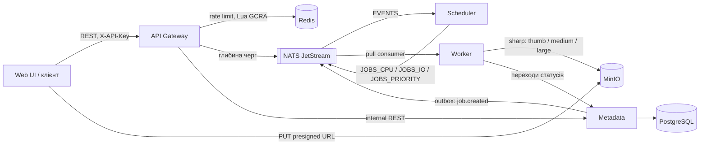

# PDP Media Pipeline

Розподілена система обробки медіа: користувач завантажує картинку, отримує `jobId`, а через
кілька секунд бачить статус `succeeded` і посилання на готові розміри. Сервіси зв'язані через
NATS JetStream, стан задач живе в PostgreSQL, файли в S3-сумісному сховищі (MinIO).

Проєкт іде за PDP-планом з 10 етапів. Зараз готові **Етапи 0, 1 і 2**. Нижче описано, як усе
працює, і як руками перевірити кожен етап.

## Як це працює



1. `POST /v1/uploads` повертає presigned URL; браузер кладе оригінал прямо в MinIO.
2. `POST /v1/jobs` створює задачу. Metadata в одній транзакції пише job і подію в outbox,
   relay публікує `job.created` у стрім `EVENTS`.
3. Scheduler визначає клас задачі (`cpu`, `io` або `priority` для пріоритету ≥ 8) і публікує її
   у стрім класу з `Nats-Msg-Id` для дедупу.
4. Worker бере повідомлення pull-консюмером, робить пресети WebP завширшки 200, 800 і 1600 px (менші оригінали не збільшуються),
   кладе їх у `results/{jobId}/{preset}.webp` і переводить задачу в `succeeded`.
   Кожна спроба пишеться в `job_executions`.
5. Статуси: `queued → scheduled → running → succeeded | failed | dead`, переходи лише через
   машину станів у Metadata.

Захист від перевантаження (Етап 2):

- **Rate limiting.** Один Lua-скрипт GCRA за виклик перевіряє ліміт користувача (20 rps, burst 20)
  і глобальний (200 rps, burst 200). Відмова — `429` з `Retry-After` і `RateLimit-*`. Невідомі
  API-ключі лімітуються за IP (10 rps, burst 20). Якщо Redis не відповідає, gateway переходить на
  локальний ліміт у пам'яті (fail-open, [ADR-005](docs/adr/0005-rate-limiting.md)).
- **Backpressure.** Gateway читає глибину стріму класу (кеш 1 с) і, якщо вона вища за поріг,
  відповідає на `POST /v1/jobs` кодом `503` з `Retry-After`. Класи ізольовані: забита черга CPU не
  блокує пріоритетні задачі.
- **Web UI** показує `429` / `503` з відліком і сам повторює запит після `Retry-After`.

### Структура репозиторію

| Шлях                                   | Що там                                                              |
| -------------------------------------- | ------------------------------------------------------------------- |
| `apps/api-gateway`                     | Публічний REST API, auth за API-ключем, rate limiting, backpressure |
| `apps/metadata`                        | PostgreSQL (Drizzle), машина станів, outbox, внутрішній REST        |
| `apps/scheduler`                       | `job.created` → стрім класу                                         |
| `apps/worker`                          | `image.resize` через sharp, concurrency і `max_ack_pending`         |
| `apps/web`                             | React + Redux Toolkit, завантаження і перегляд задач                |
| `libs/*`                               | Контракти (zod), messaging, клієнт Metadata, config, observability  |
| `deploy/helm`                          | Helm-чарти сервісів                                                 |
| `perf/k6`, `perf/reports`              | Навантажувальні сценарії і звіти                                    |
| `docs/adr`, `docs/plan`, `docs/spikes` | Рішення, плани етапів, нотатки спайку                               |
| `test/`                                | Інтеграційні тести на Testcontainers                                |

## Запуск

Потрібно: Node.js 22+, pnpm 9 (`corepack enable`), Docker Desktop, `jq` і `curl`.

```bash
pnpm install
pnpm stack:up          # docker compose up -d --build --wait
docker compose ps      # усі сервіси healthy, metadata-migrate і minio-init — Exited (0)
```

> Не плутайте з `pnpm up`: це вбудована команда pnpm (`pnpm update`), вона оновить залежності
> замість запуску Docker.

Створити користувача і запам'ятати ключ у змінній поточного терміналу:

```bash
KEY=$(docker compose exec -T metadata node dist/seed-user.js --name me | jq -r .apiKey)
echo "$KEY"            # цей ключ вставляється у Web UI
```

| Що                            | Адреса                                                      |
| ----------------------------- | ----------------------------------------------------------- |
| Web UI                        | http://localhost:18090                                      |
| API Gateway і Swagger         | http://localhost:18080, http://localhost:18080/docs         |
| Metadata / Scheduler / Worker | http://localhost:18081, :18082, :18083                      |
| Консоль MinIO                 | http://localhost:59001 (`minioadmin` / `minioadmin`)        |
| Моніторинг NATS               | http://localhost:58222                                      |
| PostgreSQL                    | `localhost:55432`, користувач і пароль `pdp`, БД `metadata` |

Порти можна змінити через `.env` (наприклад, `GATEWAY_HOST_PORT=8080`). Зупинити:
`pnpm stack:down`; разом з даними: `docker compose down -v`.

## Перевірка етапів

Команди виконуються з кореня репозиторію при запущеному стеку і заданому `KEY`.

### Етап 0. Ініціалізація

**Критерій PDP:** `docker compose up` піднімає систему, усі `/health/ready` повертають 200, CI
зелений, у `docs/adr` чотири ADR, AWS-акаунт захищений і має бюджетний алерт.

1. Health-check'и:
   ```bash
   for p in 18080 18081 18082 18083; do echo "$p $(curl -s -o /dev/null -w '%{http_code}' localhost:$p/health/ready)"; done
   ```
   Очікувано: чотири рази `200`.
2. Якість коду (усе має пройти без помилок):
   ```bash
   pnpm lint && pnpm typecheck && pnpm format:check && pnpm depcruise && pnpm helm:lint && pnpm build
   ```
3. Документи: `docs/adr/0001`–`0004` (домен, черга, БД, монорепо), `docs/spikes/01-jetstream-vs-bullmq.md`.
4. CI: на GitHub у вкладці Actions останній запуск на `main` зелений (jobs `verify`, `test`,
   `integration`, `audit`, `helm`, `docker`).
5. AWS (руками в консолі, у репозиторії не видно): MFA на root, окремий IAM-користувач або
   Identity Center, бюджетний алерт на $10–20.

### Етап 1. MVP черг з `image.resize`

**Критерій PDP:** наскрізний сценарій проходить у docker-compose і в інтеграційному тесті,
статуси видно через API, у `job_executions` записується кожна спроба.

1. Автоматичний наскрізний сценарій — upload, `PUT` у MinIO, `POST /v1/jobs`, очікування
   `succeeded`, завантаження пресетів, записи `job_executions`:
   ```bash
   scripts/e2e-smoke.sh
   ```
   Очікувано: у кінці `OK`.
2. Через Web UI: http://localhost:18090, вставити `KEY`, перетягнути картинку. Картка проходить
   завантаження → «Queued» → обробку → «Done», з'являються превʼю трьох розмірів.
3. Статуси через API і перевірка ключа:
   ```bash
   curl -s -H "x-api-key: $KEY" 'localhost:18080/v1/jobs?limit=3' | jq '.items[] | {id, status, attempts}'
   curl -s -o /dev/null -w '%{http_code}\n' -H 'x-api-key: wrong' localhost:18080/v1/jobs   # 401
   ```
4. Кожна спроба в БД:
   ```bash
   docker compose exec -T postgres psql -U pdp -d metadata -c \
     "select j.status, e.attempt, e.outcome from jobs j join job_executions e on e.job_id = j.id order by e.started_at desc limit 5"
   ```
5. Стріми і результати:
   ```bash
   curl -s 'localhost:58222/jsz?streams=true' | jq -c '[.account_details[0].stream_detail[] | {name, messages: .state.messages}]'
   ```
   Очікувано: `EVENTS`, `JOBS_CPU`, `JOBS_IO`, `JOBS_PRIORITY`. У консолі MinIO, бакет `media`,
   лежать `results/<jobId>/thumb.webp`, `medium.webp`, `large.webp`.
6. Задача не губиться при падінні воркера: завантажити кілька картинок у UI, одразу
   `docker compose kill worker`, потім `docker compose up -d worker` — задачі доходять до «Done».
7. Тести:
   ```bash
   pnpm test        # unit: машина станів, вибір класу, guard'и тощо
   pnpm test:int    # Testcontainers (потрібен Docker): від POST /jobs до succeeded, redelivery
   pnpm test:web    # Web UI
   ```

### Етап 2. Rate limiting і backpressure

**Критерій PDP:** k6 thresholds проходять, частка `429` відповідає налаштованим лімітам, а при
штучно забитій черзі Gateway віддає `503` замість росту затримки. P95 API нижче 150 мс.

1. Ліміт користувача — перші ~20–27 запитів `200`, далі `429` (частина ліміту встигає
   відновитися за час циклу):
   ```bash
   for i in $(seq 1 40); do curl -s -o /dev/null -w '%{http_code} ' -H "x-api-key: $KEY" 'localhost:18080/v1/jobs?limit=1'; done; echo
   curl -si -H "x-api-key: $KEY" 'localhost:18080/v1/jobs?limit=1' | grep -iE '^HTTP|retry-after|ratelimit'
   ```
   Очікувано: `429 Too Many Requests`, `Retry-After: 1`, `RateLimit-Limit: 20`,
   `RateLimit-Remaining: 0`, `RateLimit-Reset`.
2. Ліміт за IP для невідомих ключів — близько 20 відповідей `401`, далі `429`:
   ```bash
   for i in $(seq 1 25); do curl -s -o /dev/null -w '%{http_code} ' -H "x-api-key: guess$i" localhost:18080/v1/jobs; done; echo
   ```
3. Fail-open, коли Redis не відповідає:
   ```bash
   docker compose pause redis
   curl -s -o /dev/null -w '%{http_code}\n' -H "x-api-key: $KEY" 'localhost:18080/v1/jobs?limit=1'   # 200
   curl -s -o /dev/null -w '%{http_code}\n' localhost:18080/health/ready                            # 200
   docker compose unpause redis
   docker compose logs api-gateway --since 2m | grep -o 'redis[^"]*rate limits[^"]*'
   ```
   У логах: `redis unavailable, rate limits are local to this replica` і після паузи
   `redis is back, rate limits are shared again`. Цикл з п. 1 під час паузи теж дає `429` — ліміт
   тримається локально.
4. Backpressure: зупинити воркер і підняти gateway з порогом черги CPU = 3:

   ```bash
   docker compose stop worker
   BACKPRESSURE_MAX_DEPTH_CPU=3 docker compose up -d --no-deps --wait api-gateway

   IMG=perf/k6/fixtures/source.png
   UP=$(curl -s -H "x-api-key: $KEY" -H 'content-type: application/json' \
     -d "{\"contentType\":\"image/png\",\"size\":$(wc -c < $IMG | tr -d ' ')}" localhost:18080/v1/uploads)
   curl -s -X PUT -H 'content-type: image/png' --data-binary @$IMG "$(jq -r .uploadUrl <<<"$UP")"
   SRC=$(jq -r .sourceKey <<<"$UP")
   job() { curl -s -w '%{http_code}\n' -o /dev/null -H "x-api-key: $KEY" -H 'content-type: application/json' \
     -d "{\"type\":\"image.resize\",\"sourceKey\":\"$SRC\",\"presets\":[\"thumb\"]$1}" localhost:18080/v1/jobs; }

   for i in $(seq 1 8); do job; sleep 0.5; done   # кілька 202, далі 503
   job ',"priority":9'                             # 202: пріоритетна черга окрема
   ```

   Відповідь `503` містить `Retry-After: 5` і
   `{"message":"the cpu queue is full, retry later","retryAfterSeconds":5}`. Поріг може бути
   перевищений на кілька задач через кеш глибини (1 с).

   Те саме наочно у Web UI: при зупиненому воркері завантажити 6–8 картинок — частина карток
   покаже «Черга переповнена, чекаємо» з відліком. Протягом ~20 с запустити воркер, і UI сам
   довантажить решту.

   Повернути все назад:

   ```bash
   docker compose start worker
   docker compose up -d --no-deps --wait api-gateway   # поріг за замовчуванням
   ```

   Через 5–10 с після старту воркера черга розвантажується, і `job` знову повертає `202`.

5. `429` у Web UI: вибрати одразу 30–40 картинок — частина карток покаже «Ліміт запитів,
   чекаємо» з відліком і продовжить самостійно.
6. Навантажувальні тести (k6 у Docker в мережі compose, близько 6 хвилин; скрипт сам сідить
   perf-користувачів, зупиняє воркер для backpressure і відновлює стек):

   ```bash
   scripts/perf.sh                # api-baseline, rate-limit, spike, backpressure
   scripts/perf.sh autocannon     # GET /v1/jobs/:id з лімітами і без
   ```

   Очікувано: у кожному сценарії всі thresholds з `✓`. Сирий вивід — `perf/reports/raw/`.
   Зведення й інтерпретація — [perf/reports/stage-2.md](perf/reports/stage-2.md):

   | Сценарій     | Що перевіряє                           | Результат звіту           |
   | ------------ | -------------------------------------- | ------------------------- |
   | api-baseline | P95 при 100 rps у межах лімітів        | 6.8 мс (ціль 150 мс)      |
   | rate-limit   | частка `429`: 1 користувач × 40 rps    | 48.4% (розрахунок 48.3%)  |
   | rate-limit   | частка `429`: 15 користувачів × 20 rps | 31.1% (розрахунок 31.1%)  |
   | spike        | сплеск до 600 rps                      | 0 `5xx`, P95 `429` 1.2 мс |
   | backpressure | забита черга                           | 93.7% `503`, P95 5.6 мс   |

7. Інтеграційні тести етапу (`pnpm test:int`): `test/rate-limit.int-spec.ts` (ліміти на
   справжньому Redis, IP-ліміт, пауза Redis) і `test/backpressure.int-spec.ts` (`503`, пріоритет,
   відновлення після старту воркера).
8. Документи: [ADR-005](docs/adr/0005-rate-limiting.md) (GCRA проти token bucket, fail-open),
   [план етапу](docs/plan/stage-2.md), [звіт](perf/reports/stage-2.md).

## Конфігурація Етапу 2

Ліміти й пороги задаються через env gateway; у `docker-compose.yml` їх можна перевизначити
змінними оточення або `.env`.

| Змінна                               | За замовчуванням | Що робить                                           |
| ------------------------------------ | ---------------- | --------------------------------------------------- |
| `RATE_LIMIT_USER_RPS` / `_BURST`     | 20 / 20          | Ліміт користувача                                   |
| `RATE_LIMIT_GLOBAL_RPS` / `_BURST`   | 200 / 200        | Глобальний ліміт                                    |
| `RATE_LIMIT_IP_RPS` / `_BURST`       | 10 / 20          | Ліміт невідомих ключів за IP                        |
| `RATE_LIMIT_REPLICAS`                | 1                | На скільки ділити ліміти в режимі fail-open         |
| `BACKPRESSURE_MAX_DEPTH_CPU` / `_IO` | 2000 / 2000      | Поріг глибини черги класу                           |
| `BACKPRESSURE_MAX_DEPTH_PRIORITY`    | 500              | Поріг пріоритетної черги                            |
| `BACKPRESSURE_RETRY_AFTER_S`         | 5                | `Retry-After` у відповіді `503`                     |
| `QUEUE_DEPTH_CACHE_MS`               | 1000             | Як довго кешується глибина черги                    |
| `WORKER_MAX_ACK_PENDING` (worker)    | 256              | Спільний для всіх реплік ліміт повідомлень у роботі |

## Документація

- Плани етапів: [Етап 1](docs/plan/stage-1.md), [Етап 2](docs/plan/stage-2.md)
- ADR: [docs/adr](docs/adr/README.md)
- Спайк JetStream проти BullMQ: [docs/spikes](docs/spikes/01-jetstream-vs-bullmq.md)
- Звіти навантаження: [perf/reports](perf/reports/stage-2.md)
