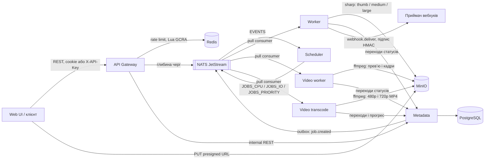

# PDP Media Pipeline

Розподілена система обробки медіа: користувач завантажує картинку чи відео, отримує `jobId`, а через
кілька секунд бачить статус `succeeded` і посилання на готові розміри або кадри. Про завершення
задачі система може сповістити підписаним вебхуком. Сервіси зв'язані через
NATS JetStream, стан задач живе в PostgreSQL, файли в S3-сумісному сховищі (MinIO).

Проєкт іде за PDP-планом з 10 етапів. Зараз готові **Етапи 0, 1, 2 і 3** (3a — надійність,
3b — `video.frames`, завантаження за URL і вебхуки) і **4a** — трейси й логи. Нижче описано, як
усе працює, і як руками перевірити кожен етап.

## Як це працює



1. `POST /v1/uploads` повертає presigned URL; браузер кладе оригінал прямо в MinIO.
2. `POST /v1/jobs` створює задачу. Metadata в одній транзакції пише job і подію в outbox,
   relay публікує `job.created` у стрім `EVENTS`.
3. Scheduler визначає клас задачі (`cpu`, `io` або `priority` для пріоритету ≥ 8) і публікує її
   у стрім класу з `Nats-Msg-Id` для дедупу.
4. Worker бере повідомлення pull-консюмером, робить пресети WebP завширшки 200, 800 і 1600 px (менші оригінали не збільшуються),
   кладе їх у `results/{jobId}/{preset}.webp` і переводить задачу в `succeeded`.
   Кожна спроба пишеться в `job_executions`. Відео (`video.frames`) бере окремий video-worker:
   ffprobe перевіряє файл, ffmpeg робить превʼю і кадри в `results/{jobId}/frames/NNNN.jpg`.
   `video.transcode` бере сервіс `video-transcode` з того самого образу: MP4 у
   `results/{jobId}/{480p|720p}.mp4`.
5. Статуси: `queued → scheduled → running → succeeded | dead`, переходи лише через
   машину станів у Metadata. Невдача — це `dead` з причиною: `permanent` (файл непридатний) або
   `exhausted` (усі спроби вичерпано).

Захист від перевантаження (Етап 2):

- **Rate limiting.** Один Lua-скрипт GCRA за виклик перевіряє ліміт користувача (20 rps, burst 20)
  і глобальний (200 rps, burst 200). Відмова — `429` з `Retry-After` і `RateLimit-*`. Невідомі
  API-ключі лімітуються за IP (10 rps, burst 20). Якщо Redis не відповідає, gateway переходить на
  локальний ліміт у пам'яті (fail-open, [ADR-005](docs/adr/0005-rate-limiting.md)).
- **Backpressure.** Gateway читає глибину стріму класу (кеш 1 с) і, якщо вона вища за поріг,
  відповідає на `POST /v1/jobs` кодом `503` з `Retry-After`. Класи ізольовані: забита черга CPU не
  блокує пріоритетні задачі.
- **Web UI** показує `429` / `503` з відліком і сам повторює запит після `Retry-After`.

Надійність (Етап 3a, [ADR-006](docs/adr/0006-idempotency-and-delivery.md),
[ADR-007](docs/adr/0007-retries-and-dlq.md)):

- **Idempotency-Key.** Повторний `POST /v1/jobs` з тим самим ключем протягом 24 год повертає ту
  саму задачу із заголовком `Idempotent-Replayed: true`; той самий ключ з іншим тілом дає `422`,
  а запит, поки перший ще виконується, отримує `409`.
- **Inbox.** Metadata запам'ятовує оброблені повідомлення в тій самій транзакції, що й фінальний
  статус. Повторна доставка після загубленого ack отримує `DUPLICATE_DELIVERY` і не обробляється.
- **Ретраї.** Спроби рахує Metadata (`JOB_MAX_ATTEMPTS = 5`), затримка між ними — exponential
  backoff з full jitter. Crash loop теж закінчується `dead / exhausted`.
- **DLQ і redrive.** Кожна `dead`-задача потрапляє в стрім `JOBS_DLQ`;
  `POST /v1/jobs/:id/redrive` (кнопка «Запустити знову» в UI) запускає її новим поколінням спроб.
- **Метрики.** `jobs_duplicates_total{source}`, `jobs_retries_total{type}`,
  `jobs_dlq_total{type,reason}`; з Етапу 4b вони йдуть через OpenTelemetry у VictoriaMetrics.

Відео, джерела за URL і вебхуки (Етап 3b, [ADR-008](docs/adr/0008-video-worker.md),
[ADR-009](docs/adr/0009-egress-and-webhooks.md)):

- **`video.frames`.** Відео до 60 с і 100 МБ (h264, hevc, vp8, vp9, av1, mpeg4): кадр-превʼю
  і кадри з інтервалом `intervalSeconds` (2 с), не більше `maxFrames` (10), шириною до 640 px.
  ffmpeg запускається з таймаутом і `SIGKILL`.
- **Джерело за URL.** Замість `sourceKey` можна передати `sourceUrl`. Дозволені лише публічні
  http(s)-адреси: IP перевіряється після DNS-резолву, з'єднання йде саме на перевірену адресу,
  редиректи перевіряються заново, є ліміт розміру й таймаут.
- **Вебхуки.** `POST /v1/webhooks` реєструє адресу для подій `job.succeeded` і `job.dead`
  (до 5 на користувача). Секрет `whsec_…` показується один раз. Доставка — задача
  `webhook.deliver` з тими самими ретраями, DLQ і redrive; заголовки за
  [Standard Webhooks](https://www.standardwebhooks.com/): `webhook-id`, `webhook-timestamp`,
  `webhook-signature`.
- **Web UI.** Відео можна перетягнути так само, як картинку; на картці видно превʼю і кадри.
  Розділ «Вебхуки» в шапці: додати адресу, побачити доставки і надіслати «мертву» ще раз.

Трейси й логи (Етап 4a, [ADR-010](docs/adr/0010-observability.md)):

- **Один трейс на задачу.** OpenTelemetry у кожному сервісі; контекст іде через HTTP, заголовки
  NATS і outbox. Від `POST /v1/jobs` через scheduler і воркер до доставки вебхука — один трейс у
  Tempo, зі span'ами на sharp, ffmpeg, S3, Postgres і вихідні запити.
- **`job.id` скрізь.** Baggage несе `job.id`, `job.type`, `job.class`; вони стають атрибутами
  кожного span'а і полями `job_id`, `job_type`, `job_class` у кожному рядку логу.
- **Логи.** Pino пише в stdout, як і раніше, і паралельно через OTLP у VictoriaLogs, з
  `trace_id` і `span_id`. У Grafana з рядка логу відкривається його трейс, а зі span'а — логи
  трейсу.
- **З UI.** Задача має `traceId`; посилання «Трейс і логи» на картці відкриває дашборд **Job**.

Метрики, SLO і алерти (Етап 4b, [ADR-010](docs/adr/0010-observability.md)):

- **Метрики.** Той самий OpenTelemetry SDK шле метрики через колектор у VictoriaMetrics:
  `job_e2e_duration_seconds` і `job_queue_wait_seconds` (гістограми з `type`, `class`),
  throughput і помилки (`jobs_finished_total{outcome}`), ретраї, DLQ, дублікати, глибина кожного
  стріму і backlog консюмерів, `http_server_request_duration_seconds{http_route}`, runtime Node.
- **SLO.** `image.resize`: 99% задач успішні за 5 хв від створення, `video.frames`: 95%
  ([ADR-008](docs/adr/0008-video-worker.md)), `video.transcode`: 95% за 10 хв
  ([ADR-011](docs/adr/0011-video-transcode.md)), `video.dub`: 95% за 15 хв
  ([ADR-016](docs/adr/0016-video-dub.md)). Бюджет помилок на 30 днів видно на дашборді **SLO**.
- **Алерти.** vmalert: burn rate 1 год / 5 хв (`page`) і 6 год / 30 хв (`ticket`), частка DLQ
  понад 1%, ріст черги. Alertmanager шле їх у `webhook-receiver`.
- **Дашборди як код.** Overview, SLO, Queues, Per-service, Job і Dub у
  `deploy/observability/grafana/dashboards`. З панелей латентності data links ведуть на
  повільні й помилкові трейси в Tempo і на логи у VictoriaLogs (замість exemplars).

Транскодинг (Етап 5.2, [ADR-011](docs/adr/0011-video-transcode.md)):

- **`video.transcode`.** Відео до 5 хв і 100 МБ перекодовується одним проходом ffmpeg у 480p і
  720p (H.264, AAC, `+faststart`), якість — за коротшою стороною, без апскейлу. Якості, більші за
  джерело, повертаються у `skipped`.
- **Прогрес.** Воркер раз на 3 с повідомляє Metadata відсоток кодування; `GET /v1/jobs/:id`
  віддає `progress` (0–100), поки задача `running`. Звіт старої спроби відкидається.
- **Окремий сервіс.** Той самий образ, але `VIDEO_JOB_TYPES=video.transcode` і свої консюмери
  `video-transcode-*`, тож хвилинний транскодинг не займає слот, на який чекають кадри.
- **Web UI.** У панелі завантаження перемикач «Кадри / Транскодинг»; на картці — прогрес-бар,
  потім якості посиланнями на MP4.

Автоскейл і graceful shutdown (Етап 5.3,
[ADR-012](docs/adr/0012-autoscaling-and-graceful-shutdown.md)):

- **Deployment на клас.** У кластері воркер картинок працює як `worker-priority`, `worker-cpu` і
  `worker-io` (`WORKER_CLASSES`), відео — як `video-frames` і `video-transcode`. У compose
  воркер, як і раніше, бере всі класи.
- **Скейл за лагом черги.** KEDA (`nats-jetstream`) рахує для кожного консюмера
  `num_pending + num_ack_pending` і ставить один под на кожні «слоти» задач, що чекають або
  виконуються. Gateway — HPA за CPU, мінімум 2 репліки. Усім — PDB і anti-affinity.
- **Зупинка без втрат.** На SIGTERM воркер одразу перестає брати повідомлення і дає поточним
  задачам `WORKER_SHUTDOWN_GRACE_MS`. Потім скасовує їх (ffmpeg вбивається) і повертає в чергу як
  `interrupted`: інший под бере задачу одразу, а спроба не рахується.

### Структура репозиторію

| Шлях                                   | Що там                                                              |
| -------------------------------------- | ------------------------------------------------------------------- |
| `apps/api-gateway`                     | Публічний REST API, сесія або API-ключ, rate limiting, backpressure |
| `apps/metadata`                        | PostgreSQL (Drizzle), машина станів, outbox, внутрішній REST        |
| `apps/scheduler`                       | `job.created` → стрім класу                                         |
| `apps/worker`                          | `image.resize` через sharp і доставка вебхуків `webhook.deliver`    |
| `apps/video-worker`                    | `video.frames` через ffmpeg, окремий образ                          |
| `apps/audio-separate`                  | Python: розділення голосу, час слів і стать мовців для `video.dub`  |
| `apps/webhook-receiver`                | Тестовий «поганий» приймач вебхуків для compose і тестів            |
| `apps/web`                             | React + Redux Toolkit, завантаження, задачі, вебхуки                |
| `libs/egress`                          | Безпечні вихідні запити: SSRF-захист, ліміти, ліміт на хост         |
| `libs/worker-kit`                      | Спільне для воркерів: `JobRunner`, `PermanentError`, S3, джерела    |
| `libs/observability`                   | OpenTelemetry SDK, хелпери span'ів, baggage і метрик, логер, health |
| `libs/*` (решта)                       | Контракти (zod), messaging, клієнт Metadata, config                 |
| `deploy/helm`                          | Helm: `pdp-lib`, чарти сервісів, umbrella `pdp`, `platform`         |
| `deploy/k3d`                           | Локальний кластер k3d з registry                                    |
| `deploy/observability`                 | Collector, Tempo, правила vmalert, Alertmanager, дашборди Grafana   |
| `perf/k6`, `perf/reports`              | Навантажувальні сценарії і звіти                                    |
| `docs/adr`, `docs/plan`, `docs/spikes` | Рішення, плани етапів, нотатки спайку                               |
| `test/`                                | Інтеграційні тести на Testcontainers                                |

## Запуск

Потрібно: Node.js 22+, pnpm 9 (`corepack enable`), Docker Desktop, `jq` і `curl`.

```bash
pnpm install
pnpm stack:up          # docker compose up -d --build --wait
docker compose ps      # усі сервіси healthy, metadata-migrate і minio-init — Exited (0)
```

> Не плутайте з `pnpm up`: це вбудована команда pnpm (`pnpm update`), вона оновить залежності
> замість запуску Docker.

Два способи увійти. Для браузера — email і пароль: зареєструватися на
http://localhost:18090/register або створити дев-акаунт командою й увійти на `/login`:

```bash
docker compose exec -T metadata node dist/seed-user.js --name me \
  --email me@example.com --password 'correct horse battery' | jq -c '{userId, email}'
```

Для скриптів — API-ключ: `seed-user` без `--email` (користувач без пароля) або
«Налаштування → API-ключі» у Web UI. Ключ іде в заголовку `X-API-Key`; Web UI його не приймає.

```bash
KEY=$(docker compose exec -T metadata node dist/seed-user.js --name me | jq -r .apiKey)
```

| Що                              | Адреса                                                      |
| ------------------------------- | ----------------------------------------------------------- |
| Web UI                          | http://localhost:18090                                      |
| API Gateway і Swagger           | http://localhost:18080, http://localhost:18080/docs         |
| Metadata / Scheduler / Worker   | http://localhost:18081, :18082, :18083                      |
| Приймач вебхуків / Video worker | http://localhost:18084, :18085                              |
| Video transcode                 | http://localhost:18086                                      |
| Консоль MinIO                   | http://localhost:59001 (`minioadmin` / `minioadmin`)        |
| Моніторинг NATS                 | http://localhost:58222                                      |
| Grafana (без логіна)            | http://localhost:13000, папка дашбордів «PDP»               |
| Tempo / VictoriaLogs API        | http://localhost:13200, http://localhost:19428              |
| VictoriaMetrics / vmalert       | http://localhost:18428/vmui, http://localhost:18880         |
| Alertmanager                    | http://localhost:19093                                      |
| PostgreSQL                      | `localhost:55432`, користувач і пароль `pdp`, БД `metadata` |

Порти можна змінити через `.env` (наприклад, `GATEWAY_HOST_PORT=8080`). Зупинити:
`pnpm stack:down`; разом з даними: `docker compose down -v`.

### Запуск у Kubernetes (k3d)

Потрібно додатково: `k3d`, `kubectl`, `helm` (`brew install k3d kubectl helm`) і щонайменше
8 ГБ пам'яті для Docker (кластер у спокої займає близько 4 ГБ). Compose-стек краще зупинити.

```bash
pnpm stack:down
pnpm k8s:up            # кластер, registry, оператори, платформа, образи, реліз pdp (~4 хв з нуля)
KEY=$(kubectl -n pdp exec deploy/metadata -- node dist/seed-user.js --name me | jq -r .apiKey)
```

Для браузера — реєстрація на http://app.pdp.localhost:19080/register або той самий `seed-user`
з `--email` і `--password` через `kubectl -n pdp exec deploy/metadata --`.

`pnpm k8s:up` повторюваний: наступний запуск перезбирає образи й оновлює релізи, а
перезапускаються лише сервіси, у яких змінився образ (тег — ID образу). Тільки застосунок:
`pnpm k8s:deploy`. Стан: `scripts/k8s.sh status`. Видалити кластер разом з даними: `pnpm k8s:down`.

| Що                    | Адреса                                                              |
| --------------------- | ------------------------------------------------------------------- |
| Web UI                | http://app.pdp.localhost:19080                                      |
| API Gateway і Swagger | http://api.pdp.localhost:19080, http://api.pdp.localhost:19080/docs |
| Grafana (без логіна)  | http://grafana.pdp.localhost:19080                                  |
| VictoriaMetrics       | http://vm.pdp.localhost:19080/vmui                                  |
| MinIO: S3 і консоль   | http://s3.pdp.localhost:19080, http://minio.pdp.localhost:19080     |

`*.localhost` браузери й `curl` резолвлять у `127.0.0.1` самі, `/etc/hosts` не потрібен.
Решта сервісів — через `kubectl -n pdp port-forward`, наприклад `svc/nats 8222` або
`svc/postgres-rw 5432`.

## Перевірка етапів

Команди виконуються з кореня репозиторію при запущеному стеку і заданому `KEY`.

### Етап 0. Ініціалізація

**Критерій PDP:** `docker compose up` піднімає систему, усі `/health/ready` повертають 200, CI
зелений, у `docs/adr` чотири ADR, AWS-акаунт захищений і має бюджетний алерт.

1. Health-check'и:
   ```bash
   for p in 18080 18081 18082 18083 18085 18086; do echo "$p $(curl -s -o /dev/null -w '%{http_code}' localhost:$p/health/ready)"; done
   ```
   Очікувано: шість разів `200` (18085 — video-worker з Етапу 3b, 18086 — video-transcode з
   Етапу 5.2).
2. Якість коду (усе має пройти без помилок):
   ```bash
   pnpm lint && pnpm typecheck && pnpm format:check && pnpm depcruise && pnpm helm:lint && pnpm build
   ```
3. Документи: `docs/adr/0001`–`0004` (домен, черга, БД, монорепо), `docs/spikes/01-jetstream-vs-bullmq.md`.
4. CI: на GitHub у вкладці Actions останній запуск на `main` зелений (jobs `verify`, `test`,
   `integration`, `audit`, `helm`, `docker`).
5. AWS (руками в консолі, у репозиторії не видно): MFA на root, окремий IAM-користувач або
   Identity Center, бюджетний алерт на $10–20.

### Етап 1. MVP черг з `image.resize`

**Критерій PDP:** наскрізний сценарій проходить у docker-compose і в інтеграційному тесті,
статуси видно через API, у `job_executions` записується кожна спроба.

1. Автоматичний наскрізний сценарій — upload, `PUT` у MinIO, `POST /v1/jobs`, очікування
   `succeeded`, завантаження пресетів, записи `job_executions`:
   ```bash
   scripts/e2e-smoke.sh
   ```
   Очікувано: у кінці `OK`.
2. Через Web UI: http://localhost:18090, увійти (див. «Запуск»), перетягнути картинку. Картка проходить
   завантаження → «Queued» → обробку → «Done», з'являються превʼю трьох розмірів.
3. Статуси через API і перевірка ключа:
   ```bash
   curl -s -H "x-api-key: $KEY" 'localhost:18080/v1/jobs?limit=3' | jq '.items[] | {id, status, attempts}'
   curl -s -o /dev/null -w '%{http_code}\n' -H 'x-api-key: wrong' localhost:18080/v1/jobs   # 401
   ```
4. Кожна спроба в БД:
   ```bash
   docker compose exec -T postgres psql -U pdp -d metadata -c \
     "select j.status, e.attempt, e.outcome from jobs j join job_executions e on e.job_id = j.id order by e.started_at desc limit 5"
   ```
5. Стріми і результати:
   ```bash
   curl -s 'localhost:58222/jsz?streams=true' | jq -c '[.account_details[0].stream_detail[] | {name, messages: .state.messages}]'
   ```
   Очікувано: `EVENTS`, `JOBS_CPU`, `JOBS_IO`, `JOBS_PRIORITY`. У консолі MinIO, бакет `media`,
   лежать `results/<jobId>/thumb.webp`, `medium.webp`, `large.webp`.
6. Задача не губиться при падінні воркера: завантажити кілька картинок у UI, одразу
   `docker compose kill worker`, потім `docker compose up -d worker` — задачі доходять до «Done».
7. Тести:
   ```bash
   pnpm test        # unit: машина станів, вибір класу, guard'и тощо
   pnpm test:int    # Testcontainers (потрібен Docker): від POST /jobs до succeeded, redelivery
   pnpm test:web    # Web UI
   ```

### Етап 2. Rate limiting і backpressure

**Критерій PDP:** k6 thresholds проходять, частка `429` відповідає налаштованим лімітам, а при
штучно забитій черзі Gateway віддає `503` замість росту затримки. P95 API нижче 150 мс.

1. Ліміт користувача — перші ~20–27 запитів `200`, далі `429` (частина ліміту встигає
   відновитися за час циклу):
   ```bash
   for i in $(seq 1 40); do curl -s -o /dev/null -w '%{http_code} ' -H "x-api-key: $KEY" 'localhost:18080/v1/jobs?limit=1'; done; echo
   curl -si -H "x-api-key: $KEY" 'localhost:18080/v1/jobs?limit=1' | grep -iE '^HTTP|retry-after|ratelimit'
   ```
   Очікувано: `429 Too Many Requests`, `Retry-After: 1`, `RateLimit-Limit: 20`,
   `RateLimit-Remaining: 0`, `RateLimit-Reset`.
2. Ліміт за IP для невідомих ключів — близько 20 відповідей `401`, далі `429`:
   ```bash
   for i in $(seq 1 25); do curl -s -o /dev/null -w '%{http_code} ' -H "x-api-key: guess$i" localhost:18080/v1/jobs; done; echo
   ```
3. Fail-open, коли Redis не відповідає:
   ```bash
   docker compose pause redis
   curl -s -o /dev/null -w '%{http_code}\n' -H "x-api-key: $KEY" 'localhost:18080/v1/jobs?limit=1'   # 200
   curl -s -o /dev/null -w '%{http_code}\n' localhost:18080/health/ready                            # 200
   docker compose unpause redis
   docker compose logs api-gateway --since 2m | grep -o 'redis[^"]*rate limits[^"]*'
   ```
   У логах: `redis unavailable, rate limits are local to this replica` і після паузи
   `redis is back, rate limits are shared again`. Цикл з п. 1 під час паузи теж дає `429` — ліміт
   тримається локально.
4. Backpressure: зупинити воркер і підняти gateway з порогом черги CPU = 3:

   ```bash
   docker compose stop worker
   BACKPRESSURE_MAX_DEPTH_CPU=3 docker compose up -d --no-deps --wait api-gateway

   IMG=perf/k6/fixtures/source.png
   UP=$(curl -s -H "x-api-key: $KEY" -H 'content-type: application/json' \
     -d "{\"contentType\":\"image/png\",\"size\":$(wc -c < $IMG | tr -d ' ')}" localhost:18080/v1/uploads)
   curl -s -X PUT -H 'content-type: image/png' --data-binary @$IMG "$(jq -r .uploadUrl <<<"$UP")"
   SRC=$(jq -r .sourceKey <<<"$UP")
   job() { curl -s -w '%{http_code}\n' -o /dev/null -H "x-api-key: $KEY" -H 'content-type: application/json' \
     -d "{\"type\":\"image.resize\",\"sourceKey\":\"$SRC\",\"presets\":[\"thumb\"]$1}" localhost:18080/v1/jobs; }

   for i in $(seq 1 8); do job; sleep 0.5; done   # кілька 202, далі 503
   job ',"priority":9'                             # 202: пріоритетна черга окрема
   ```

   Відповідь `503` містить `Retry-After: 5` і
   `{"message":"the cpu queue is full, retry later","retryAfterSeconds":5}`. Поріг може бути
   перевищений на кілька задач через кеш глибини (1 с).

   Те саме наочно у Web UI: при зупиненому воркері завантажити 6–8 картинок — частина карток
   покаже «Черга переповнена, чекаємо» з відліком. Протягом ~20 с запустити воркер, і UI сам
   довантажить решту.

   Повернути все назад:

   ```bash
   docker compose start worker
   docker compose up -d --no-deps --wait api-gateway   # поріг за замовчуванням
   ```

   Через 5–10 с після старту воркера черга розвантажується, і `job` знову повертає `202`.

5. `429` у Web UI: вибрати одразу 30–40 картинок — частина карток покаже «Ліміт запитів,
   чекаємо» з відліком і продовжить самостійно.
6. Навантажувальні тести (k6 у Docker в мережі compose, близько 6 хвилин; скрипт сам сідить
   perf-користувачів, зупиняє воркер для backpressure і відновлює стек):

   ```bash
   scripts/perf.sh                # api-baseline, rate-limit, spike, backpressure
   scripts/perf.sh autocannon     # GET /v1/jobs/:id з лімітами і без
   ```

   Очікувано: у кожному сценарії всі thresholds з `✓`. Сирий вивід — `perf/reports/raw/`.
   Зведення й інтерпретація — [perf/reports/stage-2.md](perf/reports/stage-2.md):

   | Сценарій     | Що перевіряє                           | Результат звіту           |
   | ------------ | -------------------------------------- | ------------------------- |
   | api-baseline | P95 при 100 rps у межах лімітів        | 6.8 мс (ціль 150 мс)      |
   | rate-limit   | частка `429`: 1 користувач × 40 rps    | 48.4% (розрахунок 48.3%)  |
   | rate-limit   | частка `429`: 15 користувачів × 20 rps | 31.1% (розрахунок 31.1%)  |
   | spike        | сплеск до 600 rps                      | 0 `5xx`, P95 `429` 1.2 мс |
   | backpressure | забита черга                           | 93.7% `503`, P95 5.6 мс   |

7. Інтеграційні тести етапу (`pnpm test:int`): `test/rate-limit.int-spec.ts` (ліміти на
   справжньому Redis, IP-ліміт, пауза Redis) і `test/backpressure.int-spec.ts` (`503`, пріоритет,
   відновлення після старту воркера).
8. Документи: [ADR-005](docs/adr/0005-rate-limiting.md) (GCRA проти token bucket, fail-open),
   [план етапу](docs/plan/stage-2.md), [звіт](perf/reports/stage-2.md).

### Етап 3a. Надійність

**Критерій PDP:** задача не губиться і не виконується двічі з видимим ефектом, коли падає воркер;
повторний `POST /jobs` з тим самим ключем не створює нової задачі; невдалі задачі видно в DLQ.

Підготовка: `KEY` з розділу «Запуск» і хелпер для завантаження файлу.

```bash
up() { local UP=$(curl -s -H "x-api-key: $KEY" -H 'content-type: application/json' \
    -d "{\"contentType\":\"image/png\",\"size\":$(wc -c < $1 | tr -d ' ')}" localhost:18080/v1/uploads)
  curl -s -X PUT -H 'content-type: image/png' --data-binary @$1 "$(jq -r .uploadUrl <<<"$UP")"
  jq -r .sourceKey <<<"$UP"; }
SRC=$(up perf/k6/fixtures/source.png)
```

1. Idempotency-Key — двічі `202` з тим самим `jobId`, друга відповідь з
   `idempotent-replayed: true`; інше тіло з тим самим ключем — `422 IDEMPOTENCY_KEY_REUSED`:
   ```bash
   job() { curl -s -i -H "x-api-key: $KEY" -H 'content-type: application/json' -H 'idempotency-key: demo-1' \
     -d "{\"type\":\"image.resize\",\"sourceKey\":\"$SRC\",\"presets\":[\"$1\"]}" localhost:18080/v1/jobs \
     | grep -iE '^HTTP|idempotent|jobId|code'; }
   job thumb; job thumb; job medium
   ```
2. Permanent-помилка → `dead` і DLQ:
   ```bash
   printf 'not a png' > /tmp/garbage.png
   BAD=$(curl -s -H "x-api-key: $KEY" -H 'content-type: application/json' \
     -d "{\"type\":\"image.resize\",\"sourceKey\":\"$(up /tmp/garbage.png)\",\"presets\":[\"thumb\"]}" \
     localhost:18080/v1/jobs | jq -r .jobId)
   sleep 2; curl -s -H "x-api-key: $KEY" localhost:18080/v1/jobs/$BAD | jq -c '{status, deadReason, attempts, lastError}'
   curl -s 'localhost:58222/jsz?streams=true' | jq -c '[.account_details[0].stream_detail[] | select(.name == "JOBS_DLQ") | .state.messages]'
   ```
   Очікувано: `"status":"dead","deadReason":"permanent","attempts":1` і `unreadable image` в
   `lastError`; у `JOBS_DLQ` з'явилось повідомлення.
3. Redrive — `dead`-задача стає `queued` з новим поколінням спроб (знову впаде як permanent,
   але вже з `attempts` = 3); задача, що не в стані `dead`, — `409 NOT_REDRIVABLE`:
   ```bash
   curl -s -o /dev/null -w '%{http_code}\n' -X POST -H "x-api-key: $KEY" localhost:18080/v1/jobs/$BAD/redrive   # 202
   sleep 2; curl -s -H "x-api-key: $KEY" localhost:18080/v1/jobs/$BAD | jq -c '{status, deadReason, attempts}'
   ```
   У Web UI картка такої задачі показує «Цей файл неможливо обробити.» з текстом помилки і кнопку
   «Запустити знову».
4. Метрики у VictoriaMetrics (сервіси експортують їх раз на 15 с):
   ```bash
   vm() { curl -s localhost:18428/api/v1/query --data-urlencode "query=$1" | jq -c '.data.result[] | {m: .metric, v: .value[1]}'; }
   vm 'sum by (type, reason) (jobs_dlq_total)'
   ```
   Очікувано: `{"type":"image.resize","reason":"permanent"}` з кількістю `dead`-задач.
5. Падіння воркера посеред обробки, як в Етапі 1, п. 6: задачі доходять до «Done», а в
   `job_executions` перервана спроба має `outcome = abandoned`.
6. Інтеграційні тести етапу (`pnpm test:int`):
   - `test/reliability.int-spec.ts`: crash loop → `dead / exhausted`; загублений ack після успіху →
     inbox відкидає повторну доставку; збій S3 через TCP-проксі → ретраї з jitter →
     `exhausted` → redrive → `succeeded`;
   - `test/metadata.int-spec.ts`: Idempotency-Key — повтор, `422`, `409` при утриманому lock,
     10 конкурентних запитів створюють одну задачу;
   - `test/pipeline.int-spec.ts`: permanent → `dead` + запис у `JOBS_DLQ`, replay через gateway.
7. Документи: [ADR-006](docs/adr/0006-idempotency-and-delivery.md),
   [ADR-007](docs/adr/0007-retries-and-dlq.md), [план етапу](docs/plan/stage-3.md).

### Етап 3b. `video.frames`, завантаження за URL і вебхуки

**Критерій PDP:** вебхук на «поганий» приймач доходить після ретраїв або коректно потрапляє в DLQ.

Підготовка: `KEY` і хелпер `up` з Етапу 3a, плюс тестове відео (ffmpeg із `node_modules`):

```bash
FFMPEG=$(node -p "require('ffmpeg-static')")
$FFMPEG -loglevel error -y -f lavfi -i testsrc=duration=6:size=1280x720:rate=25 -pix_fmt yuv420p /tmp/clip.mp4
upv() { local UP=$(curl -s -H "x-api-key: $KEY" -H 'content-type: application/json' \
    -d "{\"contentType\":\"video/mp4\",\"size\":$(wc -c < $1 | tr -d ' ')}" localhost:18080/v1/uploads)
  curl -s -X PUT -H 'content-type: video/mp4' --data-binary @$1 "$(jq -r .uploadUrl <<<"$UP")"
  jq -r .sourceKey <<<"$UP"; }
hook() { curl -s -H "x-api-key: $KEY" -H 'content-type: application/json' \
  -d "{\"url\":\"http://webhook-receiver:3000$1\"}" localhost:18080/v1/webhooks; }
```

1. `video.frames` — превʼю і кадри кожні 2 с:
   ```bash
   VID=$(curl -s -H "x-api-key: $KEY" -H 'content-type: application/json' \
     -d "{\"type\":\"video.frames\",\"sourceKey\":\"$(upv /tmp/clip.mp4)\"}" localhost:18080/v1/jobs | jq -r .jobId)
   sleep 5; curl -s -H "x-api-key: $KEY" localhost:18080/v1/jobs/$VID \
     | jq -c '{status, video: (.video | {durationSeconds, codec, frames: [.frames[].atSeconds]})}'
   ```
   Очікувано: `"status":"succeeded"`, `"codec":"h264"`, кадри `[0,2,4]`. У Web UI відео можна
   просто перетягнути: на картці з'являються превʼю і рядок кадрів.
2. Ліміти відео: ролик довший за 60 с закінчується `dead / permanent` з причиною в `lastError`:
   ```bash
   $FFMPEG -loglevel error -y -f lavfi -i testsrc=duration=61:size=320x240:rate=5 -pix_fmt yuv420p /tmp/long.mp4
   LONG=$(curl -s -H "x-api-key: $KEY" -H 'content-type: application/json' \
     -d "{\"type\":\"video.frames\",\"sourceKey\":\"$(upv /tmp/long.mp4)\"}" localhost:18080/v1/jobs | jq -r .jobId)
   sleep 3; curl -s -H "x-api-key: $KEY" localhost:18080/v1/jobs/$LONG | jq -c '{status, deadReason, lastError}'
   ```
3. SSRF — приватні адреси відхиляються одразу з `400`, і для джерела, і для вебхука:
   ```bash
   for u in http://169.254.169.254/latest/meta-data http://localhost:5432 http://10.0.0.1/x.png; do
     curl -s -o /dev/null -w "%{http_code} $u\n" -H "x-api-key: $KEY" -H 'content-type: application/json' \
       -d "{\"type\":\"image.resize\",\"sourceUrl\":\"$u\",\"presets\":[\"thumb\"]}" localhost:18080/v1/jobs
   done
   curl -s -H "x-api-key: $KEY" -H 'content-type: application/json' \
     -d '{"url":"http://127.0.0.1:3000/hook"}' localhost:18080/v1/webhooks | jq -c '{statusCode, message}'
   ```
   Публічний URL працює (потрібен інтернет), наприклад
   `"sourceUrl":"https://upload.wikimedia.org/wikipedia/commons/4/47/PNG_transparency_demonstration_1.png"`.
4. Вебхук на справний приймач — підпис валідний:
   ```bash
   curl -s -X DELETE localhost:18084/deliveries
   OK_SECRET=$(hook /ok | jq -r .secret)
   curl -s -H "x-api-key: $KEY" -H 'content-type: application/json' \
     -d "{\"type\":\"image.resize\",\"sourceKey\":\"$SRC\",\"presets\":[\"thumb\"]}" localhost:18080/v1/jobs >/dev/null
   sleep 3; curl -s "localhost:18084/deliveries?secret=$OK_SECRET" \
     | jq -c '.items[] | {path, webhookId, signatureValid, type: (.body | fromjson | .type)}'
   ```
   Очікувано: `"path":"/ok","signatureValid":true,"type":"job.succeeded"`.
5. «Поганий» приймач, **критерій етапу**. Адреси за замовчуванням ловлять обидві події, тож
   кожна задача дає доставку на кожну адресу:
   - `/flaky?failures=2` — дві відповіді `500`, потім `200`: доставка `succeeded` з `attempts = 3`;
   - `/fail` (500), `/drop` (обрив), `/slow?ms=15000` (довше за `WEBHOOK_TIMEOUT_MS` = 5 с) —
     транзієнтні помилки, після 5 спроб `dead / exhausted` і запис у `JOBS_DLQ`;
   - `/status/410` — permanent: `dead / permanent` після першої спроби.

   ```bash
   # Ліміт — 5 адрес на користувача, тож спершу прибираємо адресу /ok з п. 4
   OKID=$(curl -s -H "x-api-key: $KEY" localhost:18080/v1/webhooks | jq -r '.items[0].id')
   curl -s -o /dev/null -w '%{http_code}\n' -X DELETE -H "x-api-key: $KEY" localhost:18080/v1/webhooks/$OKID   # 204
   for p in '/flaky?failures=2' /fail /drop '/slow?ms=15000' /status/410; do hook "$p" | jq -r '.id + "  " + .url'; done
   curl -s -H "x-api-key: $KEY" -H 'content-type: application/json' \
     -d "{\"type\":\"image.resize\",\"sourceKey\":\"$SRC\",\"presets\":[\"thumb\"]}" localhost:18080/v1/jobs >/dev/null
   sleep 150
   for id in $(curl -s -H "x-api-key: $KEY" localhost:18080/v1/webhooks | jq -r '.items[].id'); do
     curl -s -H "x-api-key: $KEY" localhost:18080/v1/webhooks/$id/deliveries \
       | jq -c --arg id "$id" '.items[] | {endpoint: $id[0:8], status, deadReason, attempts, responseStatus, lastError}'
   done
   vm 'sum by (reason) (jobs_dlq_total{type="webhook.deliver"})'   # vm() з Етапу 3a, п. 4
   ```

   Очікувано: `flaky` — `succeeded`, `attempts: 3`, `responseStatus: 200`; `fail`, `drop` і `slow` —
   `dead / exhausted` з `attempts: 5` і помилками `endpoint responded 500`, `socket hang up`,
   `timed out`; `410` — `dead / permanent` з `attempts: 1`. У метриках
   `reason="exhausted"` — 3, `reason="permanent"` — 1.
   Backoff з full jitter і cap 60 с, тож `exhausted` настає за 1–3 хвилини. Те саме видно в Web UI:
   «Вебхуки» в шапці → адреса → таблиця доставок зі статусом, спробами, кодом відповіді й помилкою.
   «Мертву» доставку можна надіслати знову кнопкою «Запустити знову» (або
   `POST /v1/jobs/<id доставки>/redrive`); `webhook-id` при цьому той самий.

6. Інтеграційні тести етапу (`pnpm test:int`):
   - `test/media-sources.int-spec.ts`: `video.frames` наскрізно, ліміти відео, `sourceUrl` з
     локального файлового сервера, SSRF і редиректи на приватні адреси;
   - `test/webhooks.int-spec.ts`: реєстрація, ліміт і SSRF; підписана доставка; `job.dead`;
     flaky → успіх після ретраїв; `500` / обрив / повільний → `exhausted` + DLQ; `410` → permanent →
     redrive.
7. Документи: [ADR-008](docs/adr/0008-video-worker.md), [ADR-009](docs/adr/0009-egress-and-webhooks.md),
   [план етапу](docs/plan/stage-3.md).

### Етап 4a. Трейси і логи

1. Створити задачу з вебхуком і взяти її `traceId`:

   ```bash
   curl -s -H "x-api-key: $KEY" -H 'content-type: application/json' \
     -d '{"url":"http://webhook-receiver:3000/ok"}' localhost:18080/v1/webhooks >/dev/null
   IMG=perf/k6/fixtures/source.png
   UP=$(curl -s -H "x-api-key: $KEY" -H 'content-type: application/json' \
     -d "{\"contentType\":\"image/png\",\"size\":$(wc -c < $IMG | tr -d ' ')}" localhost:18080/v1/uploads)
   curl -s -X PUT -H 'content-type: image/png' --data-binary @$IMG "$(jq -r .uploadUrl <<<"$UP")"
   JOB=$(curl -s -H "x-api-key: $KEY" -H 'content-type: application/json' \
     -d "{\"type\":\"image.resize\",\"sourceKey\":\"$(jq -r .sourceKey <<<"$UP")\",\"presets\":[\"thumb\"]}" \
     localhost:18080/v1/jobs | jq -r .jobId)
   sleep 5; TRACE=$(curl -s -H "x-api-key: $KEY" localhost:18080/v1/jobs/$JOB | jq -r .traceId); echo $TRACE
   ```

2. Трейс охоплює всі сервіси. Очікувано: `api-gateway`, `metadata`, `scheduler`, `worker`, а
   серед span'ів `job create`, `send`/`process events.job.created.v1`, `sharp resize`,
   `S3.PutObject`, `job process webhook.deliver`, `egress POST`:

   ```bash
   curl -s localhost:13200/api/v2/traces/$TRACE | jq -r '[.trace.resourceSpans[]
     | .resource.attributes[] | select(.key=="service.name") | .value.stringValue] | unique | .[]'
   curl -s localhost:13200/api/v2/traces/$TRACE | jq -r '[.trace.resourceSpans[].scopeSpans[].spans[].name]
     | unique | .[]'
   ```

3. Логи задачі з усіх сервісів за `job_id`, кожен з `trace_id`:

   ```bash
   curl -s localhost:19428/select/logsql/query --data-urlencode "query=job_id:=\"$JOB\"" \
     | jq -c '{service: .["service.name"], msg: ._msg, trace_id, job_type}'
   ```

4. Grafana: http://localhost:13000 → дашборд **PDP / Job** (або посилання «Трейс і логи» на
   картці задачі в Web UI). Нагорі трейс, нижче логи задачі. Клік на `trace_id` у рядку логу
   відкриває трейс, а «Logs for this span» у трейсі — логи. Таблиця внизу показує всі трейси з
   цим `job.id`: після redrive їх два.
5. Gateway — межа довіри: `traceparent` і `baggage` від клієнта ігноруються, а вихідні запити на
   адреси користувачів (вебхуки, `sourceUrl`) не несуть ні того, ні іншого:

   ```bash
   curl -s -H "x-api-key: $KEY" -H 'traceparent: 00-aaaaaaaaaaaaaaaaaaaaaaaaaaaaaaaa-bbbbbbbbbbbbbbbb-01' \
     -H 'content-type: application/json' -d "{\"type\":\"image.resize\",\"sourceKey\":\"$(jq -r .sourceKey <<<"$UP")\",\"presets\":[\"thumb\"]}" \
     localhost:18080/v1/jobs | jq -r .jobId   # traceId цієї задачі не aaaa…
   ```

6. Тести: `test/telemetry.int-spec.ts` (один трейс з одним коренем від `POST /v1/jobs` до
   доставки вебхука), unit-тести передачі контексту через NATS, outbox і egress.
7. Документи: [ADR-010](docs/adr/0010-observability.md), [план етапу](docs/plan/stage-4.md).

### Етап 4b. Метрики, дашборди, SLO і алерти

**Критерій PDP:** у Grafana видно latency, throughput, errors і queue depth; SLO — на дашборді.

1. Демо-навантаження (k6 у Docker, 8 хв): дві задачі на секунду успішні, ще одна на секунду має
   `sourceUrl`, що відповідає `500`, і після 5 спроб стає `dead / exhausted`. Третина задач
   погані, тож бюджет `image.resize` горить у 33 рази швидше за норму:

   ```bash
   scripts/perf.sh slo-burn          # DURATION=15m scripts/perf.sh slo-burn — довше
   ```

2. Grafana http://localhost:13000, папка **PDP**:
   - **Overview** — створені задачі, частка успішних, p95 від створення до кінця, черги, алерти;
     графіки throughput, error rate, e2e latency і queue wait, запити й латентність gateway;
   - **SLO** — ціль, SLI і залишок бюджету за 30 днів, burn rate за чотирма вікнами з порогами
     алертів, добрі й погані задачі, таблиця алертів; тип задачі вибирається вгорі;
   - **Queues** — глибина стрімів, backlog і in-flight кожного консюмера, queue wait за класом,
     ретраї, DLQ за причинами, дублікати, час обробки повідомлень;
   - **Per-service** — RED за маршрутами, вихідний HTTP, Postgres, NATS, спроби задач, event
     loop, heap і warn/error логи вибраного сервісу.

   Клік по серії на панелі латентності відкриває меню data links: трейси цього типу довші за
   5 хв або з помилкою (TraceQL у Tempo) і warn/error логи цього типу (VictoriaLogs).

3. Алерти. Приблизно за 5 хв після старту `JobSloBurnRateFast` стає `firing` (1 год і 5 хв
   понад 14.4; погана задача рахується, лише коли вичерпає повтори), трохи пізніше —
   `JobDeadLetterShareHigh`. Alertmanager шле їх у приймач:

   ```bash
   curl -s localhost:18880/api/v1/alerts | jq -c '.data.alerts[] | {name, state, type: .labels.type}'
   curl -s localhost:18084/alerts | jq -c '.items[] | {status, alert: .labels.alertname, type: .labels.type}'
   docker compose logs webhook-receiver | grep 'alert '
   ```

   Після навантаження 5-хвилинне вікно очищується, і за кілька хвилин приходить `resolved`.
   Правила: `deploy/observability/vmalert/rules`, їх тести: `pnpm alerts:test`.

4. Метрики напряму — VictoriaMetrics UI http://localhost:18428/vmui або `vm()` з Етапу 3a:

   ```bash
   vm 'histogram_quantile(0.95, sum by (type, le) (rate(job_e2e_duration_seconds_bucket[5m])))'
   vm 'sum by (type, outcome) (increase(jobs_finished_total[10m]))'
   vm 'max by (stream) (nats_stream_messages)'
   vm 'job:slo_burn_rate:rate1h'
   ```

5. Як знайти трейс і логи за `jobId`: посилання «Трейс і логи» на картці в Web UI, або
   `http://localhost:13000/d/pdp-job/job?var-job_id=<jobId>`, або TraceQL
   `{ span.job.id = "<jobId>" }` у Tempo і `job_id:="<jobId>"` у VictoriaLogs (Етап 4a).
6. Тести: `test/telemetry.int-spec.ts` (SLI, queue wait, HTTP і NATS метрики однієї задачі),
   `test/reliability.int-spec.ts` (ретраї, DLQ, redrive не потрапляє в SLI), `pnpm alerts:test`
   (burn rate, виключення `permanent`, поріг DLQ, ріст черги).

### Етап 5.1. Кластер і Helm

**Критерій підетапу:** `pnpm k8s:up` з нуля піднімає систему в k3d, і наскрізний сценарій
проходить через Ingress з тими самими трейсами, логами, метриками й алертами, що й у compose.

Підготовка: кластер з [«Запуск у Kubernetes»](#запуск-у-kubernetes-k3d) і `KEY` звідти.

1. Усе запущено, міграції — хук, що відпрацював до старту сервісів:
   ```bash
   kubectl -n pdp get pods      # усе Running, metadata-migrate — Completed
   kubectl -n pdp get cluster postgres -o jsonpath='{.status.phase}{"\n"}'   # Cluster in healthy state
   helm list -n pdp             # platform і pdp — deployed
   ```
2. Наскрізний сценарій Етапу 1 через Ingress (presigned PUT іде на `s3.pdp.localhost`):
   ```bash
   KUBE_NAMESPACE=pdp scripts/e2e-smoke.sh
   ```
   Очікувано: у кінці `OK`. Web UI: http://app.pdp.localhost:19080, вставити `KEY`, перетягнути
   картинку або відео — вони обробляються так само, як у compose.
3. Вебхук на приймач у кластері. Після реєстрації завантажте картинку через UI з тим самим
   `KEY`, потім:
   ```bash
   OK_SECRET=$(curl -s -H "x-api-key: $KEY" -H 'content-type: application/json' \
     -d '{"url":"http://webhook-receiver:3000/ok"}' http://api.pdp.localhost:19080/v1/webhooks | jq -r .secret)
   # ... задача через UI ...
   kubectl -n pdp port-forward svc/webhook-receiver 18084:3000 >/dev/null & sleep 2
   curl -s "localhost:18084/deliveries?secret=$OK_SECRET" \
     | jq -c '.items[] | {path, signatureValid, type: (.body | fromjson | .type)}'
   kill %1
   ```
   Очікувано: `"path":"/ok","signatureValid":true,"type":"job.succeeded"`.
4. Observability: Grafana http://grafana.pdp.localhost:19080, папка **PDP** — ті самі п'ять
   дашбордів і datasource'и; посилання «Трейс і логи» на картці задачі відкриває **Job** з
   трейсом через `api-gateway`, `metadata`, `scheduler` і `worker`. Правила vmalert:
   ```bash
   kubectl -n pdp port-forward svc/vmalert 8880 >/dev/null & sleep 2
   curl -s localhost:8880/api/v1/rules | jq -r '.data.groups[] | "\(.name): \(.rules | length)"'
   kill %1
   ```
5. Безпека подів: non-root, `readOnlyRootFilesystem`, без capabilities, запис лише в `emptyDir`:
   ```bash
   kubectl -n pdp get deploy worker-cpu -o jsonpath='{.spec.template.spec.containers[0].securityContext}' | jq
   ```
6. CI-перевірка чартів локально — `helm lint` усіх чартів і kubeconform для відрендереної
   платформи та `pdp` з `values-dev.yaml` і `values-prod.yaml`, CRD CloudNativePG — за схемами з
   CRDs-catalog:
   ```bash
   pnpm helm:lint      # Summary: ... Invalid: 0, Errors: 0
   ```
7. Документи: [план етапу](docs/plan/stage-5.md).

### Етап 5.2. `video.transcode`

**Критерій підетапу:** відео перекодовується в 480p і 720p одним проходом, прогрес видно в API
і UI, транскодинг працює окремим сервісом і має власний SLO.

1. Окремий сервіс і консюмери. `video-worker` бере лише кадри, `video-transcode` — лише
   транскодинг:
   ```bash
   docker compose logs video-worker video-transcode | grep consuming
   curl -s 'localhost:58222/jsz?consumers=true' \
     | jq -r '.account_details[].stream_detail[] | select(.name | startswith("JOBS_")) | "\(.name): \([.consumer_detail[]?.name] | join(", "))"'
   ```
   Очікувано: `consuming video.frames` і `consuming video.transcode`; у `JOBS_CPU` і
   `JOBS_PRIORITY` зʼявились `video-transcode-cpu` і `video-transcode-priority`.
2. Тестове відео (хвилина 1080p з аудіо, ~20 МБ) статичним ffmpeg із `node_modules`:
   ```bash
   FF=$(cd apps/video-worker && node -p "require('ffmpeg-static')")
   "$FF" -v error -y -f lavfi -i testsrc2=duration=60:size=1920x1080:rate=30 \
     -f lavfi -i sine=frequency=440:duration=60 -c:v libx264 -preset veryfast -crf 28 \
     -pix_fmt yuv420p -c:a aac -shortest /tmp/clip-1080.mp4
   ```
3. Транскодинг через API з прогресом:
   ```bash
   F=/tmp/clip-1080.mp4
   UP=$(curl -s -H "x-api-key: $KEY" -H 'content-type: application/json' \
     -d "{\"contentType\":\"video/mp4\",\"size\":$(wc -c < $F | tr -d ' ')}" localhost:18080/v1/uploads)
   curl -s -X PUT -H 'content-type: video/mp4' --data-binary @$F "$(jq -r .uploadUrl <<<"$UP")"
   ID=$(curl -s -H "x-api-key: $KEY" -H 'content-type: application/json' \
     -d "{\"type\":\"video.transcode\",\"sourceKey\":\"$(jq -r .sourceKey <<<"$UP")\"}" localhost:18080/v1/jobs | jq -r .jobId)
   while :; do R=$(curl -s -H "x-api-key: $KEY" localhost:18080/v1/jobs/$ID)
     S=$(jq -r .status <<<"$R"); echo "$S $(jq -r .progress <<<"$R")"
     case $S in succeeded|dead) break ;; esac; sleep 1; done
   jq '{progress, transcode: (.transcode | {skipped, renditions: [.renditions[] | {rendition, width, height, bytes, bitrate}]})}' <<<"$R"
   ```
   Очікувано: `running 0`, далі зростаючі відсотки (на швидкій машині кодування займає кілька
   секунд, тож проміжних значень може бути одне-два), потім `succeeded null`; дві якості
   854x480 і 1280x720, `skipped: []`. Файл грається в браузері одразу за посиланням:
   `open "$(jq -r '.transcode.renditions[1].url' <<<"$R")"`.
4. Прогрес приймається лише від поточної спроби в `running`; звіт для завершеної задачі
   відкидається:
   ```bash
   curl -s -w ' %{http_code}\n' -H 'content-type: application/json' \
     -d '{"attempt":1,"progress":50}' localhost:18081/internal/jobs/$ID/progress
   ```
   Очікувано: `{"code":"JOB_TERMINAL",...} 409`.
5. Без апскейлу: відео 320x240 менше за обидві якості, задача — `dead / permanent` з
   `... it is not upscaled`. Відео 854x480 дає лише 480p і `skipped: ["720p"]`.
6. Web UI (http://localhost:18090): у панелі завантаження вибрати «Транскодинг», перетягнути
   відео. На картці — прогрес-бар під час кодування, потім обкладинка і посилання `480p`, `720p`.
7. SLO: поріг транскодингу — 600 с, мітка `le` на цілі:
   ```bash
   curl -s localhost:18428/api/v1/query --data-urlencode 'query=job:slo_objective:ratio' \
     | jq -c '.data.result[] | [.metric.type, .metric.le, .value[1]]'
   ```
   Очікувано: `["video.transcode","600","0.95"]` поруч з `image.resize` і `video.frames` на 300.
   Дашборд **SLO** у Grafana, тип `video.transcode`: формули й пунктир порогу на графіку
   перцентилів — 600 с. Тести правил: `pnpm alerts:test`.
8. У кластері: `pnpm k8s:deploy`, потім `kubectl -n pdp get deploy video-frames video-transcode`
   — обидва з образу video-worker, `VIDEO_JOB_TYPES` різний
   (`kubectl -n pdp get deploy video-transcode -o yaml | grep -A1 VIDEO_JOB_TYPES`).
9. Тести: unit — `apps/video-worker/src/ffmpeg/transcode.spec.ts` (план якостей, аргументи
   ffmpeg, розбір `-progress`), `libs/worker-kit/src/progress.spec.ts` (тротлінг),
   `apps/metadata/src/jobs/state-machine.spec.ts` (`decideProgress`); інтеграційні —
   `test/media-sources.int-spec.ts` (транскодинг, `skipped`, `+faststart`) і
   `test/metadata.int-spec.ts` (прогрес лише від поточної спроби).
10. Документи: [ADR-011](docs/adr/0011-video-transcode.md), [план етапу](docs/plan/stage-5.md).

### Етап 5.3. Автоскейл і graceful shutdown

**Критерій підетапу:** під k6-навантаженням відео-воркери скейляться з 1 до N і назад, а
`kubectl rollout restart` під навантаженням не дає втрачених, `dead` чи подвійних задач, і це
видно за метриками та в `job_executions`.

Підготовка: кластер з [«Запуск у Kubernetes»](#запуск-у-kubernetes-k3d), `pnpm k8s:deploy`
після оновлення.

1. Deployment на клас, автоскейлери, PDB:
   ```bash
   kubectl -n pdp get deploy,scaledobject,hpa,pdb
   ```
   Очікувано: `worker-priority`, `worker-cpu`, `worker-io`, `video-frames`, `video-transcode` —
   кожен зі своїм ScaledObject (`READY True`, тригер `nats-jetstream`) і HPA `keda-hpa-*` з
   цілями на кшталт `0/2 (avg)`; `api-gateway` — HPA за CPU з `MINPODS 2`, два поди на різних
   вузлах (`kubectl -n pdp get pods -l app.kubernetes.io/name=api-gateway -o wide`).
2. Кожен воркер бере лише свій клас, grace і termination узгоджені:
   ```bash
   kubectl -n pdp logs deploy/worker-io | grep consuming          # consuming worker-io
   kubectl -n pdp get deploy video-transcode -o json | jq '.spec.template.spec |
     {terminationGracePeriodSeconds, grace: (.containers[0].env[] | select(.name == "WORKER_SHUTDOWN_GRACE_MS").value)}'
   ```
   Очікувано: `75` і `"60000"`.
3. Лаг, який бачить KEDA, — той самий `/jsz`, що й у NATS:
   ```bash
   kubectl get --raw '/api/v1/namespaces/pdp/services/nats:8222/proxy/jsz?consumers=true' \
     | jq -c '.account_details[].stream_detail[].consumer_detail[]? | {name, lag: (.num_pending + .num_ack_pending)}'
   ```
4. Демо (~13 хв): k6 `perf/k6/video-load.js` дає 12 транскодингів і 20 задач кадрів за хвилину;
   під навантаженням — `rollout restart` зі штатним grace, потім з `WORKER_SHUTDOWN_GRACE_MS=2000`;
   далі черга спорожніє, і поди скорочуються до одного.
   ```bash
   scripts/autoscale-demo.sh            # HOLD=3m — коротше навантаження
   node scripts/autoscale-report.mjs    # графіки в perf/reports/stage-5/
   ```
   Поки триває, видно в іншому терміналі: `watch kubectl -n pdp get hpa`, а в Grafana —
   дашборд **Queues** (backlog консюмерів) і **SLO** для `video.transcode`.
   Очікувано в кінці (`perf/reports/raw/autoscale-checks.txt`): `created` = `succeeded`,
   `dead 0`, `succeeded twice 0`, `interrupted jobs` більше нуля лише після rollout з 2 с, а
   `max counted tries` — 1: перервані виконання не рахуються в спроби. Цифри й графіки —
   [звіт Етапу 5](perf/reports/stage-5.md).
5. Перервана спроба в `job_executions`: виконання з `interrupted`, потім успішне на іншому поді:
   ```bash
   kubectl -n pdp exec -i postgres-1 -c postgres -- psql -d metadata -c "
     select e.job_id, e.attempt, e.outcome, e.worker_id from job_executions e
     where e.job_id in (select job_id from job_executions where outcome = 'interrupted' limit 3)
     order by 1, 2"
   ```
   Метрика: `sum(jobs_interrupted_total)` у VictoriaMetrics (http://vm.pdp.localhost:19080/vmui).
6. Тести: unit — `libs/messaging/src/pull-worker.spec.ts` (дедлайн, скасування, `nak` після
   зупинки), `libs/messaging/src/semaphore.spec.ts`, `libs/worker-kit/src/job-runner.spec.ts`
   (`interrupted` і `nak(0)`), `apps/metadata/src/jobs/state-machine.spec.ts`; інтеграційний —
   `test/metadata.int-spec.ts` (п'ять перерваних спроб не доводять задачу до `dead`). Чарти:
   `pnpm helm:lint`.
7. Документи: [ADR-012](docs/adr/0012-autoscaling-and-graceful-shutdown.md),
   [відповідність ADR номерам PDF](docs/adr/README.md#відповідність-номерам-pdf),
   [план етапу](docs/plan/stage-5.md).

### Етап 5c.1. Автентифікація користувачів

**Критерій підетапу:** реєстрація і вхід через публічний API, захищені ендпоінти приймають
сесію або `X-API-Key`, наявні ключі працюють після міграції, чужий Origin і перебір пароля
відсікаються.

1. Міграція переносить ключі в `api_keys`; старий ключ лишається валідним:
   ```bash
   docker compose exec -T postgres psql -U pdp -d metadata -c \
     "select count(*) users, (select count(*) from api_keys) keys from users"
   curl -s -H "x-api-key: $KEY" localhost:18080/v1/me | jq -c '{name, email, authMethod}'
   ```
   Очікувано: `users` = `keys`, `email: null`, `authMethod: "api-key"`.
2. Реєстрація ставить cookie; сесія бачить `/v1/me` і створює API-ключ:
   ```bash
   O=http://localhost:18090
   curl -s -c jar.txt -H "origin: $O" -H 'content-type: application/json' \
     -d '{"email":"demo@example.com","password":"correct horse battery"}' $O/v1/auth/register
   curl -s -b jar.txt $O/v1/me | jq -c '{email, authMethod}'          # session
   curl -s -b jar.txt -H "origin: $O" -H 'content-type: application/json' \
     -d '{"name":"ci"}' $O/v1/api-keys | jq -c '{prefix, key: (.key[:12]+"…")}'
   ```
3. Однакова відповідь для невідомого email і неправильного пароля; чужий Origin — `403`:
   ```bash
   curl -s -o /dev/null -w '%{http_code}\n' -H 'content-type: application/json' \
     -d '{"email":"demo@example.com","password":"wrong"}' $O/v1/auth/login   # 401
   curl -s -o /dev/null -w '%{http_code}\n' -b jar.txt -H 'origin: https://evil.example' \
     -H 'content-type: application/json' -d '{"name":"x"}' $O/v1/api-keys     # 403
   ```
4. Logout інвалідує сесію; ключ, виданий із сесії, працює без cookie:
   ```bash
   curl -s -o /dev/null -w '%{http_code}\n' -b jar.txt -c jar.txt -H "origin: $O" \
     -X POST $O/v1/auth/logout                                                # 204
   curl -s -o /dev/null -w '%{http_code}\n' -b jar.txt $O/v1/me               # 401
   ```
5. Тести: unit — `apps/api-gateway/src/auth/*.spec.ts`, `apps/metadata/src/auth/passwords.spec.ts`;
   інтеграційний — `test/auth.int-spec.ts`; алерт — `pnpm alerts:test` (`LoginFailuresSpike`).
6. Документи: [ADR-013](docs/adr/0013-user-authentication.md),
   [план 5c–5d](docs/plan/stages-5c-5d.md).

### Етап 5c.2. Медіатека

**Критерій підетапу:** кожне завантаження стає asset'ом; медіатека з курсором і фільтром
«фото / відео» показує файли, з якими створили задачу; сторінка файлу віддає оригінал і результати
всіх задач; видалення прибирає об'єкти з MinIO; покинуті завантаження прибирає janitor; квота
дає зрозумілу помилку; чужий файл і чужа задача — `404`.

1. Завантаження повертає `assetId`, але в медіатеці файл з'являється лише після першої задачі:
   ```bash
   IMG=perf/k6/fixtures/source.png
   UP=$(curl -s -H "x-api-key: $KEY" -H 'content-type: application/json' \
     -d "{\"contentType\":\"image/png\",\"size\":$(wc -c < $IMG | tr -d ' '),\"name\":\"source.png\"}" \
     localhost:18080/v1/uploads)
   curl -s -X PUT -H 'content-type: image/png' --data-binary @$IMG "$(jq -r .uploadUrl <<<"$UP")"
   A=$(jq -r .assetId <<<"$UP")
   curl -s -H "x-api-key: $KEY" localhost:18080/v1/assets | jq --arg a $A '[.items[].id] | index($a)'  # null
   JOB=$(curl -s -H "x-api-key: $KEY" -H 'content-type: application/json' \
     -d "{\"type\":\"image.resize\",\"sourceKey\":\"$(jq -r .sourceKey <<<"$UP")\",\"presets\":[\"thumb\",\"medium\"]}" \
     localhost:18080/v1/jobs | jq -r .jobId)
   sleep 3
   curl -s -H "x-api-key: $KEY" 'localhost:18080/v1/assets?kind=image&limit=5' \
     | jq -c '.items[0] | {id, name, width, height, preview: .preview.width, latestJob}'
   ```
   Очікувано: файл першим у списку, `width` і `height` оригіналу, прев'ю `thumb` і `succeeded`.
   Наступна сторінка — `?cursor=<nextCursor>`, відео — `?kind=video`.
2. Сторінка файлу: оригінал і результати всіх задач із presigned URL:
   ```bash
   D=$(curl -s -H "x-api-key: $KEY" localhost:18080/v1/assets/$A)
   jq -c '{size, jobs: [.jobs[] | {id, status, results: (.results | length)}]}' <<<"$D"
   curl -s -o /dev/null -w '%{http_code}\n' "$(jq -r .originalUrl <<<"$D")"            # 200
   ```
3. Ізоляція: інший користувач не бачить ні файлу, ні задачі:
   ```bash
   OTHER=$(docker compose exec -T metadata node dist/seed-user.js --name other | jq -r .apiKey)
   curl -s -o /dev/null -w '%{http_code}\n' -H "x-api-key: $OTHER" localhost:18080/v1/assets/$A   # 404
   curl -s -o /dev/null -w '%{http_code}\n' -H "x-api-key: $OTHER" localhost:18080/v1/jobs/$JOB   # 404
   ```
4. Видалення: `204`, файл одразу зникає з API, а за секунду-дві воркер видаляє оригінал і
   `results/{jobId}/` з MinIO (старі presigned URL починають давати `404`):
   ```bash
   curl -s -o /dev/null -w '%{http_code}\n' -H "x-api-key: $KEY" -X DELETE localhost:18080/v1/assets/$A  # 204
   sleep 2
   curl -s -o /dev/null -w '%{http_code}\n' "$(jq -r .originalUrl <<<"$D")"                 # 404
   curl -s -o /dev/null -w '%{http_code}\n' "$(jq -r '.jobs[0].results[0].url' <<<"$D")"    # 404
   docker compose exec -T postgres psql -U pdp -d metadata -c \
     "select action, data->>'reason' reason from audit_log where entity_id = '$A'"
   ```
   Поки на файлі є незавершена задача, `DELETE` дає `409 ASSET_BUSY`.
5. Квота і janitor (перезапуск Metadata з малими значеннями, окремий користувач):
   ```bash
   STORAGE_QUOTA_BYTES=1000000 ASSET_UNUSED_TTL_S=60 ASSET_JANITOR_INTERVAL_MS=5000 \
     docker compose up -d metadata
   Q=$(docker compose exec -T metadata node dist/seed-user.js --name quota | jq -r .apiKey)
   up() { curl -s -H "x-api-key: $Q" -H 'content-type: application/json' \
     -d '{"contentType":"image/jpeg","size":600000}' localhost:18080/v1/uploads; }
   up | jq -c '{assetId}'; up | jq -c '{statusCode, code, message}'   # 413 STORAGE_QUOTA_EXCEEDED
   sleep 70; up | jq -c '{assetId}'   # janitor видалив файл без задачі, квота звільнилась
   docker compose up -d metadata      # повернути значення за замовчуванням
   ```
6. Тести: unit — `libs/contracts/src/assets.spec.ts`,
   `apps/worker/src/assets/asset-purge.handler.spec.ts`, `apps/worker/src/image/resize.spec.ts`;
   інтеграційний — `test/assets.int-spec.ts` (ізоляція, курсор і фільтр, видалення з очищенням
   MinIO, `409`, квота, janitor, бекфіл).
7. Документи: [ADR-014](docs/adr/0014-media-library.md), [план 5c–5d](docs/plan/stages-5c-5d.md).

### Етап 5c.3. Каркас UI і дизайн-система

**Критерій підетапу:** Web UI має маршрути з публічним каркасом і каркасом застосунку; без входу
захищена адреса веде на `/login` і повертає назад; завантаження доступне з будь-якої сторінки;
кожен асинхронний екран має стани завантаження, помилки й порожній; токени й примітиви
задокументовані.

1. Запустити UI: `pnpm --filter @pdp/web dev` (Vite, http://localhost:5173) або compose
   (http://localhost:18090).
2. Без входу відкрити http://localhost:5173/webhooks — адреса стає `/login?next=%2Fwebhooks`;
   після входу відкриваються «Вебхуки» (з 5c.4 — email і пароль замість ключа).
3. Кнопка «Завантажити» в шапці на «Вебхуках» → діалог; після вибору файлу — тост
   «Завантажуємо 1 файл» з посиланням «Відкрити задачі» (з 5c.4 — перехід у медіатеку й тост
   без посилання). Esc закриває діалог, фокус повертається на кнопку.
4. Клавіатура: Tab з початку сторінки — «До вмісту»; меню користувача відкривається Enter і
   закривається Esc; після переходу між розділами фокус на заголовку сторінки.
5. `http://localhost:5173/nowhere` — «Сторінку не знайдено».
6. Тести: `pnpm --filter @pdp/web test` (примітиви, токени і контраст, потік входу, сторінки);
   збірка `pnpm --filter @pdp/web build` дає окремі чанки сторінок.
7. Документи: [IA і user flows](docs/design/information-architecture.md),
   [дизайн-система](docs/design/design-system.md), [план 5c–5d](docs/plan/stages-5c-5d.md).

### Етап 5c.4. Екрани входу, медіатеки й налаштувань

**Критерій підетапу:** у браузері можна зареєструватися, увійти email і паролем, завантажити фото
й відео, побачити їх у медіатеці з живими статусами, відкрити файл, переглянути й завантажити
версії, видалити файл; створити й відкликати API-ключ. API-ключ більше не зберігається в браузері.

Що з'явилося:

- Вхід і реєстрація (`/login`, `/register`) з клієнтською перевіркою, помилками сервера (`401`,
  `409 EMAIL_TAKEN`, `429` з відліком `Retry-After`) і виходом через меню; сесія — cookie,
  стан — `GET /v1/me`. Фічі `api-key` і `session` замінила `features/auth`.
- Медіатека `/library`: сітка прев'ю, фільтри `?kind=image|video&status=processing|ready|failed&q=…`
  в URL (переживають перезавантаження), нескінченна прокрутка за курсором і кнопка «Показати ще»,
  живі статуси (опитування раз на 3 с, поки є що оновлювати). Файли, що ще завантажуються, — першими,
  з прогресом, відліком і причиною помилки на плитці.
- Діалог завантаження після старту веде в медіатеку; тост помилки — лише там, де плитки не видно.
- Сторінка файлу `/library/:id`: оригінал (картинка або плеєр з перемикачем 720p / 480p), факти,
  «Завантажити оригінал», вкладки «Версії» (кожна з «Завантажити») і «Задачі» з посиланням на
  трейс; видалення з підтвердженням.
- Налаштування `/settings`: профіль, мова, API-ключі (створити — ключ показується один раз,
  список з «востаннє використано», відкликати).

API: `GET /v1/assets?status=&q=` (статус останньої задачі, пошук за назвою без урахування
регістру), `originalDownloadUrl` і `downloadUrl` кожної версії в `GET /v1/assets/:id` — presigned
GET з `Content-Disposition: attachment`; посилання стабільні в межах 5-хвилинного вікна, тож
опитування не перезавантажує картинки. `seed-user --email --password` створює акаунт для входу.

1. Зареєструватися на http://localhost:18090/register — після реєстрації відкривається порожня
   медіатека з кнопкою «Завантажити файл».
2. «Завантажити» в шапці → вибрати картинку (`perf/k6/fixtures/source.png`) і відео
   (`perf/k6/fixtures/video.mp4`, режим «Транскодинг»). Діалог закривається, у медіатеці —
   плитки з прогресом, далі серверні плитки; статус змінюється на «Готово» без перезавантаження.
3. Тип «Відео» і пошук за частиною назви → адреса `?kind=video&q=…`; після перезавантаження
   фільтри лишаються. Tab проходить перемикач, список статусів, пошук і плитки.
4. Відкрити відео: плеєр грає 720p, перемикач «480p» міняє джерело; вкладка «Версії» має
   «Завантажити» для кожної версії, браузер зберігає файл з іменем `<назва>-480p.mp4`.
5. «Видалити» → підтвердити → повернення в медіатеку, тост «Файл видалено».
6. «Налаштування → API-ключі» → створити ключ, скопіювати з діалогу й викликати API:
   ```bash
   KEY=pdp_…   # ключ з діалогу
   curl -s -o /dev/null -w '%{http_code}\n' -H "X-API-Key: $KEY" http://localhost:18090/v1/jobs  # 200
   ```
   «Відкликати» → той самий `curl` дає `401`, найпізніше за хвилину: gateway кешує перевірені
   ключі на `API_KEY_CACHE_TTL_MS` (60 с).
7. Меню користувача → «Вийти» → `/login`; вхід тими самими даними повертає в медіатеку.
8. Тести: `pnpm test:web` (вхід, реєстрація, медіатека, сторінка файлу, налаштування, діалог);
   бекенд — `test/assets.int-spec.ts` (фільтри, `downloadUrl`), `test/auth.int-spec.ts`
   (`seed-user` з паролем), `apps/api-gateway/src/jobs/job-presenter.spec.ts` (імена файлів).
9. Документи: [специфікація 5c.4](docs/superpowers/specs/2026-10-15-stage-5c4-screens-design.md),
   [IA і user flows](docs/design/information-architecture.md),
   [дизайн-система](docs/design/design-system.md), [план 5c–5d](docs/plan/stages-5c-5d.md).

### Етап 5c.5. Пререндер публічних сторінок (SSG)

**Критерій підетапу:** HTML сторінок `/`, `/login` і `/register` уже містить розмітку, гідрація
проходить без попереджень і без мигання форми; решта маршрутів — SPA, як і раніше.

Що з'явилося:

- Збірка вебу пререндерить опис сервісу, вхід і реєстрацію англійською
  (`src/entry-server.tsx`, `scripts/prerender.mjs`): `dist/index.html`, `dist/login/index.html`,
  `dist/register/index.html`, а порожня оболонка SPA — `dist/app.html`. У `<head>` кожної
  сторінки — її CSS і `modulepreload` чанків.
- Клієнт гідрує пререндерену сторінку (`hydrateRoot`), решту рендерить з нуля. Мова за
  замовчуванням — англійська; збережений вибір вмикається після гідрації, `?next=` теж читається
  після неї. Форма входу не підміняється скелетом, поки перевіряється сесія.
- nginx: `try_files $uri $uri/index.html /app.html`.
- k6-сценарій входу `perf/k6/login.js` (argon2id під навантаженням), compose передає ліміти
  входу `AUTH_*` у gateway.

1. Зібрати й підняти веб: `docker compose up -d --build --wait web`.
2. Розмітка вже в HTML, без JS:
   ```bash
   curl -s http://localhost:18090/login | grep -o '<h1[^>]*>[^<]*</h1>\|<input[^>]*type="[a-z]*"'
   curl -s http://localhost:18090/library | grep -o '<div id="root"></div>'   # SPA-оболонка
   ```
3. Відкрити http://localhost:18090/login?next=%2Fjobs з відкритою консоллю: попереджень про
   гідрацію немає, посилання «Create one» веде на `/register?next=%2Fjobs`. Після вибору «UA» і
   перезавантаження сторінка гідрується англійською й одразу перемикається на українську.
4. Тести: `pnpm test:web` — проєкт `ssr` (`src/entry-server.ssr.test.tsx`, Node без браузерних
   глобалів) і `src/app/hydration.test.tsx` (гідрація зібраної розмітки падає на будь-якому
   `console.error` React).
5. Вхід під навантаженням: `scripts/perf.sh login` (20 входів/с) і
   `LOGIN_RATE=60 LOGIN_DURATION=30s scripts/perf.sh login`; ліміти входу на час прогону підняті.
   Результати — [звіт 5c](perf/reports/stage-5c.md).
6. Документи: [ADR-015](docs/adr/0015-frontend-prerender.md), [план 5c–5d](docs/plan/stages-5c-5d.md).

### Етап 5d.2. UI перекладу

**Критерій підетапу:** вибір мови, прогрес по кроках, перегляд з перемиканням доріжок і
транскриптом, виправлення мовця — усе в браузері, без API і консолі.

Що з'явилося:

- «Перекласти» — третій режим відео в діалозі завантаження і кнопка на сторінці файлу: цільова
  мова (`uk`, `de`, `en`, `es`, `fr`), мова оригіналу (за замовчуванням визначається сама),
  тривалість, залишок квоти з `GET /v1/dub-quota`, попередження про задовге відео й про те, що
  звук і текст ідуть в OpenAI.
- Сторінка перекладу `/library/:assetId/dubs/:jobId`: шість кроків з поточним і відсотком, поки
  задача йде; помилка словами за кодом і «Спробувати ще раз» для збоїв провайдера. Готовий
  переклад — програвач «переклад / оригінал» на тому самому моменті, субтитри VTT, завантаження
  MP4 і VTT, визначена мова. Поруч транскрипт: таймкод (клік перемотує), мовець, оригінал і
  переклад, позначки «прискорено», «скорочено», «не вмістилося», нерозпізнані фрагменти. Під
  програвачем мовці: виправлена стать або голос запускає новий дубляж з `speakers` і `reuseOf`.
- Медіатека: бейдж «Є переклад: DE, UK» на плитці, фільтр «З перекладом» (`?dubbed=true`);
  на сторінці файлу — посилання на незавершені переклади, готові переклади у «Версіях».

1. Підняти воркер дубляжу з фейковими розпізнаванням, перекладом і розділенням (без ключа й
   оплати): `docker compose --profile dub up -d --build --wait`.
2. Відео зі звуком (`perf/k6/fixtures/video.mp4` німе — дубляж відмовить з `no_audio`), 20 с
   тестової картинки й тону, ffmpeg з образу дубляжу:
   ```bash
   docker run --rm -v "$PWD:/out" --entrypoint ffmpeg pdp/video-dub:dev -v error \
     -f lavfi -i testsrc2=size=1280x720:rate=30 -f lavfi -i sine=frequency=440 -t 20 \
     -c:v libx264 -pix_fmt yuv420p -c:a aac -y /out/dub-test.mp4
   ```
   «Завантажити» → `dub-test.mp4` → режим «Перекласти», мова «Українська» (фейкове
   розпізнавання вважає оригінал англійським, тож англійська дасть `same_language`) →
   «Завантажити й перекласти». Екран підтвердження показує тривалість і залишок квоти; з
   квотою, меншою за хвилину, кнопка неактивна.
3. Відкрити файл → «Іде переклад: Українська» веде на сторінку перекладу: кроки змінюються без
   перезавантаження, після перезавантаження сторінка показує той самий стан.
4. Коли переклад готовий: перемкнути «Оригінал» і назад — відтворення триває з того самого
   моменту; клік на таймкод у транскрипті перемотує, поточна фраза підсвічена.
5. «Тип голосу» мовця B → інший, «Озвучити знову» → сторінка нового перекладу; у задачі
   `reuseOf` вказує на попередню, розпізнавання не повторюється.
6. Медіатека: на плитці «Є переклад: UK», «З перекладом» лишає тільки такі файли.
7. Справжні провайдери (платно; образ `audio-separate` ~6 ГБ): відео з мовленням і
   `DUB_PROVIDERS=openai DUB_AUDIO_SEPARATE=http OPENAI_API_KEY=…
docker compose --profile dub --profile dub-separate up -d --build --wait`.

## Конфігурація Етапу 2

Ліміти й пороги задаються через env gateway; у `docker-compose.yml` їх можна перевизначити
змінними оточення або `.env`.

| Змінна                               | За замовчуванням | Що робить                                           |
| ------------------------------------ | ---------------- | --------------------------------------------------- |
| `RATE_LIMIT_USER_RPS` / `_BURST`     | 20 / 20          | Ліміт користувача                                   |
| `RATE_LIMIT_GLOBAL_RPS` / `_BURST`   | 200 / 200        | Глобальний ліміт                                    |
| `RATE_LIMIT_IP_RPS` / `_BURST`       | 10 / 20          | Ліміт невідомих ключів за IP                        |
| `RATE_LIMIT_REPLICAS`                | 1                | На скільки ділити ліміти в режимі fail-open         |
| `BACKPRESSURE_MAX_DEPTH_CPU` / `_IO` | 2000 / 2000      | Поріг глибини черги класу                           |
| `BACKPRESSURE_MAX_DEPTH_PRIORITY`    | 500              | Поріг пріоритетної черги                            |
| `BACKPRESSURE_RETRY_AFTER_S`         | 5                | `Retry-After` у відповіді `503`                     |
| `QUEUE_DEPTH_CACHE_MS`               | 1000             | Як довго кешується глибина черги                    |
| `WORKER_MAX_ACK_PENDING` (worker)    | 256              | Спільний для всіх реплік ліміт повідомлень у роботі |

## Конфігурація Етапу 3a

| Змінна                             | За замовчуванням | Що робить                                          |
| ---------------------------------- | ---------------- | -------------------------------------------------- |
| `JOB_MAX_ATTEMPTS` (metadata)      | 5                | Скільки виконань може почати одне покоління задачі |
| `IDEMPOTENCY_TTL_HOURS` (metadata) | 24               | Скільки живе `Idempotency-Key`                     |
| `WORKER_RETRY_BASE_MS` (worker)    | 1000             | База backoff між спробами                          |
| `WORKER_RETRY_MAX_MS` (worker)     | 60000            | Стеля backoff                                      |

## Конфігурація Етапу 3b

| Змінна                                      | За замовчуванням | Що робить                                                   |
| ------------------------------------------- | ---------------- | ----------------------------------------------------------- |
| `EGRESS_TIMEOUT_MS` (gateway, воркери)      | 15000            | Дедлайн вихідного запиту за замовчуванням                   |
| `EGRESS_PER_HOST_CONCURRENCY`               | 4                | Скільки одночасних запитів на один хост                     |
| `EGRESS_PRIVATE_HOSTS`                      | порожньо         | Хости, яким дозволено приватні адреси (у compose — приймач) |
| `MAX_VIDEO_UPLOAD_BYTES` (gateway)          | 104857600        | Ліміт розміру відео в `POST /v1/uploads`                    |
| `WEBHOOK_CONCURRENCY` (worker)              | 16               | Скільки доставок одночасно                                  |
| `WEBHOOK_TIMEOUT_MS` (worker)               | 10000            | Таймаут однієї доставки (у compose 5000)                    |
| `VIDEO_CONCURRENCY` (video-worker)          | 1                | Скільки відео одночасно на под                              |
| `FFMPEG_TIMEOUT_MS` (video-worker)          | 120000           | Після нього ffmpeg / ffprobe отримує `SIGKILL`              |
| `MAX_VIDEO_BYTES` (video-worker)            | 104857600        | Ліміт розміру джерела, зокрема за URL                       |
| `VIDEO_MAX_DURATION_SECONDS` (video-worker) | 60               | Максимальна тривалість відео                                |

## Конфігурація Етапу 4

| Змінна                        | За замовчуванням        | Що робить                                          |
| ----------------------------- | ----------------------- | -------------------------------------------------- |
| `OTEL_EXPORTER_OTLP_ENDPOINT` | `http://localhost:4318` | Куди сервіси шлють трейси, логи й метрики (OTLP)   |
| `OTEL_METRIC_EXPORT_INTERVAL` | `15000`                 | Як часто, мс, сервіс експортує метрики             |
| `OTEL_SDK_DISABLED`           | `false`                 | `true` вимикає SDK; stdout-логи лишаються          |
| `SERVICE_VERSION`             | `dev`                   | `service.version` у ресурсі                        |
| `DEPLOYMENT_ENVIRONMENT`      | `local`                 | `deployment.environment.name` (compose: `compose`) |
| `GRAFANA_URL` (web)           | порожньо                | Адреса Grafana для посилань; порожня ховає їх      |

## Конфігурація Етапу 5.2

| Змінна                                          | За замовчуванням               | Що робить                                               |
| ----------------------------------------------- | ------------------------------ | ------------------------------------------------------- |
| `VIDEO_JOB_TYPES` (video-worker)                | `video.frames,video.transcode` | Які типи бере процес (compose і Helm задають по одному) |
| `TRANSCODE_TIMEOUT_MS` (video-worker)           | 600000                         | Після нього ffmpeg транскодингу отримує `SIGKILL`       |
| `TRANSCODE_MAX_DURATION_SECONDS` (video-worker) | 300                            | Максимальна тривалість відео для транскодингу           |
| `JOB_PROGRESS_INTERVAL_MS` (video-worker)       | 3000                           | Не частіше ніж раз на цей інтервал воркер шле прогрес   |

## Конфігурація Етапу 5.3

| Змінна / value                            | За замовчуванням    | Що робить                                                                  |
| ----------------------------------------- | ------------------- | -------------------------------------------------------------------------- |
| `WORKER_SHUTDOWN_GRACE_MS` (воркери)      | 20000               | Скільки поточні задачі мають на SIGTERM, перш ніж їх повернуть у чергу     |
| `WORKER_CLASSES` (worker)                 | `io,cpu,priority`   | Які класи черг бере процес (у кластері — по одному на Deployment)          |
| `shutdownGraceSeconds` (чарт)             | 20, відео 30 і 60   | Задає `WORKER_SHUTDOWN_GRACE_MS` і `terminationGracePeriodSeconds` = +15 с |
| `autoscaling.minReplicas` / `maxReplicas` | різні, див. ADR-012 | Межі HPA, який створює KEDA (або HPA за CPU для gateway)                   |
| `autoscaling.lagThreshold`                | слотів на под       | Лаг консюмера на один под                                                  |
| `autoscaling.scaleDown`                   | 60 с, 1 под / 30 с  | `behavior.scaleDown` HPA; у `video-transcode` — 120 с, 1 под / 60 с        |

## Конфігурація Етапу 5c.1

| Змінна (gateway)                               | За замовчуванням | Що робить                                                     |
| ---------------------------------------------- | ---------------- | ------------------------------------------------------------- |
| `SESSION_IDLE_TTL_S`                           | 604800 (7 д)     | Idle TTL сесії в Redis (`GETEX`)                              |
| `SESSION_MAX_AGE_S`                            | 2592000 (30 д)   | Абсолютний вік сесії і `Max-Age` cookie                       |
| `SESSION_COOKIE_SECURE`                        | `true`           | Прапорець `Secure` на `pdp_session` (працює на `*.localhost`) |
| `APP_ORIGINS`                                  | Vite і compose   | Дозволені значення `Origin` для запитів із сесією             |
| `AUTH_IP_RATE_PER_MIN` / `AUTH_IP_BURST`       | 10 / 20          | Ліміт логіну й реєстрації за IP                               |
| `AUTH_EMAIL_RATE_PER_MIN` / `AUTH_EMAIL_BURST` | 1 / 5            | Ліміт логіну за email                                         |
| `API_KEY_MAX_PER_USER` (контракт)              | 10               | Скільки активних ключів може мати користувач                  |

## Конфігурація Етапу 5c.2

| Змінна                                 | За замовчуванням  | Що робить                                                                        |
| -------------------------------------- | ----------------- | -------------------------------------------------------------------------------- |
| `STORAGE_QUOTA_BYTES` (metadata)       | 5368709120 (5 ГБ) | Сума заявлених розмірів живих файлів користувача                                 |
| `ASSET_UNUSED_TTL_S` (metadata)        | 86400 (24 год)    | Скільки живе завантаження, з якого не створили задачу                            |
| `ASSET_JANITOR_INTERVAL_MS` (metadata) | 600000 (10 хв)    | Як часто janitor шукає такі завантаження                                         |
| `ASSET_DETAIL_JOBS` (контракт)         | 50                | Скільки задач віддає `GET /v1/assets/:id`; решта — через `GET /v1/jobs?assetId=` |

## Конфігурація Етапу 5d

`video.dub` бере окремий Deployment `video-dub` (Debian-образ `--target dub` з вагами
Supertonic) з `VIDEO_JOB_TYPES=video.dub`. У compose — `--profile dub`, фейки за замовчуванням;
`audio-separate` — `--profile dub-separate`.

Результат — поле `dub` у `GET /v1/jobs/:id`: мови, мовці, фрази з таймкодами, статистика
підгонки, presigned `video` і `subtitles`. `GET /v1/dub-quota` — використано й лишилось секунд
цього місяця так, як їх рахує перевірка створення, і найдовше відео для дубляжу;
`GET /v1/assets` віддає `dubs` (мови готових перекладів) і фільтр `dubbed=true`.
Спостережуваність: span `dub.step.*` на кожен крок і
`dub.transcribe` / `translate` / `refit` / `separate` / `analyze` на виклик провайдера;
метрики `dub_step_duration_seconds{step}`, `dub_provider_duration_seconds{provider,outcome}`,
`dub_breaker_state`, `dub_phrases_total`, `dub_phrases_adjusted_total{adjustment}`,
`dub_cost_usd_total`; SLO 95% за 15 хв; дашборд **Dub**; алерт `DubProviderCircuitOpen`.

| Змінна (video-dub)             | За замовчуванням             | Що робить                                                                       |
| ------------------------------ | ---------------------------- | ------------------------------------------------------------------------------- |
| `DUB_PROVIDERS`                | `openai` (compose: `fake`)   | Розпізнавання й переклад; `fake` не потребує ключа                              |
| `OPENAI_API_KEY`               | —                            | Секрет `dub-provider` / `openaiApiKey`; без нього под не стартує                |
| `DUB_TRANSLATE_MODEL`          | `gpt-5-mini`                 | Модель перекладу й підгонки                                                     |
| `DUB_REASONING_EFFORT`         | `low`                        | `reasoning.effort` перекладу                                                    |
| `DUB_STT_TIMEOUT_MS`           | 60000                        | Одна спроба розпізнавання                                                       |
| `DUB_TRANSLATE_TIMEOUT_MS`     | 60000                        | Одна спроба перекладу                                                           |
| `DUB_REFIT_TIMEOUT_MS`         | 30000                        | Одна спроба підгонки фраз, що не влізли                                         |
| `DUB_TTS`                      | `supertonic`                 | `fake` — без моделі, для тестів                                                 |
| `SUPERTONIC_ASSETS_DIR`        | `/opt/supertonic`            | `onnx/` і `voice_styles/`, вбудовані в образ                                    |
| `SUPERTONIC_THREADS`           | 2                            | Потоки ONNX: ліміт CPU пода                                                     |
| `SUPERTONIC_STEPS`             | 8                            | Кроки дифузії на фразу                                                          |
| `DUB_AUDIO_SEPARATE`           | `http` (compose: `fake`)     | `fake` робить усю доріжку і голосом, і фоном                                    |
| `AUDIO_SEPARATE_URL`           | `http://audio-separate:3000` | Адреса сервісу розділення                                                       |
| `AUDIO_SEPARATE_TIMEOUT_MS`    | 300000                       | Один виклик разом з очікуванням зайнятого пода                                  |
| `DUB_MAX_DURATION_SECONDS`     | 60                           | Максимальна тривалість відео для дубляжу                                        |
| `DUB_QUOTA_SECONDS` (metadata) | 1800 (30 хв)                 | Секунд дубляжу на користувача за місяць (UTC); понад — `429 DUB_QUOTA_EXCEEDED` |

| Змінна (audio-separate)                | За замовчуванням      | Що робить                                                     |
| -------------------------------------- | --------------------- | ------------------------------------------------------------- |
| `TORCH_THREADS` / `OMP_NUM_THREADS`    | 2                     | Потоки PyTorch: ліміт CPU, інакше кроки у 2–3 рази повільніші |
| `S3_ENDPOINT`, `S3_BUCKET`, `S3_*_KEY` | —                     | Ті самі, що в сервісів на Node                                |
| `WORK_DIR`                             | `/tmp/audio-separate` | Тимчасові файли запиту                                        |
| `SHUTDOWN_GRACE_SECONDS`               | 30 (Helm: 120)        | Скільки uvicorn доробляє поточний запит після SIGTERM         |

## Документація

- Плани етапів: [Етап 1](docs/plan/stage-1.md), [Етап 2](docs/plan/stage-2.md), [Етап 3](docs/plan/stage-3.md), [Етап 4](docs/plan/stage-4.md), [Етап 5](docs/plan/stage-5.md), [Етапи 5c–5d](docs/plan/stages-5c-5d.md)
- ADR: [docs/adr](docs/adr/README.md)
- Спайк JetStream проти BullMQ: [docs/spikes](docs/spikes/01-jetstream-vs-bullmq.md)
- Звіти навантаження: [Етап 2](perf/reports/stage-2.md), [Етап 5](perf/reports/stage-5.md),
  [Етап 5c](perf/reports/stage-5c.md)
