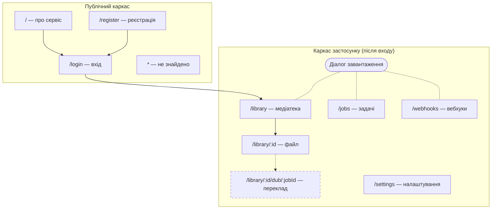
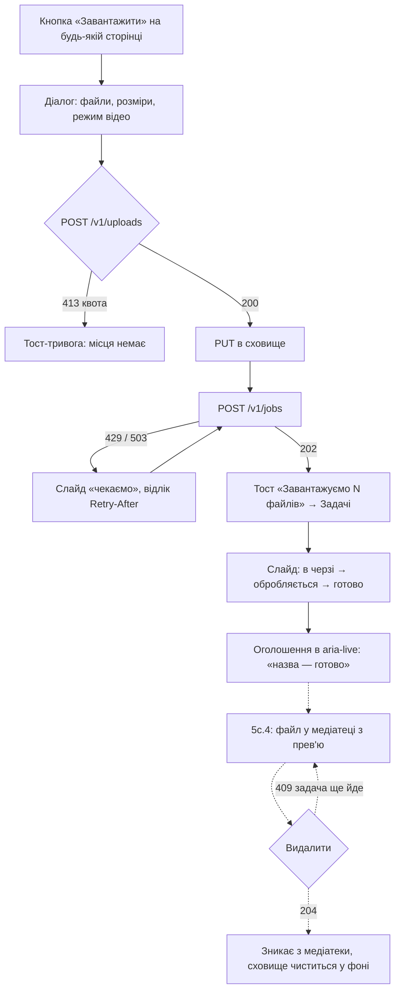
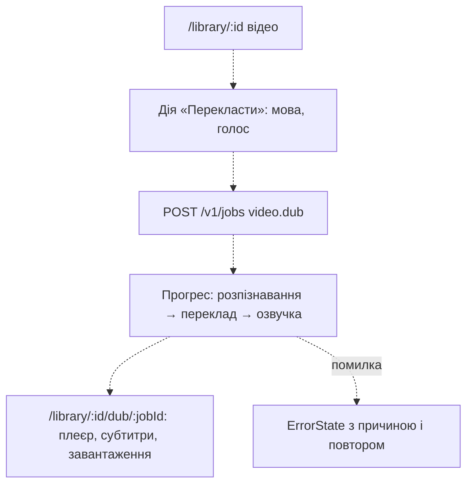

# Інформаційна архітектура і user flows

Документ описує, з яких сторінок складається Web UI після Етапу 5c.3 і як користувач проходить
три головні сценарії. Маршрути 5d позначені пунктиром: їх ще немає в коді, але каркас уже має
для них місце.

## Карта сайту



## Маршрути

| Маршрут                   | Хто бачить  | 5c.3                                  | Далі                                       |
| ------------------------- | ----------- | ------------------------------------- | ------------------------------------------ |
| `/`                       | усі         | опис сервісу, кнопки входу            | 5c.5 — статична сторінка                   |
| `/login`                  | усі         | форма API-ключа, повернення на `next` | 5c.4 — email і пароль                      |
| `/register`               | усі         | пояснення і посилання на вхід         | 5c.4 — форма реєстрації                    |
| `/library`                | після входу | заглушка                              | 5c.4 — сітка файлів, фільтр, курсор        |
| `/library/:id`            | після входу | заглушка                              | 5c.4 — оригінал, результати; 5d — переклад |
| `/library/:id/dub/:jobId` | після входу | —                                     | 5d — перегляд перекладу                    |
| `/jobs`                   | після входу | контактний аркуш задач                | —                                          |
| `/webhooks`               | після входу | адреси і доставки                     | —                                          |
| `/settings`               | після входу | заглушка                              | 5c.4 — API-ключі, профіль                  |
| `*`                       | усі         | «Сторінку не знайдено»                | —                                          |

## Вхід і реєстрація

```mermaid
flowchart TD
  A[Відкрити захищену адресу] --> B{GET /v1/me}
  B -- 200 --> C[Сторінка]
  B -- 401 --> D["/login?next=адреса"]
  B -- інша помилка --> E[ErrorState: спробувати ще]
  D --> F{Спосіб входу}
  F -- API-ключ --> G[Зберегти ключ]
  F -. email і пароль, 5c.4 .-> H[POST /v1/auth/login]
  G --> B2{GET /v1/me}
  H -.-> B2
  B2 -- 200 --> I{next внутрішній?}
  I -- так --> C
  I -- ні --> J["/library"]
  B2 -- 401 --> K[Повідомлення: ключ відхилено] --> D
  R["/register"] -. 5c.4: POST /v1/auth/register .-> B2
```

## Завантаження → обробка → медіатека



## Відео → переклад → перегляд (5d)



## Вайрфрейми

Low-fi, без кольорів і шрифтів стилю: розташування і пріоритети. Ліворуч десктоп 1280 px,
праворуч мобільний 375 px.

### Вхід


### Медіатека


### Сторінка файлу


### Діалог завантаження з вибором дії


### Переклад відео


