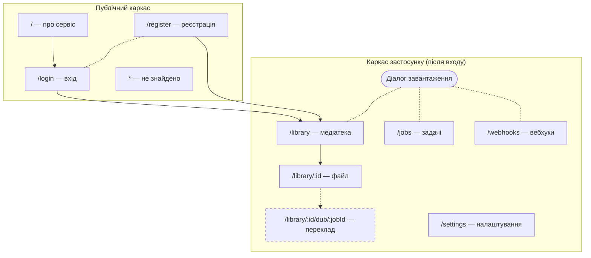
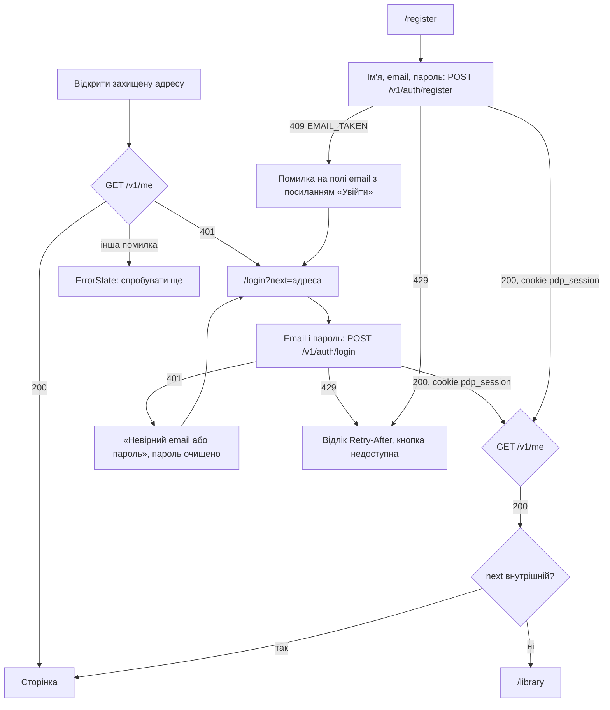
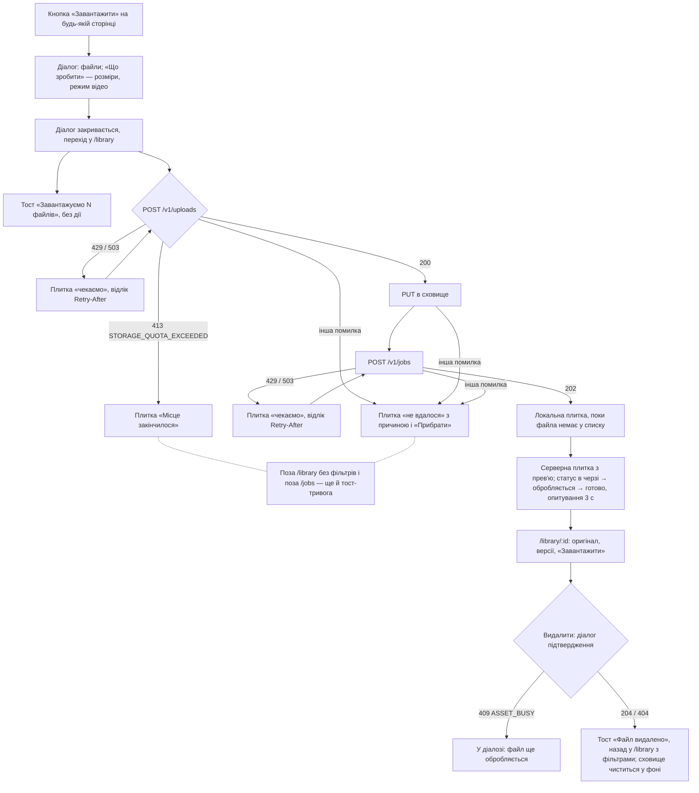
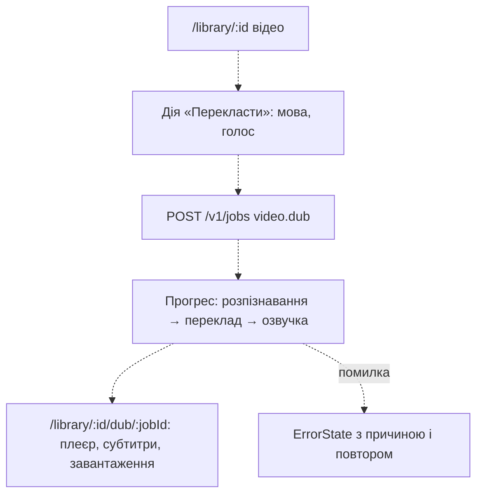
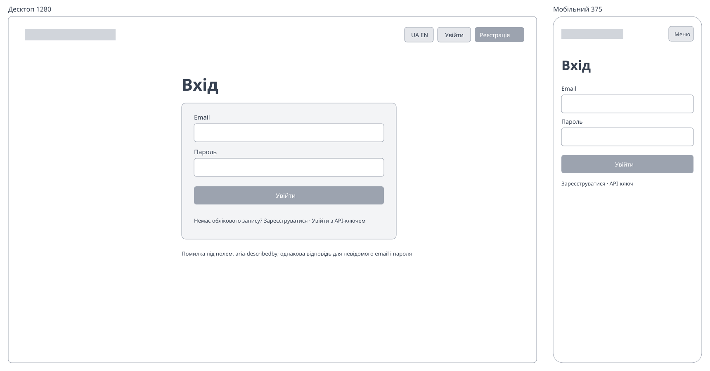
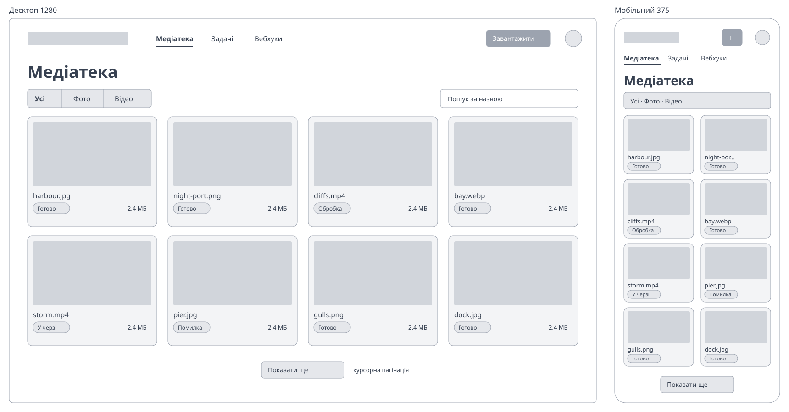
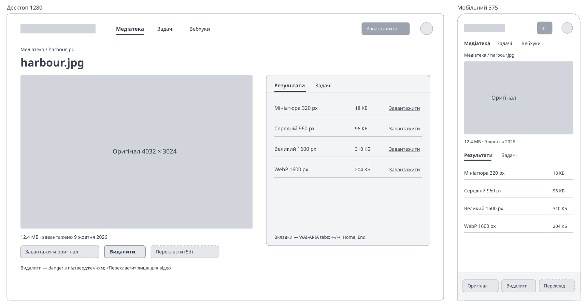
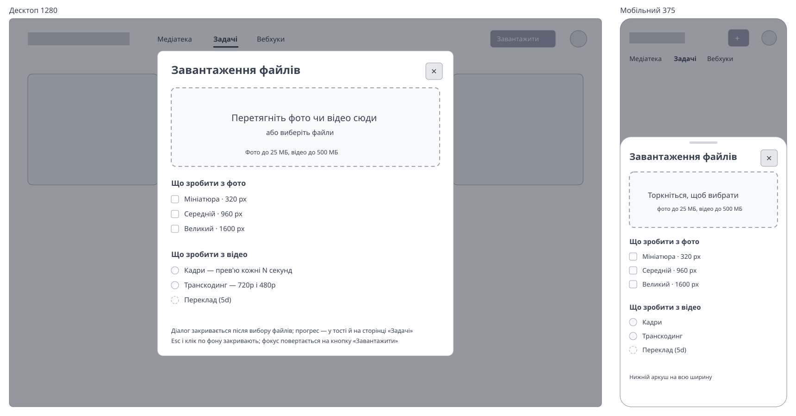
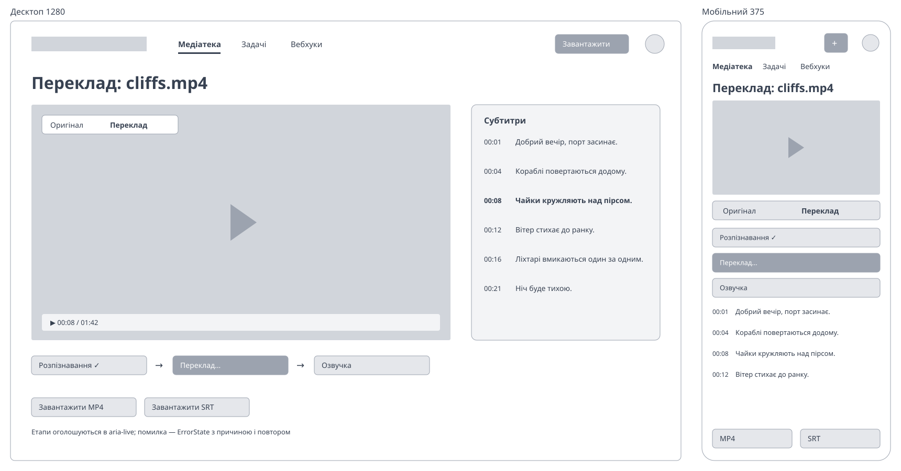

# Інформаційна архітектура і user flows

Документ описує, з яких сторінок складається Web UI після Етапу 5c.4 і як користувач проходить
три головні сценарії. Маршрути 5d позначені пунктиром: їх ще немає в коді, але каркас уже має
для них місце.

## Карта сайту

## Маршрути

| Маршрут                   | Хто бачить  | 5c.4                                                                | Далі                     |
| ------------------------- | ----------- | ------------------------------------------------------------------- | ------------------------ |
| `/`                       | усі         | опис сервісу, кнопки входу                                          | 5c.5 — статична сторінка |
| `/login`                  | усі         | email і пароль, повернення на `next`                                | 5c.5 — пререндер         |
| `/register`               | усі         | ім'я (необов'язкове), email, пароль                                 | 5c.5 — пререндер         |
| `/library`                | після входу | сітка файлів, фільтри `?kind&status&q`, прокрутка, файли в роботі   | —                        |
| `/library/:id`            | після входу | оригінал і плеєр, факти, версії із завантаженням, задачі, видалення | 5d — переклад            |
| `/library/:id/dub/:jobId` | після входу | —                                                                   | 5d — перегляд перекладу  |
| `/jobs`                   | після входу | контактний аркуш задач                                              | —                        |
| `/webhooks`               | після входу | адреси і доставки                                                   | —                        |
| `/settings`               | після входу | профіль, мова, API-ключі                                            | —                        |
| `*`                       | усі         | «Сторінку не знайдено»                                              | —                        |

## Вхід і реєстрація

Перевірка полів — на submit, фокус на першому хибному полі; мережа чи `5xx` — «Не вдалося
зв'язатися з сервером». Той, хто вже увійшов, з `/login` і `/register` одразу йде на `next` або
`/library`. Вихід — меню користувача: `POST /v1/auth/logout`, кеш API і список завантажень
очищуються, перехід на `/login`. Сесія, що сплила посеред роботи: перший `401` поза `/v1/auth/*`
перезапитує `GET /v1/me`, і охорона веде на вхід зі збереженням адреси. Браузер не зберігає
API-ключ; ключі — для скриптів, їх видають у налаштуваннях.

## Завантаження → обробка → медіатека

Локальні плитки (прогрес, відлік, помилка) стоять першими лише в медіатеці без фільтрів: чи
підійде файл під фільтр, ще невідомо. На `/jobs` ті самі завантаження — слайди контактного
аркуша, а зміни статусу оголошує `aria-live` («назва — готово»). Поки DELETE у дорозі, діалог
видалення не закривається ні Esc, ні кліком по фону.

## Сторінка файлу і налаштування

- **`/library/:id`**: хлібні крихти «Медіатека / назва» (повертають фільтри, з якими відкрили
  файл); заголовок — назва; дії «Завантажити оригінал» і «Видалити»; факти — розміри,
  тривалість, вага, тип, дата. Картинка показується цілою, відео — у плеєрі: найкраща готова
  якість, перемикач 720p / 480p, без транскодингу — оригінал, а якщо браузер його не грає, —
  кадр-прев'ю з підказкою. Вкладки «Версії» (мініатюра, назва, розміри, вага, формат,
  «Завантажити»; кадри — стрічкою) і «Задачі» (до 50, статус, спроби, помилка, трейс). Опитування
  3 с, поки задача йде; `404` — «Файл не знайдено» з посиланням у медіатеку.
- **`/settings`**: три картки з `h2` — «Профіль» (ім'я, email, лише читання), «Мова»
  (`LanguageSwitch`), «API-ключі»: список (назва, префікс, створено, востаннє використано,
  «Відкликати» з підтвердженням), форма «Новий ключ» (недоступна на ліміті в 10 ключів) і діалог,
  що показує ключ один раз з «Копіювати» і прикладом `curl`. Після відкликання фокус — на
  заголовку «API-ключі».

## Відео → переклад → перегляд (5d)

## Вайрфрейми

Low-fi, без кольорів і шрифтів стилю: розташування і пріоритети. Ліворуч десктоп 1280 px,
праворуч мобільний 375 px.

### Вхід

### Медіатека

### Сторінка файлу

### Діалог завантаження з вибором дії

### Переклад відео

