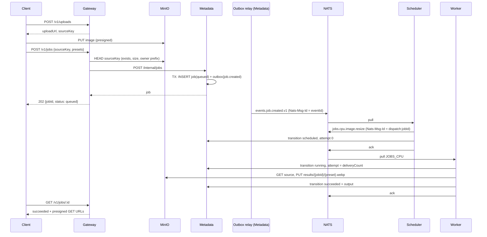

# Етап 1. MVP черг з `image.resize`

- Тижні 3–5: 26 жовтня – 15 листопада 2026
- Статус: план, коду ще немає

## Результат і критерій

**Результат:** користувач завантажує картинку, отримує `jobId`, а через кілька секунд бачить
статус `succeeded` і посилання на готові розміри.

**Готово, коли:**

- наскрізний сценарій проходить у `docker compose` і в інтеграційному тесті;
- статуси видно через API (`GET /v1/jobs/:id`, `GET /v1/jobs?status=`);
- у `job_executions` записується кожна спроба, включно з невдалими й покинутими.

## Прийняті рішення

| Питання                 | Рішення                                                                                                   |
| ----------------------- | --------------------------------------------------------------------------------------------------------- |
| ORM і міграції          | Drizzle (`drizzle-orm` + `drizzle-kit`), SQL-міграції в репозиторії                                       |
| Зміна статусу           | Синхронно через Metadata REST, переходи ідемпотентні за `(jobId, attempt, to)`                            |
| Події                   | Metadata пише `job.created` і `job.status_changed` в outbox у тій самій транзакції, relay публікує в NATS |
| Ack воркера             | Лише після успішної відповіді Metadata; помилка Metadata дає `nak(delay)`                                 |
| Прогрес транскодингу    | Окремий endpoint з тротлінгом, не перехід стану (Етап 5)                                                  |
| Тести                   | Jest (стандарт NestJS), Testcontainers для інтеграції                                                     |
| Валідація публічних DTO | `class-validator` + `@nestjs/swagger`; zod лишається для контрактів шини                                  |

### Відхилення від початкового плану

Outbox у плані стоїть на Етапі 3. Тут він з'являється раніше, бо подія `job.status_changed`
пишеться в одній транзакції зі зміною статусу. Раз таблиця і relay однаково є, `job.created`
теж іде через outbox, і dual write «INSERT, потім publish» не виникає взагалі.

На Етапі 3 лишається посилення outbox: кілька реплік relay під навантаженням, очищення таблиці,
метрики відставання, chaos-тест «вбити Postgres посеред relay». Плюс усе інше з Етапу 3:
`Idempotency-Key`, inbox, класифікація помилок, DLQ.

### Рішення, прийняті під час реалізації

- **`libs/metadata-client`.** Три сервіси викликають той самий internal API, тож типізований
  клієнт (fetch з таймаутом, zod-розбір відповідей, `MetadataError` з `retryable`) живе в окремому
  lib. Що робити з кожним кодом відповіді, вирішує сервіс: таблиця реакцій лишається у воркері та
  scheduler, а не в lib.
- **Один слот семафора на один fetch.** `worker-cpu` і `worker-priority` ділять семафор. Якби
  консюмер резервував усі вільні слоти на час fetch, порожня черга `cpu` блокувала б `priority` до
  `expires`. Тепер кожен консюмер тримає в очікуванні щонайбільше один слот; зайвий round-trip на
  повідомлення для CPU-задач непомітний.
- **`WORKER_ACK_WAIT_MS`** (за замовчуванням 30 с) винесено в env, щоб інтеграційний тест
  повторної доставки не чекав 30 секунд.
- **`class` записується і в переході `running`**, якщо його ще немає: коли воркер випереджає
  scheduler, перехід `scheduled@0` стає no-op і клас інакше загубився б.
- **Unit-покриття мале (~22%), інтеграційне по коду застосунків ~84%.** Сервіси в інтеграційних
  тестах працюють у процесі Jest, тому обидва звіти йдуть у Job Summary.

## Потік задачі

## Модель даних (Metadata, PostgreSQL)

Типи `job_status`, `job_class`, `job_type` як Postgres enum, значення беруться з
`libs/contracts`, щоб не розійшлися.

### `users`

| Колонка          | Тип         | Примітка                                         |
| ---------------- | ----------- | ------------------------------------------------ |
| `id`             | uuid PK     |                                                  |
| `name`           | text        |                                                  |
| `api_key_hash`   | text unique | SHA-256 від ключа; сам ключ ніде не зберігається |
| `api_key_prefix` | text        | перші 8 символів, щоб розпізнати ключ у логах    |
| `created_at`     | timestamptz |                                                  |

### `jobs`

| Колонка                    | Тип              | Примітка                                               |
| -------------------------- | ---------------- | ------------------------------------------------------ |
| `id`                       | uuid PK          | генерує Metadata                                       |
| `user_id`                  | uuid FK users    |                                                        |
| `type`                     | job_type         | `image.resize` на цьому етапі                          |
| `class`                    | job_class null   | заповнює перехід `scheduled`                           |
| `status`                   | job_status       | `queued` при створенні                                 |
| `priority`                 | smallint         | 0–9, за замовчуванням 5                                |
| `input`                    | jsonb            | `{ sourceKey, presets }`, схема в contracts            |
| `output`                   | jsonb null       | `{ results: [{ preset, key, width, height, bytes }] }` |
| `attempts`                 | int              | номер останньої спроби                                 |
| `last_error`               | text null        |                                                        |
| `created_at`, `updated_at` | timestamptz      |                                                        |
| `finished_at`              | timestamptz null | при термінальному статусі                              |

Індекси:

- `(user_id, created_at desc, id desc)` для `GET /jobs` з keyset-пагінацією;
- `(user_id, status, created_at desc, id desc)` для `GET /jobs?status=`;
- `(status) where status in ('queued','scheduled','running')` для операційних запитів
  (застряглі задачі); частковий індекс не росте разом з архівом.

### `job_executions`

Одна строка на спробу.

| Колонка       | Тип              | Примітка                                    |
| ------------- | ---------------- | ------------------------------------------- |
| `id`          | uuid PK          |                                             |
| `job_id`      | uuid FK jobs     |                                             |
| `attempt`     | int              | `msg.info.deliveryCount`                    |
| `worker_id`   | text             | ім'я поду або hostname                      |
| `started_at`  | timestamptz      |                                             |
| `finished_at` | timestamptz null |                                             |
| `outcome`     | enum null        | `succeeded`, `retry`, `failed`, `abandoned` |
| `error`       | text null        |                                             |

Unique `(job_id, attempt)`. `abandoned` ставиться, коли приходить `running` з більшою спробою, а
попередня так і не завершилась (воркер упав без звіту).

### `job_transitions`

Ключ ідемпотентності переходів і повна історія статусів. Таблиці немає в початковому плані:
`audit_log` для цього не годиться, бо там різнорідні дії без унікального ключа.

| Колонка       | Тип         | Примітка                   |
| ------------- | ----------- | -------------------------- |
| `job_id`      | uuid FK     |                            |
| `attempt`     | int         |                            |
| `to_status`   | job_status  |                            |
| `from_status` | job_status  |                            |
| `actor`       | text        | `scheduler`, `worker:<id>` |
| `created_at`  | timestamptz |                            |

PK `(job_id, attempt, to_status)`.

### `audit_log`

`id`, `actor`, `action` (`job.created`, `user.created`, далі `job.redrive`), `entity_id`, `data jsonb`,
`created_at`. Пишеться в тій самій транзакції, що й дія.

### `outbox`

| Колонка        | Тип              | Примітка                         |
| -------------- | ---------------- | -------------------------------- |
| `id`           | uuid PK          | він же `eventId` і `Nats-Msg-Id` |
| `subject`      | text             | `events.job.created.v1`          |
| `payload`      | jsonb            | повний конверт події з contracts |
| `created_at`   | timestamptz      |                                  |
| `published_at` | timestamptz null |                                  |

Частковий індекс `(created_at) where published_at is null`.

## Машина станів

Переходи робить одна функція `transition(jobId, { to, attempt, actor, error?, output? })` в
Metadata. Усе в одній транзакції: `SELECT ... FOR UPDATE` по job, перевірка, `UPDATE jobs`, запис у
`job_transitions`, `job_executions`, `outbox`.

### Дозволені переходи

| З           | В           | Хто       | Коли                                                   |
| ----------- | ----------- | --------- | ------------------------------------------------------ |
| `queued`    | `scheduled` | scheduler | задача опублікована в стрім класу                      |
| `queued`    | `running`   | worker    | воркер узяв задачу раніше, ніж scheduler оновив статус |
| `scheduled` | `running`   | worker    | звичайний старт спроби                                 |
| `running`   | `running`   | worker    | нова спроба (`attempt` більший): попередня покинута    |
| `running`   | `scheduled` | worker    | transient-помилка, буде повтор                         |
| `running`   | `succeeded` | worker    |                                                        |
| `running`   | `failed`    | worker    | permanent-помилка або остання спроба                   |

`dead` з'являється на Етапі 3 разом з DLQ.

### Ідемпотентність і відповіді

| Ситуація                                                 | Відповідь                           | Що робить викликач                   |
| -------------------------------------------------------- | ----------------------------------- | ------------------------------------ |
| Перехід застосовано                                      | `200 { applied: true, job }`        | продовжує                            |
| `(jobId, attempt, to)` уже є в `job_transitions`         | `200 { applied: false, job }`       | продовжує як після успіху            |
| `scheduled`, а job уже далі (`running` або термінальний) | `200 { applied: false }`            | scheduler робить ack                 |
| `succeeded` від старої спроби, job ще не термінальний    | застосовується: перший успіх виграє | worker робить ack                    |
| Job уже термінальний, прийшов `running`                  | `409 JOB_TERMINAL`                  | worker робить ack **без обробки**    |
| `running` або `failed` від старої спроби                 | `409 STALE_ATTEMPT`                 | worker робить ack, результат не пише |
| Перехід не з таблиці                                     | `409 INVALID_TRANSITION`            | worker робить `term()`, лог error    |
| Metadata недоступний, 5xx, таймаут                       |                                     | `nak(delay)`                         |

Рядок `JOB_TERMINAL` закриває сценарій зі спайку E2: ack загубився, повідомлення прийшло знову,
а задача вже `succeeded`. Воркер дізнається про це до ресайзу і не робить зайвої роботи.

Рядок «перший успіх виграє» закриває сценарій E4: дві копії працюють паралельно, обидві
закінчують. Результати детерміновані (`results/{jobId}/{preset}.webp`), тож неважливо, чия спроба
записана.

## Топологія NATS

`libs/messaging` отримує ідемпотентні `ensureStream` і `ensureConsumer`. Кожен сервіс оголошує на
старті те, що публікує або споживає.

| Стрім           | Subjects          | Retention                | Інше                    |
| --------------- | ----------------- | ------------------------ | ----------------------- |
| `EVENTS`        | `events.>`        | Limits, `max_age` 7 днів | `duplicate_window` 2 хв |
| `JOBS_CPU`      | `jobs.cpu.>`      | WorkQueue                | `duplicate_window` 2 хв |
| `JOBS_IO`       | `jobs.io.>`       | WorkQueue                | порожній до вебхуків    |
| `JOBS_PRIORITY` | `jobs.priority.>` | WorkQueue                |                         |

Чому `EVENTS` окремо з Limits: WorkQueue дозволяє лише одного споживача на subject, а
`job.status_changed` пізніше читатимуть і вебхуки, і audit.

| Консюмер          | Стрім           | Filter                  | `AckWait` | `MaxDeliver` | `MaxAckPending`   |
| ----------------- | --------------- | ----------------------- | --------- | ------------ | ----------------- |
| `scheduler`       | `EVENTS`        | `events.job.created.v1` | 30 с      | 10           | 100               |
| `worker-cpu`      | `JOBS_CPU`      | `jobs.cpu.>`            | 30 с      | 3            | `2 × concurrency` |
| `worker-priority` | `JOBS_PRIORITY` | `jobs.priority.>`       | 30 с      | 3            | `2 × concurrency` |

Усі pull, `AckPolicy.Explicit`. Воркер шле `msg.working()` кожні `AckWait / 3`, навіть для
картинок: великий файл на завантаженому CPU може перевищити `AckWait` (спайк E4).

### Нові контракти в `libs/contracts`

- `ImageResizeInputV1`: `{ sourceKey, presets: ('thumb'|'medium'|'large')[] }`.
- `JobDispatchV1`: повідомлення в `JOBS_*`: `{ jobId, type, class, input }`. Це команда, не подія,
  тому живе в `jobs.*`, а не в `events.*`.
- `ImageResizeOutputV1`: `{ results: [{ preset, key, width, height, bytes }] }`.
- Коди помилок Metadata API (`JOB_TERMINAL`, `STALE_ATTEMPT`, `INVALID_TRANSITION`) як спільні
  константи, щоб воркер і scheduler не порівнювали рядки навмання.

### Вибір класу

Чиста функція `selectClass(job)` у scheduler, покрита unit-тестами:

- `priority >= 8` → `priority`;
- `image.resize`, `video.*` → `cpu`;
- `webhook.deliver` → `io` (з'явиться на Етапі 3).

## API

### Публічний (Gateway, `/v1`, заголовок `X-API-Key`)

| Метод  | Шлях           | Що робить                                                                |
| ------ | -------------- | ------------------------------------------------------------------------ |
| `POST` | `/v1/uploads`  | `{ contentType, size }` → `{ uploadUrl, sourceKey, expiresAt }`          |
| `POST` | `/v1/jobs`     | `{ type: "image.resize", sourceKey, presets }` → `202 { jobId, status }` |
| `GET`  | `/v1/jobs/:id` | job, для `succeeded` з presigned GET URL на кожен результат              |
| `GET`  | `/v1/jobs`     | `?status=&limit=&cursor=`, keyset-пагінація                              |

Swagger на `/docs`.

- Upload: дозволені `image/jpeg`, `image/png`, `image/webp`; до 20 МБ; ключ
  `uploads/{userId}/{uuid}`; URL живе 10 хв.
- `POST /v1/jobs` перевіряє, що `sourceKey` починається з `uploads/{userId}/` (чужі файли
  недоступні), і робить `HEAD` в S3: об'єкт існує, розмір у межах ліміту.
- Чужий або неіснуючий job дає `404`, а не `403`, щоб не розкривати існування id.

### Внутрішній (Metadata, `/internal`, без auth, лише в мережі compose і кластера)

| Метод  | Шлях                             | Хто викликає                                   |
| ------ | -------------------------------- | ---------------------------------------------- |
| `POST` | `/internal/auth/resolve`         | Gateway: `{ apiKeyHash }` → `{ userId }`       |
| `POST` | `/internal/jobs`                 | Gateway                                        |
| `GET`  | `/internal/jobs/:id`             | Gateway, worker                                |
| `GET`  | `/internal/jobs`                 | Gateway: `userId`, `status`, `cursor`, `limit` |
| `POST` | `/internal/jobs/:id/transitions` | Scheduler, worker                              |

Gateway кешує результат `auth/resolve` в пам'яті на 60 с. Rate limiting через Redis буде на Етапі 2.

## Worker `image.resize`

1. Отримати повідомлення, розпарсити `JobDispatchV1` (невалідне → `term()`).
2. `transition running`, `attempt = msg.info.deliveryCount`. Обробити відповідь за таблицею вище.
3. `HEAD` + `GET` оригіналу з S3; відмовити, якщо файл більший за ліміт.
4. sharp: `failOn: 'error'`, `limitInputPixels` (наприклад, 50 МП), `.rotate()` за EXIF,
   `resize({ width, withoutEnlargement: true })`, `.webp({ quality: 80 })`.
5. `PUT results/{jobId}/{preset}.webp` для кожного пресету.
6. `transition succeeded` з output, потім `ack`.

Помилки на цьому етапі:

- битий або завеликий файл: `transition failed`, `ack`;
- помилка S3 або sharp, не остання спроба: `transition scheduled` (retry), `nak(2s × attempt)`;
- остання спроба: `transition failed`, `ack`.

Повна класифікація transient і permanent, full jitter і DLQ — на Етапі 3.

Concurrency: семафор на `WORKER_CONCURRENCY` (за замовчуванням кількість ядер), `sharp.concurrency(1)`,
щоб libvips не множив потоки поверх нашого паралелізму.

## Конфіг і інфраструктура

Нові змінні в `libs/config`:

| Змінна                           | Сервіс                     | Навіщо                                                                                         |
| -------------------------------- | -------------------------- | ---------------------------------------------------------------------------------------------- |
| `S3_PUBLIC_ENDPOINT`             | gateway                    | presigned URL підписується з хостом, який бачить клієнт (`localhost:59000`), а не `minio:9000` |
| `METADATA_URL`                   | gateway, scheduler, worker | уже є в gateway                                                                                |
| `METADATA_TIMEOUT_MS`            | gateway, scheduler, worker | за замовчуванням 2000                                                                          |
| `WORKER_CONCURRENCY`             | worker                     |                                                                                                |
| `MAX_UPLOAD_BYTES`               | gateway, worker            | 20 МБ                                                                                          |
| `OUTBOX_POLL_MS`, `OUTBOX_BATCH` | metadata                   | 200 мс, 100                                                                                    |

`docker-compose.yml`:

- сервіс `metadata-migrate`: `node dist/migrate.js`, `restart: no`; `metadata` чекає його
  `service_completed_successfully`. Це той самий підхід, що на Етапі 5 стане Helm pre-install hook;
- S3 і NATS додаються до залежностей scheduler і gateway.

Сід користувача: `pnpm --filter @pdp/metadata seed:user --name dev` створює користувача і один раз
друкує API-ключ.

## Тести

**Unit (Jest), покриття звітом у CI без порогу:**

- машина станів: кожен рядок обох таблиць вище;
- `selectClass`;
- розбір відповіді Metadata у воркері (що робити з 200, 409 і кожним кодом, 5xx);
- обчислення пресетів і ключів результатів;
- хешування і перевірка API-ключа.

**Інтеграційні (Jest + Testcontainers: Postgres, NATS, MinIO):**

- `transition` на справжньому Postgres: паралельні виклики одного переходу дають рівно один
  `applied: true`;
- outbox: після `POST /internal/jobs` подія з'являється в `EVENTS` рівно один раз;
- наскрізний: усі чотири сервіси піднімаються в процесі тесту (Nest testing module) поверх
  контейнерів, `POST /v1/uploads` → PUT → `POST /v1/jobs` → очікування `succeeded` → три об'єкти
  в S3, три строки в `job_transitions` до `succeeded`, одна в `job_executions`;
- повторна доставка: воркер не робить ack першого повідомлення, після `AckWait` друга спроба
  отримує `JOB_TERMINAL` або доводить задачу до кінця; у `job_executions` дві строки.

Сервіси в процесі тесту, а не в контейнерах: швидше, і покриття рахується.

CI: окремий джоб `test` з Docker (Testcontainers на `ubuntu-latest` працює без налаштувань),
coverage-звіт у Job Summary і як артефакт.

## Задачі

### Тиждень 1 (26.10–01.11): Metadata

- [x] Drizzle: схема всіх таблиць, `drizzle-kit generate`, перша міграція, `migrate.ts`
- [x] `metadata-migrate` у compose
- [x] Сід користувача з API-ключем
- [x] Машина станів як чиста функція `decide(job, request) → Decision` + unit-тести на кожен рядок
- [x] `transition()` у транзакції з `job_transitions`, `job_executions`, `outbox`, `audit_log`
- [x] Internal REST: створити job, отримати, список з keyset-пагінацією, transitions, auth/resolve
- [x] Outbox relay: цикл з `FOR UPDATE SKIP LOCKED`, publish з `Nats-Msg-Id`, graceful stop
- [x] Інтеграційний тест `transition` на паралельних викликах

**Готово, коли** `curl` на `/internal/jobs` створює job, а подія видна в `EVENTS` через
`nats stream view`.

### Тиждень 2 (02.11–08.11): шина, Gateway, Scheduler

- [x] `libs/messaging`: `ensureStream`, `ensureConsumer`, типізований publish з `Nats-Msg-Id`,
      pull-consume з heartbeat і graceful stop
- [x] `libs/contracts`: `JobDispatchV1`, `ImageResizeInputV1`, `ImageResizeOutputV1`, коди помилок
- [x] HTTP-клієнт до Metadata зі спільним таймаутом і розбором кодів (у `libs/contracts` типи,
      клієнт у кожному сервісі або в окремому lib)
- [x] Gateway: guard `X-API-Key`, `POST /v1/uploads`, `POST /v1/jobs`, `GET /v1/jobs/:id`,
      `GET /v1/jobs`, Swagger
- [x] Scheduler: консюмер `job.created`, `selectClass` з unit-тестами, publish, `transition scheduled`

**Готово, коли** після `POST /v1/jobs` задача стає `scheduled`, а повідомлення лежить у `JOBS_CPU`.

### Тиждень 3 (09.11–15.11): Worker і наскрізний сценарій

- [x] Worker: консюмер `JOBS_CPU` і `JOBS_PRIORITY`, семафор concurrency, heartbeat
- [x] sharp-пайплайн з лімітами, запис результатів, `transition succeeded/failed/scheduled`
- [x] Обробка відповідей Metadata за таблицею, unit-тести на неї
- [x] Presigned GET URL у `GET /v1/jobs/:id`
- [x] Наскрізний інтеграційний тест і тест повторної доставки
- [x] CI: джоб `test`, coverage у Summary
- [x] Скрипт `scripts/e2e-smoke.sh`: завантажити картинку через API, дочекатися `succeeded`,
      скачати результати
- [x] Ручна перевірка: `docker compose kill worker` посеред обробки, задача доходить до `succeeded`

**Готово, коли** виконано критерій етапу на початку документа.

## Ризики й відкриті питання

- **Обсяг.** Outbox і ідемпотентні переходи додають роботи, якої не було в початковому плані
  етапу. Якщо тиждень 1 не вкладається, relay спершу робиться найпростішим (одна репліка, без
  `SKIP LOCKED`), а посилення переїжджає на Етап 3, як і планувалось.
- **Metadata як вузьке місце.** Кожна спроба дає два синхронні виклики Metadata. На 2.8 jobs/с це
  дрібниця, але на Етапі 8 треба виміряти. Відповідь на захисті: переходи дешеві (один рядок під
  `FOR UPDATE`), Metadata скейлиться горизонтально, бо стан у Postgres.
- **Metadata недоступний.** Задачі не губляться: воркер робить `nak`, повідомлення чекає в стрімі.
  Але `MaxDeliver: 3` вичерпається за хвилину простою. Варіанти: не рахувати спроби, коли Metadata
  недоступний (`nak` до старту обробки не має збільшувати `attempt` у БД, а лічильник NATS
  збільшиться все одно), або більший `MaxDeliver` з backoff. Рішення в ADR-007 на Етапі 3.
- **Де живе HTTP-клієнт Metadata.** Вирішено: `libs/metadata-client` (див. «Рішення, прийняті під
  час реалізації»).
- **Presigned PUT не обмежує розмір.** Клієнт може залити більше, ніж оголосив. Це ловить `HEAD` у
  `POST /v1/jobs` і повторно воркер. Альтернатива — presigned POST з `content-length-range`.

## Що свідомо не робимо на цьому етапі

- Rate limiting і backpressure (Етап 2).
- `Idempotency-Key` у `POST /v1/jobs`, inbox, DLQ, класифікація помилок, full jitter (Етап 3).
- Вебхуки, `video.*`, завантаження за URL (Етапи 3 і 5).
- Трейсинг і метрики (Етап 4), хоча `jobId` у кожному рядку логу варто писати вже зараз.
- AVIF: лише WebP, AVIF як опційний пресет пізніше.
