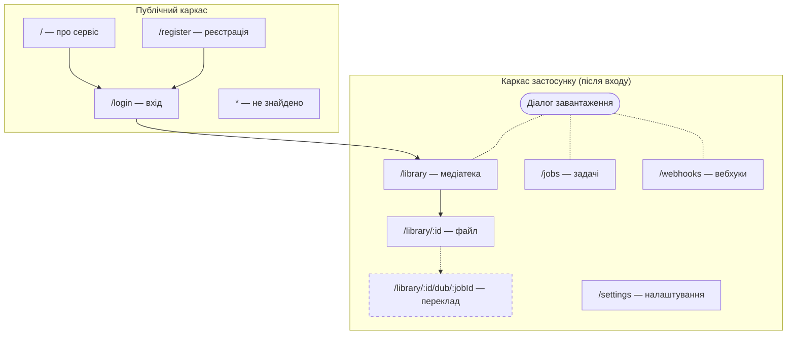
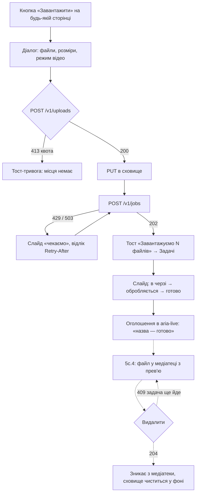
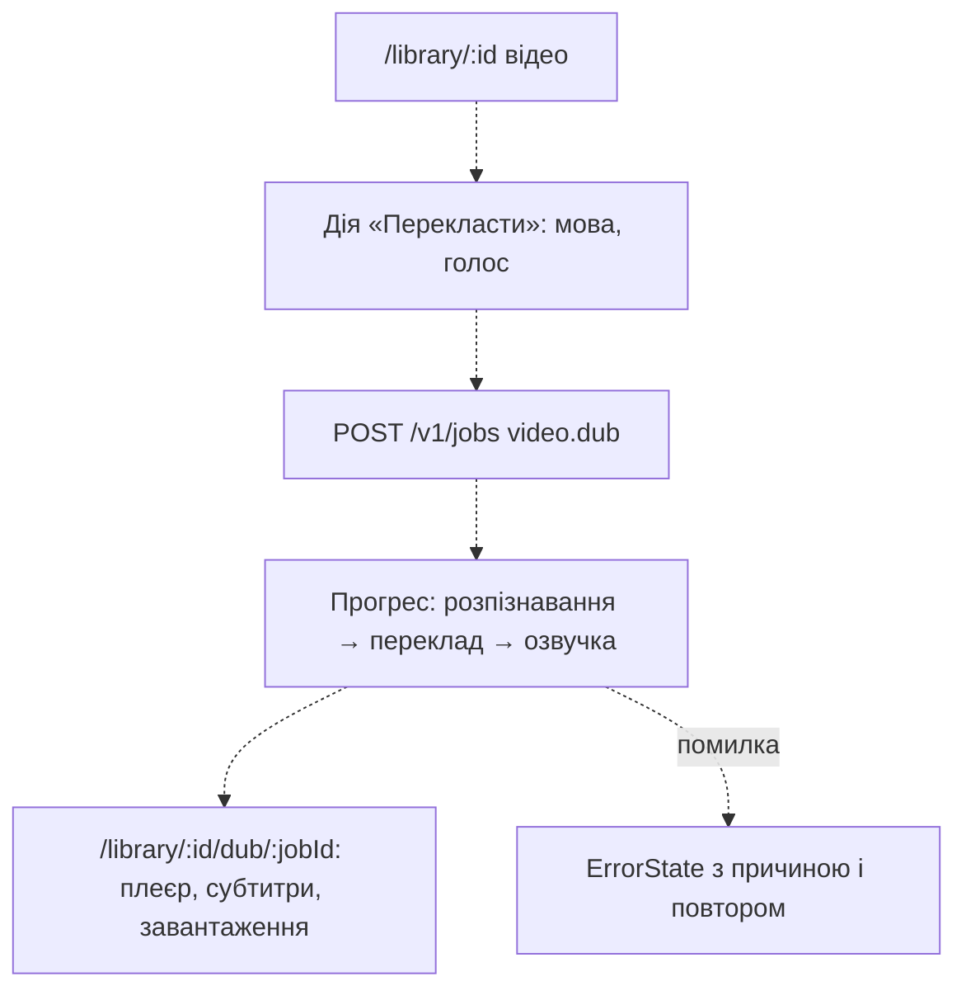

# Етап 5c.3. Каркас UI і дизайн-система — план реалізації

> **For agentic workers:** REQUIRED SUB-SKILL: Use superpowers:subagent-driven-development (recommended) or superpowers:executing-plans to implement this plan task-by-task. Steps use checkbox (`- [x]`) syntax for tracking.

**Goal:** перетворити односторінковий `WorkspacePage` на застосунок із маршрутами, каркасом,
охороною входу й дизайн-системою, не втративши жодного наявного сценарію.

**Architecture:** react-router 8 у data mode (`createBrowserRouter`, route objects, `lazy`);
корінь маршрутів тримає тости, `PublicLayout` і `AppLayout` (під `RequireAuth` на `GET /v1/me`)
дають каркаси; примітиви в `shared/ui/<name>/` поверх нативних елементів; сторінки в `pages/`.

**Tech Stack:** React 19, Redux Toolkit / RTK Query, react-router 8, i18next, CSS Modules,
Vitest + Testing Library + MSW, Vite 8.

Специфікація: [2026-10-14-stage-5c3-ui-shell-design.md](../specs/2026-10-14-stage-5c3-ui-shell-design.md).

## Global Constraints

- Робоча тека для команд: `apps/web` (якщо не сказано інше). Тести: `pnpm test` (Vitest).
- Strict TypeScript, `noUncheckedIndexedAccess: true`; без `any`, `as`-приведень, `@ts-ignore`, `!`.
- Без default exports (сторінки теж експортуються іменовано).
- Напрям імпортів: `app → pages → features → shared`; фічі не імпортують одна одну.
- Кожен видимий рядок — через `t()`, ключі в `en` і `uk` (українські плюралі: `_one`, `_few`, `_many`, `_other`).
- Примітиви `shared/ui` без мережі й доменних знань; приймають пропси нативного елемента.
- Lint: `eslint-plugin-react-hooks` 7 (`refs`, `set-state-in-effect`, `set-state-in-render`, `purity`):
  не читати `ref.current` під час рендеру, не викликати власний `setState` синхронно в ефекті.
- Колір ніколи не єдиний носій сенсу; текст ≥ 4.5:1, межі контролів і фокус ≥ 3:1.
- Ціль натискання ≥ 24×24 px; `prefers-reduced-motion` вимикає анімації.
- Назва застосунку в `document.title`: `PDP Media Pipeline`.
- Коміти: Conventional Commits з префіксом `feat(stage-5c.3):` / `docs(stage-5c.3):` /
  `refactor(stage-5c.3):`, трейлер `Co-authored-by: Cursor <cursoragent@cursor.com>`.
- `react-router@^8` уже доданий у `apps/web/package.json` і `pnpm-lock.yaml` (комітиться в Task 9).

## Карта файлів

```
apps/web/src/
  main.tsx                                  M  RouterProvider замість <App/>
  app/
    App.tsx, App.test.tsx                   D  (тести розходяться по файлах нижче)
    Providers.tsx                           M  без змін API; тости переїжджають у корінь маршрутів
    i18n.ts                                 M  + namespace shell
    store.ts                                M  401 → інвалідація Me
    router.tsx                              C  дерево маршрутів
    auth-flow.test.tsx                      C  вхід, next, 404, вихід, меню
    layouts/
      AppRoot.tsx                           C  ToastProvider + Outlet
      RouteFallback.tsx, RouteError.tsx     C  HydrateFallback і ErrorBoundary кореня
      PublicLayout.tsx (+ .module.css)      C
      AppLayout.tsx (+ .module.css)         C
      RequireAuth.tsx                       C
      UserMenu.tsx (+ .module.css)          C
      LanguageSwitch.tsx (+ .module.css)    C  (переїзд з pages/workspace/ui)
      use-upload-failure-toasts.ts          C
  features/
    session/                                C  api/session-api.ts, model/types.ts, index.ts
    upload/ui/UploadDialog.tsx              C
    upload/ui/UploadDialogProvider.tsx      C
    upload/model/open-upload-context.ts     C
    upload/ui/UploadPanel.tsx               M  onSubmitted, примітиви вибору
    api-key/ui/ApiKeyForm.tsx               M  без h1, Field/Input/Button
    jobs/ui/RedriveButton.tsx               M  Button
    jobs/model/use-live-jobs.ts             M  retryAfterOf → shared/api
    webhooks/ui/*.tsx                       M  кнопки → Button
  pages/
    workspace/                              D
    landing/ login/ register/ library/ asset/ settings/ not-found/   C
    jobs/                                   C  JobsPage, JobAnnouncer, переїзд ContactSheet і моделі
    webhooks/                               C  WebhooksPage
  shared/
    api/base-api.ts                         M  тег Me
    api/http.ts                             M  retryAfterOf, isUnauthorized
    lib/cx.ts, lib/return-to.ts             C
    ui/tokens.css, ui/tokens.test.ts        C
    ui/tone.ts                              C
    ui/button/ field/ select/ choice/ card/ badge/ progress/ skeleton/ state/
       dialog/ toast/ tabs/ visually-hidden/ page-heading/                 C
    ui/button.module.css                    D  (Task 14)
  test/
    fixtures.ts                             C  TEST_API_KEY, TEST_ME
    server.ts, setup.ts, render-app.tsx     M
  locales/{en,uk}/shell.json                C
docs/design/                                C  information-architecture.md, design-system.md, wireframes/*.svg
```

---

### Task 1: Токени і перевірка контрасту

**Files:**

- Create: `apps/web/src/shared/ui/tokens.css`
- Create: `apps/web/src/test/contrast.ts`
- Create: `apps/web/src/shared/ui/tokens.test.ts`
- Modify: `apps/web/src/app/global.css` (прибрати блок `:root`)
- Modify: `apps/web/src/main.tsx` (імпорт токенів)

**Interfaces:**

- Produces: CSS-змінні `--tone-{neutral,progress,success,warning,danger}` і `-wash`, `--rule-control`,
  `--text-lg`, `--weight-{regular,medium,semibold,bold,display}`, `--radius-pill`, `--shadow-overlay`,
  `--z-{header,overlay,toast}`, `--motion-{fast,slow}`; `contrastRatio(a, b): number` (лише тести).

- [x] **Step 1: Тест контрасту (падає, бо `tokens.css` ще немає)**

`apps/web/src/test/contrast.ts`:

```ts
const channel = (hex: string, offset: number): number => {
  const value = Number.parseInt(hex.slice(offset, offset + 2), 16) / 255;
  return value <= 0.039_28 ? value / 12.92 : ((value + 0.055) / 1.055) ** 2.4;
};

/** Relative luminance of a `#rrggbb` colour, as WCAG 2.2 defines it. */
export function luminance(hex: string): number {
  if (!/^#[0-9a-f]{6}$/i.test(hex)) throw new Error(`expected #rrggbb, got ${hex}`);
  return 0.2126 * channel(hex, 1) + 0.7152 * channel(hex, 3) + 0.0722 * channel(hex, 5);
}

export function contrastRatio(a: string, b: string): number {
  const la = luminance(a);
  const lb = luminance(b);
  return (Math.max(la, lb) + 0.05) / (Math.min(la, lb) + 0.05);
}

/** `--name: value;` pairs of a stylesheet, with one level of `var(--x)` resolved. */
export function readTokens(css: string): Map<string, string> {
  const raw = new Map<string, string>();
  for (const [, name, value] of css.matchAll(/--([a-z0-9-]+):\s*([^;]+);/g)) {
    if (name && value && !raw.has(name)) raw.set(name, value.trim());
  }
  const resolved = new Map<string, string>();
  for (const [name, value] of raw) {
    const ref = /^var\(--([a-z0-9-]+)\)$/.exec(value)?.[1];
    resolved.set(name, ref ? (raw.get(ref) ?? value) : value);
  }
  return resolved;
}
```

`apps/web/src/shared/ui/tokens.test.ts`:

```ts
import { contrastRatio, readTokens } from '../../test/contrast';
import css from './tokens.css?raw';

const tokens = readTokens(css);
const color = (name: string): string => {
  const value = tokens.get(name);
  if (!value) throw new Error(`--${name} is not defined`);
  return value;
};

const TONES = ['neutral', 'progress', 'success', 'warning', 'danger'] as const;

/** Text on its background: WCAG 2.2 AA, 4.5:1. */
const TEXT_PAIRS: [string, string][] = [
  ['ink', 'table'],
  ['ink', 'mount'],
  ['graphite', 'table'],
  ['graphite', 'mount'],
  ['mount', 'ink'],
  ['red', 'mount'],
  ...TONES.flatMap((tone): [string, string][] => [
    [`tone-${tone}`, `tone-${tone}-wash`],
    [`tone-${tone}`, 'mount'],
    [`tone-${tone}`, 'table'],
  ]),
];

/** Control borders, focus ring and state marks: 3:1. */
const NON_TEXT_PAIRS: [string, string][] = [
  ['rule-control', 'table'],
  ['rule-control', 'mount'],
  ['focus', 'table'],
  ['focus', 'mount'],
  ['amber', 'mount'],
  ['green', 'mount'],
  ['red', 'mount'],
];

describe('design tokens', () => {
  it.each(TEXT_PAIRS)('--%s on --%s is readable text', (fg, bg) => {
    expect(contrastRatio(color(fg), color(bg))).toBeGreaterThanOrEqual(4.5);
  });

  it.each(NON_TEXT_PAIRS)('--%s on --%s stands out as a mark', (fg, bg) => {
    expect(contrastRatio(color(fg), color(bg))).toBeGreaterThanOrEqual(3);
  });

  it('computes contrast like WCAG', () => {
    expect(contrastRatio('#000000', '#ffffff')).toBeCloseTo(21, 5);
    expect(contrastRatio('#56636f', '#fdfcf8')).toBeCloseTo(6.0, 1);
  });
});
```

- [x] **Step 2: Запустити, переконатися що падає**

Run: `pnpm test src/shared/ui/tokens.test.ts`
Expected: FAIL — `Failed to resolve import "./tokens.css?raw"`.

- [x] **Step 3: `tokens.css`, `global.css`, `main.tsx`**

`apps/web/src/shared/ui/tokens.css`:

```css
/*
 * Light table: a cool, evenly lit work surface; slides sit on it as warm card
 * stock. Colour is reserved for state. tokens.test.ts checks the pairs used for
 * text (4.5:1) and for marks and control borders (3:1).
 */
:root {
  --table: #dce3e8;
  --table-lit: #e9eef1;
  --glow: #f6f8fa;
  --mount: #fdfcf8;
  --film: #c9d1d8;
  --ink: #1b2530;
  --graphite: #56636f;
  --rule: #cfd6dc;
  --rule-strong: #a9b4bd;
  /* A border that alone shows where a control is. */
  --rule-control: #6f7c88;
  --amber: #b06a00;
  --green: #2a7550;
  --red: #ad3528;
  --focus: #2f6fd0;

  /* State tones: text and the wash behind it. */
  --tone-neutral: var(--graphite);
  --tone-neutral-wash: var(--table-lit);
  --tone-progress: #2f5fa8;
  --tone-progress-wash: #e2ebf7;
  --tone-success: #236a47;
  --tone-success-wash: #e1efe6;
  --tone-warning: #8a5300;
  --tone-warning-wash: #f6ead3;
  --tone-danger: var(--red);
  --tone-danger-wash: #f7e1dd;

  --space-1: 0.25rem;
  --space-2: 0.5rem;
  --space-3: 0.75rem;
  --space-4: 1rem;
  --space-5: 1.5rem;
  --space-6: 2rem;
  --space-7: 3rem;
  --space-8: 4.5rem;

  /* Modular scale, ratio 1.25 */
  --text-sm: 0.8rem;
  --text-base: 1rem;
  --text-lg: 1.25rem;
  --text-xl: 1.5625rem;
  --text-2xl: 1.953rem;
  --text-3xl: clamp(2.2rem, 5vw, 3.815rem);

  --weight-regular: 400;
  --weight-medium: 550;
  --weight-semibold: 650;
  --weight-bold: 720;
  --weight-display: 800;

  --radius-mount: 10px;
  --radius-window: 3px;
  --radius-control: 6px;
  --radius-pill: 999px;
  --shadow-mount: 0 1px 0 rgb(27 37 48 / 0.06), 0 6px 14px -8px rgb(27 37 48 / 0.35);
  --shadow-overlay: 0 2px 4px rgb(27 37 48 / 0.08), 0 18px 40px -12px rgb(27 37 48 / 0.45);

  --z-header: 10;
  --z-overlay: 100;
  --z-toast: 200;

  --motion-fast: 120ms;
  --motion-slow: 320ms;

  color-scheme: light;
}

@media (prefers-reduced-motion: reduce) {
  :root {
    --motion-fast: 0ms;
    --motion-slow: 0ms;
  }
}
```

`apps/web/src/app/global.css` — видалити весь блок `:root { … }` разом із коментарем над ним
(рядки 1–42); решта файлу (`*`, `html`, `body`, `:focus-visible`, `img`) лишається.

`apps/web/src/main.tsx` — перед `import './app/global.css';` додати рядок:

```ts
import './shared/ui/tokens.css';
```

- [x] **Step 4: Тест проходить**

Run: `pnpm test src/shared/ui/tokens.test.ts`
Expected: PASS (усі пари). Якщо `?raw` не резолвиться через `css: false` у `vite.config.ts`,
замінити імпорт на `import css from './tokens.css?inline';` — і перезапустити.

- [x] **Step 5: Commit**

```bash
git add apps/web/src/shared/ui/tokens.css apps/web/src/shared/ui/tokens.test.ts apps/web/src/test/contrast.ts apps/web/src/app/global.css apps/web/src/main.tsx
git commit -m "feat(stage-5c.3): design tokens with a WCAG contrast check

Co-authored-by: Cursor <cursoragent@cursor.com>"
```

---

### Task 2: `cx`, `Button`, `VisuallyHidden`

**Files:**

- Create: `apps/web/src/shared/lib/cx.ts`, `apps/web/src/shared/lib/cx.test.ts`
- Create: `apps/web/src/shared/ui/button/Button.tsx`, `Button.module.css`, `Button.test.tsx`
- Create: `apps/web/src/shared/ui/visually-hidden/VisuallyHidden.tsx`, `VisuallyHidden.module.css`

**Interfaces:**

- Produces: `cx(...classes: (string | false | null | undefined)[]): string`;
  `Button(props: ButtonProps)`, `ButtonProps = ComponentProps<'button'> & { variant?: ButtonVariant; size?: ButtonSize; isBusy?: boolean }`,
  `ButtonVariant = 'primary' | 'secondary' | 'quiet' | 'danger'`, `ButtonSize = 'md' | 'sm'`,
  `buttonClass(look?: { variant?: ButtonVariant; size?: ButtonSize }, extra?: string): string`;
  `VisuallyHidden({ children }: { children: ReactNode })`.

- [x] **Step 1: Тести**

`apps/web/src/shared/lib/cx.test.ts`:

```ts
import { cx } from './cx';

it('joins the class names that are set', () => {
  expect(cx('a', false, null, undefined, '', 'b')).toBe('a b');
});
```

`apps/web/src/shared/ui/button/Button.test.tsx`:

```tsx
import { render, screen } from '@testing-library/react';
import userEvent from '@testing-library/user-event';
import { Button } from './Button';

describe('Button', () => {
  it('does not submit the surrounding form unless asked to', async () => {
    const onSubmit = vi.fn();
    render(
      <form
        onSubmit={(event) => {
          event.preventDefault();
          onSubmit();
        }}
      >
        <Button>Plain</Button>
        <Button type="submit">Send</Button>
      </form>,
    );
    await userEvent.click(screen.getByRole('button', { name: 'Plain' }));
    expect(onSubmit).not.toHaveBeenCalled();
    await userEvent.click(screen.getByRole('button', { name: 'Send' }));
    expect(onSubmit).toHaveBeenCalledOnce();
  });

  it('ignores clicks while busy but stays focusable', async () => {
    const onClick = vi.fn();
    render(
      <Button isBusy onClick={onClick}>
        Save
      </Button>,
    );
    const button = screen.getByRole('button', { name: 'Save' });
    expect(button).toHaveAttribute('aria-busy', 'true');
    expect(button).toHaveAttribute('aria-disabled', 'true');
    await userEvent.click(button);
    expect(onClick).not.toHaveBeenCalled();
    await userEvent.tab();
    expect(button).toHaveFocus();
  });

  it('passes native props through', () => {
    render(<Button aria-label="Close dialog" disabled />);
    expect(screen.getByRole('button', { name: 'Close dialog' })).toBeDisabled();
  });
});
```

- [x] **Step 2: Запустити — падає**

Run: `pnpm test src/shared/lib/cx.test.ts src/shared/ui/button`
Expected: FAIL — модулі `./cx` і `./Button` не знайдені.

- [x] **Step 3: Реалізація**

`apps/web/src/shared/lib/cx.ts`:

```ts
/** Joins the class names that are set; falsy entries are skipped. */
export function cx(...classes: (string | false | null | undefined)[]): string {
  return classes.filter(Boolean).join(' ');
}
```

`apps/web/src/shared/ui/button/Button.tsx`:

```tsx
import { type ComponentProps, type MouseEvent } from 'react';
import { cx } from '../../lib/cx';
import styles from './Button.module.css';

export type ButtonVariant = 'primary' | 'secondary' | 'quiet' | 'danger';
export type ButtonSize = 'md' | 'sm';

type ButtonLook = { variant?: ButtonVariant; size?: ButtonSize };

/** The button look for elements that are not buttons, e.g. router links. */
export function buttonClass(
  { variant = 'secondary', size = 'md' }: ButtonLook = {},
  extra?: string,
) {
  return cx(styles.button, styles[variant], size === 'sm' && styles.sm, extra);
}

export type ButtonProps = ComponentProps<'button'> &
  ButtonLook & {
    /** The action is in progress: further clicks are ignored, focus stays. */
    isBusy?: boolean;
  };

export function Button({
  variant,
  size,
  isBusy = false,
  className,
  type = 'button',
  onClick,
  ...rest
}: ButtonProps) {
  const handleClick = (event: MouseEvent<HTMLButtonElement>) => {
    if (isBusy) {
      event.preventDefault();
      return;
    }
    onClick?.(event);
  };

  return (
    <button
      {...rest}
      type={type}
      className={buttonClass({ variant, size }, className)}
      aria-busy={isBusy || undefined}
      aria-disabled={isBusy || rest['aria-disabled'] || undefined}
      onClick={handleClick}
    />
  );
}
```

`apps/web/src/shared/ui/button/Button.module.css`:

```css
.button {
  display: inline-flex;
  align-items: center;
  justify-content: center;
  gap: var(--space-2);
  min-height: 2.75rem;
  padding: var(--space-2) var(--space-4);
  border: 1px solid transparent;
  border-radius: var(--radius-control);
  font: inherit;
  font-weight: var(--weight-semibold);
  line-height: 1.2;
  text-decoration: none;
  cursor: pointer;
  transition:
    background-color var(--motion-fast),
    border-color var(--motion-fast),
    color var(--motion-fast);
}

.sm {
  min-height: 2rem;
  padding: var(--space-1) var(--space-3);
  font-size: var(--text-sm);
}

.primary {
  border-color: var(--ink);
  background: var(--ink);
  color: var(--mount);
}

.primary:hover {
  background: color-mix(in srgb, var(--ink) 86%, var(--mount));
}

.secondary {
  border-color: var(--rule-control);
  background: var(--mount);
  color: var(--ink);
}

.secondary:hover {
  border-color: var(--ink);
}

.quiet {
  background: transparent;
  color: var(--graphite);
  font-weight: var(--weight-medium);
}

.quiet:hover {
  border-color: var(--rule);
  color: var(--ink);
}

.danger {
  border-color: var(--red);
  background: var(--mount);
  color: var(--red);
}

.danger:hover {
  background: var(--tone-danger-wash);
}

.button:disabled,
.button[aria-disabled='true'] {
  cursor: not-allowed;
  opacity: 0.45;
}

.button[aria-busy='true'] {
  cursor: progress;
  opacity: 1;
}

.button[aria-busy='true']::before {
  content: '';
  width: 0.9em;
  height: 0.9em;
  border: 2px solid currentColor;
  border-right-color: transparent;
  border-radius: 50%;
  animation: spin 0.8s linear infinite;
}

@keyframes spin {
  to {
    transform: rotate(1turn);
  }
}

@media (prefers-reduced-motion: reduce) {
  .button[aria-busy='true']::before {
    animation-duration: 2.4s;
  }
}
```

`apps/web/src/shared/ui/visually-hidden/VisuallyHidden.tsx`:

```tsx
import { type ReactNode } from 'react';
import styles from './VisuallyHidden.module.css';

/** Read by screen readers, not shown. */
export function VisuallyHidden({ children }: { children: ReactNode }) {
  return <span className={styles.hidden}>{children}</span>;
}
```

`apps/web/src/shared/ui/visually-hidden/VisuallyHidden.module.css`:

```css
.hidden {
  position: absolute;
  width: 1px;
  height: 1px;
  margin: -1px;
  padding: 0;
  overflow: hidden;
  clip-path: inset(50%);
  white-space: nowrap;
  border: 0;
}
```

- [x] **Step 4: Тести проходять**

Run: `pnpm test src/shared/lib/cx.test.ts src/shared/ui/button`
Expected: PASS (4 тести).

- [x] **Step 5: Commit**

```bash
git add apps/web/src/shared/lib/cx.ts apps/web/src/shared/lib/cx.test.ts apps/web/src/shared/ui/button apps/web/src/shared/ui/visually-hidden
git commit -m "feat(stage-5c.3): Button and VisuallyHidden primitives

Co-authored-by: Cursor <cursoragent@cursor.com>"
```

---

### Task 3: Поля форм — `Field`, `Input`, `Select`, `Checkbox`, `Radio`, `ChoiceGroup`

**Files:**

- Create: `apps/web/src/shared/ui/field/Field.tsx`, `Input.tsx`, `Field.module.css`, `Field.test.tsx`
- Create: `apps/web/src/shared/ui/select/Select.tsx`, `Select.module.css`
- Create: `apps/web/src/shared/ui/choice/Checkbox.tsx`, `Radio.tsx`, `ChoiceGroup.tsx`, `Choice.module.css`, `Choice.test.tsx`

**Interfaces:**

- Consumes: `cx` (Task 2).
- Produces:
  - `Field({ label, hint?, error?, className?, children }: FieldProps)` де
    `children: (control: FieldControlProps) => ReactNode`,
    `FieldControlProps = { id: string; 'aria-describedby': string | undefined; 'aria-invalid': true | undefined }`;
  - `Input(props: ComponentProps<'input'>)`; `Select(props: ComponentProps<'select'>)`;
  - `Checkbox(props: Omit<ComponentProps<'input'>, 'type'> & { label: ReactNode; detail?: ReactNode })`;
  - `Radio(` ті самі пропси `)`;
  - `ChoiceGroup({ legend, children, className? }: { legend: ReactNode; children: ReactNode; className?: string })`.

- [x] **Step 1: Тести**

`apps/web/src/shared/ui/field/Field.test.tsx`:

```tsx
import { render, screen } from '@testing-library/react';
import { Field } from './Field';
import { Input } from './Input';

describe('Field', () => {
  it('names the control and describes it with the hint and the error', () => {
    render(
      <Field label="Email" hint="We never share it." error="Enter a valid email.">
        {(control) => <Input {...control} type="email" />}
      </Field>,
    );
    const input = screen.getByLabelText('Email');
    expect(input).toHaveAccessibleDescription('We never share it. Enter a valid email.');
    expect(input).toHaveAttribute('aria-invalid', 'true');
  });

  it('is neither described nor invalid without hint and error', () => {
    render(<Field label="Name">{(control) => <Input {...control} />}</Field>);
    const input = screen.getByLabelText('Name');
    expect(input).not.toHaveAttribute('aria-describedby');
    expect(input).not.toHaveAttribute('aria-invalid');
  });
});
```

`apps/web/src/shared/ui/choice/Choice.test.tsx`:

```tsx
import { render, screen } from '@testing-library/react';
import userEvent from '@testing-library/user-event';
import { Checkbox } from './Checkbox';
import { ChoiceGroup } from './ChoiceGroup';
import { Radio } from './Radio';

describe('choices', () => {
  it('groups checkboxes under a legend and toggles them through the label', async () => {
    render(
      <ChoiceGroup legend="Sizes">
        <Checkbox label="Thumbnail" detail="200 px wide" defaultChecked />
        <Checkbox label="Large" detail="1600 px wide" />
      </ChoiceGroup>,
    );
    const group = screen.getByRole('group', { name: 'Sizes' });
    expect(group).toBeInTheDocument();
    const large = screen.getByRole('checkbox', { name: /Large/ });
    await userEvent.click(screen.getByText('Large'));
    expect(large).toBeChecked();
    // Adjacent spans join without a space in the accessible name, so match the label only.
    expect(screen.getByRole('checkbox', { name: /Thumbnail/ })).toBeChecked();
  });

  it('selects one radio of a group', async () => {
    render(
      <ChoiceGroup legend="Videos">
        <Radio name="mode" label="Frames" defaultChecked />
        <Radio name="mode" label="Transcode" />
      </ChoiceGroup>,
    );
    await userEvent.click(screen.getByRole('radio', { name: 'Transcode' }));
    expect(screen.getByRole('radio', { name: 'Transcode' })).toBeChecked();
    expect(screen.getByRole('radio', { name: 'Frames' })).not.toBeChecked();
  });
});
```

- [x] **Step 2: Запустити — падає**

Run: `pnpm test src/shared/ui/field src/shared/ui/choice`
Expected: FAIL — модулі не знайдені.

- [x] **Step 3: Реалізація**

`apps/web/src/shared/ui/field/Field.tsx`:

```tsx
import { type ReactNode, useId } from 'react';
import { cx } from '../../lib/cx';
import styles from './Field.module.css';

export type FieldControlProps = {
  id: string;
  'aria-describedby': string | undefined;
  'aria-invalid': true | undefined;
};

type FieldProps = {
  label: ReactNode;
  hint?: ReactNode;
  error?: ReactNode;
  className?: string;
  /** Renders the control with the ids that tie it to the label, hint and error. */
  children: (control: FieldControlProps) => ReactNode;
};

export function Field({ label, hint, error, className, children }: FieldProps) {
  const id = useId();
  const hintId = `${id}-hint`;
  const errorId = `${id}-error`;
  const describedBy = cx(hint ? hintId : null, error ? errorId : null) || undefined;

  return (
    <div className={cx(styles.field, className)}>
      <label className={styles.label} htmlFor={id}>
        {label}
      </label>
      {children({ id, 'aria-describedby': describedBy, 'aria-invalid': error ? true : undefined })}
      {hint && (
        <p id={hintId} className={styles.hint}>
          {hint}
        </p>
      )}
      {error && (
        <p id={errorId} className={styles.error}>
          {error}
        </p>
      )}
    </div>
  );
}
```

`apps/web/src/shared/ui/field/Input.tsx`:

```tsx
import { type ComponentProps } from 'react';
import { cx } from '../../lib/cx';
import styles from './Field.module.css';

export function Input({ className, ...rest }: ComponentProps<'input'>) {
  return <input {...rest} className={cx(styles.input, className)} />;
}
```

`apps/web/src/shared/ui/field/Field.module.css`:

```css
.field {
  display: flex;
  flex-direction: column;
  gap: var(--space-1);
}

.label {
  font-size: var(--text-sm);
  font-weight: var(--weight-semibold);
}

.input {
  min-height: 2.75rem;
  padding: var(--space-2) var(--space-3);
  border: 1px solid var(--rule-control);
  border-radius: var(--radius-control);
  background: var(--mount);
  color: var(--ink);
  font: inherit;
}

.input[aria-invalid='true'] {
  border-color: var(--red);
  box-shadow: inset 0 0 0 1px var(--red);
}

.hint {
  margin: 0;
  color: var(--graphite);
  font-size: var(--text-sm);
}

.error {
  margin: 0;
  color: var(--red);
  font-size: var(--text-sm);
}
```

`apps/web/src/shared/ui/select/Select.tsx`:

```tsx
import { type ComponentProps } from 'react';
import { cx } from '../../lib/cx';
import styles from './Select.module.css';

export function Select({ className, ...rest }: ComponentProps<'select'>) {
  return <select {...rest} className={cx(styles.select, className)} />;
}
```

`apps/web/src/shared/ui/select/Select.module.css`:

```css
.select {
  min-height: 2.75rem;
  padding: var(--space-2) var(--space-7) var(--space-2) var(--space-3);
  border: 1px solid var(--rule-control);
  border-radius: var(--radius-control);
  background:
    linear-gradient(45deg, transparent 50%, currentColor 50%) right 1.1rem center / 5px 5px
      no-repeat,
    linear-gradient(135deg, currentColor 50%, transparent 50%) right 0.8rem center / 5px 5px
      no-repeat,
    var(--mount);
  color: var(--ink);
  font: inherit;
  appearance: none;
}

.select[aria-invalid='true'] {
  border-color: var(--red);
}
```

`apps/web/src/shared/ui/choice/Checkbox.tsx`:

```tsx
import { type ComponentProps, type ReactNode } from 'react';
import { cx } from '../../lib/cx';
import styles from './Choice.module.css';

export type ChoiceProps = Omit<ComponentProps<'input'>, 'type'> & {
  label: ReactNode;
  /** Secondary text after the label, e.g. a size. */
  detail?: ReactNode;
};

export function Checkbox({ label, detail, className, ...rest }: ChoiceProps) {
  return (
    <label className={cx(styles.choice, className)}>
      <input {...rest} type="checkbox" className={styles.control} />
      <span className={styles.label}>{label}</span>
      {detail && <span className={styles.detail}>{detail}</span>}
    </label>
  );
}
```

`apps/web/src/shared/ui/choice/Radio.tsx`:

```tsx
import { cx } from '../../lib/cx';
import { type ChoiceProps } from './Checkbox';
import styles from './Choice.module.css';

export function Radio({ label, detail, className, ...rest }: ChoiceProps) {
  return (
    <label className={cx(styles.choice, className)}>
      <input {...rest} type="radio" className={styles.control} />
      <span className={styles.label}>{label}</span>
      {detail && <span className={styles.detail}>{detail}</span>}
    </label>
  );
}
```

`apps/web/src/shared/ui/choice/ChoiceGroup.tsx`:

```tsx
import { type ReactNode } from 'react';
import { cx } from '../../lib/cx';
import styles from './Choice.module.css';

type ChoiceGroupProps = { legend: ReactNode; children: ReactNode; className?: string };

export function ChoiceGroup({ legend, children, className }: ChoiceGroupProps) {
  return (
    <fieldset className={cx(styles.group, className)}>
      <legend className={styles.legend}>{legend}</legend>
      {children}
    </fieldset>
  );
}
```

`apps/web/src/shared/ui/choice/Choice.module.css`:

```css
.group {
  display: flex;
  flex-direction: column;
  gap: var(--space-1);
  min-width: 0;
  margin: 0;
  padding: 0;
  border: 0;
}

.legend {
  margin-bottom: var(--space-2);
  padding: 0;
  font-size: var(--text-sm);
  font-weight: var(--weight-semibold);
}

.choice {
  display: flex;
  align-items: center;
  gap: var(--space-2);
  min-height: 2rem;
  cursor: pointer;
}

.control {
  width: 1.1rem;
  height: 1.1rem;
  margin: 0;
  accent-color: var(--ink);
}

.label {
  font-weight: var(--weight-medium);
}

.detail {
  color: var(--graphite);
  font-size: var(--text-sm);
}
```

- [x] **Step 4: Тести проходять**

Run: `pnpm test src/shared/ui/field src/shared/ui/choice`
Expected: PASS (4 тести).

- [x] **Step 5: Commit**

```bash
git add apps/web/src/shared/ui/field apps/web/src/shared/ui/select apps/web/src/shared/ui/choice
git commit -m "feat(stage-5c.3): form primitives on native controls

Co-authored-by: Cursor <cursoragent@cursor.com>"
```

---

### Task 4: Відображення — `Card`, `Badge`, `Progress`, `Skeleton`, `EmptyState`, `ErrorState`

**Files:**

- Create: `apps/web/src/shared/ui/tone.ts`
- Create: `apps/web/src/shared/ui/card/Card.tsx`, `Card.module.css`
- Create: `apps/web/src/shared/ui/badge/Badge.tsx`, `Badge.module.css`
- Create: `apps/web/src/shared/ui/progress/Progress.tsx`, `Progress.module.css`
- Create: `apps/web/src/shared/ui/skeleton/Skeleton.tsx`, `Skeleton.module.css`
- Create: `apps/web/src/shared/ui/state/EmptyState.tsx`, `ErrorState.tsx`, `State.module.css`
- Test: `apps/web/src/shared/ui/display.test.tsx`

**Interfaces:**

- Consumes: `cx`, `Button` (Task 2).
- Produces:
  - `Tone = 'neutral' | 'progress' | 'success' | 'warning' | 'danger'`;
  - `Card(props: ComponentProps<'div'>)`;
  - `Badge({ tone, children, className?, ...span })`;
  - `Progress({ label, value?, max?, className? }: { label: string; value?: number; max?: number; className?: string })`;
  - `Skeleton({ width?, height?, radius?, className? }: { width?: string; height?: string; radius?: 'control' | 'mount'; className?: string })`;
  - `EmptyState({ title, children?, action?, headingLevel? }: { title: string; children?: ReactNode; action?: ReactNode; headingLevel?: 2 | 3 })`;
  - `ErrorState({ title, children?, retry?, headingLevel? }: { title: string; children?: ReactNode; retry?: { label: string; onRetry: () => void }; headingLevel?: 2 | 3 })`.

- [x] **Step 1: Тести**

`apps/web/src/shared/ui/display.test.tsx`:

```tsx
import { render, screen } from '@testing-library/react';
import userEvent from '@testing-library/user-event';
import { Badge } from './badge/Badge';
import { Progress } from './progress/Progress';
import { Skeleton } from './skeleton/Skeleton';
import { EmptyState } from './state/EmptyState';
import { ErrorState } from './state/ErrorState';

describe('display primitives', () => {
  it('Badge carries its meaning in text', () => {
    render(<Badge tone="success">Done</Badge>);
    expect(screen.getByText('Done')).toHaveAttribute('data-tone', 'success');
  });

  it('Progress is a named progressbar, indeterminate without a value', () => {
    const { rerender } = render(<Progress label="Upload" value={0.4} />);
    const bar = screen.getByRole('progressbar', { name: 'Upload' });
    expect(bar).toHaveAttribute('value', '0.4');
    rerender(<Progress label="Upload" />);
    expect(screen.getByRole('progressbar', { name: 'Upload' })).not.toHaveAttribute('value');
  });

  it('Skeleton is hidden from assistive technology', () => {
    const { container } = render(<Skeleton height="2rem" />);
    expect(container.firstElementChild).toHaveAttribute('aria-hidden', 'true');
  });

  it('EmptyState names the situation and offers the next step', () => {
    render(
      <EmptyState title="No jobs yet" action={<button type="button">Upload a file</button>}>
        Upload an image to start.
      </EmptyState>,
    );
    expect(screen.getByRole('heading', { name: 'No jobs yet' })).toBeInTheDocument();
    expect(screen.getByRole('status')).toHaveTextContent('Upload an image to start.');
    expect(screen.getByRole('button', { name: 'Upload a file' })).toBeInTheDocument();
  });

  it('ErrorState alerts and retries', async () => {
    const onRetry = vi.fn();
    render(
      <ErrorState title="Could not load jobs" retry={{ label: 'Try again', onRetry }}>
        Is the gateway running?
      </ErrorState>,
    );
    const alert = screen.getByRole('alert');
    expect(alert).toHaveTextContent('Could not load jobs');
    expect(alert).toHaveTextContent('Is the gateway running?');
    await userEvent.click(screen.getByRole('button', { name: 'Try again' }));
    expect(onRetry).toHaveBeenCalledOnce();
  });
});
```

- [x] **Step 2: Запустити — падає**

Run: `pnpm test src/shared/ui/display.test.tsx`
Expected: FAIL — модулі не знайдені.

- [x] **Step 3: Реалізація**

`apps/web/src/shared/ui/tone.ts`:

```ts
/** State colours of the design system; see `--tone-*` in tokens.css. */
export type Tone = 'neutral' | 'progress' | 'success' | 'warning' | 'danger';
```

`apps/web/src/shared/ui/card/Card.tsx`:

```tsx
import { type ComponentProps } from 'react';
import { cx } from '../../lib/cx';
import styles from './Card.module.css';

/** A slide on the light table. */
export function Card({ className, ...rest }: ComponentProps<'div'>) {
  return <div {...rest} className={cx(styles.card, className)} />;
}
```

`apps/web/src/shared/ui/card/Card.module.css`:

```css
.card {
  padding: var(--space-5);
  border-radius: var(--radius-mount);
  background: var(--mount);
  box-shadow: var(--shadow-mount);
}
```

`apps/web/src/shared/ui/badge/Badge.tsx`:

```tsx
import { type ComponentProps, type ReactNode } from 'react';
import { cx } from '../../lib/cx';
import { type Tone } from '../tone';
import styles from './Badge.module.css';

type BadgeProps = Omit<ComponentProps<'span'>, 'children'> & { tone: Tone; children: ReactNode };

export function Badge({ tone, className, children, ...rest }: BadgeProps) {
  return (
    <span {...rest} className={cx(styles.badge, className)} data-tone={tone}>
      {children}
    </span>
  );
}
```

`apps/web/src/shared/ui/badge/Badge.module.css`:

```css
.badge {
  display: inline-flex;
  align-items: center;
  padding: 0.1rem var(--space-2);
  border-radius: var(--radius-pill);
  font-size: var(--text-sm);
  font-weight: var(--weight-semibold);
  white-space: nowrap;
}

.badge[data-tone='neutral'] {
  background: var(--tone-neutral-wash);
  color: var(--tone-neutral);
}

.badge[data-tone='progress'] {
  background: var(--tone-progress-wash);
  color: var(--tone-progress);
}

.badge[data-tone='success'] {
  background: var(--tone-success-wash);
  color: var(--tone-success);
}

.badge[data-tone='warning'] {
  background: var(--tone-warning-wash);
  color: var(--tone-warning);
}

.badge[data-tone='danger'] {
  background: var(--tone-danger-wash);
  color: var(--tone-danger);
}
```

`apps/web/src/shared/ui/progress/Progress.tsx`:

```tsx
import { cx } from '../../lib/cx';
import styles from './Progress.module.css';

type ProgressProps = { label: string; value?: number; max?: number; className?: string };

/** Without `value` the bar is indeterminate. */
export function Progress({ label, value, max = 1, className }: ProgressProps) {
  return (
    <progress
      className={cx(styles.progress, className)}
      aria-label={label}
      value={value}
      max={max}
    />
  );
}
```

`apps/web/src/shared/ui/progress/Progress.module.css`:

```css
.progress {
  width: 100%;
  height: 0.4rem;
  border: 0;
  border-radius: var(--radius-pill);
  background: var(--film);
  color: var(--tone-progress);
  appearance: none;
  overflow: hidden;
}

.progress::-webkit-progress-bar {
  background: var(--film);
}

.progress::-webkit-progress-value {
  background: var(--tone-progress);
  transition: width var(--motion-slow);
}

.progress::-moz-progress-bar {
  background: var(--tone-progress);
}
```

`apps/web/src/shared/ui/skeleton/Skeleton.tsx`:

```tsx
import { cx } from '../../lib/cx';
import styles from './Skeleton.module.css';

type SkeletonProps = {
  width?: string;
  height?: string;
  radius?: 'control' | 'mount';
  className?: string;
};

/** A placeholder in the shape of content that is loading; the container sets `aria-busy`. */
export function Skeleton({
  width = '100%',
  height = '1rem',
  radius = 'control',
  className,
}: SkeletonProps) {
  return (
    <div
      className={cx(styles.skeleton, className)}
      data-radius={radius}
      style={{ width, height }}
      aria-hidden="true"
    />
  );
}
```

`apps/web/src/shared/ui/skeleton/Skeleton.module.css`:

```css
.skeleton {
  border-radius: var(--radius-control);
  background: linear-gradient(90deg, var(--table-lit) 25%, var(--glow) 50%, var(--table-lit) 75%) 0
    0 / 200% 100%;
  animation: shimmer 1.6s ease-in-out infinite;
}

.skeleton[data-radius='mount'] {
  border-radius: var(--radius-mount);
}

@keyframes shimmer {
  from {
    background-position: 100% 0;
  }
  to {
    background-position: -100% 0;
  }
}

@media (prefers-reduced-motion: reduce) {
  .skeleton {
    animation: none;
  }
}
```

`apps/web/src/shared/ui/state/EmptyState.tsx`:

```tsx
import { type ReactNode } from 'react';
import styles from './State.module.css';

type EmptyStateProps = {
  title: string;
  children?: ReactNode;
  /** The next step, e.g. a button that creates the first item. */
  action?: ReactNode;
  headingLevel?: 2 | 3;
};

export function EmptyState({ title, children, action, headingLevel = 2 }: EmptyStateProps) {
  const Heading = headingLevel === 2 ? 'h2' : 'h3';
  return (
    <div className={styles.state} role="status">
      <Heading className={styles.title}>{title}</Heading>
      {children && <div className={styles.body}>{children}</div>}
      {action && <div className={styles.action}>{action}</div>}
    </div>
  );
}
```

`apps/web/src/shared/ui/state/ErrorState.tsx`:

```tsx
import { type ReactNode } from 'react';
import { Button } from '../button/Button';
import styles from './State.module.css';

type ErrorStateProps = {
  title: string;
  children?: ReactNode;
  retry?: { label: string; onRetry: () => void };
  headingLevel?: 2 | 3;
};

export function ErrorState({ title, children, retry, headingLevel = 2 }: ErrorStateProps) {
  const Heading = headingLevel === 2 ? 'h2' : 'h3';
  return (
    <div className={styles.state} data-tone="danger" role="alert">
      <Heading className={styles.title}>{title}</Heading>
      {children && <div className={styles.body}>{children}</div>}
      {retry && (
        <div className={styles.action}>
          <Button variant="primary" onClick={retry.onRetry}>
            {retry.label}
          </Button>
        </div>
      )}
    </div>
  );
}
```

`apps/web/src/shared/ui/state/State.module.css`:

```css
.state {
  display: flex;
  flex-direction: column;
  align-items: flex-start;
  gap: var(--space-2);
  padding: var(--space-6) var(--space-5);
  border: 1px dashed var(--rule-strong);
  border-radius: var(--radius-mount);
  background: var(--table-lit);
}

.state[data-tone='danger'] {
  border-style: solid;
  border-color: var(--red);
  background: var(--tone-danger-wash);
}

.title {
  margin: 0;
  font-size: var(--text-lg);
  font-weight: var(--weight-bold);
}

.body {
  max-width: 62ch;
  color: var(--graphite);
}

.state[data-tone='danger'] .body {
  color: var(--ink);
}

.body > p {
  margin: 0;
}

.action {
  margin-top: var(--space-2);
}
```

- [x] **Step 4: Тести проходять**

Run: `pnpm test src/shared/ui/display.test.tsx`
Expected: PASS (5 тестів).

- [x] **Step 5: Commit**

```bash
git add apps/web/src/shared/ui/tone.ts apps/web/src/shared/ui/card apps/web/src/shared/ui/badge apps/web/src/shared/ui/progress apps/web/src/shared/ui/skeleton apps/web/src/shared/ui/state apps/web/src/shared/ui/display.test.tsx
git commit -m "feat(stage-5c.3): display primitives and empty and error states

Co-authored-by: Cursor <cursoragent@cursor.com>"
```

---

### Task 5: `Dialog`

**Files:**

- Create: `apps/web/src/shared/ui/dialog/Dialog.tsx`, `Dialog.module.css`, `Dialog.test.tsx`
- Modify: `apps/web/src/test/setup.ts` (поліфіл `showModal` / `close`)

**Interfaces:**

- Consumes: `cx`, `Button`.
- Produces: `Dialog({ open, onClose, title, closeLabel, children, className? }: { open: boolean; onClose: () => void; title: ReactNode; closeLabel: string; children: ReactNode; className?: string })`.
  Вміст рендериться лише коли `open`; при закритті фокус повертається на елемент, що мав фокус до відкриття.

- [x] **Step 1: Поліфіл і тест**

У `apps/web/src/test/setup.ts` після блоку з `URL.revokeObjectURL` додати:

```ts
// jsdom has no modal dialogs; enough of one for the open state and the close event.
HTMLDialogElement.prototype.showModal = function showModal(this: HTMLDialogElement) {
  this.open = true;
};
HTMLDialogElement.prototype.close = function close(this: HTMLDialogElement) {
  if (!this.open) return;
  this.open = false;
  this.dispatchEvent(new Event('close'));
};
```

`apps/web/src/shared/ui/dialog/Dialog.test.tsx`:

```tsx
import { fireEvent, render, screen } from '@testing-library/react';
import userEvent from '@testing-library/user-event';
import { useState } from 'react';
import { Dialog } from './Dialog';

function Harness() {
  const [open, setOpen] = useState(false);
  return (
    <>
      <button type="button" onClick={() => setOpen(true)}>
        Open
      </button>
      <Dialog open={open} onClose={() => setOpen(false)} title="Upload files" closeLabel="Close">
        <p>Body</p>
        <button type="button">Inside</button>
      </Dialog>
    </>
  );
}

const dialog = () => screen.getByRole('dialog', { hidden: true });

describe('Dialog', () => {
  it('opens as a modal named by its title and renders content only while open', async () => {
    render(<Harness />);
    expect(screen.queryByText('Body')).not.toBeInTheDocument();
    await userEvent.click(screen.getByRole('button', { name: 'Open' }));
    expect(screen.getByRole('dialog', { name: 'Upload files' })).toHaveAttribute('open');
    expect(screen.getByText('Body')).toBeInTheDocument();
  });

  it('closes on Escape and returns focus to the opener', async () => {
    render(<Harness />);
    const opener = screen.getByRole('button', { name: 'Open' });
    await userEvent.click(opener);
    fireEvent(dialog(), new Event('cancel', { cancelable: true }));
    expect(dialog()).not.toHaveAttribute('open');
    expect(opener).toHaveFocus();
  });

  it('closes with its close button and on a click on the backdrop, not inside', async () => {
    render(<Harness />);
    await userEvent.click(screen.getByRole('button', { name: 'Open' }));
    await userEvent.click(screen.getByRole('button', { name: 'Inside' }));
    expect(dialog()).toHaveAttribute('open');
    fireEvent.click(dialog());
    expect(dialog()).not.toHaveAttribute('open');

    await userEvent.click(screen.getByRole('button', { name: 'Open' }));
    await userEvent.click(screen.getByRole('button', { name: 'Close' }));
    expect(dialog()).not.toHaveAttribute('open');
  });
});
```

- [x] **Step 2: Запустити — падає**

Run: `pnpm test src/shared/ui/dialog`
Expected: FAIL — `./Dialog` не знайдено.

- [x] **Step 3: Реалізація**

`apps/web/src/shared/ui/dialog/Dialog.tsx`:

```tsx
import { type ReactNode, useEffect, useId, useRef } from 'react';
import { cx } from '../../lib/cx';
import { Button } from '../button/Button';
import styles from './Dialog.module.css';

type DialogProps = {
  open: boolean;
  onClose: () => void;
  title: ReactNode;
  closeLabel: string;
  children: ReactNode;
  className?: string;
};

/**
 * A modal `<dialog>`: the browser traps focus, makes the page inert and turns
 * Escape into `cancel`. Focus goes back to whatever had it before opening.
 */
export function Dialog({ open, onClose, title, closeLabel, children, className }: DialogProps) {
  const ref = useRef<HTMLDialogElement>(null);
  const titleId = useId();

  useEffect(() => {
    const dialog = ref.current;
    if (!dialog || !open) return;
    const opener = document.activeElement instanceof HTMLElement ? document.activeElement : null;
    if (!dialog.open) dialog.showModal();
    return () => {
      if (dialog.open) dialog.close();
      opener?.focus();
    };
  }, [open]);

  return (
    <dialog
      ref={ref}
      className={cx(styles.dialog, className)}
      aria-labelledby={titleId}
      onCancel={(event) => {
        event.preventDefault();
        onClose();
      }}
      onClick={(event) => {
        if (event.target === event.currentTarget) onClose();
      }}
    >
      {open && (
        <div className={styles.frame}>
          <header className={styles.header}>
            <h2 id={titleId} className={styles.title}>
              {title}
            </h2>
            <Button variant="quiet" size="sm" aria-label={closeLabel} onClick={onClose}>
              <span aria-hidden="true">×</span>
            </Button>
          </header>
          <div className={styles.body}>{children}</div>
        </div>
      )}
    </dialog>
  );
}
```

`apps/web/src/shared/ui/dialog/Dialog.module.css`:

```css
.dialog {
  width: min(44rem, calc(100vw - 2 * var(--space-4)));
  max-height: calc(100dvh - 2 * var(--space-4));
  padding: 0;
  border: 0;
  border-radius: var(--radius-mount);
  background: var(--mount);
  color: var(--ink);
  box-shadow: var(--shadow-overlay);
}

.dialog::backdrop {
  background: rgb(27 37 48 / 0.45);
}

.dialog[open] {
  animation: rise var(--motion-slow) ease-out;
}

.frame {
  display: flex;
  flex-direction: column;
  gap: var(--space-4);
  padding: var(--space-5);
}

.header {
  display: flex;
  align-items: center;
  justify-content: space-between;
  gap: var(--space-3);
}

.title {
  margin: 0;
  font-size: var(--text-xl);
  font-stretch: 72%;
  font-weight: var(--weight-bold);
}

@keyframes rise {
  from {
    opacity: 0;
    transform: translateY(0.75rem);
  }
}

@media (max-width: 40rem) {
  .dialog {
    width: 100vw;
    max-width: 100vw;
    margin: auto 0 0;
    border-radius: var(--radius-mount) var(--radius-mount) 0 0;
  }
}
```

- [x] **Step 4: Тести проходять**

Run: `pnpm test src/shared/ui/dialog`
Expected: PASS (3 тести).

- [x] **Step 5: Commit**

```bash
git add apps/web/src/shared/ui/dialog apps/web/src/test/setup.ts
git commit -m "feat(stage-5c.3): modal Dialog on the native dialog element

Co-authored-by: Cursor <cursoragent@cursor.com>"
```

---

### Task 6: Тости — `ToastProvider`, `useToast`

**Files:**

- Create: `apps/web/src/shared/ui/toast/toast-context.ts`, `ToastProvider.tsx`, `Toast.module.css`, `Toast.test.tsx`

**Interfaces:**

- Consumes: `Button`, `Tone`, `cx`.
- Produces:
  - `type ToastInput = { tone?: Tone; message: ReactNode; action?: ReactNode }`;
  - `useToast(): (toast: ToastInput) => void`;
  - `ToastProvider({ closeLabel, children }: { closeLabel: string; children: ReactNode })`;
  - `TOAST_TIMEOUT_MS = 5000`, `MAX_TOASTS = 3`.

- [x] **Step 1: Тест**

`apps/web/src/shared/ui/toast/Toast.test.tsx`:

```tsx
import { act, render, screen } from '@testing-library/react';
import userEvent from '@testing-library/user-event';
import { type ToastInput, useToast } from './toast-context';
import { TOAST_TIMEOUT_MS, ToastProvider } from './ToastProvider';

function Trigger({ toast }: { toast: ToastInput }) {
  const show = useToast();
  return (
    <button type="button" onClick={() => show(toast)}>
      Show
    </button>
  );
}

function setup(toast: ToastInput) {
  const user = userEvent.setup({ advanceTimers: vi.advanceTimersByTime });
  render(
    <ToastProvider closeLabel="Close">
      <Trigger toast={toast} />
    </ToastProvider>,
  );
  return { user, show: () => user.click(screen.getByRole('button', { name: 'Show' })) };
}

describe('toasts', () => {
  beforeEach(() => vi.useFakeTimers({ shouldAdvanceTime: true }));
  afterEach(() => vi.useRealTimers());

  it('announces politely and goes away on its own', async () => {
    const { show } = setup({ message: 'Uploading 2 files' });
    await show();
    const message = screen.getByText('Uploading 2 files');
    expect(message.closest('[aria-live]')).toHaveAttribute('aria-live', 'polite');
    act(() => vi.advanceTimersByTime(TOAST_TIMEOUT_MS));
    expect(screen.queryByText('Uploading 2 files')).not.toBeInTheDocument();
  });

  it('puts errors into the assertive region', async () => {
    const { show } = setup({ tone: 'danger', message: 'a.png was not uploaded.' });
    await show();
    const message = screen.getByText('a.png was not uploaded.');
    expect(message.closest('[aria-live]')).toHaveAttribute('aria-live', 'assertive');
  });

  it('waits while the pointer is on it', async () => {
    const { user, show } = setup({ message: 'Hold me' });
    await show();
    await user.hover(screen.getByText('Hold me'));
    act(() => vi.advanceTimersByTime(TOAST_TIMEOUT_MS * 2));
    expect(screen.getByText('Hold me')).toBeInTheDocument();
    await user.unhover(screen.getByText('Hold me'));
    act(() => vi.advanceTimersByTime(TOAST_TIMEOUT_MS));
    expect(screen.queryByText('Hold me')).not.toBeInTheDocument();
  });

  it('closes with its button and keeps at most three', async () => {
    const { user, show } = setup({ message: 'Again' });
    for (let i = 0; i < 4; i++) await show();
    expect(screen.getAllByText('Again')).toHaveLength(3);
    const [first] = screen.getAllByRole('button', { name: 'Close' });
    if (!first) throw new Error('no close button');
    await user.click(first);
    expect(screen.getAllByText('Again')).toHaveLength(2);
  });
});
```

- [x] **Step 2: Запустити — падає**

Run: `pnpm test src/shared/ui/toast`
Expected: FAIL — модулі не знайдені.

- [x] **Step 3: Реалізація**

`apps/web/src/shared/ui/toast/toast-context.ts`:

```ts
import { createContext, type ReactNode, useContext } from 'react';
import { type Tone } from '../tone';

export type ToastInput = { tone?: Tone; message: ReactNode; action?: ReactNode };

export const ToastContext = createContext<((toast: ToastInput) => void) | null>(null);

export function useToast(): (toast: ToastInput) => void {
  const show = useContext(ToastContext);
  if (!show) throw new Error('useToast needs a ToastProvider above it');
  return show;
}
```

`apps/web/src/shared/ui/toast/ToastProvider.tsx`:

```tsx
import { type ReactNode, useCallback, useEffect, useRef, useState } from 'react';
import { Button } from '../button/Button';
import { ToastContext, type ToastInput } from './toast-context';
import styles from './Toast.module.css';

export const TOAST_TIMEOUT_MS = 5000;
export const MAX_TOASTS = 3;

type ToastItem = ToastInput & { id: number };

type ToastProviderProps = { closeLabel: string; children: ReactNode };

/**
 * Both live regions are always in the DOM, so screen readers pick up the first
 * toast too: polite for news, assertive for failures. They carry `aria-live`
 * rather than `role="status"` / `role="alert"`, so an empty region is not a
 * second alert on every page.
 */
export function ToastProvider({ closeLabel, children }: ToastProviderProps) {
  const [toasts, setToasts] = useState<ToastItem[]>([]);
  const nextId = useRef(0);

  const show = useCallback((toast: ToastInput) => {
    nextId.current += 1;
    const id = nextId.current;
    setToasts((current) => [...current, { ...toast, id }].slice(-MAX_TOASTS));
  }, []);

  const dismiss = useCallback((id: number) => {
    setToasts((current) => current.filter((toast) => toast.id !== id));
  }, []);

  const render = (toast: ToastItem) => (
    <ToastCard key={toast.id} toast={toast} closeLabel={closeLabel} onDismiss={dismiss} />
  );

  return (
    <ToastContext value={show}>
      {children}
      <div className={styles.viewport}>
        <div aria-live="polite" className={styles.region}>
          {toasts.filter((toast) => toast.tone !== 'danger').map(render)}
        </div>
        <div aria-live="assertive" className={styles.region}>
          {toasts.filter((toast) => toast.tone === 'danger').map(render)}
        </div>
      </div>
    </ToastContext>
  );
}

type ToastCardProps = {
  toast: ToastItem;
  closeLabel: string;
  onDismiss: (id: number) => void;
};

function ToastCard({ toast, closeLabel, onDismiss }: ToastCardProps) {
  const [isPaused, setPaused] = useState(false);
  const { id } = toast;

  useEffect(() => {
    if (isPaused) return;
    const timer = setTimeout(() => onDismiss(id), TOAST_TIMEOUT_MS);
    return () => clearTimeout(timer);
  }, [isPaused, id, onDismiss]);

  return (
    <div
      className={styles.toast}
      data-tone={toast.tone ?? 'neutral'}
      onPointerEnter={() => setPaused(true)}
      onPointerLeave={() => setPaused(false)}
      onFocus={() => setPaused(true)}
      onBlur={() => setPaused(false)}
    >
      <div className={styles.message}>{toast.message}</div>
      {toast.action}
      <Button variant="quiet" size="sm" aria-label={closeLabel} onClick={() => onDismiss(id)}>
        <span aria-hidden="true">×</span>
      </Button>
    </div>
  );
}
```

Якщо `user.hover` у jsdom не шле `pointerenter`, замінити обробники на `onMouseEnter` /
`onMouseLeave` (userEvent шле обидва типи подій; перевірити тестом «waits while the pointer is on it»).

`apps/web/src/shared/ui/toast/Toast.module.css`:

```css
.viewport {
  position: fixed;
  inset: auto var(--space-4) var(--space-4) auto;
  z-index: var(--z-toast);
  display: flex;
  flex-direction: column;
  gap: var(--space-2);
  width: min(24rem, calc(100vw - 2 * var(--space-4)));
  pointer-events: none;
}

.region {
  display: contents;
}

.toast {
  display: flex;
  align-items: center;
  gap: var(--space-3);
  padding: var(--space-3) var(--space-3) var(--space-3) var(--space-4);
  border-left: 4px solid var(--tone-neutral);
  border-radius: var(--radius-control);
  background: var(--mount);
  box-shadow: var(--shadow-overlay);
  pointer-events: auto;
  animation: enter var(--motion-slow) ease-out;
}

.toast[data-tone='progress'] {
  border-left-color: var(--tone-progress);
}

.toast[data-tone='success'] {
  border-left-color: var(--tone-success);
}

.toast[data-tone='warning'] {
  border-left-color: var(--tone-warning);
}

.toast[data-tone='danger'] {
  border-left-color: var(--tone-danger);
}

.message {
  flex: 1;
}

@keyframes enter {
  from {
    opacity: 0;
    transform: translateY(0.5rem);
  }
}

@media (max-width: 40rem) {
  .viewport {
    inset: auto var(--space-3) var(--space-3);
    width: auto;
  }
}
```

- [x] **Step 4: Тести проходять**

Run: `pnpm test src/shared/ui/toast`
Expected: PASS (4 тести).

- [x] **Step 5: Commit**

```bash
git add apps/web/src/shared/ui/toast
git commit -m "feat(stage-5c.3): toasts with polite and alert live regions

Co-authored-by: Cursor <cursoragent@cursor.com>"
```

---

### Task 7: `Tabs`

**Files:**

- Create: `apps/web/src/shared/ui/tabs/Tabs.tsx`, `Tabs.module.css`, `Tabs.test.tsx`

**Interfaces:**

- Produces: `Tabs({ label, items, selectedId?, onSelect? }: TabsProps)`,
  `TabItem = { id: string; label: ReactNode; panel: ReactNode }`. Без `selectedId` вибір
  зберігається всередині (перша вкладка за замовчуванням).

- [x] **Step 1: Тест**

`apps/web/src/shared/ui/tabs/Tabs.test.tsx`:

```tsx
import { render, screen } from '@testing-library/react';
import userEvent from '@testing-library/user-event';
import { Tabs } from './Tabs';

const ITEMS = [
  { id: 'original', label: 'Original', panel: <p>Original file</p> },
  { id: 'results', label: 'Results', panel: <p>Resized images</p> },
  { id: 'jobs', label: 'Jobs', panel: <p>Job history</p> },
];

const tab = (name: string) => screen.getByRole('tab', { name });

describe('Tabs', () => {
  it('shows the first panel and makes only the selected tab tabbable', async () => {
    render(
      <>
        <button type="button">Before</button>
        <Tabs label="File" items={ITEMS} />
      </>,
    );
    expect(screen.getByRole('tablist', { name: 'File' })).toBeInTheDocument();
    expect(screen.getByRole('tabpanel', { name: 'Original' })).toHaveTextContent('Original file');
    await userEvent.click(screen.getByRole('button', { name: 'Before' }));
    await userEvent.tab();
    expect(tab('Original')).toHaveFocus();
    await userEvent.tab();
    expect(tab('Results')).not.toHaveFocus();
  });

  it('moves with arrows, wraps around, and jumps with Home and End', async () => {
    render(<Tabs label="File" items={ITEMS} />);
    await userEvent.click(tab('Original'));
    await userEvent.keyboard('{ArrowRight}');
    expect(tab('Results')).toHaveFocus();
    expect(tab('Results')).toHaveAttribute('aria-selected', 'true');
    expect(screen.getByRole('tabpanel')).toHaveTextContent('Resized images');
    await userEvent.keyboard('{End}');
    expect(tab('Jobs')).toHaveFocus();
    await userEvent.keyboard('{ArrowRight}');
    expect(tab('Original')).toHaveFocus();
    await userEvent.keyboard('{ArrowLeft}');
    expect(tab('Jobs')).toHaveFocus();
    await userEvent.keyboard('{Home}');
    expect(tab('Original')).toHaveFocus();
  });

  it('reports the choice when controlled', async () => {
    const onSelect = vi.fn();
    render(<Tabs label="File" items={ITEMS} selectedId="jobs" onSelect={onSelect} />);
    expect(tab('Jobs')).toHaveAttribute('aria-selected', 'true');
    await userEvent.click(tab('Results'));
    expect(onSelect).toHaveBeenCalledWith('results');
  });
});
```

- [x] **Step 2: Запустити — падає**

Run: `pnpm test src/shared/ui/tabs`
Expected: FAIL — `./Tabs` не знайдено.

- [x] **Step 3: Реалізація**

`apps/web/src/shared/ui/tabs/Tabs.tsx`:

```tsx
import { type KeyboardEvent, type ReactNode, useId, useRef, useState } from 'react';
import styles from './Tabs.module.css';

export type TabItem = { id: string; label: ReactNode; panel: ReactNode };

type TabsProps = {
  label: string;
  items: readonly TabItem[];
  /** Controlled selection; without it the component keeps its own. */
  selectedId?: string;
  onSelect?: (id: string) => void;
};

/** WAI-ARIA tabs with automatic activation and a roving tabindex. */
export function Tabs({ label, items, selectedId, onSelect }: TabsProps) {
  const baseId = useId();
  const [ownSelectedId, setOwnSelectedId] = useState(items[0]?.id);
  const current = selectedId ?? ownSelectedId;
  const tabs = useRef(new Map<string, HTMLButtonElement>());

  const select = (id: string) => {
    setOwnSelectedId(id);
    onSelect?.(id);
  };

  const moveTo = (index: number) => {
    const item = items[(index + items.length) % items.length];
    if (!item) return;
    select(item.id);
    tabs.current.get(item.id)?.focus();
  };

  const handleKeyDown = (event: KeyboardEvent<HTMLButtonElement>, index: number) => {
    switch (event.key) {
      case 'ArrowRight':
        moveTo(index + 1);
        break;
      case 'ArrowLeft':
        moveTo(index - 1);
        break;
      case 'Home':
        moveTo(0);
        break;
      case 'End':
        moveTo(items.length - 1);
        break;
      default:
        return;
    }
    event.preventDefault();
  };

  return (
    <div className={styles.tabs}>
      <div role="tablist" aria-label={label} className={styles.list}>
        {items.map((item, index) => {
          const isSelected = item.id === current;
          return (
            <button
              key={item.id}
              ref={(node) => {
                if (node) tabs.current.set(item.id, node);
                else tabs.current.delete(item.id);
              }}
              type="button"
              role="tab"
              id={`${baseId}-tab-${item.id}`}
              aria-selected={isSelected}
              aria-controls={`${baseId}-panel-${item.id}`}
              tabIndex={isSelected ? 0 : -1}
              className={styles.tab}
              onClick={() => select(item.id)}
              onKeyDown={(event) => handleKeyDown(event, index)}
            >
              {item.label}
            </button>
          );
        })}
      </div>
      {items.map((item) => (
        <div
          key={item.id}
          role="tabpanel"
          id={`${baseId}-panel-${item.id}`}
          aria-labelledby={`${baseId}-tab-${item.id}`}
          hidden={item.id !== current}
          tabIndex={0}
          className={styles.panel}
        >
          {item.id === current && item.panel}
        </div>
      ))}
    </div>
  );
}
```

`apps/web/src/shared/ui/tabs/Tabs.module.css`:

```css
.list {
  display: flex;
  gap: var(--space-1);
  border-bottom: 1px solid var(--rule);
  overflow-x: auto;
}

.tab {
  min-height: 2.75rem;
  padding: var(--space-2) var(--space-3);
  border: 0;
  border-bottom: 3px solid transparent;
  background: transparent;
  color: var(--graphite);
  font: inherit;
  font-weight: var(--weight-semibold);
  cursor: pointer;
}

.tab:hover {
  color: var(--ink);
}

.tab[aria-selected='true'] {
  border-bottom-color: var(--ink);
  color: var(--ink);
}

.panel {
  padding-top: var(--space-4);
}
```

- [x] **Step 4: Тести проходять**

Run: `pnpm test src/shared/ui/tabs`
Expected: PASS (3 тести).

- [x] **Step 5: Commit**

```bash
git add apps/web/src/shared/ui/tabs
git commit -m "feat(stage-5c.3): Tabs with keyboard navigation

Co-authored-by: Cursor <cursoragent@cursor.com>"
```

---

### Task 8: Спільні хелпери — `retryAfterOf`, `isUnauthorized`, `safeReturnTo`, `PageHeading`

**Files:**

- Modify: `apps/web/src/shared/api/http.ts` (додати `retryAfterOf`, `isUnauthorized`)
- Modify: `apps/web/src/features/jobs/model/use-live-jobs.ts` (імпорт `retryAfterOf` зі shared)
- Modify: `apps/web/src/features/jobs/index.ts` (прибрати реекспорт `retryAfterOf`)
- Modify: `apps/web/src/pages/workspace/ui/JobsView.tsx` (імпорт `retryAfterOf` зі shared)
- Create: `apps/web/src/shared/api/http.test.ts`
- Create: `apps/web/src/shared/lib/return-to.ts`, `return-to.test.ts`
- Create: `apps/web/src/shared/ui/page-heading/PageHeading.tsx`, `PageHeading.module.css`

**Interfaces:**

- Produces:
  - `retryAfterOf(error: AppError | SerializedError | undefined): number | null`;
  - `isUnauthorized(error: AppError | SerializedError | undefined): boolean`;
  - `DEFAULT_RETURN_TO = '/library'`, `safeReturnTo(raw: string | null): string`, `loginPath(returnTo: string): string`;
  - `PageHeading({ children, className? }: { children: string; className?: string })` — `h1` з
    `tabIndex={-1}`, ставить `document.title = "<children> — PDP Media Pipeline"`, фокусується
    після кожної навігації (не на першому рендері: `location.key !== 'default'`). Потребує
    контексту роутера.

- [x] **Step 1: Тести**

`apps/web/src/shared/api/http.test.ts`:

```ts
import { isUnauthorized, retryAfterOf } from './http';

describe('AppError helpers', () => {
  it('reads Retry-After only from refusals about timing', () => {
    expect(retryAfterOf({ kind: 'retryLater', status: 429, retryAfterS: 3 })).toBe(3);
    expect(retryAfterOf({ kind: 'network' })).toBeNull();
    expect(retryAfterOf({ message: 'serialized' })).toBeNull();
    expect(retryAfterOf(undefined)).toBeNull();
  });

  it('recognises a rejected sign-in', () => {
    expect(isUnauthorized({ kind: 'unauthorized' })).toBe(true);
    expect(isUnauthorized({ kind: 'http', status: 403, message: 'no' })).toBe(false);
    expect(isUnauthorized(undefined)).toBe(false);
  });
});
```

`apps/web/src/shared/lib/return-to.test.ts`:

```ts
import { DEFAULT_RETURN_TO, loginPath, safeReturnTo } from './return-to';

describe('return address after sign-in', () => {
  it.each([
    ['/webhooks', '/webhooks'],
    ['/jobs?status=dead', '/jobs?status=dead'],
    [null, DEFAULT_RETURN_TO],
    ['', DEFAULT_RETURN_TO],
    ['https://evil.example', DEFAULT_RETURN_TO],
    ['//evil.example', DEFAULT_RETURN_TO],
    ['/\\evil.example', DEFAULT_RETURN_TO],
    ['/login?next=/jobs', DEFAULT_RETURN_TO],
  ])('%s → %s', (raw, expected) => {
    expect(safeReturnTo(raw)).toBe(expected);
  });

  it('builds the sign-in address with the return path encoded', () => {
    expect(loginPath('/jobs?status=dead')).toBe('/login?next=%2Fjobs%3Fstatus%3Ddead');
  });
});
```

- [x] **Step 2: Запустити — падає**

Run: `pnpm test src/shared/api/http.test.ts src/shared/lib/return-to.test.ts`
Expected: FAIL — `isUnauthorized`, `retryAfterOf` не експортовані з `http`; `./return-to` немає.

- [x] **Step 3: Реалізація**

В кінець `apps/web/src/shared/api/http.ts` додати (і `import { type SerializedError } from '@reduxjs/toolkit';` угорі):

```ts
type QueryError = AppError | SerializedError | undefined;

const isAppError = (error: QueryError): error is AppError => error !== undefined && 'kind' in error;

/** Seconds the gateway asked to wait, if the request was refused for timing. */
export function retryAfterOf(error: QueryError): number | null {
  return isAppError(error) && error.kind === 'retryLater' ? error.retryAfterS : null;
}

export function isUnauthorized(error: QueryError): boolean {
  return isAppError(error) && error.kind === 'unauthorized';
}
```

У `apps/web/src/features/jobs/model/use-live-jobs.ts`: видалити локальну функцію `retryAfterOf`
разом з імпортами `SerializedError` і `AppError`, натомість:

```ts
import { retryAfterOf } from '../../../shared/api/http';
```

У `apps/web/src/features/jobs/index.ts` рядок
`export { retryAfterOf, useLiveJobs } from './model/use-live-jobs';` замінити на
`export { useLiveJobs } from './model/use-live-jobs';` — споживачі імпортують `retryAfterOf`
з `shared/api/http` (у `JobsView.tsx` виправити імпорт відповідно).

`apps/web/src/shared/lib/return-to.ts`:

```ts
export const DEFAULT_RETURN_TO = '/library';

/**
 * Where to go after signing in. Only paths inside the app are accepted: anything
 * that could leave the origin, or lead back to sign-in, falls back to the library.
 */
export function safeReturnTo(raw: string | null): string {
  if (!raw?.startsWith('/') || raw.startsWith('//') || raw.includes('\\')) return DEFAULT_RETURN_TO;
  if (raw === '/login' || raw.startsWith('/login?') || raw.startsWith('/login/')) {
    return DEFAULT_RETURN_TO;
  }
  return raw;
}

export function loginPath(returnTo: string): string {
  return `/login?next=${encodeURIComponent(returnTo)}`;
}
```

`apps/web/src/shared/ui/page-heading/PageHeading.tsx`:

```tsx
import { useEffect, useRef } from 'react';
import { useLocation } from 'react-router';
import { cx } from '../../lib/cx';
import styles from './PageHeading.module.css';

const APP_NAME = 'PDP Media Pipeline';

type PageHeadingProps = { children: string; className?: string };

/**
 * The page's `h1`. It names the browser tab and, after client-side navigation,
 * takes focus, so screen readers notice the new page. The first render keeps
 * focus where the browser put it.
 */
export function PageHeading({ children, className }: PageHeadingProps) {
  const ref = useRef<HTMLHeadingElement>(null);
  const { key } = useLocation();

  useEffect(() => {
    document.title = `${children} — ${APP_NAME}`;
  }, [children]);

  useEffect(() => {
    if (key !== 'default') ref.current?.focus();
  }, [key]);

  return (
    <h1 ref={ref} tabIndex={-1} className={cx(styles.heading, className)}>
      {children}
    </h1>
  );
}
```

`apps/web/src/shared/ui/page-heading/PageHeading.module.css`:

```css
.heading {
  margin: 0;
  font-size: var(--text-2xl);
  font-stretch: 62%;
  font-weight: var(--weight-display);
  line-height: 1;
  letter-spacing: -0.01em;
}

.heading:focus:not(:focus-visible) {
  outline: none;
}
```

- [x] **Step 4: Тести проходять, решта не зламалась**

Run: `pnpm test`
Expected: PASS — нові тести і всі наявні (`App.test.tsx` теж: `retryAfterOf` поводиться так само).

- [x] **Step 5: Commit**

```bash
git add apps/web/src/shared apps/web/src/features/jobs apps/web/src/pages/workspace/ui/JobsView.tsx
git commit -m "refactor(stage-5c.3): shared AppError helpers, return address and page heading

Co-authored-by: Cursor <cursoragent@cursor.com>"
```

---

### Task 9: Фіча `session`, роутер, каркаси і охорона

Найбільше завдання: після нього застосунок працює через маршрути, а `/jobs` і `/webhooks`
поки рендерять наявні `JobsView` і `WebhooksView` (переїзд — Task 10 і 12).

**Files:**

- Create: `apps/web/src/features/session/model/types.ts`, `api/session-api.ts`, `index.ts`
- Modify: `apps/web/src/shared/api/base-api.ts` (тег `Me`)
- Modify: `apps/web/src/app/store.ts` (401 → інвалідація `Me`)
- Create: `apps/web/src/locales/en/shell.json`, `apps/web/src/locales/uk/shell.json`
- Modify: `apps/web/src/app/i18n.ts`
- Create: `apps/web/src/app/router.tsx`
- Create: `apps/web/src/app/layouts/AppRoot.tsx`, `RouteFallback.tsx`, `RouteError.tsx`,
  `PublicLayout.tsx`, `PublicLayout.module.css`, `AppLayout.tsx`, `AppLayout.module.css`,
  `RequireAuth.tsx`, `UserMenu.tsx`, `UserMenu.module.css`, `LanguageSwitch.tsx`, `LanguageSwitch.module.css`
- Create: `apps/web/src/pages/landing/LandingPage.tsx`, `pages/login/LoginPage.tsx`,
  `pages/register/RegisterPage.tsx`, `pages/library/LibraryPage.tsx`, `pages/asset/AssetPage.tsx`,
  `pages/settings/SettingsPage.tsx`, `pages/not-found/NotFoundPage.tsx`, `pages/page.module.css`
- Create: `apps/web/src/pages/jobs/JobsPage.tsx`, `apps/web/src/pages/webhooks/WebhooksPage.tsx` (тимчасові обгортки)
- Modify: `apps/web/src/features/api-key/ui/ApiKeyForm.tsx`, `ApiKeyForm.module.css`, локалі `apiKey.json`
- Modify: `apps/web/src/main.tsx`
- Delete: `apps/web/src/app/App.tsx`
- Create: `apps/web/src/test/fixtures.ts`; Modify: `test/server.ts`, `test/render-app.tsx`
- Create: `apps/web/src/app/auth-flow.test.tsx`
- Modify: `apps/web/src/app/App.test.tsx` (імпорти, маршрут webhooks, URL через роутер)

**Interfaces:**

- Consumes: `PageHeading`, `safeReturnTo`, `loginPath`, `isUnauthorized`, `retryAfterOf`,
  `Button`, `buttonClass`, `Skeleton`, `EmptyState`, `ErrorState`, `ToastProvider`, `useToast`,
  `VisuallyHidden`, `Field`, `Input`.
- Produces:
  - `Me = { id: string; name: string; email: string | null; createdAt: string; authMethod: AuthMethod }`,
    `AuthMethod = 'api-key' | 'session'`, `useGetMeQuery()`, `useLogoutMutation()` з `features/session`;
  - `routes: RouteObject[]` з `app/router.tsx`;
  - `renderApp({ apiKey?, route? }): { store, user, router, ...RenderResult }` (`route` за
    замовчуванням `/jobs`);
  - `TEST_API_KEY`, `TEST_ME` з `test/fixtures.ts`; сервер за замовчуванням відповідає на
    `GET /v1/me` 200 для `x-api-key: TEST_API_KEY` і 401 інакше.

- [x] **Step 1: Тести потоку входу (падають)**

`apps/web/src/test/fixtures.ts`:

```ts
export const TEST_API_KEY = 'pdp_test_key';

export const TEST_ME = {
  id: '00000000-0000-4000-8000-0000000000aa',
  name: 'dev',
  email: null,
  createdAt: '2026-10-01T10:00:00.000Z',
  authMethod: 'api-key',
} as const;
```

`apps/web/src/test/server.ts` — замінити `setupServer(...)` на:

```ts
import { http, HttpResponse } from 'msw';
import { setupServer } from 'msw/node';
import { TEST_API_KEY, TEST_ME } from './fixtures';

export const STORAGE_ORIGIN = 'http://storage.test';

/**
 * Each test declares the handlers it relies on; unknown requests fail the test. Two are
 * shared: every page loads the runtime config (Grafana off by default), and the app shell
 * asks who is signed in, which the test key answers.
 */
export const server = setupServer(
  http.get('/config.json', () => HttpResponse.json({ grafanaUrl: null })),
  http.get('/v1/me', ({ request }) =>
    request.headers.get('x-api-key') === TEST_API_KEY
      ? HttpResponse.json(TEST_ME)
      : HttpResponse.json({ statusCode: 401, message: 'unauthorized' }, { status: 401 }),
  ),
);
```

`apps/web/src/test/render-app.tsx`:

```tsx
import { render } from '@testing-library/react';
import userEvent from '@testing-library/user-event';
import { createMemoryRouter, RouterProvider } from 'react-router';
import { initI18n } from '../app/i18n';
import { Providers } from '../app/Providers';
import { routes } from '../app/router';
import { createStore } from '../app/store';
import { API_KEY_STORAGE_KEY } from '../features/api-key';

export { TEST_API_KEY } from './fixtures';

export function renderApp({ apiKey, route = '/jobs' }: { apiKey?: string; route?: string } = {}) {
  if (apiKey) window.localStorage.setItem(API_KEY_STORAGE_KEY, apiKey);
  const store = createStore(window.localStorage);
  const router = createMemoryRouter(routes, { initialEntries: [route] });
  const user = userEvent.setup();
  const view = render(
    <Providers store={store} i18n={initI18n('en')}>
      <RouterProvider router={router} />
    </Providers>,
  );
  return { ...view, store, user, router };
}
```

`apps/web/src/app/auth-flow.test.tsx`:

```tsx
import { screen, waitFor, within } from '@testing-library/react';
import { http, HttpResponse } from 'msw';
import { TEST_API_KEY, TEST_ME } from '../test/fixtures';
import { renderApp } from '../test/render-app';
import { server } from '../test/server';

const noJobs = () => http.get('/v1/jobs', () => HttpResponse.json({ items: [], nextCursor: null }));
const noWebhooks = () => http.get('/v1/webhooks', () => HttpResponse.json({ items: [] }));

describe('signing in', () => {
  it('sends a visitor to sign-in and back to where they were going', async () => {
    server.use(noWebhooks());
    const { user, router } = renderApp({ route: '/webhooks' });

    expect(await screen.findByRole('heading', { level: 1, name: 'Sign in' })).toBeInTheDocument();
    expect(router.state.location.pathname).toBe('/login');
    expect(router.state.location.search).toBe('?next=%2Fwebhooks');

    await user.type(screen.getByLabelText('API key'), TEST_API_KEY);
    await user.click(screen.getByRole('button', { name: 'Continue' }));

    expect(await screen.findByText(/No endpoints yet/)).toBeInTheDocument();
    expect(router.state.location.pathname).toBe('/webhooks');
  });

  it('ignores a return address that leaves the app', async () => {
    const { user, router } = renderApp({ route: '/login?next=//evil.example' });
    await user.type(await screen.findByLabelText('API key'), TEST_API_KEY);
    await user.click(screen.getByRole('button', { name: 'Continue' }));
    await waitFor(() => expect(router.state.location.pathname).toBe('/library'));
  });

  it('skips the form when already signed in', async () => {
    const { router } = renderApp({ apiKey: TEST_API_KEY, route: '/login?next=%2Fsettings' });
    await waitFor(() => expect(router.state.location.pathname).toBe('/settings'));
    expect(await screen.findByRole('heading', { level: 1, name: 'Settings' })).toBeInTheDocument();
  });

  it('explains when the sign-in check itself fails', async () => {
    server.use(http.get('/v1/me', () => HttpResponse.json({ message: 'down' }, { status: 502 })));
    renderApp({ apiKey: TEST_API_KEY, route: '/jobs' });
    expect(await screen.findByRole('alert')).toHaveTextContent('Could not check your sign-in');
    expect(screen.getByRole('button', { name: 'Try again' })).toBeInTheDocument();
  });
});

describe('app shell', () => {
  it('names the page in the tab and marks the current section', async () => {
    server.use(noJobs(), noWebhooks());
    const { user } = renderApp({ apiKey: TEST_API_KEY, route: '/jobs' });
    const nav = await screen.findByRole('navigation', { name: 'Main' });
    expect(within(nav).getByRole('link', { name: 'Jobs' })).toHaveAttribute('aria-current', 'page');

    await user.click(within(nav).getByRole('link', { name: 'Webhooks' }));
    const heading = await screen.findByRole('heading', { level: 1, name: 'Webhooks' });
    expect(heading).toHaveFocus();
    expect(document.title).toBe('Webhooks — PDP Media Pipeline');
  });

  it('shows a not-found page for unknown addresses', async () => {
    renderApp({ route: '/nowhere' });
    expect(
      await screen.findByRole('heading', { level: 1, name: 'Page not found' }),
    ).toBeInTheDocument();
    expect(screen.getByRole('link', { name: 'Go to the library' })).toHaveAttribute(
      'href',
      '/library',
    );
  });

  it('signs out an API key from the user menu', async () => {
    server.use(noJobs());
    const { user, router } = renderApp({ apiKey: TEST_API_KEY, route: '/jobs' });
    await user.click(await screen.findByRole('button', { name: 'Account: dev' }));
    await user.click(screen.getByRole('button', { name: 'Sign out' }));

    await waitFor(() => expect(router.state.location.pathname).toBe('/login'));
    expect(window.localStorage.getItem('pdp.apiKey')).toBeNull();
  });

  it('signs out a session through the gateway', async () => {
    let signedIn = true;
    server.use(
      noJobs(),
      http.get('/v1/me', () =>
        signedIn
          ? HttpResponse.json({ ...TEST_ME, email: 'dev@example.com', authMethod: 'session' })
          : HttpResponse.json({ message: 'unauthorized' }, { status: 401 }),
      ),
      http.post('/v1/auth/logout', () => {
        signedIn = false;
        return new HttpResponse(null, { status: 204 });
      }),
    );
    const { user, router } = renderApp({ route: '/jobs' });
    await user.click(await screen.findByRole('button', { name: 'Account: dev@example.com' }));
    await user.click(screen.getByRole('button', { name: 'Sign out' }));

    await waitFor(() => expect(router.state.location.pathname).toBe('/login'));
    expect(signedIn).toBe(false);
    expect(await screen.findByLabelText('API key')).toBeInTheDocument();
  });

  it('closes the user menu with Escape and returns focus to its button', async () => {
    server.use(noJobs());
    const { user } = renderApp({ apiKey: TEST_API_KEY, route: '/jobs' });
    const trigger = await screen.findByRole('button', { name: 'Account: dev' });
    await user.click(trigger);
    expect(trigger).toHaveAttribute('aria-expanded', 'true');
    await user.keyboard('{Escape}');
    expect(trigger).toHaveAttribute('aria-expanded', 'false');
    expect(trigger).toHaveFocus();
  });
});
```

У `apps/web/src/app/App.test.tsx`:

- імпорт `import { renderApp, TEST_API_KEY } from '../test/render-app';` лишається (реекспорт є);
- тест `returns to the form when the gateway rejects the stored key` — `/v1/me` для ключа
  `revoked` уже дає 401 за замовчуванням; рядок `server.use(http.get('/v1/jobs', …401…))`
  лишити (не заважає);
- у `describe('webhooks')` видалити `beforeEach`/`afterEach` з `replaceState` і в кожному
  `renderApp({ apiKey: TEST_API_KEY })` цього блоку передати `route: '/webhooks'`;
- тест `switches views through the header…` видалити (його покриває `auth-flow.test.tsx`
  «names the page in the tab and marks the current section»);
- тест `keeps the status filter in the URL`: `const { user, router } = renderApp(...)` і замість
  `expect(window.location.search).toBe('?status=dead')` —
  `expect(router.state.location.search).toBe('?status=dead')`.

- [x] **Step 2: Запустити — падає**

Run: `pnpm test src/app`
Expected: FAIL — `../app/router` не знайдено.

- [x] **Step 3: Фіча `session`, тег `Me`, 401**

`apps/web/src/features/session/model/types.ts`:

```ts
export type AuthMethod = 'api-key' | 'session';

/** `GET /v1/me`: the signed-in user and how this request was authenticated. */
export type Me = {
  id: string;
  name: string;
  email: string | null;
  createdAt: string;
  authMethod: AuthMethod;
};
```

`apps/web/src/features/session/api/session-api.ts`:

```ts
import { baseApi } from '../../../shared/api/base-api';
import { type Me } from '../model/types';

export const sessionApi = baseApi.injectEndpoints({
  endpoints: (build) => ({
    // Errors provide no tag: invalidating `Me` after a 401 must not refetch it in a loop.
    getMe: build.query<Me, void>({
      query: () => ({ url: '/v1/me' }),
      providesTags: (result) => (result ? ['Me'] : []),
    }),
    logout: build.mutation<void, void>({
      query: () => ({ url: '/v1/auth/logout', method: 'POST' }),
    }),
  }),
});

export const { useGetMeQuery, useLogoutMutation } = sessionApi;
```

`apps/web/src/features/session/index.ts`:

```ts
export { useGetMeQuery, useLogoutMutation } from './api/session-api';
export { type AuthMethod, type Me } from './model/types';
```

`apps/web/src/shared/api/base-api.ts`: `tagTypes: ['Job', 'Webhook', 'Me'],`.

`apps/web/src/app/store.ts` — у `configureHttp` замінити `onUnauthorized`:

```ts
    onUnauthorized: () => {
      if (selectApiKey(store.getState())) store.dispatch(apiKeyRejected());
      // A session that expired mid-work: the shell re-checks and sends the user to sign in.
      store.dispatch(baseApi.util.invalidateTags(['Me']));
    },
```

- [x] **Step 4: Локалі `shell`**

`apps/web/src/locales/en/shell.json`:

```json
{
  "brand": "PDP Media Pipeline",
  "skipToContent": "Skip to content",
  "loading": "Loading…",
  "retry": "Try again",
  "close": "Close",
  "language": "Language",
  "nav": {
    "main": "Main",
    "account": "Account",
    "library": "Library",
    "jobs": "Jobs",
    "webhooks": "Webhooks"
  },
  "signIn": "Sign in",
  "register": "Create an account",
  "upload": {
    "open": "Upload",
    "started_one": "Uploading {{count}} file.",
    "started_other": "Uploading {{count}} files.",
    "openJobs": "Open jobs",
    "failed": "{{name}} was not uploaded."
  },
  "menu": {
    "label": "Account: {{name}}",
    "signedInAs": "Signed in as {{name}}",
    "settings": "Settings",
    "apiDocs": "API docs",
    "signOut": "Sign out",
    "signOutFailed": "Could not sign out. Check the connection and try again."
  },
  "auth": {
    "unavailableTitle": "Could not check your sign-in",
    "unavailable": "The gateway did not answer. Is it running?",
    "tooManyRequests_one": "Too many requests. Try again in {{count}} second.",
    "tooManyRequests_other": "Too many requests. Try again in {{count}} seconds."
  },
  "landing": {
    "title": "Media pipeline",
    "lead": "Every image becomes a resize job and every video a frames or transcoding job: the scheduler queues it, a worker processes it, results land in storage.",
    "openLibrary": "Open the library"
  },
  "login": {
    "title": "Sign in"
  },
  "registerPage": {
    "title": "Create an account",
    "body": "Accounts with email and password are on their way. Until then, sign in with an API key.",
    "toLogin": "Sign in with an API key"
  },
  "library": {
    "title": "Library",
    "emptyTitle": "Your files will live here",
    "emptyBody": "Every upload and its processed versions will be collected on this page. Until then, follow processing on the Jobs page.",
    "toJobs": "Open jobs"
  },
  "asset": {
    "title": "File",
    "emptyTitle": "File pages are on their way",
    "emptyBody": "This page will show the original, every processed version and the jobs that made them.",
    "toLibrary": "Back to the library"
  },
  "settings": {
    "title": "Settings",
    "emptyTitle": "Nothing to set up yet",
    "emptyBody": "API keys and profile settings will appear here."
  },
  "notFound": {
    "title": "Page not found",
    "body": "The address may be mistyped, or the page has moved.",
    "toLibrary": "Go to the library"
  },
  "routeError": {
    "title": "This page failed to load",
    "body": "A new version may have been deployed. Reload to get it.",
    "reload": "Reload"
  }
}
```

`apps/web/src/locales/uk/shell.json`:

```json
{
  "brand": "PDP Media Pipeline",
  "skipToContent": "До вмісту",
  "loading": "Завантаження…",
  "retry": "Спробувати ще",
  "close": "Закрити",
  "language": "Мова",
  "nav": {
    "main": "Основна",
    "account": "Обліковий запис",
    "library": "Медіатека",
    "jobs": "Задачі",
    "webhooks": "Вебхуки"
  },
  "signIn": "Увійти",
  "register": "Зареєструватися",
  "upload": {
    "open": "Завантажити",
    "started_one": "Завантажуємо {{count}} файл.",
    "started_few": "Завантажуємо {{count}} файли.",
    "started_many": "Завантажуємо {{count}} файлів.",
    "started_other": "Завантажуємо {{count}} файлу.",
    "openJobs": "Відкрити задачі",
    "failed": "{{name}} не завантажено."
  },
  "menu": {
    "label": "Обліковий запис: {{name}}",
    "signedInAs": "Ви увійшли як {{name}}",
    "settings": "Налаштування",
    "apiDocs": "Документація API",
    "signOut": "Вийти",
    "signOutFailed": "Не вдалося вийти. Перевірте з'єднання і спробуйте ще."
  },
  "auth": {
    "unavailableTitle": "Не вдалося перевірити вхід",
    "unavailable": "Шлюз не відповів. Він запущений?",
    "tooManyRequests_one": "Забагато запитів. Спробуйте за {{count}} с.",
    "tooManyRequests_few": "Забагато запитів. Спробуйте за {{count}} с.",
    "tooManyRequests_many": "Забагато запитів. Спробуйте за {{count}} с.",
    "tooManyRequests_other": "Забагато запитів. Спробуйте за {{count}} с."
  },
  "landing": {
    "title": "Медіа-пайплайн",
    "lead": "Кожне зображення стає задачею масштабування, а кожне відео — задачею кадрів або транскодингу: планувальник ставить її в чергу, воркер обробляє, результати потрапляють у сховище.",
    "openLibrary": "Відкрити медіатеку"
  },
  "login": {
    "title": "Вхід"
  },
  "registerPage": {
    "title": "Реєстрація",
    "body": "Облікові записи з email і паролем уже в роботі. Поки що входьте з API-ключем.",
    "toLogin": "Увійти з API-ключем"
  },
  "library": {
    "title": "Медіатека",
    "emptyTitle": "Тут житимуть ваші файли",
    "emptyBody": "На цій сторінці зберуться всі завантаження та їхні оброблені версії. А поки стежте за обробкою на сторінці «Задачі».",
    "toJobs": "Відкрити задачі"
  },
  "asset": {
    "title": "Файл",
    "emptyTitle": "Сторінки файлів уже в роботі",
    "emptyBody": "Тут буде оригінал, усі оброблені версії та задачі, що їх зробили.",
    "toLibrary": "До медіатеки"
  },
  "settings": {
    "title": "Налаштування",
    "emptyTitle": "Поки нічого налаштовувати",
    "emptyBody": "Тут з'являться API-ключі й налаштування профілю."
  },
  "notFound": {
    "title": "Сторінку не знайдено",
    "body": "Можливо, в адресі помилка або сторінку перенесли.",
    "toLibrary": "До медіатеки"
  },
  "routeError": {
    "title": "Сторінка не завантажилась",
    "body": "Можливо, вийшла нова версія. Перезавантажте, щоб її отримати.",
    "reload": "Перезавантажити"
  }
}
```

`apps/web/src/app/i18n.ts`: додати імпорти `enShell` / `ukShell`, ключ `shell` в обидва
об'єкти `resources` і `'shell'` у масив `ns`.

`apps/web/src/locales/{en,uk}/apiKey.json`: видалити ключ `title` (заголовок дає сторінка).

- [x] **Step 5: `ApiKeyForm` на примітивах**

`apps/web/src/features/api-key/ui/ApiKeyForm.tsx`:

```tsx
import { type FormEvent, useState } from 'react';
import { useTranslation } from 'react-i18next';
import { useAppDispatch, useAppSelector } from '../../../shared/lib/redux';
import { Button } from '../../../shared/ui/button/Button';
import { Field } from '../../../shared/ui/field/Field';
import { Input } from '../../../shared/ui/field/Input';
import { apiKeySaved, selectApiKeyWasRejected } from '../model/api-key-slice';
import styles from './ApiKeyForm.module.css';

const SEED_COMMAND = 'docker compose exec metadata node dist/seed-user.js --name dev';

export function ApiKeyForm() {
  const { t } = useTranslation('apiKey');
  const dispatch = useAppDispatch();
  const wasRejected = useAppSelector(selectApiKeyWasRejected);
  const [value, setValue] = useState('');
  const canSubmit = value.trim().length > 0;

  const handleSubmit = (event: FormEvent<HTMLFormElement>) => {
    event.preventDefault();
    if (canSubmit) dispatch(apiKeySaved(value));
  };

  return (
    <form className={styles.form} onSubmit={handleSubmit}>
      <p className={styles.lead}>{t('lead')}</p>
      <Field
        label={t('label')}
        error={wasRejected ? <span role="alert">{t('rejected')}</span> : undefined}
        hint={
          <>
            {t('hint')} <code className={styles.command}>{SEED_COMMAND}</code>
          </>
        }
      >
        {(control) => (
          <div className={styles.row}>
            <Input
              {...control}
              className={styles.input}
              type="password"
              autoComplete="off"
              spellCheck={false}
              placeholder="pdp_…"
              value={value}
              onChange={(event) => setValue(event.target.value)}
            />
            <Button variant="primary" type="submit" disabled={!canSubmit}>
              {t('submit')}
            </Button>
          </div>
        )}
      </Field>
    </form>
  );
}
```

`apps/web/src/features/api-key/ui/ApiKeyForm.module.css` (повна заміна):

```css
.form {
  display: flex;
  flex-direction: column;
  gap: var(--space-4);
  max-width: 34rem;
  padding: var(--space-5);
  border-radius: var(--radius-mount);
  background: var(--mount);
  box-shadow: var(--shadow-mount);
}

.lead {
  margin: 0;
  color: var(--graphite);
}

.row {
  display: flex;
  gap: var(--space-2);
}

.input {
  flex: 1;
  min-width: 0;
}

.command {
  display: block;
  margin-top: var(--space-1);
  overflow-wrap: anywhere;
  font-size: var(--text-sm);
}
```

- [x] **Step 6: Корінь, каркаси, охорона, меню**

`apps/web/src/app/layouts/AppRoot.tsx`:

```tsx
import { useTranslation } from 'react-i18next';
import { Outlet } from 'react-router';
import { ToastProvider } from '../../shared/ui/toast/ToastProvider';

/** Root of every route: toasts live inside the router, so their actions can be links. */
export function AppRoot() {
  const { t } = useTranslation('shell');
  return (
    <ToastProvider closeLabel={t('close')}>
      <Outlet />
    </ToastProvider>
  );
}
```

`apps/web/src/app/layouts/RouteFallback.tsx`:

```tsx
import { useTranslation } from 'react-i18next';
import { Skeleton } from '../../shared/ui/skeleton/Skeleton';
import { VisuallyHidden } from '../../shared/ui/visually-hidden/VisuallyHidden';
import styles from './AppLayout.module.css';

/** Shown while a lazy page or the sign-in check is loading. */
export function RouteFallback() {
  const { t } = useTranslation('shell');
  return (
    <div className={styles.fallback} role="status" aria-busy="true">
      <VisuallyHidden>{t('loading')}</VisuallyHidden>
      <Skeleton height="3rem" />
      <Skeleton height="14rem" radius="mount" />
    </div>
  );
}
```

`apps/web/src/app/layouts/RouteError.tsx`:

```tsx
import { useTranslation } from 'react-i18next';
import { ErrorState } from '../../shared/ui/state/ErrorState';
import styles from './AppLayout.module.css';

/** A lazy chunk failed to load, usually because a new version replaced it. */
export function RouteError() {
  const { t } = useTranslation('shell');
  return (
    <div className={styles.fallback}>
      <ErrorState
        title={t('routeError.title')}
        retry={{ label: t('routeError.reload'), onRetry: () => window.location.reload() }}
      >
        <p>{t('routeError.body')}</p>
      </ErrorState>
    </div>
  );
}
```

`apps/web/src/app/layouts/LanguageSwitch.tsx` — перенести вміст
`pages/workspace/ui/LanguageSwitch.tsx` з двома змінами: `useTranslation('shell')` і
`aria-label={t('language')}` (ключ уже є в `shell`). `LanguageSwitch.module.css` — копія
`pages/workspace/ui/LanguageSwitch.module.css` плюс `min-height: 2rem;` у `.option`.
Старі файли видаляються в Task 14.

`apps/web/src/app/layouts/PublicLayout.tsx`:

```tsx
import { useTranslation } from 'react-i18next';
import { Link, NavLink, Outlet } from 'react-router';
import { buttonClass } from '../../shared/ui/button/Button';
import { LanguageSwitch } from './LanguageSwitch';
import styles from './PublicLayout.module.css';

export function PublicLayout() {
  const { t } = useTranslation('shell');
  return (
    <div className={styles.page}>
      <a className={styles.skip} href="#main">
        {t('skipToContent')}
      </a>
      <header className={styles.header}>
        <Link to="/" className={styles.brand}>
          {t('brand')}
        </Link>
        <nav className={styles.nav} aria-label={t('nav.account')}>
          <LanguageSwitch />
          <NavLink to="/login" className={buttonClass({ variant: 'quiet', size: 'sm' })}>
            {t('signIn')}
          </NavLink>
          <NavLink to="/register" className={buttonClass({ variant: 'primary', size: 'sm' })}>
            {t('register')}
          </NavLink>
        </nav>
      </header>
      <main id="main" tabIndex={-1} className={styles.main}>
        <Outlet />
      </main>
    </div>
  );
}
```

`apps/web/src/app/layouts/PublicLayout.module.css`:

```css
.page {
  max-width: 64rem;
  margin: 0 auto;
  padding: var(--space-4) var(--space-5) var(--space-8);
}

.skip {
  position: absolute;
  top: var(--space-2);
  left: var(--space-2);
  z-index: var(--z-overlay);
  padding: var(--space-2) var(--space-3);
  border-radius: var(--radius-control);
  background: var(--ink);
  color: var(--mount);
  transform: translateY(-200%);
}

.skip:focus {
  transform: none;
}

.header {
  display: flex;
  flex-wrap: wrap;
  align-items: center;
  justify-content: space-between;
  gap: var(--space-3);
  margin-bottom: var(--space-7);
}

.brand {
  color: var(--ink);
  font-weight: var(--weight-display);
  font-stretch: 62%;
  font-size: var(--text-lg);
  text-decoration: none;
}

.nav {
  display: flex;
  align-items: center;
  gap: var(--space-2);
}

.main:focus {
  outline: none;
}
```

`apps/web/src/app/layouts/RequireAuth.tsx`:

```tsx
import { useTranslation } from 'react-i18next';
import { Navigate, Outlet, useLocation } from 'react-router';
import { useGetMeQuery } from '../../features/session';
import { isUnauthorized, retryAfterOf } from '../../shared/api/http';
import { loginPath } from '../../shared/lib/return-to';
import { ErrorState } from '../../shared/ui/state/ErrorState';
import styles from './AppLayout.module.css';
import { RouteFallback } from './RouteFallback';

/** The app shell is for signed-in users: a session cookie or an API key. */
export function RequireAuth() {
  const { t } = useTranslation('shell');
  const location = useLocation();
  const me = useGetMeQuery();

  if (me.isLoading) return <RouteFallback />;
  if (isUnauthorized(me.error)) {
    return <Navigate to={loginPath(location.pathname + location.search)} replace />;
  }
  if (!me.data) {
    const retryAfterS = retryAfterOf(me.error);
    return (
      <div className={styles.fallback}>
        <ErrorState
          title={t('auth.unavailableTitle')}
          retry={{ label: t('retry'), onRetry: () => void me.refetch() }}
        >
          <p>
            {retryAfterS === null
              ? t('auth.unavailable')
              : t('auth.tooManyRequests', { count: retryAfterS })}
          </p>
        </ErrorState>
      </div>
    );
  }
  return <Outlet />;
}
```

`apps/web/src/app/layouts/UserMenu.tsx`:

```tsx
import { useEffect, useId, useRef, useState } from 'react';
import { useTranslation } from 'react-i18next';
import { Link, useNavigate } from 'react-router';
import { apiKeyCleared } from '../../features/api-key';
import { useGetMeQuery, useLogoutMutation } from '../../features/session';
import { useAppDispatch } from '../../shared/lib/redux';
import { Button } from '../../shared/ui/button/Button';
import { useToast } from '../../shared/ui/toast/toast-context';
import { LanguageSwitch } from './LanguageSwitch';
import styles from './UserMenu.module.css';

/** A disclosure: the button toggles a panel; Escape and a click outside close it. */
export function UserMenu() {
  const { t } = useTranslation('shell');
  const { data: me } = useGetMeQuery();
  const [logout, { isLoading: isSigningOut }] = useLogoutMutation();
  const dispatch = useAppDispatch();
  const navigate = useNavigate();
  const toast = useToast();
  const [isOpen, setOpen] = useState(false);
  const panelId = useId();
  const rootRef = useRef<HTMLDivElement>(null);
  const triggerRef = useRef<HTMLButtonElement>(null);

  useEffect(() => {
    if (!isOpen) return;
    const handlePointer = (event: PointerEvent) => {
      if (event.target instanceof Node && !rootRef.current?.contains(event.target)) setOpen(false);
    };
    const handleKey = (event: KeyboardEvent) => {
      if (event.key !== 'Escape') return;
      setOpen(false);
      triggerRef.current?.focus();
    };
    document.addEventListener('pointerdown', handlePointer);
    document.addEventListener('keydown', handleKey);
    return () => {
      document.removeEventListener('pointerdown', handlePointer);
      document.removeEventListener('keydown', handleKey);
    };
  }, [isOpen]);

  if (!me) return null;
  const displayName = me.email ?? me.name;

  const signOut = async () => {
    if (me.authMethod === 'session') {
      try {
        await logout().unwrap();
      } catch {
        toast({ tone: 'danger', message: t('menu.signOutFailed') });
        return;
      }
    }
    // Also resets the API cache, so the next user starts clean.
    dispatch(apiKeyCleared());
    void navigate('/login');
  };

  return (
    <div ref={rootRef} className={styles.menu}>
      <button
        ref={triggerRef}
        type="button"
        className={styles.trigger}
        aria-label={t('menu.label', { name: displayName })}
        aria-expanded={isOpen}
        aria-controls={panelId}
        onClick={() => setOpen((open) => !open)}
      >
        <span className={styles.initial} aria-hidden="true">
          {displayName.slice(0, 1).toUpperCase()}
        </span>
        <span className={styles.name} aria-hidden="true">
          {displayName}
        </span>
      </button>
      <div id={panelId} className={styles.panel} hidden={!isOpen}>
        <p className={styles.who}>{t('menu.signedInAs', { name: displayName })}</p>
        <ul className={styles.items}>
          <li>
            <Link to="/settings" className={styles.item} onClick={() => setOpen(false)}>
              {t('menu.settings')}
            </Link>
          </li>
          <li>
            <a className={styles.item} href="/docs" target="_blank" rel="noreferrer">
              {t('menu.apiDocs')}
            </a>
          </li>
        </ul>
        <LanguageSwitch />
        <Button variant="quiet" size="sm" isBusy={isSigningOut} onClick={() => void signOut()}>
          {t('menu.signOut')}
        </Button>
      </div>
    </div>
  );
}
```

`apps/web/src/app/layouts/UserMenu.module.css`:

```css
.menu {
  position: relative;
}

.trigger {
  display: inline-flex;
  align-items: center;
  gap: var(--space-2);
  min-height: 2.75rem;
  padding: var(--space-1) var(--space-2);
  border: 1px solid var(--rule);
  border-radius: var(--radius-pill);
  background: var(--mount);
  color: var(--ink);
  font: inherit;
  cursor: pointer;
}

.initial {
  display: grid;
  place-items: center;
  width: 2rem;
  height: 2rem;
  border-radius: 50%;
  background: var(--ink);
  color: var(--mount);
  font-weight: var(--weight-bold);
}

.name {
  max-width: 14rem;
  overflow: hidden;
  text-overflow: ellipsis;
  white-space: nowrap;
}

.panel {
  position: absolute;
  top: calc(100% + var(--space-2));
  right: 0;
  z-index: var(--z-overlay);
  display: flex;
  flex-direction: column;
  align-items: flex-start;
  gap: var(--space-3);
  min-width: 16rem;
  padding: var(--space-4);
  border-radius: var(--radius-mount);
  background: var(--mount);
  box-shadow: var(--shadow-overlay);
}

.panel[hidden] {
  display: none;
}

.who {
  margin: 0;
  color: var(--graphite);
  font-size: var(--text-sm);
  overflow-wrap: anywhere;
}

.items {
  display: flex;
  flex-direction: column;
  align-self: stretch;
  margin: 0;
  padding: 0;
  list-style: none;
}

.item {
  display: block;
  padding: var(--space-2) 0;
  color: var(--ink);
  text-decoration: none;
}

.item:hover {
  text-decoration: underline;
}

@media (max-width: 40rem) {
  .name {
    display: none;
  }
}
```

`apps/web/src/app/layouts/AppLayout.tsx`:

```tsx
import { useTranslation } from 'react-i18next';
import { Link, NavLink, Outlet } from 'react-router';
import styles from './AppLayout.module.css';
import { UserMenu } from './UserMenu';

const NAV_ITEMS = [
  { to: '/library', labelKey: 'nav.library' },
  { to: '/jobs', labelKey: 'nav.jobs' },
  { to: '/webhooks', labelKey: 'nav.webhooks' },
] as const;

export function AppLayout() {
  const { t } = useTranslation('shell');
  return (
    <div className={styles.page}>
      <a className={styles.skip} href="#main">
        {t('skipToContent')}
      </a>
      <header className={styles.header}>
        <Link to="/library" className={styles.brand}>
          {t('brand')}
        </Link>
        <nav className={styles.nav} aria-label={t('nav.main')}>
          <ul className={styles.navList}>
            {NAV_ITEMS.map(({ to, labelKey }) => (
              <li key={to}>
                <NavLink to={to} className={styles.navLink}>
                  {t(labelKey)}
                </NavLink>
              </li>
            ))}
          </ul>
        </nav>
        <div className={styles.actions}>
          <UserMenu />
        </div>
      </header>
      <main id="main" tabIndex={-1} className={styles.main}>
        <Outlet />
      </main>
    </div>
  );
}
```

`apps/web/src/app/layouts/AppLayout.module.css`:

```css
.page {
  max-width: 82rem;
  margin: 0 auto;
  padding: var(--space-4) var(--space-5) var(--space-8);
}

.skip {
  position: absolute;
  top: var(--space-2);
  left: var(--space-2);
  z-index: var(--z-overlay);
  padding: var(--space-2) var(--space-3);
  border-radius: var(--radius-control);
  background: var(--ink);
  color: var(--mount);
  transform: translateY(-200%);
}

.skip:focus {
  transform: none;
}

.header {
  display: grid;
  grid-template-columns: auto 1fr auto;
  align-items: center;
  gap: var(--space-3) var(--space-5);
  margin-bottom: var(--space-6);
}

.brand {
  color: var(--ink);
  font-size: var(--text-lg);
  font-stretch: 62%;
  font-weight: var(--weight-display);
  text-decoration: none;
  white-space: nowrap;
}

.navList {
  display: flex;
  gap: var(--space-1);
  margin: 0;
  padding: 0;
  list-style: none;
}

.navLink {
  display: inline-flex;
  align-items: center;
  min-height: 2.75rem;
  padding: 0 var(--space-3);
  border-radius: var(--radius-control);
  color: var(--graphite);
  font-weight: var(--weight-semibold);
  text-decoration: none;
}

.navLink:hover {
  color: var(--ink);
}

.navLink[aria-current='page'] {
  background: var(--ink);
  color: var(--mount);
}

.actions {
  display: flex;
  align-items: center;
  gap: var(--space-2);
}

.main {
  display: flex;
  flex-direction: column;
  gap: var(--space-6);
}

.main:focus {
  outline: none;
}

.fallback {
  display: flex;
  flex-direction: column;
  gap: var(--space-4);
  max-width: 82rem;
  margin: 0 auto;
  padding: var(--space-6) var(--space-5);
}

@media (max-width: 40rem) {
  .header {
    grid-template-columns: 1fr auto;
  }

  .nav {
    grid-column: 1 / -1;
    grid-row: 2;
    overflow-x: auto;
  }
}
```

- [x] **Step 7: Сторінки**

`apps/web/src/pages/page.module.css`:

```css
.page {
  display: flex;
  flex-direction: column;
  gap: var(--space-5);
}

.narrow {
  max-width: 40rem;
}

.lead {
  max-width: 62ch;
  margin: 0;
  color: var(--graphite);
  font-size: var(--text-lg);
}

.actions {
  display: flex;
  flex-wrap: wrap;
  gap: var(--space-2);
}
```

`apps/web/src/pages/landing/LandingPage.tsx`:

```tsx
import { useTranslation } from 'react-i18next';
import { Link } from 'react-router';
import { buttonClass } from '../../shared/ui/button/Button';
import { PageHeading } from '../../shared/ui/page-heading/PageHeading';
import styles from '../page.module.css';

export function LandingPage() {
  const { t } = useTranslation('shell');
  return (
    <div className={styles.page}>
      <PageHeading>{t('landing.title')}</PageHeading>
      <p className={styles.lead}>{t('landing.lead')}</p>
      <div className={styles.actions}>
        <Link to="/library" className={buttonClass({ variant: 'primary' })}>
          {t('landing.openLibrary')}
        </Link>
        <Link to="/register" className={buttonClass({ variant: 'secondary' })}>
          {t('register')}
        </Link>
      </div>
    </div>
  );
}
```

`apps/web/src/pages/login/LoginPage.tsx`:

```tsx
import { useTranslation } from 'react-i18next';
import { Navigate, useSearchParams } from 'react-router';
import { ApiKeyForm } from '../../features/api-key';
import { useGetMeQuery } from '../../features/session';
import { safeReturnTo } from '../../shared/lib/return-to';
import { PageHeading } from '../../shared/ui/page-heading/PageHeading';
import { Skeleton } from '../../shared/ui/skeleton/Skeleton';
import styles from '../page.module.css';

export function LoginPage() {
  const { t } = useTranslation('shell');
  const [params] = useSearchParams();
  const me = useGetMeQuery();

  if (me.data) return <Navigate to={safeReturnTo(params.get('next'))} replace />;

  return (
    <div className={`${styles.page} ${styles.narrow}`}>
      <PageHeading>{t('login.title')}</PageHeading>
      {me.isLoading ? <Skeleton height="12rem" radius="mount" /> : <ApiKeyForm />}
    </div>
  );
}
```

`apps/web/src/pages/register/RegisterPage.tsx`:

```tsx
import { useTranslation } from 'react-i18next';
import { Link } from 'react-router';
import { buttonClass } from '../../shared/ui/button/Button';
import { PageHeading } from '../../shared/ui/page-heading/PageHeading';
import styles from '../page.module.css';

export function RegisterPage() {
  const { t } = useTranslation('shell');
  return (
    <div className={`${styles.page} ${styles.narrow}`}>
      <PageHeading>{t('registerPage.title')}</PageHeading>
      <p className={styles.lead}>{t('registerPage.body')}</p>
      <div className={styles.actions}>
        <Link to="/login" className={buttonClass({ variant: 'primary' })}>
          {t('registerPage.toLogin')}
        </Link>
      </div>
    </div>
  );
}
```

`apps/web/src/pages/library/LibraryPage.tsx`:

```tsx
import { useTranslation } from 'react-i18next';
import { Link } from 'react-router';
import { buttonClass } from '../../shared/ui/button/Button';
import { PageHeading } from '../../shared/ui/page-heading/PageHeading';
import { EmptyState } from '../../shared/ui/state/EmptyState';
import styles from '../page.module.css';

export function LibraryPage() {
  const { t } = useTranslation('shell');
  return (
    <div className={styles.page}>
      <PageHeading>{t('library.title')}</PageHeading>
      <EmptyState
        title={t('library.emptyTitle')}
        action={
          <Link to="/jobs" className={buttonClass({ variant: 'primary' })}>
            {t('library.toJobs')}
          </Link>
        }
      >
        <p>{t('library.emptyBody')}</p>
      </EmptyState>
    </div>
  );
}
```

`apps/web/src/pages/asset/AssetPage.tsx`:

```tsx
import { useTranslation } from 'react-i18next';
import { Link } from 'react-router';
import { buttonClass } from '../../shared/ui/button/Button';
import { PageHeading } from '../../shared/ui/page-heading/PageHeading';
import { EmptyState } from '../../shared/ui/state/EmptyState';
import styles from '../page.module.css';

export function AssetPage() {
  const { t } = useTranslation('shell');
  return (
    <div className={styles.page}>
      <PageHeading>{t('asset.title')}</PageHeading>
      <EmptyState
        title={t('asset.emptyTitle')}
        action={
          <Link to="/library" className={buttonClass({ variant: 'secondary' })}>
            {t('asset.toLibrary')}
          </Link>
        }
      >
        <p>{t('asset.emptyBody')}</p>
      </EmptyState>
    </div>
  );
}
```

`apps/web/src/pages/settings/SettingsPage.tsx`:

```tsx
import { useTranslation } from 'react-i18next';
import { PageHeading } from '../../shared/ui/page-heading/PageHeading';
import { EmptyState } from '../../shared/ui/state/EmptyState';
import styles from '../page.module.css';

export function SettingsPage() {
  const { t } = useTranslation('shell');
  return (
    <div className={styles.page}>
      <PageHeading>{t('settings.title')}</PageHeading>
      <EmptyState title={t('settings.emptyTitle')}>
        <p>{t('settings.emptyBody')}</p>
      </EmptyState>
    </div>
  );
}
```

`apps/web/src/pages/not-found/NotFoundPage.tsx`:

```tsx
import { useTranslation } from 'react-i18next';
import { Link } from 'react-router';
import { buttonClass } from '../../shared/ui/button/Button';
import { PageHeading } from '../../shared/ui/page-heading/PageHeading';
import styles from '../page.module.css';

export function NotFoundPage() {
  const { t } = useTranslation('shell');
  return (
    <div className={`${styles.page} ${styles.narrow}`}>
      <PageHeading>{t('notFound.title')}</PageHeading>
      <p className={styles.lead}>{t('notFound.body')}</p>
      <div className={styles.actions}>
        <Link to="/library" className={buttonClass({ variant: 'primary' })}>
          {t('notFound.toLibrary')}
        </Link>
      </div>
    </div>
  );
}
```

Тимчасові обгортки до Task 10 і 12:

`apps/web/src/pages/jobs/JobsPage.tsx`:

```tsx
import { useTranslation } from 'react-i18next';
import { PageHeading } from '../../shared/ui/page-heading/PageHeading';
import { JobsView } from '../workspace/ui/JobsView';

export function JobsPage() {
  const { t } = useTranslation('shell');
  return (
    <>
      <PageHeading>{t('nav.jobs')}</PageHeading>
      <JobsView />
    </>
  );
}
```

`apps/web/src/pages/webhooks/WebhooksPage.tsx`:

```tsx
import { useTranslation } from 'react-i18next';
import { PageHeading } from '../../shared/ui/page-heading/PageHeading';
import { WebhooksView } from '../workspace/ui/WebhooksView';

export function WebhooksPage() {
  const { t } = useTranslation('shell');
  return (
    <>
      <PageHeading>{t('nav.webhooks')}</PageHeading>
      <WebhooksView />
    </>
  );
}
```

`JobsView.tsx`: замінити `useStatusParam` з `../lib/use-status-param` на версію з
`useSearchParams` — файл `apps/web/src/pages/workspace/lib/use-status-param.ts` повністю:

```ts
import { useCallback } from 'react';
import { useSearchParams } from 'react-router';
import { FILTERABLE_STATUSES, type JobStatusFilter } from '../../../features/jobs';

const PARAM = 'status';

/** Keeps the status filter in the URL, so a filtered view survives reload and can be shared. */
export function useStatusParam(): [JobStatusFilter | null, (next: JobStatusFilter | null) => void] {
  const [params, setParams] = useSearchParams();
  const status = FILTERABLE_STATUSES.find((value) => value === params.get(PARAM)) ?? null;

  const update = useCallback(
    (next: JobStatusFilter | null) =>
      setParams(
        (current) => {
          const copy = new URLSearchParams(current);
          if (next) copy.set(PARAM, next);
          else copy.delete(PARAM);
          return copy;
        },
        { replace: true },
      ),
    [setParams],
  );

  return [status, update];
}
```

- [x] **Step 8: Дерево маршрутів і `main.tsx`**

`apps/web/src/app/router.tsx`:

```tsx
import { type RouteObject } from 'react-router';
import { AppLayout } from './layouts/AppLayout';
import { AppRoot } from './layouts/AppRoot';
import { PublicLayout } from './layouts/PublicLayout';
import { RequireAuth } from './layouts/RequireAuth';
import { RouteError } from './layouts/RouteError';
import { RouteFallback } from './layouts/RouteFallback';

/** Pages are lazy chunks; layouts ship in the main bundle. Shared by the app and the tests. */
export const routes: RouteObject[] = [
  {
    Component: AppRoot,
    HydrateFallback: RouteFallback,
    ErrorBoundary: RouteError,
    children: [
      {
        Component: PublicLayout,
        children: [
          {
            index: true,
            lazy: () =>
              import('../pages/landing/LandingPage').then((m) => ({ Component: m.LandingPage })),
          },
          {
            path: 'login',
            lazy: () =>
              import('../pages/login/LoginPage').then((m) => ({ Component: m.LoginPage })),
          },
          {
            path: 'register',
            lazy: () =>
              import('../pages/register/RegisterPage').then((m) => ({ Component: m.RegisterPage })),
          },
          {
            path: '*',
            lazy: () =>
              import('../pages/not-found/NotFoundPage').then((m) => ({
                Component: m.NotFoundPage,
              })),
          },
        ],
      },
      {
        Component: RequireAuth,
        children: [
          {
            Component: AppLayout,
            children: [
              {
                path: 'library',
                lazy: () =>
                  import('../pages/library/LibraryPage').then((m) => ({
                    Component: m.LibraryPage,
                  })),
              },
              {
                path: 'library/:assetId',
                lazy: () =>
                  import('../pages/asset/AssetPage').then((m) => ({ Component: m.AssetPage })),
              },
              {
                path: 'jobs',
                lazy: () =>
                  import('../pages/jobs/JobsPage').then((m) => ({ Component: m.JobsPage })),
              },
              {
                path: 'webhooks',
                lazy: () =>
                  import('../pages/webhooks/WebhooksPage').then((m) => ({
                    Component: m.WebhooksPage,
                  })),
              },
              {
                path: 'settings',
                lazy: () =>
                  import('../pages/settings/SettingsPage').then((m) => ({
                    Component: m.SettingsPage,
                  })),
              },
            ],
          },
        ],
      },
    ],
  },
];
```

Примітка: шлях `/` збігається з index-маршрутом публічного каркаса; `*` у публічному каркасі
ловить усе, що не збіглося із захищеними шляхами (react-router ранжує статичні сегменти вище
за `*`).

`apps/web/src/main.tsx` (повністю):

```tsx
import '@fontsource-variable/archivo/wdth.css';
import './shared/ui/tokens.css';
import './app/global.css';
import { createRoot } from 'react-dom/client';
import { createBrowserRouter } from 'react-router';
import { RouterProvider } from 'react-router/dom';
import { initI18n } from './app/i18n';
import { Providers } from './app/Providers';
import { routes } from './app/router';
import { createStore } from './app/store';

const root = document.getElementById('root');
if (!root) throw new Error('#root is missing in index.html');

createRoot(root).render(
  <Providers store={createStore()} i18n={initI18n()}>
    <RouterProvider router={createBrowserRouter(routes)} />
  </Providers>,
);
```

Видалити `apps/web/src/app/App.tsx`.

- [x] **Step 9: Усі тести проходять**

Run: `pnpm test`
Expected: PASS — `auth-flow.test.tsx` (10), оновлений `App.test.tsx`, усі примітиви.
Якщо react-router попереджає в консолі про відсутній `HydrateFallback` — перевірити, що він
стоїть на корені (так у плані).

- [x] **Step 10: Typecheck, lint, commit**

Run: `pnpm typecheck` (у `apps/web`) і з кореня `npx eslint apps/web --max-warnings=0`
Expected: без помилок.

```bash
git add apps/web/package.json pnpm-lock.yaml apps/web/src
git commit -m "feat(stage-5c.3): router with public and app shells, sign-in guard and user menu

Co-authored-by: Cursor <cursoragent@cursor.com>"
```

---

### Task 10: Перенести сторінку задач у `pages/jobs`

**Files:**

- Move: `pages/workspace/ui/{ContactSheet,SlideMount,Countdown}.*` → `pages/jobs/ui/`
- Move: `pages/workspace/model/*` → `pages/jobs/model/`
- Move: `pages/workspace/lib/use-status-param.ts` → `pages/jobs/lib/`
- Modify: `apps/web/src/pages/jobs/JobsPage.tsx` (вміст `JobsView` + стани на примітивах)
- Modify: `apps/web/src/pages/jobs/ui/SlideMount.tsx` (`Badge`, `Progress`, `Button`)
- Modify: `apps/web/src/pages/jobs/ui/ContactSheet.tsx` (видалити `SheetMessage`)
- Create: `apps/web/src/pages/jobs/JobsPage.module.css` (з `JobsView.module.css`)
- Modify: `apps/web/src/locales/{en,uk}/workspace.json`
- Delete: `apps/web/src/pages/workspace/ui/JobsView.tsx`, `JobsView.module.css`

**Interfaces:**

- Consumes: `PageHeading`, `Skeleton`, `EmptyState`, `ErrorState`, `Badge`, `Progress`, `Button`,
  `VisuallyHidden`, `retryAfterOf`.
- Produces: `JobsPage()`; `SheetItem`, `buildSheetItems`, `describeItem` у `pages/jobs/model/`.

- [x] **Step 1: Перенести файли без змін**

```bash
cd apps/web/src/pages
mkdir -p jobs/ui jobs/model jobs/lib
git mv workspace/ui/ContactSheet.tsx workspace/ui/ContactSheet.module.css jobs/ui/
git mv workspace/ui/SlideMount.tsx workspace/ui/SlideMount.module.css workspace/ui/Countdown.tsx jobs/ui/
git mv workspace/model/describe-item.ts workspace/model/sheet-items.ts workspace/model/sheet-items.test.ts workspace/model/timecode.ts workspace/model/timecode.test.ts jobs/model/
git mv workspace/lib/use-status-param.ts jobs/lib/
git mv workspace/ui/JobsView.module.css jobs/JobsPage.module.css
```

Шляхи `../../../features/...` у перенесених файлах лишаються правильними (глибина та сама).

- [x] **Step 2: Локалі `workspace` для станів**

У `apps/web/src/locales/en/workspace.json` у блоці `sheet`:

- `"error"` → `"Is the gateway running?"`;
- додати `"errorTitle": "Could not load jobs"`, `"emptyBody": "Upload an image or a video to start one."`,
  `"uploadFirst": "Upload a file"`;
- `"empty"` → `"No jobs yet"`.

У корінь додати `"progressLabel": "Progress of {{title}}"` і
`"announce": { "finished": "{{title}} — {{status}}" }`.

У `apps/web/src/locales/uk/workspace.json` відповідно:
`"error": "Шлюз запущений?"`, `"errorTitle": "Не вдалося завантажити задачі"`,
`"emptyBody": "Завантажте зображення чи відео, щоб створити першу."`,
`"uploadFirst": "Завантажити файл"`, `"empty": "Задач ще немає"`,
`"progressLabel": "Прогрес: {{title}}"`, `"announce": { "finished": "{{title}} — {{status}}" }`.

- [x] **Step 3: `SlideMount` на примітивах**

У `apps/web/src/pages/jobs/ui/SlideMount.tsx`:

1. Імпорти додати:

```tsx
import { Badge } from '../../../shared/ui/badge/Badge';
import { Button } from '../../../shared/ui/button/Button';
import { Progress } from '../../../shared/ui/progress/Progress';
import { type Tone } from '../../../shared/ui/tone';
import { type ItemTone } from '../model/describe-item';
```

і над компонентом:

```tsx
const BADGE_TONE: Record<ItemTone, Tone> = {
  pending: 'neutral',
  active: 'progress',
  done: 'success',
  failed: 'danger',
};
```

2. Блок `<progress …>…</progress>` замінити на:

```tsx
{
  progress !== null && (
    <Progress className={styles.progress} label={t('progressLabel', { title })} value={progress} />
  );
}
```

3. Блок `<p className={styles.status}>…</p>` замінити на:

```tsx
<p className={styles.status}>
  <Badge tone={BADGE_TONE[tone]}>{t(label.key, { ns: label.ns })}</Badge>
  {attempts > 1 && <span className={styles.attempts}>{t('attempt', { count: attempts })}</span>}
  {retryAt !== null && <Countdown until={retryAt} className={styles.attempts} />}
</p>
```

4. Кнопку `dismiss` замінити на:

```tsx
{
  onDismiss && (
    <Button variant="quiet" size="sm" className={styles.dismiss} onClick={onDismiss}>
      {t('dismiss')}
    </Button>
  );
}
```

У `apps/web/src/pages/jobs/model/describe-item.ts` перейменувати тип `Tone` на `ItemTone`
(і в полі `ItemDescription.tone`, і в `TONE_BY_STATUS`).

У `apps/web/src/pages/jobs/ui/SlideMount.module.css`: видалити правило `.dot { … }`; у `.dismiss`
прибрати рядки `composes: …` і `font-size: var(--text-sm);`; правила
`.progress::-webkit-progress-bar`, `::-webkit-progress-value`, `::-moz-progress-bar` видалити
(їх дає `Progress`), а в `.progress` лишити лише позиціонування (position/inset/width/height).

- [x] **Step 4: `ContactSheet` без `SheetMessage`**

У `apps/web/src/pages/jobs/ui/ContactSheet.tsx` видалити `SheetMessageProps`, функцію
`SheetMessage` та імпорт `type ReactNode`. У `ContactSheet.module.css` видалити правила
`.message` і `.message[data-tone…]`.

- [x] **Step 5: `JobsPage` з усіма станами**

`apps/web/src/pages/jobs/JobsPage.tsx` (повністю):

```tsx
import { useMemo } from 'react';
import { useTranslation } from 'react-i18next';
import { StatusFilter, useLiveJobs } from '../../features/jobs';
import { dismissUpload, selectUploads, UploadPanel } from '../../features/upload';
import { retryAfterOf } from '../../shared/api/http';
import { useAppDispatch, useAppSelector } from '../../shared/lib/redux';
import { PageHeading } from '../../shared/ui/page-heading/PageHeading';
import { Skeleton } from '../../shared/ui/skeleton/Skeleton';
import { EmptyState } from '../../shared/ui/state/EmptyState';
import { ErrorState } from '../../shared/ui/state/ErrorState';
import { VisuallyHidden } from '../../shared/ui/visually-hidden/VisuallyHidden';
import styles from './JobsPage.module.css';
import { useStatusParam } from './lib/use-status-param';
import { buildSheetItems } from './model/sheet-items';
import { ContactSheet } from './ui/ContactSheet';
import sheetStyles from './ui/ContactSheet.module.css';

const SKELETON_SLIDES = 6;

export function JobsPage() {
  const { t } = useTranslation('workspace');
  const dispatch = useAppDispatch();
  const [status, setStatus] = useStatusParam();
  const uploads = useAppSelector(selectUploads);
  const hasLocalActivity = uploads.some(
    (u) => u.phase === 'uploading' || u.phase === 'creating' || u.phase === 'waiting',
  );
  const jobs = useLiveJobs({ status }, { hasLocalActivity });

  const items = useMemo(
    () => buildSheetItems(jobs.data?.items ?? [], uploads),
    [jobs.data, uploads],
  );

  const handleDismiss = (uploadId: string) => {
    const upload = uploads.find((u) => u.id === uploadId);
    if (upload) dispatch(dismissUpload({ id: upload.id, previewUrl: upload.previewUrl }));
  };

  const renderSheet = () => {
    if (jobs.isLoading) {
      return (
        <div role="status" aria-busy="true">
          <VisuallyHidden>{t('sheet.loading')}</VisuallyHidden>
          <ol className={sheetStyles.sheet} aria-hidden="true">
            {Array.from({ length: SKELETON_SLIDES }, (_, index) => (
              <li key={index}>
                <Skeleton height="17rem" radius="mount" />
              </li>
            ))}
          </ol>
        </div>
      );
    }
    if (jobs.isError && items.length === 0) {
      const retryAfterS = retryAfterOf(jobs.error);
      return (
        <ErrorState
          title={t('sheet.errorTitle')}
          retry={{ label: t('sheet.retry'), onRetry: () => void jobs.refetch() }}
        >
          <p>
            {retryAfterS === null
              ? t('sheet.error')
              : t('sheet.tooManyRequests', { count: retryAfterS })}
          </p>
        </ErrorState>
      );
    }
    if (items.length === 0) {
      return status ? (
        <EmptyState title={t('sheet.emptyFiltered')} />
      ) : (
        <EmptyState title={t('sheet.empty')}>
          <p>{t('sheet.emptyBody')}</p>
        </EmptyState>
      );
    }
    return <ContactSheet items={items} onDismiss={handleDismiss} />;
  };

  return (
    <>
      <UploadPanel />
      <section className={styles.sheetSection} aria-label={t('sheet.title')}>
        <div className={styles.sheetHeader}>
          <PageHeading>{t('sheet.title')}</PageHeading>
          <StatusFilter value={status} onChange={setStatus} />
        </div>
        {renderSheet()}
      </section>
    </>
  );
}
```

У `apps/web/src/pages/jobs/JobsPage.module.css` видалити правила `.sheetTitle` і `.retry`.

Видалити `apps/web/src/pages/workspace/ui/JobsView.tsx`.

`WorkspacePage.tsx` більше не компілюється (імпортує `JobsView`) — видалити
`apps/web/src/pages/workspace/WorkspacePage.tsx`, `WorkspacePage.module.css`,
`lib/use-view-param.ts` уже зараз.

- [x] **Step 6: Тести**

Run: `pnpm test`
Expected: PASS. Тести `App.test.tsx`, що шукали `findByText(/No jobs yet/)`, проходять (заголовок
`No jobs yet`); `'No jobs with this status.'` — заголовок фільтрованого стану;
`'Could not load jobs'` і `'Too many requests. Refreshing in 3 seconds.'` — в `role="alert"`.

- [x] **Step 7: Commit**

```bash
git add -A apps/web/src/pages apps/web/src/locales
git commit -m "refactor(stage-5c.3): jobs page with skeleton, empty and error states

Co-authored-by: Cursor <cursoragent@cursor.com>"
```

---

### Task 11: Оголошення статусів задач

**Files:**

- Create: `apps/web/src/pages/jobs/model/finished-jobs.ts`, `finished-jobs.test.ts`
- Create: `apps/web/src/pages/jobs/ui/JobAnnouncer.tsx`
- Modify: `apps/web/src/pages/jobs/JobsPage.tsx`
- Modify: `apps/web/src/app/App.test.tsx` (новий тест у `describe('jobs sheet')`)

**Interfaces:**

- Consumes: `SheetItem` (Task 10), `isTerminal`, `STATUS_LABEL_KEY`, `VisuallyHidden`.
- Produces: `StatusSnapshot = ReadonlyMap<string, JobStatus>`, `snapshotOf(items)`,
  `sameSnapshot(a, b)`, `finishedSince(before, items)`; `JobAnnouncer({ items })`.

- [x] **Step 1: Тести**

`apps/web/src/pages/jobs/model/finished-jobs.test.ts`:

```ts
import { finishedSince, sameSnapshot, snapshotOf } from './finished-jobs';
import { type SheetItem } from './sheet-items';

const jobItem = (
  jobId: string,
  status: Extract<SheetItem, { kind: 'job' }>['status'],
): SheetItem => ({
  kind: 'job',
  key: `job:${jobId}`,
  jobId,
  title: null,
  previewUrl: null,
  status,
  attempts: 1,
  lastError: null,
  deadReason: null,
  progress: null,
  results: [],
  frames: [],
  createdAt: '2026-10-09T10:00:00.000Z',
  traceId: null,
});

describe('finished jobs', () => {
  it('reports jobs that reached a final state since the snapshot', () => {
    const before = snapshotOf([
      jobItem('a', 'running'),
      jobItem('b', 'queued'),
      jobItem('c', 'succeeded'),
    ]);
    const now = [jobItem('a', 'succeeded'), jobItem('b', 'running'), jobItem('c', 'succeeded')];
    expect(finishedSince(before, now).map((item) => item.jobId)).toEqual(['a']);
  });

  it('does not report jobs first seen already finished', () => {
    expect(finishedSince(snapshotOf([]), [jobItem('a', 'dead')])).toEqual([]);
  });

  it('compares snapshots by status', () => {
    const a = snapshotOf([jobItem('a', 'running')]);
    expect(sameSnapshot(a, snapshotOf([jobItem('a', 'running')]))).toBe(true);
    expect(sameSnapshot(a, snapshotOf([jobItem('a', 'succeeded')]))).toBe(false);
    expect(sameSnapshot(a, snapshotOf([]))).toBe(false);
  });
});
```

У `apps/web/src/app/App.test.tsx`, в кінець `describe('jobs sheet', …)`:

```tsx
it('announces jobs that finish while the page is open', async () => {
  const id = 'abababab-0000-4000-8000-000000000007';
  let polls = 0;
  server.use(
    http.get('/v1/jobs', () =>
      HttpResponse.json({
        items: [job({ id, status: ++polls === 1 ? 'running' : 'succeeded', attempts: 1 })],
        nextCursor: null,
      }),
    ),
  );
  renderApp({ apiKey: TEST_API_KEY });
  await screen.findByRole('heading', { name: 'Job abababab' });
  expect(await screen.findByText('Job abababab — Done', {}, { timeout: 3000 })).toBeInTheDocument();
});
```

- [x] **Step 2: Запустити — падає**

Run: `pnpm test src/pages/jobs src/app/App.test.tsx`
Expected: FAIL — `./finished-jobs` не знайдено; тест оголошення не знаходить текст.

- [x] **Step 3: Реалізація**

`apps/web/src/pages/jobs/model/finished-jobs.ts`:

```ts
import { isTerminal, type JobStatus } from '../../../features/jobs';
import { type SheetItem } from './sheet-items';

type JobItem = Extract<SheetItem, { kind: 'job' }>;

export type StatusSnapshot = ReadonlyMap<string, JobStatus>;

export function snapshotOf(items: readonly SheetItem[]): StatusSnapshot {
  const statuses = new Map<string, JobStatus>();
  for (const item of items) if (item.kind === 'job') statuses.set(item.jobId, item.status);
  return statuses;
}

export function sameSnapshot(a: StatusSnapshot, b: StatusSnapshot): boolean {
  if (a.size !== b.size) return false;
  for (const [id, status] of a) if (b.get(id) !== status) return false;
  return true;
}

/** Jobs that reached a final state since `before`; ones first seen already finished are skipped. */
export function finishedSince(before: StatusSnapshot, items: readonly SheetItem[]): JobItem[] {
  return items.filter((item): item is JobItem => {
    if (item.kind !== 'job' || !isTerminal(item.status)) return false;
    const was = before.get(item.jobId);
    return was !== undefined && !isTerminal(was);
  });
}
```

`apps/web/src/pages/jobs/ui/JobAnnouncer.tsx`:

```tsx
import { useState } from 'react';
import { useTranslation } from 'react-i18next';
import { STATUS_LABEL_KEY } from '../../../features/jobs';
import { VisuallyHidden } from '../../../shared/ui/visually-hidden/VisuallyHidden';
import {
  finishedSince,
  sameSnapshot,
  type StatusSnapshot,
  snapshotOf,
} from '../model/finished-jobs';
import { type SheetItem } from '../model/sheet-items';

type Announcement = { snapshot: StatusSnapshot | null; message: string };

/**
 * One polite live region for the whole sheet. It speaks only when a job reaches a
 * final state; the first load and every poll in between stay quiet.
 */
export function JobAnnouncer({ items }: { items: readonly SheetItem[] }) {
  const { t } = useTranslation(['workspace', 'jobs']);
  const [announcement, setAnnouncement] = useState<Announcement>({ snapshot: null, message: '' });
  const snapshot = snapshotOf(items);

  if (announcement.snapshot === null || !sameSnapshot(announcement.snapshot, snapshot)) {
    const finished = announcement.snapshot ? finishedSince(announcement.snapshot, items) : [];
    const message = finished
      .map((job) =>
        t('announce.finished', {
          title: job.title ?? t('untitled', { id: job.jobId.slice(0, 8) }),
          status: t(STATUS_LABEL_KEY[job.status], { ns: 'jobs' }),
        }),
      )
      .join(' ');
    setAnnouncement({ snapshot, message: message || announcement.message });
  }

  return (
    <VisuallyHidden>
      <span aria-live="polite">{announcement.message}</span>
    </VisuallyHidden>
  );
}
```

У `JobsPage.tsx`: імпорт `import { JobAnnouncer } from './ui/JobAnnouncer';` і рядок
`<JobAnnouncer items={items} />` першим дочірнім елементом `<section>`.

- [x] **Step 4: Тести проходять, lint чистий**

Run: `pnpm test src/pages/jobs src/app/App.test.tsx` і з кореня `npx eslint apps/web/src/pages/jobs --max-warnings=0`
Expected: PASS; ESLint без `react-hooks/set-state-in-render` (setState умовний, патерн
«adjusting state when props change»). Якщо правило все ж спрацьовує — перенести логіку в
`useReducer`-форму з тією самою умовою й повторити.

- [x] **Step 5: Commit**

```bash
git add apps/web/src/pages/jobs apps/web/src/app/App.test.tsx
git commit -m "feat(stage-5c.3): announce finished jobs through one live region

Co-authored-by: Cursor <cursoragent@cursor.com>"
```

---

### Task 12: Сторінка вебхуків і кнопки фіч на `Button`

**Files:**

- Move: `pages/workspace/ui/WebhooksView.module.css` → `pages/webhooks/WebhooksPage.module.css`
- Modify: `apps/web/src/pages/webhooks/WebhooksPage.tsx` (вміст `WebhooksView` + стани)
- Delete: `apps/web/src/pages/workspace/ui/WebhooksView.tsx`
- Modify: `apps/web/src/features/webhooks/ui/{WebhookForm,WebhookList,DeliveryList}.tsx`, `Webhooks.module.css`
- Modify: `apps/web/src/features/jobs/ui/RedriveButton.tsx`, `RedriveButton.module.css`
- Modify: `apps/web/src/locales/{en,uk}/webhooks.json`

**Interfaces:**

- Consumes: `PageHeading`, `Button`, `Skeleton`, `EmptyState`, `ErrorState`, `VisuallyHidden`.
- Produces: `WebhooksPage()`.

- [x] **Step 1: Локалі**

`webhooks.json` (en): у `list` додати `"errorTitle": "Could not load endpoints"`, змінити
`"empty"` на `"No endpoints yet"` і додати `"emptyBody": "Add one to be notified when a job finishes."`;
у `deliveries` додати `"errorTitle": "Could not load deliveries"`.
(uk): `"errorTitle": "Не вдалося завантажити адреси"`, `"empty": "Адрес ще немає"`,
`"emptyBody": "Додайте адресу, щоб отримувати сповіщення про завершені задачі."`,
`deliveries.errorTitle`: `"Не вдалося завантажити доставки"`.

- [x] **Step 2: `WebhooksPage`**

```bash
cd apps/web/src/pages
git mv workspace/ui/WebhooksView.module.css webhooks/WebhooksPage.module.css
git rm workspace/ui/WebhooksView.tsx
```

`apps/web/src/pages/webhooks/WebhooksPage.tsx` (повністю):

```tsx
import { useState } from 'react';
import { useTranslation } from 'react-i18next';
import { RedriveButton } from '../../features/jobs';
import {
  DeliveryList,
  problemOf,
  ProblemText,
  useListWebhooksQuery,
  WEBHOOK_MAX_ENDPOINTS,
  WebhookForm,
  WebhookList,
} from '../../features/webhooks';
import { PageHeading } from '../../shared/ui/page-heading/PageHeading';
import { Skeleton } from '../../shared/ui/skeleton/Skeleton';
import { EmptyState } from '../../shared/ui/state/EmptyState';
import { ErrorState } from '../../shared/ui/state/ErrorState';
import { VisuallyHidden } from '../../shared/ui/visually-hidden/VisuallyHidden';
import styles from './WebhooksPage.module.css';

export function WebhooksPage() {
  const { t } = useTranslation('webhooks');
  const { t: tShell } = useTranslation('shell');
  const webhooks = useListWebhooksQuery();
  const [picked, setPicked] = useState<string | null>(null);
  const items = webhooks.data?.items ?? [];
  // Falls back to the first endpoint, also after the picked one was deleted.
  const selected = items.find((w) => w.id === picked) ?? items[0] ?? null;
  const problem = problemOf(webhooks.error);

  const renderEndpoints = () => {
    if (webhooks.isLoading) {
      return (
        <div role="status" aria-busy="true" className={styles.skeleton}>
          <VisuallyHidden>{t('list.loading')}</VisuallyHidden>
          <Skeleton height="3.25rem" />
          <Skeleton height="3.25rem" />
        </div>
      );
    }
    if (!webhooks.data) {
      return (
        <ErrorState
          headingLevel={3}
          title={t('list.errorTitle')}
          retry={{ label: t('list.retry'), onRetry: () => void webhooks.refetch() }}
        >
          {problem && <ProblemText problem={problem} />}
        </ErrorState>
      );
    }
    if (items.length === 0) {
      return (
        <EmptyState headingLevel={3} title={t('list.empty')}>
          <p>{t('list.emptyBody')}</p>
        </EmptyState>
      );
    }
    return <WebhookList webhooks={items} selectedId={selected?.id ?? null} onSelect={setPicked} />;
  };

  return (
    <>
      <PageHeading>{tShell('nav.webhooks')}</PageHeading>
      <div className={styles.view}>
        <aside className={styles.side}>
          <WebhookForm
            disabled={items.length >= WEBHOOK_MAX_ENDPOINTS}
            onCreated={(id) => setPicked(id)}
          />
          <section className={styles.section} aria-labelledby="endpoints-title">
            <h2 id="endpoints-title" className={styles.title}>
              {t('list.title')}
            </h2>
            {renderEndpoints()}
          </section>
        </aside>

        <section className={styles.section} aria-labelledby="deliveries-title">
          <h2 id="deliveries-title" className={styles.title}>
            {t('deliveries.title')}
          </h2>
          {selected ? (
            <>
              <p className={styles.lead}>{t('deliveries.lead', { url: selected.url })}</p>
              <DeliveryList
                key={selected.id}
                endpointId={selected.id}
                renderAction={(delivery) =>
                  delivery.status === 'dead' ? <RedriveButton jobId={delivery.id} /> : null
                }
              />
            </>
          ) : (
            <p className={styles.message}>{t('deliveries.none')}</p>
          )}
        </section>
      </div>
    </>
  );
}
```

`ProblemText` має `role="alert"`, а всередині `ErrorState` (теж `alert`) це подвійне оголошення.
У `features/webhooks/ui/ProblemText.tsx` додати проп, який вимикає роль:

```tsx
type ProblemTextProps = { problem: Problem; isAlert?: boolean };

export function ProblemText({ problem, isAlert = true }: ProblemTextProps) {
```

і `<p className={styles.problem} role={isAlert ? 'alert' : undefined}>`. У `WebhooksPage`
виклик уже має `isAlert={false}` (див. код вище).

У `WebhooksPage.module.css`: видалити `.retry`; додати

```css
.skeleton {
  display: flex;
  flex-direction: column;
  gap: var(--space-2);
}
```

- [x] **Step 3: Кнопки фіч на `Button`**

`features/webhooks/ui/WebhookForm.tsx`: `<button type="submit" className={styles.submit} disabled={!canSubmit}>`
→ `<Button variant="primary" type="submit" disabled={!canSubmit}>`; `<button type="button" className={styles.quiet} onClick={reset}>`
→ `<Button variant="quiet" size="sm" onClick={reset}>` (закривальні теги `</Button>`).
Імпорт: `import { Button } from '../../../shared/ui/button/Button';`.

`features/webhooks/ui/WebhookList.tsx`: обидві кнопки з `className={styles.quiet}` →
`<Button variant="quiet" size="sm" …>`; кнопку з `className={styles.danger}` (підтвердження
видалення) → `<Button variant="danger" size="sm" …>`. Інші пропси (`onClick`, `aria-label`)
лишаються.

`features/webhooks/ui/DeliveryList.tsx`: блок помилки замінити на

```tsx
if (!deliveries.data) {
  return (
    <ErrorState
      headingLevel={3}
      title={t('deliveries.errorTitle')}
      retry={{ label: t('deliveries.retry'), onRetry: () => void deliveries.refetch() }}
    >
      {problem && <ProblemText problem={problem} isAlert={false} />}
    </ErrorState>
  );
}
```

а порожній стан — на
`return <EmptyState headingLevel={3} title={t('deliveries.empty')} />;`.
Імпорти `ErrorState`, `EmptyState` з `../../../shared/ui/state/...`.
`<span className={styles.visuallyHidden}>` → `<VisuallyHidden>` (і видалити `.visuallyHidden` з CSS).

`features/webhooks/ui/Webhooks.module.css`: видалити правила `.submit`, `.quiet`, `.danger`,
`.visuallyHidden`.

`features/jobs/ui/RedriveButton.tsx`: кнопку з `className={styles.action}` замінити на
`<Button variant="quiet" size="sm" isBusy={isLoading} onClick={…}>` (`isLoading` — з
`useRedriveJobMutation`, якщо файл зараз використовує `disabled={isLoading}` — замінити на
`isBusy`). У `RedriveButton.module.css` видалити правило `.action`.

- [x] **Step 4: Тести**

Run: `pnpm test`
Expected: PASS. У `App.test.tsx` блок `webhooks`: `findByText(/No endpoints yet/)` знаходить
заголовок; `Run again` — `Button` з тим самим іменем; `role="alert"` для відмови шлюзу лишається
в `WebhookForm` (не змінювався).

- [x] **Step 5: Commit**

```bash
git add -A apps/web/src/pages apps/web/src/features apps/web/src/locales
git commit -m "refactor(stage-5c.3): webhooks page and feature buttons on the design system

Co-authored-by: Cursor <cursoragent@cursor.com>"
```

---

### Task 13: Діалог завантаження з будь-якої сторінки і тости

**Files:**

- Create: `apps/web/src/features/upload/model/open-upload-context.ts`
- Create: `apps/web/src/features/upload/ui/UploadDialog.tsx`, `UploadDialogProvider.tsx`
- Modify: `apps/web/src/features/upload/ui/UploadPanel.tsx`, `UploadPanel.module.css`, `index.ts`
- Modify: `apps/web/src/locales/{en,uk}/upload.json`
- Create: `apps/web/src/app/layouts/use-upload-failure-toasts.ts`
- Modify: `apps/web/src/app/layouts/AppLayout.tsx`
- Modify: `apps/web/src/pages/jobs/JobsPage.tsx` (без `UploadPanel`, дія в порожньому стані)
- Create: `apps/web/src/app/upload-dialog.test.tsx`
- Modify: `apps/web/src/app/App.test.tsx` (завантаження через діалог)

**Interfaces:**

- Consumes: `Dialog`, `Checkbox`, `Radio`, `ChoiceGroup`, `useToast`, `buttonClass`, `selectUploads`.
- Produces: `UploadDialogProvider({ onStarted, children }: { onStarted: (count: number) => void; children: ReactNode })`,
  `useOpenUpload(): () => void`; `UploadPanel({ onSubmitted? }: { onSubmitted?: (count: number) => void })`;
  `useUploadFailureToasts()`.

- [x] **Step 1: Тести (падають)**

`apps/web/src/app/upload-dialog.test.tsx`:

```tsx
import { screen, waitFor, within } from '@testing-library/react';
import { http, HttpResponse } from 'msw';
import { type Job } from '../features/jobs';
import { TEST_API_KEY } from '../test/fixtures';
import { renderApp } from '../test/render-app';
import { server, STORAGE_ORIGIN } from '../test/server';

const CORS = {
  'Access-Control-Allow-Origin': window.location.origin,
  'Access-Control-Allow-Methods': 'PUT',
  'Access-Control-Allow-Headers': 'content-type',
};

const JOB_ID = '12121212-0000-4000-8000-000000000012';
const queued: Job = {
  id: JOB_ID,
  type: 'image.resize',
  status: 'queued',
  attempts: 0,
  lastError: null,
  deadReason: null,
  createdAt: '2026-10-09T10:00:00.000Z',
  traceId: null,
};

function uploadHandlers() {
  let created = false;
  server.use(
    http.get('/v1/webhooks', () => HttpResponse.json({ items: [] })),
    http.get('/v1/jobs', () =>
      HttpResponse.json({ items: created ? [queued] : [], nextCursor: null }),
    ),
    http.post('/v1/uploads', () =>
      HttpResponse.json({
        uploadUrl: `${STORAGE_ORIGIN}/sources/9.png?sig=x`,
        sourceKey: 'sources/9.png',
      }),
    ),
    http.options(
      `${STORAGE_ORIGIN}/sources/9.png`,
      () => new HttpResponse(null, { status: 204, headers: CORS }),
    ),
    http.put(
      `${STORAGE_ORIGIN}/sources/9.png`,
      () => new HttpResponse(null, { status: 200, headers: CORS }),
    ),
    http.post('/v1/jobs', () => {
      created = true;
      return HttpResponse.json({ jobId: JOB_ID }, { status: 202 });
    }),
  );
}

describe('upload dialog', () => {
  it('uploads from any page and points to the jobs', async () => {
    uploadHandlers();
    const { user, router } = renderApp({ apiKey: TEST_API_KEY, route: '/webhooks' });

    await user.click(await screen.findByRole('button', { name: 'Upload' }));
    const dialog = screen.getByRole('dialog', { name: 'Upload files' });
    await user.upload(
      within(dialog).getByLabelText(/Drop images or videos here/, { selector: 'input' }),
      new File([new Uint8Array(64)], 'harbour.png', { type: 'image/png' }),
    );

    expect(dialog).not.toHaveAttribute('open');
    expect(await screen.findByText('Uploading 1 file.')).toBeInTheDocument();
    await user.click(screen.getByRole('link', { name: 'Open jobs' }));

    await waitFor(() => expect(router.state.location.pathname).toBe('/jobs'));
    expect(await screen.findByRole('heading', { name: 'harbour.png' })).toBeInTheDocument();
  });

  it('offers an upload from the empty jobs page', async () => {
    server.use(http.get('/v1/jobs', () => HttpResponse.json({ items: [], nextCursor: null })));
    const { user } = renderApp({ apiKey: TEST_API_KEY, route: '/jobs' });
    await user.click(await screen.findByRole('button', { name: 'Upload a file' }));
    expect(screen.getByRole('dialog', { name: 'Upload files' })).toHaveAttribute('open');
  });

  it('alerts about a file that could not be uploaded, away from the jobs page', async () => {
    server.use(http.get('/v1/webhooks', () => HttpResponse.json({ items: [] })));
    const { user } = renderApp({ apiKey: TEST_API_KEY, route: '/webhooks' });
    await user.click(await screen.findByRole('button', { name: 'Upload' }));
    await user.upload(
      screen.getByLabelText(/Drop images or videos here/, { selector: 'input' }),
      new File([], 'empty.png', { type: 'image/png' }),
    );
    const message = await screen.findByText('empty.png was not uploaded.');
    expect(message.closest('[aria-live]')).toHaveAttribute('aria-live', 'assertive');
  });
});
```

У `apps/web/src/app/App.test.tsx` додати хелпер біля `listJobs`:

```tsx
async function openUpload(user: ReturnType<typeof renderApp>['user']) {
  await user.click(screen.getByRole('button', { name: 'Upload' }));
}
```

і в кожному тесті, де є `user.upload(…)` або `user.click(screen.getByLabelText(/Large/))` чи
`radio … Transcode` (блоки `uploading`, `video` — два тести створення, `when the gateway asks…` —
перший тест), одразу після `await screen.findByText(/No jobs yet/);` вставити
`await openUpload(user);`. Тест `rejects unusable files locally…` після `user.upload` чекає
`'The file is empty.'` на слайді — лишається як є (на `/jobs` тост не показується).

- [x] **Step 2: Запустити — падає**

Run: `pnpm test src/app`
Expected: FAIL — немає кнопки `Upload`.

- [x] **Step 3: Фіча `upload`**

`apps/web/src/locales/en/upload.json` — додати `"dialog": { "title": "Upload files", "close": "Close" }`;
`uk` — `"dialog": { "title": "Завантаження файлів", "close": "Закрити" }`.

`apps/web/src/features/upload/model/open-upload-context.ts`:

```ts
import { createContext, useContext } from 'react';

export const OpenUploadContext = createContext<(() => void) | null>(null);

/** Opens the upload dialog that the app shell renders. */
export function useOpenUpload(): () => void {
  const open = useContext(OpenUploadContext);
  if (!open) throw new Error('useOpenUpload needs an UploadDialogProvider above it');
  return open;
}
```

`apps/web/src/features/upload/ui/UploadDialog.tsx`:

```tsx
import { useTranslation } from 'react-i18next';
import { Dialog } from '../../../shared/ui/dialog/Dialog';
import { UploadPanel } from './UploadPanel';

type UploadDialogProps = {
  open: boolean;
  onClose: () => void;
  onStarted: (count: number) => void;
};

export function UploadDialog({ open, onClose, onStarted }: UploadDialogProps) {
  const { t } = useTranslation('upload');
  return (
    <Dialog open={open} onClose={onClose} title={t('dialog.title')} closeLabel={t('dialog.close')}>
      <UploadPanel
        onSubmitted={(count) => {
          onClose();
          onStarted(count);
        }}
      />
    </Dialog>
  );
}
```

`apps/web/src/features/upload/ui/UploadDialogProvider.tsx`:

```tsx
import { type ReactNode, useCallback, useState } from 'react';
import { OpenUploadContext } from '../model/open-upload-context';
import { UploadDialog } from './UploadDialog';

type UploadDialogProviderProps = {
  /** Called once files are handed to the upload queue, with how many. */
  onStarted: (count: number) => void;
  children: ReactNode;
};

export function UploadDialogProvider({ onStarted, children }: UploadDialogProviderProps) {
  const [isOpen, setOpen] = useState(false);
  const open = useCallback(() => setOpen(true), []);
  return (
    <OpenUploadContext value={open}>
      {children}
      <UploadDialog open={isOpen} onClose={() => setOpen(false)} onStarted={onStarted} />
    </OpenUploadContext>
  );
}
```

`apps/web/src/features/upload/ui/UploadPanel.tsx`:

- сигнатура: `export function UploadPanel({ onSubmitted }: { onSubmitted?: (count: number) => void } = {}) {`;
- у `submit` після `void dispatch(uploadFiles(…));` додати `onSubmitted?.(files.length);`;
- обидва `<fieldset className={styles.presets}>…</fieldset>` замінити на примітиви:

```tsx
<div className={styles.options}>
  <ChoiceGroup legend={t('presets.legend')}>
    {IMAGE_PRESETS.map(({ name, width }) => (
      <Checkbox
        key={name}
        label={t(PRESET_LABEL_KEY[name])}
        detail={t('presets.width', { width })}
        checked={presets.includes(name)}
        onChange={() => togglePreset(name)}
      />
    ))}
    {!hasPresets && <p className={styles.warning}>{t('presets.required')}</p>}
  </ChoiceGroup>

  <ChoiceGroup legend={t('video.legend')}>
    {VIDEO_MODES.map((mode) => (
      <Radio
        key={mode}
        name={`${inputId}-video`}
        label={t(`video.${mode}`)}
        detail={t(`video.${mode}Detail`)}
        checked={videoMode === mode}
        onChange={() => setVideoMode(mode)}
      />
    ))}
  </ChoiceGroup>
</div>
```

з імпортами `Checkbox`, `Radio`, `ChoiceGroup` з `../../../shared/ui/choice/...`. У
`UploadPanel.module.css` видалити правила `.presets`, `.legend`, `.preset`, `.presetName`,
`.presetWidth`.

`apps/web/src/features/upload/index.ts` — додати:

```ts
export { useOpenUpload } from './model/open-upload-context';
export { UploadDialogProvider } from './ui/UploadDialogProvider';
```

і прибрати `export { UploadPanel } from './ui/UploadPanel';` (зовні більше не потрібен).

- [x] **Step 4: Каркас, тости, сторінка задач**

`apps/web/src/app/layouts/use-upload-failure-toasts.ts`:

```ts
import { useEffect, useRef } from 'react';
import { useTranslation } from 'react-i18next';
import { useLocation } from 'react-router';
import { selectUploads } from '../../features/upload';
import { useAppSelector } from '../../shared/lib/redux';
import { useToast } from '../../shared/ui/toast/toast-context';

/**
 * Failed uploads show on the jobs sheet; elsewhere nobody would see them, so they
 * come as alerts. Each failure is reported once.
 */
export function useUploadFailureToasts(): void {
  const { t } = useTranslation('shell');
  const uploads = useAppSelector(selectUploads);
  const toast = useToast();
  const { pathname } = useLocation();
  const reported = useRef(new Set<string>());

  useEffect(() => {
    for (const upload of uploads) {
      if (upload.phase !== 'failed' || reported.current.has(upload.id)) continue;
      reported.current.add(upload.id);
      if (pathname !== '/jobs') {
        toast({ tone: 'danger', message: t('upload.failed', { name: upload.fileName }) });
      }
    }
  }, [uploads, pathname, toast, t]);
}
```

`apps/web/src/app/layouts/AppLayout.tsx` — нова версія:

```tsx
import { useTranslation } from 'react-i18next';
import { Link, NavLink, Outlet, useLocation } from 'react-router';
import { UploadDialogProvider, useOpenUpload } from '../../features/upload';
import { Button, buttonClass } from '../../shared/ui/button/Button';
import { useToast } from '../../shared/ui/toast/toast-context';
import styles from './AppLayout.module.css';
import { useUploadFailureToasts } from './use-upload-failure-toasts';
import { UserMenu } from './UserMenu';

const NAV_ITEMS = [
  { to: '/library', labelKey: 'nav.library' },
  { to: '/jobs', labelKey: 'nav.jobs' },
  { to: '/webhooks', labelKey: 'nav.webhooks' },
] as const;

export function AppLayout() {
  const { t } = useTranslation('shell');
  const toast = useToast();
  const { pathname } = useLocation();
  useUploadFailureToasts();

  const handleStarted = (count: number) =>
    toast({
      tone: 'progress',
      message: t('upload.started', { count }),
      action:
        pathname === '/jobs' ? undefined : (
          <Link to="/jobs" className={buttonClass({ variant: 'quiet', size: 'sm' })}>
            {t('upload.openJobs')}
          </Link>
        ),
    });

  return (
    <UploadDialogProvider onStarted={handleStarted}>
      <div className={styles.page}>
        <a className={styles.skip} href="#main">
          {t('skipToContent')}
        </a>
        <header className={styles.header}>
          <Link to="/library" className={styles.brand}>
            {t('brand')}
          </Link>
          <nav className={styles.nav} aria-label={t('nav.main')}>
            <ul className={styles.navList}>
              {NAV_ITEMS.map(({ to, labelKey }) => (
                <li key={to}>
                  <NavLink to={to} className={styles.navLink}>
                    {t(labelKey)}
                  </NavLink>
                </li>
              ))}
            </ul>
          </nav>
          <div className={styles.actions}>
            <UploadButton label={t('upload.open')} />
            <UserMenu />
          </div>
        </header>
        <main id="main" tabIndex={-1} className={styles.main}>
          <Outlet />
        </main>
      </div>
    </UploadDialogProvider>
  );
}

function UploadButton({ label }: { label: string }) {
  const openUpload = useOpenUpload();
  return (
    <Button variant="primary" size="sm" onClick={openUpload}>
      {label}
    </Button>
  );
}
```

`apps/web/src/pages/jobs/JobsPage.tsx`:

- прибрати `UploadPanel` з імпорту і `<UploadPanel />` з JSX (фрагмент `<>…</>` з однією
  секцією лишити або замінити на `<section>` напряму);
- імпорт `useOpenUpload` з `../../features/upload` і `Button` з `../../shared/ui/button/Button`;
- у компоненті `const openUpload = useOpenUpload();`;
- порожній нефільтрований стан:

```tsx
<EmptyState
  title={t('sheet.empty')}
  action={
    <Button variant="primary" onClick={openUpload}>
      {t('sheet.uploadFirst')}
    </Button>
  }
>
  <p>{t('sheet.emptyBody')}</p>
</EmptyState>
```

- [x] **Step 5: Тести проходять**

Run: `pnpm test`
Expected: PASS — `upload-dialog.test.tsx` (3), оновлені сценарії завантаження й відео в `App.test.tsx`.

- [x] **Step 6: Commit**

```bash
git add -A apps/web/src
git commit -m "feat(stage-5c.3): upload dialog from any page with progress and failure toasts

Co-authored-by: Cursor <cursoragent@cursor.com>"
```

---

### Task 14: Прибирання і розподіл тестів

**Files:**

- Delete: `apps/web/src/shared/ui/button.module.css`, `apps/web/src/pages/workspace/` (усе, що лишилось)
- Modify: `apps/web/src/locales/{en,uk}/workspace.json` (прибрати невикористані ключі)
- Move: блоки `App.test.tsx` → `pages/jobs/JobsPage.test.tsx`, `pages/webhooks/WebhooksPage.test.tsx`
- Delete: `apps/web/src/app/App.test.tsx`

- [x] **Step 1: Жодних посилань на старі модулі**

Run (з кореня репозиторію):

```bash
rg -n "button.module.css|pages/workspace|use-view-param|SheetMessage" apps/web/src
```

Expected: порожньо, крім самого `shared/ui/button.module.css`. Видалити його:
`git rm apps/web/src/shared/ui/button.module.css`; також `git rm -r apps/web/src/pages/workspace`,
якщо тека ще існує (у ній лишились `ui/LanguageSwitch.*`).

- [x] **Step 2: Ключі `workspace`, яких більше ніхто не читає**

З `locales/en/workspace.json` і `locales/uk/workspace.json` видалити ключі `title`, `subtitle`,
`apiDocs`, `changeKey`, `language`, `views`. Перевірка, що їх ніде не читають:

```bash
rg -n "'(title|subtitle|apiDocs|changeKey|language)'|views\." apps/web/src --glob '!**/locales/**'
```

Expected: збіги лише з інших namespace (`shell`, `apiKey`), не з `useTranslation('workspace')`.

- [x] **Step 3: Розподілити `App.test.tsx`**

- `describe('API key gate')` → додати обидва тести в `apps/web/src/app/auth-flow.test.tsx` у
  `describe('signing in')` (імпорти `http`, `HttpResponse`, `server` там уже є).
- `describe('jobs sheet')`, `describe('uploading')`, `describe('video')`,
  `describe('when the gateway asks to come back later')`, хелпери `job`, `VIDEO_JOB_ID`, `CORS`,
  `listJobs`, `openUpload` → новий файл `apps/web/src/pages/jobs/JobsPage.test.tsx` з імпортами:

```tsx
import { screen, waitFor, within } from '@testing-library/react';
import { http, HttpResponse } from 'msw';
import { type Job } from '../../features/jobs';
import { renderApp, TEST_API_KEY } from '../../test/render-app';
import { server, STORAGE_ORIGIN } from '../../test/server';
```

- `describe('webhooks')` (з `ENDPOINT`, `DELIVERY_ID`, `delivery`) → `apps/web/src/pages/webhooks/WebhooksPage.test.tsx`
  з тими самими імпортами (без `STORAGE_ORIGIN`, з `job` і `VIDEO_JOB_ID`, бо тест redrive їх
  використовує — скопіювати ці два визначення).
- `git rm apps/web/src/app/App.test.tsx`.

- [x] **Step 4: Повна перевірка web**

Run: `pnpm test && pnpm typecheck && pnpm build` (у `apps/web`), з кореня `npx eslint apps/web --max-warnings=0 && npx prettier --check apps/web`
Expected: усе зелене; у `dist/assets` окремі чанки сторінок (`LandingPage-*.js`, `JobsPage-*.js`…).

- [x] **Step 5: Commit**

```bash
git add -A apps/web
git commit -m "refactor(stage-5c.3): drop the workspace page and split app tests by page

Co-authored-by: Cursor <cursoragent@cursor.com>"
```

---

### Task 15: Документи — IA, user flows, вайрфрейми, дизайн-система

**Files:**

- Create: `docs/design/information-architecture.md`
- Create: `docs/design/wireframes/login.svg`, `library.svg`, `asset.svg`, `upload-dialog.svg`, `dub.svg`
- Create: `docs/design/design-system.md`
- Modify: `README.md` (розділ «Етап 5c.3»), `docs/plan/stages-5c-5d.md` (пункти 5c.3),
  `docs/superpowers/specs/2026-10-14-stage-5c3-ui-shell-design.md` (уточнення з реалізації)

- [x] **Step 1: `information-architecture.md`**

Повний вміст:

````markdown
# Інформаційна архітектура і user flows

Документ описує, з яких сторінок складається Web UI після Етапу 5c.3 і як користувач проходить
три головні сценарії. Маршрути 5d позначені пунктиром: їх ще немає в коді, але каркас уже має
для них місце.

## Карта сайту



## Маршрути

| Маршрут                   | Хто бачить  | 5c.3                                  | Далі                                       |
| ------------------------- | ----------- | ------------------------------------- | ------------------------------------------ |
| `/`                       | усі         | опис сервісу, кнопки входу            | 5c.5 — статична сторінка                   |
| `/login`                  | усі         | форма API-ключа, повернення на `next` | 5c.4 — email і пароль                      |
| `/register`               | усі         | пояснення і посилання на вхід         | 5c.4 — форма реєстрації                    |
| `/library`                | після входу | заглушка                              | 5c.4 — сітка файлів, фільтр, курсор        |
| `/library/:id`            | після входу | заглушка                              | 5c.4 — оригінал, результати; 5d — переклад |
| `/library/:id/dub/:jobId` | після входу | —                                     | 5d — перегляд перекладу                    |
| `/jobs`                   | після входу | контактний аркуш задач                | —                                          |
| `/webhooks`               | після входу | адреси і доставки                     | —                                          |
| `/settings`               | після входу | заглушка                              | 5c.4 — API-ключі, профіль                  |
| `*`                       | усі         | «Сторінку не знайдено»                | —                                          |

## Вхід і реєстрація

```mermaid
flowchart TD
  A[Відкрити захищену адресу] --> B{GET /v1/me}
  B -- 200 --> C[Сторінка]
  B -- 401 --> D["/login?next=адреса"]
  B -- інша помилка --> E[ErrorState: спробувати ще]
  D --> F{Спосіб входу}
  F -- API-ключ --> G[Зберегти ключ]
  F -. email і пароль, 5c.4 .-> H[POST /v1/auth/login]
  G --> B2{GET /v1/me}
  H -.-> B2
  B2 -- 200 --> I{next внутрішній?}
  I -- так --> C
  I -- ні --> J["/library"]
  B2 -- 401 --> K[Повідомлення: ключ відхилено] --> D
  R["/register"] -. 5c.4: POST /v1/auth/register .-> B2
```

## Завантаження → обробка → медіатека



## Відео → переклад → перегляд (5d)



## Вайрфрейми

Low-fi, без кольорів і шрифтів стилю: розташування і пріоритети. Ліворуч десктоп 1280 px,
праворуч мобільний 375 px.

### Вхід


### Медіатека


### Сторінка файлу


### Діалог завантаження з вибором дії


### Переклад відео


````

- [x] **Step 2: П'ять SVG**

Усі файли мають однакову рамку: `viewBox="0 0 1720 900"`, ліворуч десктоп-рамка
`x=20 y=40 1280×840`, праворуч мобільна `x=1340 y=40 360×840`, підписи над рамками, сірі
блоки (`#e5e7eb` фон, `#9ca3af` контур, текст `#374151`, `font-family: system-ui`, 14–20 px).
Повний вміст `docs/design/wireframes/login.svg`:

```xml
<svg xmlns="http://www.w3.org/2000/svg" viewBox="0 0 1720 900" font-family="system-ui, sans-serif" fill="#374151">
  <title>Вхід — вайрфрейм</title>
  <rect width="1720" height="900" fill="#ffffff"/>
  <text x="20" y="28" font-size="16">Десктоп 1280</text>
  <text x="1340" y="28" font-size="16">Мобільний 375</text>
  <g stroke="#9ca3af" fill="none"><rect x="20" y="40" width="1280" height="840" rx="8"/><rect x="1340" y="40" width="360" height="840" rx="24"/></g>
  <!-- desktop header -->
  <rect x="60" y="70" width="220" height="28" fill="#d1d5db"/>
  <rect x="980" y="66" width="70" height="36" rx="6" fill="#e5e7eb" stroke="#9ca3af"/><text x="996" y="90" font-size="14">UA EN</text>
  <rect x="1060" y="66" width="80" height="36" rx="6" fill="#e5e7eb" stroke="#9ca3af"/><text x="1078" y="90" font-size="14">Увійти</text>
  <rect x="1150" y="66" width="120" height="36" rx="6" fill="#9ca3af"/><text x="1162" y="90" font-size="14" fill="#fff">Реєстрація</text>
  <!-- desktop form -->
  <text x="440" y="220" font-size="40" font-weight="700">Вхід</text>
  <rect x="440" y="250" width="520" height="330" rx="10" fill="#f3f4f6" stroke="#9ca3af"/>
  <text x="470" y="290" font-size="15">Email</text><rect x="470" y="300" width="460" height="44" rx="6" fill="#fff" stroke="#9ca3af"/>
  <text x="470" y="374" font-size="15">Пароль</text><rect x="470" y="384" width="460" height="44" rx="6" fill="#fff" stroke="#9ca3af"/>
  <rect x="470" y="452" width="460" height="44" rx="6" fill="#9ca3af"/><text x="668" y="480" font-size="15" fill="#fff">Увійти</text>
  <text x="470" y="540" font-size="14">Немає облікового запису? Зареєструватися · Увійти з API-ключем</text>
  <text x="440" y="620" font-size="13">Помилка під полем, aria-describedby; однакова відповідь для невідомого email і пароля</text>
  <!-- mobile -->
  <rect x="1360" y="70" width="150" height="24" fill="#d1d5db"/><rect x="1620" y="64" width="60" height="36" rx="6" fill="#e5e7eb" stroke="#9ca3af"/><text x="1634" y="88" font-size="13">Меню</text>
  <text x="1360" y="170" font-size="32" font-weight="700">Вхід</text>
  <text x="1360" y="220" font-size="14">Email</text><rect x="1360" y="230" width="320" height="44" rx="6" fill="#fff" stroke="#9ca3af"/>
  <text x="1360" y="300" font-size="14">Пароль</text><rect x="1360" y="310" width="320" height="44" rx="6" fill="#fff" stroke="#9ca3af"/>
  <rect x="1360" y="376" width="320" height="44" rx="6" fill="#9ca3af"/><text x="1490" y="404" font-size="14" fill="#fff">Увійти</text>
  <text x="1360" y="450" font-size="13">Зареєструватися · API-ключ</text>
</svg>
```

Решта чотири — та сама рамка й палітра, вміст:

- `library.svg` — шапка застосунку (бренд, «Медіатека · Задачі · Вебхуки», кнопка
  «Завантажити», аватар-меню); заголовок «Медіатека»; рядок фільтрів «Усі | Фото | Відео» і пошук;
  сітка 4×2 карток (прев'ю-прямокутник, назва, бейдж статусу останньої задачі, розмір);
  кнопка «Показати ще» (курсор). Мобільний: навігація рядком під шапкою, сітка 2×4, кнопка
  «Завантажити» в шапці іконкою.
- `asset.svg` — хлібні крихти «Медіатека / назва»; ліворуч велике прев'ю оригіналу з розміром і
  датою, кнопки «Завантажити оригінал», «Видалити» (danger); праворуч вкладки
  «Результати | Задачі» (активна — «Результати»: список розмірів з посиланнями); для відео —
  кнопка «Перекласти» (позначка «5d»). Мобільний: прев'ю зверху, вкладки під ним, дії в нижній
  панелі.
- `upload-dialog.svg` — затемнений фон, модальне вікно «Завантаження файлів» із хрестиком;
  зона перетягування; група «Що зробити з фото» (розміри-чекбокси); група «Що зробити з відео»
  (радіо: «Кадри», «Транскодинг», «Переклад (5d)»); підказка лімітів. Мобільний: вікно як
  нижній аркуш на всю ширину.
- `dub.svg` — заголовок «Переклад: назва»; плеєр 16:9 з перемикачем «Оригінал | Переклад»;
  під ним прогрес етапів «Розпізнавання → Переклад → Озвучка» (поточний — активний); праворуч
  субтитри з таймкодами; кнопки «Завантажити MP4», «Завантажити SRT». Мобільний: плеєр на всю
  ширину, етапи вертикально, субтитри під ними.

Кожен SVG перевірити відкриттям у браузері (`open docs/design/wireframes/library.svg`): текст
не виходить за рамки, мобільна версія вміщується в 360 px.

- [x] **Step 3: `design-system.md`**

Повний вміст:

```markdown
# Дизайн-система

Візуальна метафора — «світловий стіл»: холодна рівно освітлена поверхня (`--table`), на ній
теплі «слайди» (`--mount`). Колір несе лише стан: черга, обробка, готово, помилка. Шрифт —
Archivo Variable з віссю ширини: заголовки вузькі й важкі, текст звичайний.

## Токени

Файл: `apps/web/src/shared/ui/tokens.css`. Тест `tokens.test.ts` перевіряє контраст.

| Група    | Токени                                                                          |
| -------- | ------------------------------------------------------------------------------- |
| Поверхні | `--table`, `--table-lit`, `--glow`, `--mount`, `--film`                         |
| Текст    | `--ink` (основний), `--graphite` (приглушений)                                  |
| Лінії    | `--rule`, `--rule-strong` (декор), `--rule-control` (межа контролу)             |
| Стани    | `--tone-{neutral,progress,success,warning,danger}` і `--tone-*-wash`            |
| Фокус    | `--focus`                                                                       |
| Відступи | `--space-1` … `--space-8` (0.25–4.5 rem)                                        |
| Текст    | `--text-sm`, `-base`, `-lg`, `-xl`, `-2xl`, `-3xl`; шкала 1.25                  |
| Вага     | `--weight-regular` 400 … `--weight-display` 800                                 |
| Радіуси  | `--radius-window` 3, `--radius-control` 6, `--radius-mount` 10, `--radius-pill` |
| Тіні     | `--shadow-mount`, `--shadow-overlay`                                            |
| Шари     | `--z-header`, `--z-overlay`, `--z-toast`                                        |
| Рух      | `--motion-fast` 120 мс, `--motion-slow` 320 мс; 0 при reduced motion            |

### Контраст (WCAG 2.2 AA)

| Пара                                  | Мінімум | Факт          |
| ------------------------------------- | ------- | ------------- |
| `--ink` на `--table` / `--mount`      | 4.5     | 11.96 / 15.11 |
| `--graphite` на `--table` / `--mount` | 4.5     | 4.75 / 6.00   |
| `--tone-success` на `--table`         | 4.5     | 5.02          |
| `--tone-warning` на `--table`         | 4.5     | 4.88          |
| `--tone-progress` на `--table`        | 4.5     | 4.87          |
| `--rule-control` на `--table`         | 3       | 3.30          |
| `--focus` на `--table`                | 3       | 3.76          |

`--amber` (4.17 на `--mount`) і `--green` (4.31 на `--table`) лишились для позначок і рамок, а
для тексту з'явились `--tone-warning` і `--tone-success`.

## Примітиви

Теки `apps/web/src/shared/ui/<name>/`; імпорт за шляхом. Без мережі й доменних знань; обгортки
приймають пропси нативного елемента.

| Примітив                           | Призначення і поведінка                                                           |
| ---------------------------------- | --------------------------------------------------------------------------------- |
| `Button`, `buttonClass`            | 4 варіанти, 2 розміри; `isBusy` → `aria-busy`, клік ігнорується, фокус лишається  |
| `Field`, `Input`                   | мітка, підказка, помилка, `aria-describedby`, `aria-invalid`                      |
| `Select`                           | нативний список                                                                   |
| `Checkbox`, `Radio`, `ChoiceGroup` | нативні контроли в `fieldset` / `legend`                                          |
| `Card`                             | «слайд»                                                                           |
| `Badge`                            | тон + текст                                                                       |
| `Progress`                         | `<progress>` з підписом; без значення — невизначений                              |
| `Dialog`                           | `<dialog>` + `showModal()`: фокус усередині, Esc, клік по фону, повернення фокуса |
| `ToastProvider`, `useToast`        | `aria-live` polite / assertive, 5 с, пауза під курсором і фокусом, до трьох       |
| `Tabs`                             | WAI-ARIA tabs: ←/→, Home, End, roving tabindex                                    |
| `Skeleton`                         | форма вмісту, `aria-hidden`; контейнер ставить `aria-busy`                        |
| `EmptyState`, `ErrorState`         | заголовок, текст, дія; `status` / `alert`                                         |
| `PageHeading`                      | `h1` сторінки: назва вкладки, фокус після навігації                               |
| `VisuallyHidden`                   | текст лише для скрінрідерів                                                       |

## Правила доступності для екранів

- Кожна сторінка має один `h1` через `PageHeading`; після переходу фокус на ньому.
- Каркаси мають посилання «До вмісту» і `main#main`.
- Асинхронний екран показує три стани: `Skeleton`, `ErrorState` з повтором, `EmptyState` з дією.
- Зміни статусу, що відбуваються без дії користувача, оголошує один live-регіон на сторінку.
- Ціль натискання ≥ 24×24 px (кнопки 32 і 44 px).
- Колір не єдиний носій сенсу: бейджі мають текст, помилки — текст і рамку.

## Чому так

- **Нативні елементи замість бібліотеки.** `<dialog>` дає модальність, inert-фон і Esc;
  `<select>`, `<progress>`, checkbox і radio — доступність без коду. Власні лише Tabs і Toast,
  за WAI-ARIA APG. Зовнішніх залежностей для UI немає.
- **react-router у data mode.** Маршрути — об'єкти з `lazy`; для SSG у 5c.5 є
  `createStaticHandler` і `StaticRouterProvider`, тож роутер не доведеться переписувати.
```

- [x] **Step 4: README, план, специфікація**

`README.md`: після розділу «### Етап 5c.2. Медіатека» (перед «## Конфігурація Етапу 2») вставити:

```markdown
### Етап 5c.3. Каркас UI і дизайн-система

**Критерій підетапу:** Web UI має маршрути з публічним каркасом і каркасом застосунку; без входу
захищена адреса веде на `/login` і повертає назад; завантаження доступне з будь-якої сторінки;
кожен асинхронний екран має стани завантаження, помилки й порожній; токени й примітиви
задокументовані.

1. Запустити UI: `pnpm --filter @pdp/web dev` (Vite, http://localhost:5173) або compose
   (http://localhost:18090).
2. Без ключа відкрити http://localhost:5173/webhooks — адреса стає `/login?next=%2Fwebhooks`;
   після введення ключа відкриваються «Вебхуки».
3. Кнопка «Завантажити» в шапці на «Вебхуках» → діалог; після вибору файлу — тост
   «Завантажуємо 1 файл» з посиланням «Відкрити задачі». Esc закриває діалог, фокус повертається
   на кнопку.
4. Клавіатура: Tab з початку сторінки — «До вмісту»; меню користувача відкривається Enter і
   закривається Esc; після переходу між розділами фокус на заголовку сторінки.
5. `http://localhost:5173/nowhere` — «Сторінку не знайдено».
6. Тести: `pnpm --filter @pdp/web test` (примітиви, токени і контраст, потік входу, сторінки);
   збірка `pnpm --filter @pdp/web build` дає окремі чанки сторінок.
7. Документи: [IA і user flows](docs/design/information-architecture.md),
   [дизайн-система](docs/design/design-system.md), [план 5c–5d](docs/plan/stages-5c-5d.md).
```

`docs/plan/stages-5c-5d.md`: у блоці «Кроки (каркас UI і дизайн-система, 5c.3)» поставити `[x]`
у всіх восьми пунктах і дописати до відповідних:

- вайрфрейми: «SVG у `docs/design/wireframes/` замість Figma»;
- токени: «`--tone-warning` і `--tone-success` для тексту: `--amber` і `--green` не тягнули 4.5:1»;
- примітиви: «`Checkbox` / `Radio` у `ChoiceGroup`; плюс `PageHeading` і `VisuallyHidden`»;
- react-router: «react-router 8, data mode»;
- перенесення: «`LanguageSwitch` — у меню користувача і публічну шапку».

У специфікації `docs/superpowers/specs/2026-10-14-stage-5c3-ui-shell-design.md`: «react-router v7» →
«react-router 8»; `RadioGroup` → `ChoiceGroup`; рядок про `describeError` замінити на «`retryAfterOf`
і `isUnauthorized` переїжджають у `shared/api/http.ts`»; додати `PageHeading` і `VisuallyHidden`
до таблиці примітивів; у розділі «Структура» `ToastProvider` — у корені маршрутів (`AppRoot`),
а не в `Providers`.

- [x] **Step 5: Форматування і commit**

Run (з кореня): `npx prettier --write docs README.md && npx prettier --check docs README.md`
Expected: «All matched files use Prettier code style!»

```bash
git add docs README.md
git commit -m "docs(stage-5c.3): information architecture, user flows, wireframes and design system

Co-authored-by: Cursor <cursoragent@cursor.com>"
```

---

### Task 16: Фінальна перевірка

- [x] **Step 1: Перевірки репозиторію**

Run (з кореня):

```bash
pnpm lint && pnpm format:check && pnpm typecheck && pnpm depcruise && npx jest && pnpm --filter @pdp/web test && pnpm --filter @pdp/web build
```

Expected: усе зелене. Якщо `depcruise` скаржиться на нові залежності web — переглянути
`.dependency-cruiser.cjs` (він рахує `apps` і `libs`; web імпортує лише свої модулі й npm).

- [x] **Step 2: Ручна перевірка в браузері**

`pnpm --filter @pdp/web dev` при запущеному compose (`docker compose up -d`):
пройти кроки 2–5 з README 5c.3; вузьке вікно (375 px) — навігація під шапкою, діалог як нижній
аркуш, меню показує лише ініціал; DevTools → Rendering → `prefers-reduced-motion: reduce` —
скелети не мерехтять.

- [x] **Step 3: Нічого не лишилось незакоміченим**

Run: `git status --short`
Expected: порожньо.
