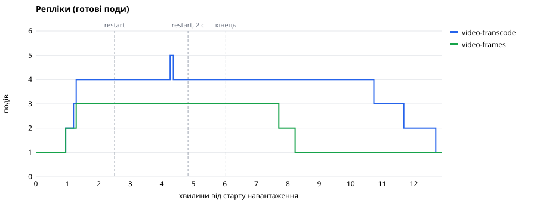
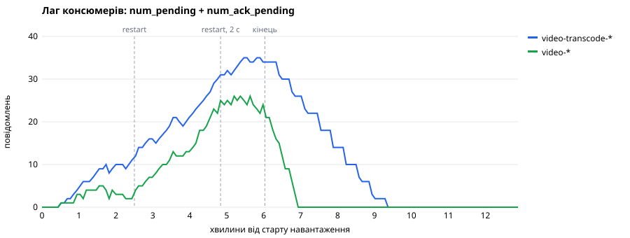
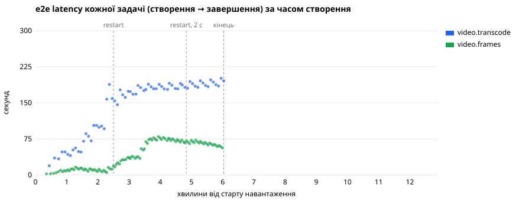

# Етап 5.3. Автоскейл і graceful shutdown під навантаженням

- Дата: 13 жовтня 2026, гілка `feature/stage-5.3-autoscale-shutdown`
- Стенд: k3d (1 server + 2 agents) у Docker Desktop, Apple M4 Pro, 12 CPU і 13 ГБ на всю VM.
  Кожен вузол k3d оголошує всі 12 CPU, тож три вузли «мають» 36 CPU на 12 справжніх
- Навантаження: [`perf/k6/video-load.js`](../k6/video-load.js), `grafana/k6:1.3.0`, 3 користувачі,
  розгін 1 хв і 5 хв рівної швидкості: 12 транскодингів і 20 задач кадрів за хвилину. Вхід —
  60 с 1080p (`testsrc2`, ~20 МБ), один транскодинг ~18 с на поді з 2 CPU
- Автоскейл (ADR-012): `video-transcode` 1–4 поди, `lagThreshold 1`, grace 60 с;
  `video-frames` 1–3, `lagThreshold 1`, grace 30 с
- Відтворити: `scripts/autoscale-demo.sh`, потім `node scripts/autoscale-report.mjs`

## Підсумок

Числа — з другого прогону, після того як перший виявив голодування Metadata за CPU
(див. [Перший прогін](#перший-прогін-голодування-metadata-за-cpu)).

| Критерій                                  | Результат                                                     |
| ----------------------------------------- | ------------------------------------------------------------- |
| Скейл 1 → N під навантаженням             | `video-transcode` 1 → 4 за 77 с, `video-frames` 1 → 3 за 77 с |
| Скейл N → 1 після черги                   | `video-frames` за 67 с, `video-transcode` за 190 с            |
| Задачі прийнято (`202`)                   | 175 з 175                                                     |
| Втрачені задачі                           | 0: створено 175, `succeeded` 175                              |
| `dead`                                    | 0                                                             |
| Задача з двома успішними виконаннями      | 0                                                             |
| `rollout restart` зі штатним grace (60 с) | 0 перерваних: усі поточні задачі завершились на старих подах  |
| `rollout restart` з grace 2 с             | 4 виконання 3 задач перервано, усі завершились на інших подах |
| Перервані виконання рахуються в спроби    | ні: `max counted tries` — 1                                   |
| Метрики збігаються з `job_executions`     | так: created 175 / 175, finished 175 / 175, interrupted 4 / 4 |

## Хронологія

Секунди від старту навантаження.

| t, с | Подія                                                            | Тривалість rollout |
| ---- | ---------------------------------------------------------------- | ------------------ |
| 0    | старт k6                                                         |                    |
| 57   | KEDA: обидва Deployment'и 1 → 2                                  |                    |
| 77   | `video-transcode` 4, `video-frames` 3 — максимум                 |                    |
| 150  | `rollout restart` обох зі штатним grace                          | 37 с               |
| 220  | `video-transcode`: `WORKER_SHUTDOWN_GRACE_MS=2000` (теж rollout) | 37 с               |
| 290  | `rollout restart video-transcode` з 2 с: поточні транскодинги    | 29 с               |
|      | повертаються як `interrupted`                                    |                    |
| 362  | кінець навантаження                                              |                    |
| 427  | черга кадрів порожня; 463 — `video-frames` 2, 494 — 1            |                    |
| 563  | усі задачі завершено; повернення штатного grace                  | 12 с               |
| 644  | `video-transcode` 3, 701 — 2, 762 — 1                            |                    |

Скорочення йде так, як задано в `behavior.scaleDown`: для кадрів вікно 60 с і под за 30 с, для
транскодингу — 120 с і под за 60 с. Короткий пік до 5 подів транскодингу на 256 с — це
`maxSurge` rollout'у, а не KEDA.

## Графіки







Лаг — це `num_pending + num_ack_pending`, той самий, який читає KEDA. Транскодинг на чотирьох
подах (стеля dev) не встигає за навантаженням: середнє виконання 25.5 с дає
`4 × 60 / 25.5 ≈ 9.4` задачі за хвилину проти ~11 вхідних, тож черга росте до кінця
навантаження. Це навмисно: так видно, що скейл зупиняється на `maxReplicas`, а черга потім
спорожніє без втрат.

e2e — точне значення кожної задачі (`finished_at - created_at` з Postgres); гістограма
`job.e2e.duration` для цього не годиться: її межі (60, 120, 300 с) дають сходинки.

| Тип               | Задач | p50 до restart | p95 до restart | p50 після | p95 після |
| ----------------- | ----- | -------------- | -------------- | --------- | --------- |
| `video.transcode` | 66    | 70 с           | 159 с          | 184 с     | 196 с     |
| `video.frames`    | 109   | 10 с           | 16 с           | 67 с      | 77 с      |

Стрибок e2e задач, створених перед першим rollout'ом, — ціна graceful shutdown при насиченні.
Старий под одразу перестає брати задачі й лише дороблює свою, а новий ще стартує, тож на
хвилину-півтори Deployment обробляє менше. Втрат від цього немає, а черга виростає. Кадри
сповільнюються ще й тому, що ділять CPU вузлів з транскодингом.

## Перервані задачі

```sql
select left(j.id::text, 8) job, e.attempt, e.outcome,
       extract(epoch from e.started_at) - :t0 start_s, extract(epoch from e.finished_at) - :t0 end_s
from job_executions e join jobs j on j.id = e.job_id
where j.id in (select job_id from job_executions where outcome = 'interrupted')
order by j.id, e.started_at;
```

| Задача     | Виконання | Outcome       | Старт, с | Кінець, с | Тривалість |
| ---------- | --------- | ------------- | -------- | --------- | ---------- |
| `1a28239b` | 1         | `interrupted` | 239      | 305       | 65 с       |
|            | 2         | `interrupted` | 309      | 322       | 13 с       |
|            | 3         | `succeeded`   | 322      | 340       | 18 с       |
| `858433e8` | 1         | `interrupted` | 227      | 292       | 65 с       |
|            | 2         | `succeeded`   | 306      | 330       | 24 с       |
| `c89c90b8` | 1         | `interrupted` | 256      | 315       | 59 с       |
|            | 2         | `succeeded`   | 315      | 334       | 19 с       |

Усі переривання припали на rollout з 2 с (290–319 с). Штатний rollout на 150 с не перервав
нічого. Друге переривання `1a28239b`: задачу взяв старий под, до якого rollout ще не дійшов.
Перші виконання тривали 59–65 с замість звичайних 18 с, бо стартували під час rollout'у на 220 с,
коли на вузлах працювало п'ять подів транскодингу і три поди кадрів.

`attempt` у `job_executions` — номер виконання, і він росте. Спробою з `JOB_MAX_ATTEMPTS` рахується
лише виконання без `interrupted`; у кожної задачі такого виконання одне.

Перевірки з `perf/reports/raw/autoscale-checks.txt`:

```text
created            175
succeeded          175
dead               0
succeeded twice    0
interrupted jobs   3
max counted tries  1
metrics created    175
metrics finished   175
metrics interrupted 4
metrics dlq        0
duplicates caught  2
```

`duplicates caught` — це `jobs_duplicates_total{source="dispatch"}`: scheduler двічі повторно
опублікував задачу, і дедуплікація JetStream (`Nats-Msg-Id`) відкинула копії. До воркерів ці
копії не дійшли.

## Перший прогін: голодування Metadata за CPU

Перший прогін з тими самими параметрами дав ті самі гарантії обробки (170 створено, 170
`succeeded`, 0 `dead`, 0 подвійних успіхів), але k6 не пройшов поріг: 8 з 175 `POST /v1/jobs`
отримали `503`.

- Gateway з 18:10:37 до 18:11:08 отримував таймаути від Metadata (2 с) і Redis і відповідав `503`.
- Дві спроби `running` для однієї задачі кадрів не дочекались відповіді Metadata, виконання
  стали `abandoned`, і задача використала 3 спроби з 5 (`max counted tries 3`), хоча зрештою
  завершилась.

Причина — розподіл CPU за `requests`. Під час конкуренції CFS ділить CPU пропорційно `requests`,
а сума `limits` відео-подів (14 CPU) більша за 12 CPU хоста. Metadata з `requests: 50m` поруч з
подами ffmpeg з `1` CPU отримувала двадцяту частку зайнятого ядра, хоча через неї проходить кожен
перехід і кожен звіт прогресу. Kubernetes цього не бачить: кожен вузол k3d оголошує 12 CPU, і
планувальник вважає, що місця вистачає.

Виправлення — `requests` за роллю, а не за середнім споживанням:

| Сервіс      | `requests.cpu` було → стало | Ліміт      |
| ----------- | --------------------------- | ---------- |
| Metadata    | 50m → 250m                  | 500m → 1   |
| API Gateway | 100m → 250m                 | без змін   |
| Postgres    | 100m → 250m                 | без ліміту |
| Redis       | 25m → 100m                  | без ліміту |

| Прогін | `503` | `abandoned` | `max counted tries` | Перервано (у штатному rollout) | e2e transcode p50 / p95 |
| ------ | ----- | ----------- | ------------------- | ------------------------------ | ----------------------- |
| перший | 8     | 2           | 3                   | 3 (1)                          | 88 / 132 с              |
| другий | 0     | 0           | 1                   | 4 (0)                          | 178 / 196 с             |

e2e другого прогону вищий. При насиченні e2e дуже чутливий до втраченої ємності, а в другому
прогоні її втрачено більше: перервані виконання з'їли 201 с CPU проти 86 с, rollout'и тривали
29–37 с проти 14–17 с, задача кадрів виконувалась у середньому 4.9 с проти 3.0 с. Час самого
транскодингу однаковий (p50 18 с в обох). Перевищення `limits` над CPU хоста робить ці величини
шумними від прогону до прогону. Одного прогону замало, щоб пов'язати різницю з новими `requests`.

## API під навантаженням

`POST /v1/jobs` — 175 з 181 запиту k6 (решта — завантаження вхідного файлу в `setup`): медіана
189 мс, p95 1.5 с, максимум 4.1 с. Це далеко від 8 мс p95 Етапу 2 на тому самому ноутбуці: поди
ffmpeg забирають майже весь CPU хоста, а gateway і Metadata отримують свою частку лише за
`requests`. HPA gateway за CPU такого стану не бачить: под, що чекає CPU, не споживає його, тож
утилізація не росте, а нова репліка опинилась би на тих самих перевантажених ядрах.

## Висновки

- Лаг консюмера JetStream — придатний сигнал: KEDA додає поди в межах хвилини від першої задачі
  і скорочує лише після того, як закінчились задачі в роботі, бо лаг містить `num_ack_pending`.
- Штатний grace 60 с покриває звичайний транскодинг: rollout під навантаженням нічого не
  перервав і не загубив.
- Коли grace не вистачає, задача повертається за секунди й продовжується на іншому поді, не
  витрачаючи спробу; `jobs_interrupted_total` збігається з `job_executions`.
- `requests` критичних сервісів (Metadata, Postgres, Redis, gateway) мають відповідати їхній
  ролі, а не середньому споживанню, інакше автоскейл важких воркерів забирає в них CPU.
- Не перевірено на цьому стенді: кілька фізичних вузлів (anti-affinity тут розкладає поди по
  контейнерах одного хоста), scale-to-zero (`minReplicas: 0`) і скорочення під зайнятим подом
  без rollout'у. Останнє прибирає довільний под, і зайнятий транскодинг довший за grace почнеться
  спочатку (ADR-012, Наслідки).
