# Етап 6. Збої під навантаженням

- Дата: 21 жовтня 2026, код гілки `feature/stage-6.1-chaos`. Сценарії 1, 2, 4, 5, 7 і 8 повторено
  того ж вечора на тому самому коді: у перших прогонах метрики мали діри по 2–6 хв
  (див. [Tempo](#що-знайшли-й-виправили)), тож таблиця й графіки для них — з повторів
- Стенд: k3d (`scripts/k8s.sh up`) у Docker Desktop, Apple M4 Pro; Chaos Mesh 2.8.5
  (`scripts/k8s.sh chaos-mesh`), лише namespace `pdp`
- Навантаження: [`perf/k6/chaos.js`](../k6/chaos.js), 5 задач/с протягом 5 хв: на кожні 50 —
  один `video.dub`, чотири `video.frames`, решта `image.resize`. Кожен запит з
  `Idempotency-Key` прогону; на `0`, `409`, `429` і `5xx` клієнт повторює з тим самим ключем до
  п'яти разів (1, 2, 4, 8, 8 с або `Retry-After`), після повтору ще раз перевіряє, що ключ дає
  той самий `jobId`
- Дубляж ходить до `openai-mock` ([`perf/openai-mock/server.mjs`](../openai-mock/server.mjs)):
  той самий HTTP, що в OpenAI, з лічильниками оплачених, кинутих клієнтом і збійних відповідей
- Збій вмикається на 60-й секунді й тримається до кінця k6; потім черги спорожняються (лаг усіх
  консюмерів 0) і [`scripts/chaos-audit.mjs`](../../scripts/chaos-audit.mjs) рахує результат
- Паралельно раз на 2 с перевіряються readiness gateway, `/v1/me` за ключем і за сесією, раз на
  40 с — вхід (`probes.csv`)
- Відтворити: `scripts/chaos.sh all` або `scripts/chaos.sh <сценарій>`; сирі дані —
  `perf/reports/raw/stage-6/<сценарій>-<час>/`, таблиця — `perf/reports/raw/stage-6/summary.md`.
  Графіки — [`scripts/chaos-graphs.mjs`](../../scripts/chaos-graphs.mjs), логи —
  [`scripts/chaos-logs.mjs`](../../scripts/chaos-logs.mjs)

## Методика

Дублікат — повтор із видимим ефектом, а не перехоплений дедупом:

| Перевірка                                   | Звідки                                                    |
| ------------------------------------------- | --------------------------------------------------------- |
| На ключ одна задача, на повтор той самий id | `idempotency_keys`, `jobs`; `chaos_key_mismatch` у k6     |
| Не більше одного успішного виконання        | `job_executions`                                          |
| Одна задача доставки вебхука на подію       | задачі `webhook.deliver` за `jobId` і подією              |
| Платний крок дубляжу — один раз             | оплачені відповіді `openai-mock` проти кількості дубляжів |

Загублена задача — прийнята (k6 отримав `202`), але без запису за ключем або не завершена, чи
без доставленого вебхука. **DLQ** — частка `dead` серед задач прогону. Пройдено, коли загублених
0, дублікатів < 0.1‰ і DLQ < 1%. «Перехоплено» — приріст `jobs_duplicates_total{source}` за прогін:
скільки повторів зупинив дедуп (`dispatch` — `Nats-Msg-Id`, `inbox` — inbox воркера).

## Підсумок

| #   | Збій                                                            | Задач | Загублено | Дублікатів | DLQ   | P95 до кінця | Перехоплено | Клієнт здався | Результат |
| --- | --------------------------------------------------------------- | ----- | --------- | ---------- | ----- | ------------ | ----------- | ------------- | --------- |
| 1   | `container-kill` воркерів (SIGKILL), раз на 30–45 с             | 1501  | 0         | 0          | 0%    | 8.4 с        | 0           | 0             | так       |
| 2   | `pod-kill` gateway, Metadata, scheduler                         | 1499  | 0         | 0          | 0%    | 2.9 с        | 7           | 0             | так       |
| 3   | `pod-kill` NATS раз на 60 с                                     | 1501  | 0         | 0          | 0%    | 13.5 с       | 3           | 0             | так       |
| 4   | Postgres недоступний для застосунку 60 с                        | 1296  | 0         | 0          | 0%    | 10.5 с       | 6           | 111           | так       |
| 5   | Redis недоступний 60 с                                          | 1500  | 0         | 0          | 0%    | 2.2 с        | 0           | 0             | так       |
| 6   | Затримка 200 ± 50 мс і втрата 5% пакетів у всіх подах, 120 с    | 1051  | 0         | 0          | 0.57% | 78.1 с       | 343         | 384           | так       |
| 7   | `StressChaos` пам'яті воркерів до `OOMKilled`                   | 1501  | 0         | 0          | 0%    | 6.1 с        | 0           | 0             | так       |
| 8   | `openai-mock`: 50% відповідей `500`                             | 1501  | 0         | 0          | 0%    | 2.5 с        | 0           | 0             | так       |
| 8   | `openai-mock`: 50% відповідей `429`                             | 1500  | 0         | 0          | 0%    | 2.0 с        | 0           | 0             | так       |
| 8   | `openai-mock`: 30% відповідей через 15 с (таймаут клієнта 10 с) | 1501  | 0         | 0          | 0.07% | 4.0 с        | 0           | 0             | так       |
| 10  | MinIO недоступний для застосунку 60 с                           | 1308  | 0         | 0          | 0%    | 5.1 с        | 0           | 80            | так       |

Сценарій 9 (`audio-separate` недоступний) — лише в AWS: у k3d розділення голосу фейкове всередині
`video-dub`. «Клієнт здався» — запити, на які k6 так і не отримав `202` за п'ять повторів: задача
не створена, клієнт про це знає, тож це не втрата, а недоступність API.

Перші прогони сценаріїв 1, 2, 4, 5, 7 і 8 теж пройшли, з тими самими нулями; помітно
відрізнявся лише DLQ сценарію 8: `429` — 0.13% (2 дубляжі), повільний провайдер — 0%.

## Графіки

Дашборд «Overview» у Grafana, ряди «Jobs» і «API», від старту навантаження до хвилини після
спорожнення черг. Червоним затінено час, коли збій діяв: для розривів і деградації мережі — їхні
60 чи 120 с, для `Schedule` і збоїв `openai-mock` — до кінця k6. Швидкості й перцентилі рахуються
за хвилинним вікном, тож на графіку реакція запізнюється до хвилини відносно затінення.

**1. `container-kill` воркерів.** Пропускна здатність рівна; кожне вбивство видно як сплеск
очікування в черзі `cpu` до 15 с, задачі вбитого пода доходять новою спробою.

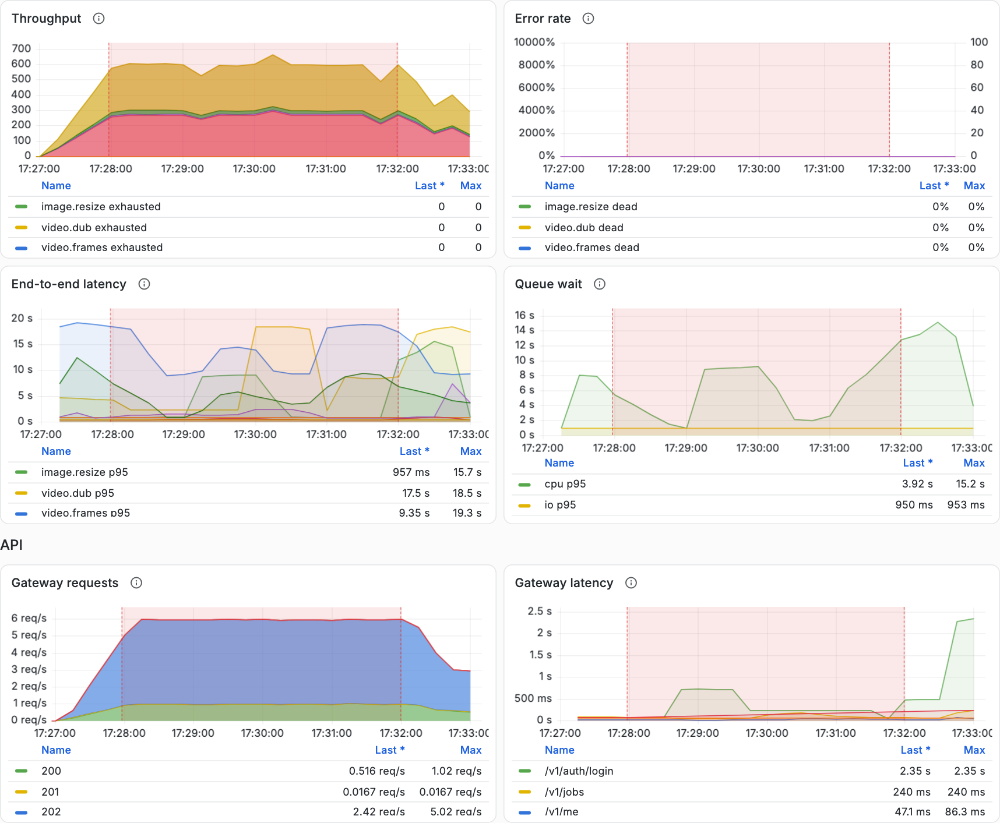

**2. `pod-kill` gateway, Metadata, scheduler.**

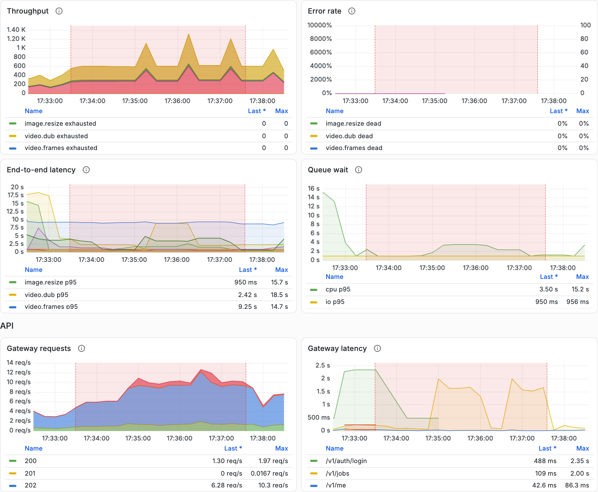

**3. `pod-kill` NATS.** Пропускна здатність майже не проседає, очікування в черзі після кожного
рестарту NATS росте до ~30 с: консюмери перепідключаються й добирають накопичене.

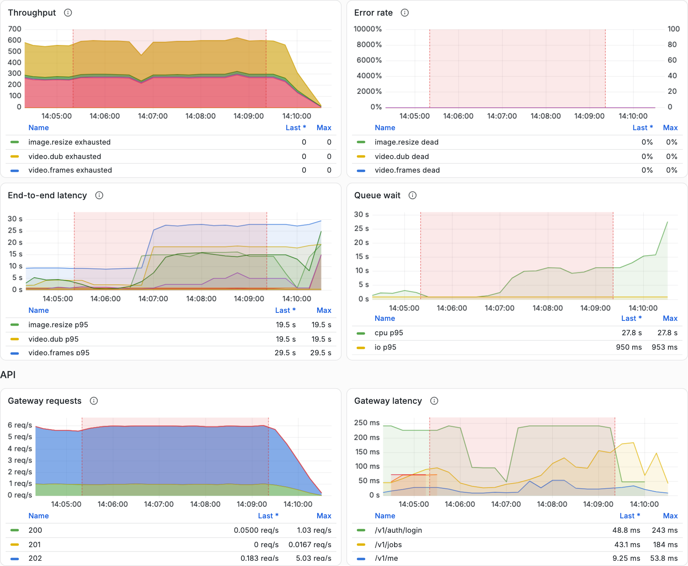

**4. Postgres недоступний 60 с.** Gateway відповідає `503` (червоне на «Gateway requests»),
задачі не завершуються; після розриву черга розбирається приблизно за 2 хв, E2E задач, що
чекали, — до 2 хв.

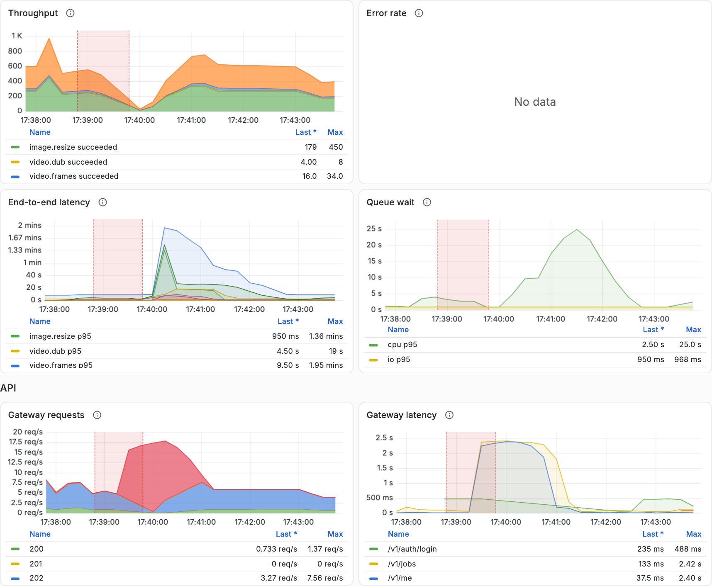

**5. Redis недоступний 60 с.**

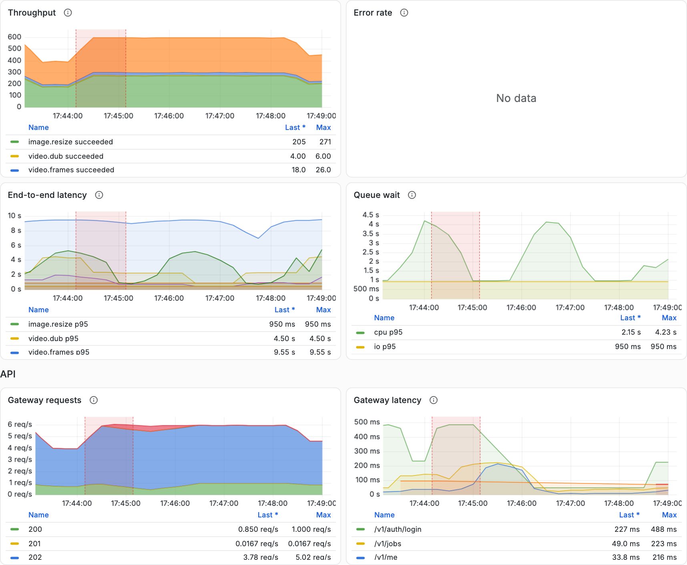

**6. Повільна мережа з втратою пакетів, 120 с.** Пропускна здатність падає до нуля на ~1 хв,
E2E і очікування в черзі — до 2 хв; після зняття збою черга розбирається за ~1 хв. Частка `dead`
стрибає вже після зняття: це задачі, що вичерпали спроби під час збою.

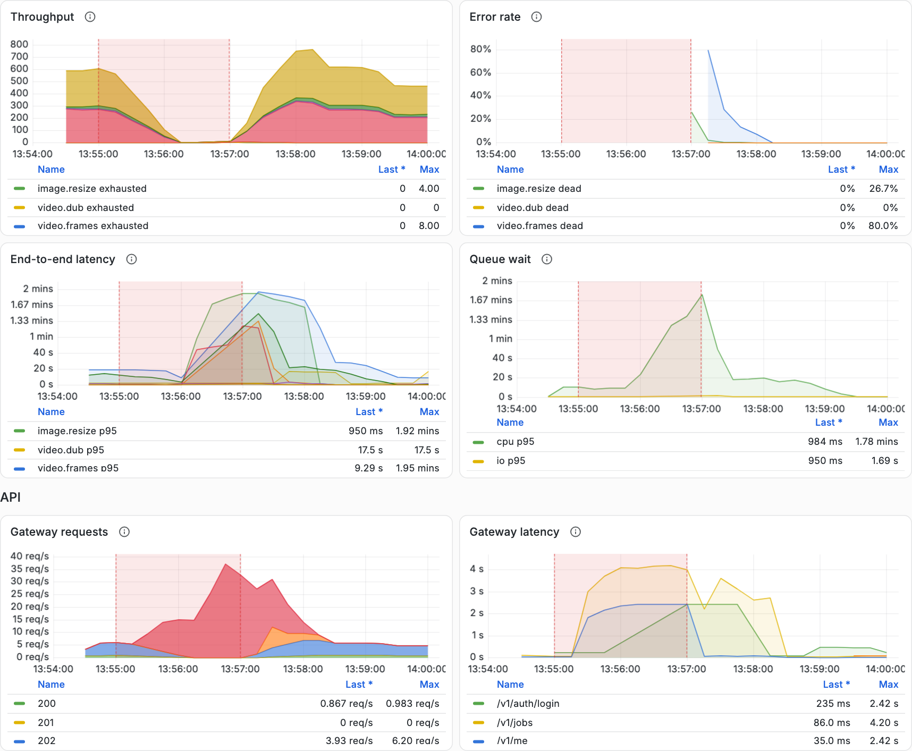

**7. OOM воркерів.**

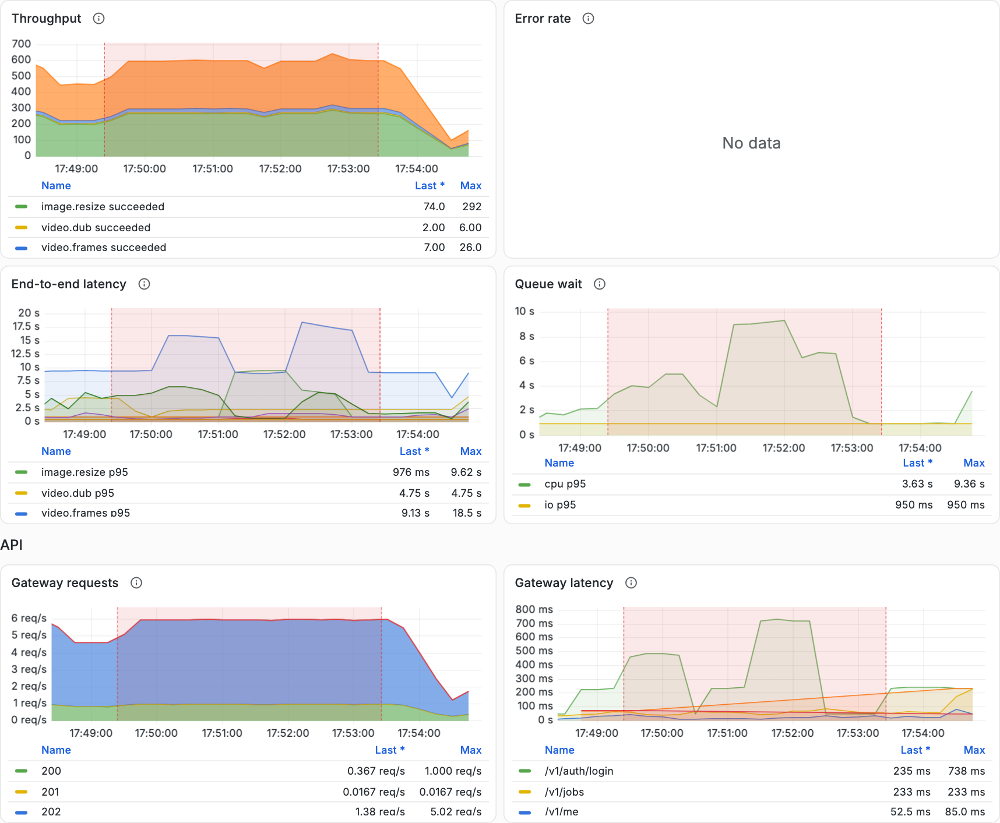

**8. Збійний провайдер дубляжу: `500`, `429`, повільні відповіді.**

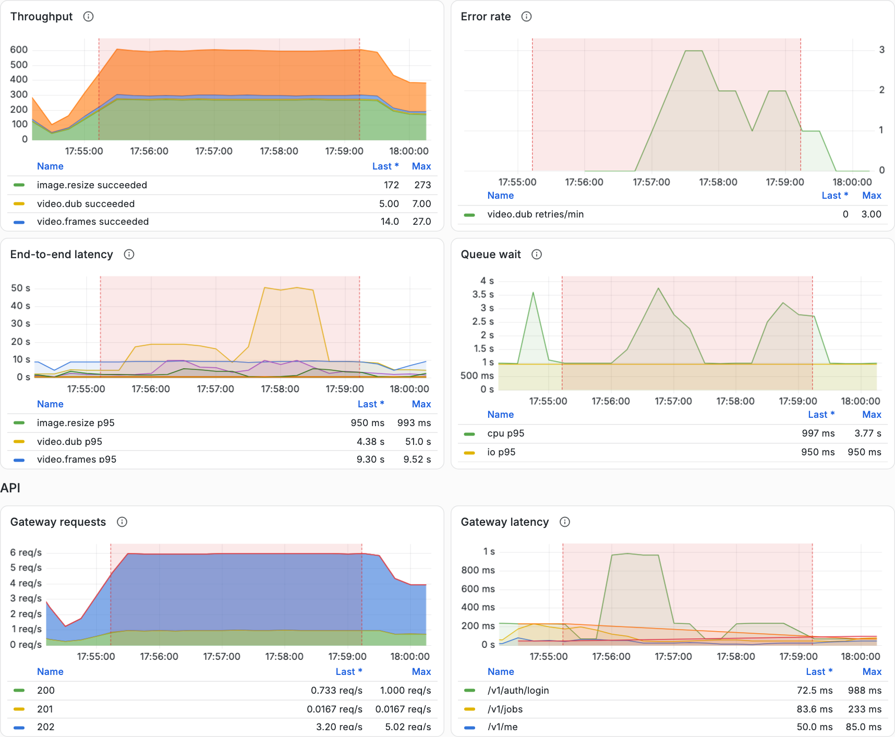

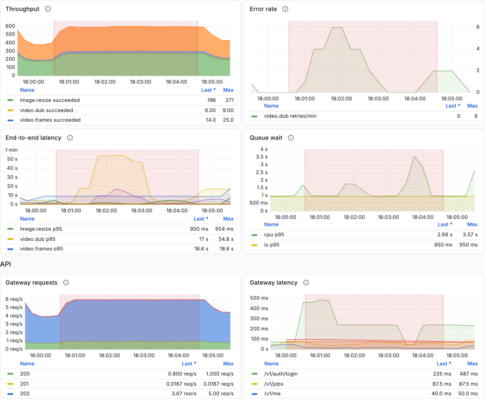

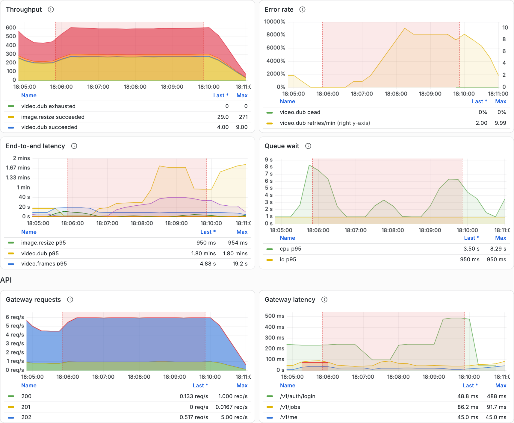

**10. MinIO недоступний 60 с.** Gateway відповідає `503` на запити, яким потрібне сховище, решта
API працює; E2E відео — до 2 хв, поки воркери чекають на MinIO.

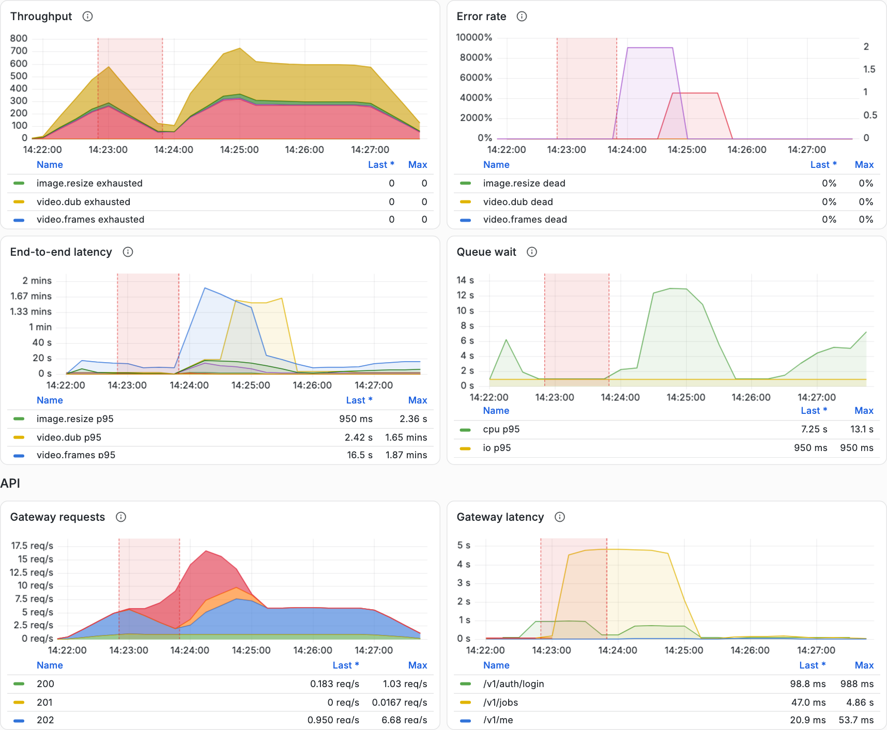

## Що знайшли й виправили

1. **Недоступний MinIO або рестарт NATS вимикали весь API.** Readiness gateway перевіряла S3 і NATS,
   тож при розриві з MinIO усі поди gateway виходили з балансування і `503` отримували навіть
   запити, яким сховище не потрібне; при рестарті NATS — так само ≈20 с. Тепер readiness gateway
   не перевіряє спільних залежностей (принцип ADR-005), а `HeadObject` має власний таймаут
   (`S3_TIMEOUT_MS`, 3 с) і відповідає `503` з `Retry-After`. Тест — сховище, що мовчить, і
   закритий порт (`storage.service.spec.ts`). Повторні прогони 3 і 10: readiness 200 увесь час.
2. **Повільна мережа спалювала спроби.** Під затримкою 200 мс запит Metadata з базою триває 0.6–1.4 с
   замість 2–40 мс, а перехід стану — кілька таких звернень, тож він виходив за таймаут клієнта
   (2 с), хоча в базі застосовувався. Воркер робив `nak`, повторна доставка ставала новою спробою,
   попередня — «superseded», і за п'ять доставок задача йшла в `dead/exhausted`: DLQ 2.78%.
   Тепер `JobRunner` повторює перехід без відповіді з тим самим номером спроби (до трьох разів,
   0.5–2 с), а Metadata приймає повтор `(jobId, attempt, to)` як no-op. Тести —
   `job-runner.spec.ts` і `metadata.int-spec.ts`. DLQ упав до 0.57%.
3. **Tempo тягнув за собою метрики й логи.** Tempo перевищує ліміт 512Mi і отримує `OOMKilled`.
   Поки він лежав, колектор накопичував для нього чергу, а після рестарту відправляв її всю одразу
   і знову валив Tempo. Метрики й логи йдуть через той самий колектор, тож у перших прогонах вони
   мали діри по 2–6 хв саме у вікні збою. Тепер колектор тримає для Tempo коротку чергу й решту
   відкидає, а Tempo обмежує прийом. Метрики після цього безперервні: за 44 хв повторних прогонів
   Tempo падав 9 разів, а метрики не мали жодної діри. Сам Tempo падати не перестав
   (див. [Що лишилось](#що-лишилось-і-чому-так)).

## Логи (Checkpoint 2)

[`scripts/chaos-logs.mjs`](../../scripts/chaos-logs.mjs) рахує у VictoriaLogs записи за вікном
кожного прогону (від старту навантаження до спорожнення черг). Помилка — рядок рівня `error` або
відповідь `5xx`; клітинка — «помилок / попереджень». Помилки розкладено за тим, про що вони:
**задача** — є `job_id`; **запит** — немає задачі, але є `req.id` і `trace_id` (наприклад,
створення задачі, яка ще не існує); **компонент** — фоновий цикл із `context`: outbox relay чи
консюмер NATS.

| Прогін                 | api-gateway | metadata | scheduler | worker | video-worker | Задача | Запит | Компонент | Без контексту |
| ---------------------- | ----------- | -------- | --------- | ------ | ------------ | ------ | ----- | --------- | ------------- |
| Без збою (`baseline`)  | 0 / 0       | 0 / 0    | 0 / 0     | 0 / 0  | 0 / 0        | 0      | 0     | 0         | 0             |
| 1 `container-kill`     | 0 / 0       | 0 / 0    | 0 / 0     | 0 / 0  | 0 / 0        | 0      | 0     | 0         | 0             |
| 2 `pod-kill` керування | 81 / 81     | 0 / 0    | 0 / 0     | 0 / 0  | 0 / 0        | 0      | 81    | 0         | 0             |
| 3 `pod-kill` NATS      | 0 / 24      | 17 / 8   | 4 / 9     | 0 / 34 | 3 / 38       | 0      | 0     | 24        | 0             |
| 4 Postgres             | 990 / 990   | 102 / 0  | 0 / 0     | 0 / 0  | 0 / 0        | 0      | 1092  | 0         | 0             |
| 5 Redis                | 32 / 34     | 0 / 0    | 0 / 0     | 0 / 0  | 0 / 0        | 0      | 32    | 0         | 0             |
| 6 повільна мережа      | 2465 / 2407 | 211 / 0  | 0 / 0     | 0 / 0  | 0 / 1        | 133    | 2540  | 3         | 0             |
| 7 OOM                  | 0 / 0       | 0 / 0    | 0 / 0     | 0 / 0  | 0 / 0        | 0      | 0     | 0         | 0             |
| 8 `500`                | 0 / 0       | 0 / 0    | 0 / 0     | 0 / 0  | 0 / 6        | 0      | 0     | 0         | 0             |
| 8 `429`                | 0 / 0       | 0 / 0    | 0 / 0     | 0 / 0  | 0 / 10       | 0      | 0     | 0         | 0             |
| 8 повільні відповіді   | 0 / 0       | 0 / 0    | 0 / 0     | 0 / 0  | 0 / 30       | 0      | 0     | 0         | 0             |
| 10 MinIO               | 640 / 0     | 0 / 0    | 0 / 0     | 0 / 0  | 0 / 3        | 0      | 640   | 0         | 0             |

| Сервіс       | Рядків  | З `trace_id` | Рядків запиту чи задачі без `trace_id` |
| ------------ | ------- | ------------ | -------------------------------------- |
| api-gateway  | 43 658  | 98.5%        | 0                                      |
| metadata     | 219 442 | 99.9%        | 0                                      |
| scheduler    | 157     | 0.6%         | 0                                      |
| worker       | 1 041   | 3.3%         | 0                                      |
| video-worker | 2 464   | 5.5%         | 0                                      |

- **Структуровані логи з `trace_id`.** Усі логи — JSON із `service` і `severity_text`, у межах
  запиту чи задачі — ще `trace_id`, `req.id`, `job_id`; секрети в заголовках замасковані
  (`[Redacted]`). Кожен рядок, що належить
  запиту чи задачі, має `trace_id`. Без нього лишаються лише старт застосунку, з'єднання з NATS
  і фонові цикли; у воркерах і scheduler це майже всі рядки, бо задача, що пройшла успішно, логів
  не пише, звідси низька частка.
- **У спокої помилок немає**, під збоями їх видно в тих сервісах, яких збій торкається: `503`
  gateway при недоступних Postgres, Redis і MinIO, таймаути бази в Metadata, консюмери й relay
  при рестарті NATS.
- **Жодної помилки без контексту.** Помилки Metadata без задачі — здебільшого `POST /internal/jobs`
  під час розриву з Postgres (72 у сценарії 4): задачі ще немає, але кожна з 72 через `trace_id`
  знаходиться в запиті gateway з `Idempotency-Key`, тобто видно, чий це запит і чи він дійшов
  повтором.

Що знайшла перевірка й виправлено в коді (після прогонів, тож у k3d ще старі образи і таблиця
вище рахує `5xx` за статусом, а не за рівнем):

1. **Відповіді `5xx` писались з рівнем `info`.** За перші прогони 5026 рядків «request errored»
   від gateway і Metadata не потрапляли ні в панель «Warnings and errors», ні в підрахунок за рівнем: за логами
   gateway під час розриву з Postgres виглядав здоровим. Тепер відповідь `5xx` або кинута помилка
   — `error` (`observability.module.spec.ts`).
2. **Relay не казав, яку подію не опублікував.** «relay failed: jetstream is not enabled» без
   події, задачі й трейсу. Тепер помилка публікації пишеться в контексті збереженого трейсу
   рядка outbox, з `job_id` із baggage, і не дублюється загальним «relay failed»
   (`outbox.relay.spec.ts`).
3. **Задача, що пішла в DLQ, не лишала помилки.** Дубляж зі сценарію 8 п'ять разів упирався в
   таймаут перекладу й пішов у `dead`, а в логах були лише попередження «attempt N failed
   (transient)», однакові для кожної спроби. Тепер перехід у `dead` — окремий рядок `error` з
   причиною (`permanent` чи `exhausted`) і останньою помилкою (`job-runner.spec.ts`).

## Що лишилось і чому так

- **Сценарій 6: решта 0.57%.** Затримка накладається на кожен пакет кожного пода, разом із
  Postgres, тож частина переходів не вкладається в 2 с і на всіх чотирьох спробах. Для реальної
  мережі кластера (≈1 мс між зонами) це запас у сотні разів; якщо буде потреба — підняти
  `METADATA_TIMEOUT_MS` або зменшити кількість звернень до бази в переході.
- **Сценарій 6: клієнт здається на 28% запитів.** Gateway під такою мережею відповідає за P95
  2.6 с, з повторами k6 вкладається не завжди. Задачі, що отримали `202`, не губляться.
- **Сценарій 8: дубляж іноді вичерпує спроби.** За половини відмов `429` у першому прогоні 2 з 30
  дубляжів пішли в `dead`, у повторному — жоден; при 30% повільних відповідей — 1 з 30 (DLQ
  0.07%). П'яти спроб задачі вистачає не завжди. Оплачених повторів немає: кожен готовий крок
  оплачено один раз.
- **Сценарій 8, повільний провайдер: 30 кинутих відповідей.** Відповіді, які прийшли вже після
  таймауту клієнта (14 розпізнавань, 16 перекладів), справжній OpenAI все одно рахує. Другого
  успішного кроку немає, але повільний провайдер коштує більше, ніж показує `dub_cost_usd_total`.
- **Tempo в k3d не тримає 5 задач/с.** З лімітом 512Mi він падає з `OOMKilled` приблизно за
  хвилину-дві навантаження, і без збоїв теж: пам'ять росте з 42 до 500 МБ за ~1.5 хв. Трейси
  під навантаженням у k3d тому неповні; метрики й логи після виправлення 3 від цього не
  страждають. Варіанти — більший ліміт, коротший `max_block_duration` або семплювання трейсів у
  k3d; перевірити разом із навантаженням етапу 8.
- **Телеметрія під деградацією мережі губиться.** Метрики, логи й трейси йдуть через ту саму
  мережу, тож у сценарії 6 у Grafana провали саме тоді, коли дані найпотрібніші. Аудит тому
  рахує за Postgres, а не за метриками.
- **Обмеження Chaos Mesh у k3d.** Розрив за `target` не працює: клієнт іде на ClusterIP, а DNAT
  відбувається на вузлі, поза подом. Тому розриви задаються на боці сервера (селектор — под
  Postgres, Redis чи MinIO, ціль — поди застосунку, `direction: to`). `pod-kill` — це штатна
  зупинка з передачею задачі (ADR-012), справжній збій посеред задачі — `container-kill`.

## Redis і Postgres недоступні

Що бачив користувач під час розриву (проби раз на 2 с):

| Залежність | Readiness gateway | API-ключ                  | Сесія | Вхід  | Задачі                                  |
| ---------- | ----------------- | ------------------------- | ----- | ----- | --------------------------------------- |
| Redis      | 200               | 200, rate limit fail-open | `503` | `503` | приймаються далі                        |
| Postgres   | 200               | `503`                     | `503` | `503` | `503`, після відновлення доходять       |
| MinIO      | 200               | 200                       | 200   | 200   | ті, що читають сховище, — `503`, повтор |

`503` в усіх випадках, а не `500` і не вихід користувача: сесія лишається дійсною, просто
перевірити її поки нічим. Окремі `429` у пробах після розривів — rate limit користувача: k6 тим
самим ключем повторює накопичені запити.

## AWS

Ті самі сценарії разом із 9 — у підсумковій AWS-сесії етапу 8 (`scripts/chaos.sh --target aws
all`); результати буде дописано сюди окремою таблицею.
